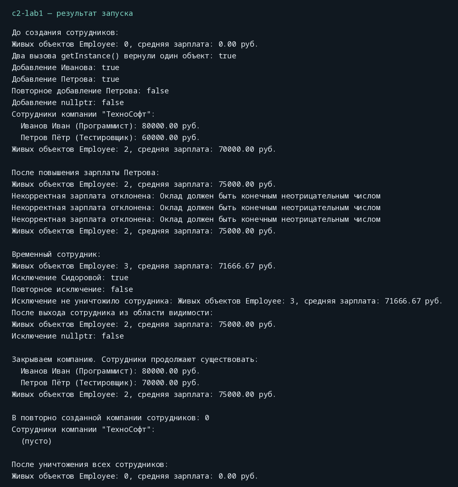

# Отчет по лабораторной работе 1

МИНИСТЕРСТВО НАУКИ И ВЫСШЕГО ОБРАЗОВАНИЯ
РОССИЙСКОЙ ФЕДЕРАЦИИ
Федеральное государственное автономное
образовательное учреждение высшего образования
«СЕВЕРО-КАВКАЗСКИЙ ФЕДЕРАЛЬНЫЙ УНИВЕРСИТЕТ»
Институт информационных технологий и кибер безопасности
Департамент цифровых, робототехнических систем и электроники
Кафедра программной инженерии

**Тема:** Композиция и агрегация классов. Статические члены

**Вариант:** 3. Продвинутый уровень

**Выполнил:**
Студент группы ПИЖ-б-о-25-2 (2),
направление подготовки: 09.03.04
“Программная инженерия”

Кравцун Михаил Алексеевич

**Проверил:**
Ассистент межинститутской базовой кафедры департаманта цифровых,
робототехнических систем и электроники института перспективной
инженерии

Белик Ангелина Игоревна

---
## Репозиторий

[GitHub: Algorithms-Data-structures, первая лабораторная второго курса](https://github.com/WhXteBeXr/Algorithms-Data-structures/tree/main/course-2/lab1)


## Задачи лабораторной работы
**Цель работы:** разработать систему учёта сотрудников на C++20, реализовать агрегацию и паттерн Singleton, научиться поддерживать общую статистику объектов статическими членами и проверять независимость времени жизни компании и сотрудников.

---
## Ход выполнения

### Постановка задачи

Общее задание продвинутого уровня: реализовать композицию или агрегацию согласно варианту, добавить статическое поле для подсчёта объектов, реализовать Singleton для одного из классов и продемонстрировать все возможности.

Вариант 3: система учёта сотрудников - `Company` (одиночка) и `Employee` (агрегация), подсчёт сотрудников и средней зарплаты.

Объём реализации: общее задание продвинутого уровня и его вариант 3.

### Теоретическое обоснование

**Композиция** означает владение частями: целое управляет их временем жизни. В C++ для этого используют поля-объекты и `std::unique_ptr`. В варианте 3 композиция между компанией и сотрудниками не требуется.

**Агрегация** связывает независимо существующие объекты. Компания хранит `std::vector<Employee*>`, но не создаёт и не уничтожает сотрудников. Удаление адреса из списка и закрытие компании не изменяют время жизни `Employee`. Перед уничтожением сотрудника его необходимо исключить из существующей компании, иначе в списке останется висячий указатель.

**Статические члены** принадлежат классу в целом. `Employee::count` хранит число живых объектов, `totalSalary` - сумму их окладов. Конструктор регистрирует объект, деструктор снимает его с учёта, `setSalary()` корректирует сумму. Средняя зарплата равна сумме, делённой на число объектов. При нуле объектов возвращается `0`.

Счётчик и средняя зарплата относятся ко всем живым объектам `Employee`, в том числе не включённым в компанию. `Company::getStaffCount()` отдельно возвращает размер списка компании. Исключение сотрудника из компании не меняет общую статистику объектов.

**Singleton** ограничивает число одновременно существующих компаний одним экземпляром. Конструктор и деструктор закрыты, копирование и перемещение запрещены. `getInstance()` лениво создаёт объект и возвращает его адрес. Статический `std::unique_ptr` владеет компанией и освобождает её при явном `destroyInstance()` либо при завершении программы. Повторное уничтожение безопасно. Последующий `getInstance()` создаёт пустую компанию. После уничтожения старые указатели на компанию недействительны. Программа рассчитана на однопоточное использование.

### Структура программы

- `Employee.h`, `Employee.cpp` - данные сотрудника, проверка оклада и общая статистика.
- `Company.h`, `Company.cpp` - одиночка и невладеющий список сотрудников.
- `main.cpp` - демонстрация возможностей и граничных случаев.
- `CMakeLists.txt` - сборка программы и общей библиотеки классов.

Копирование и перемещение `Employee` намеренно запрещены: компания идентифицирует сотрудников по адресам. Поддержка копирования возможна при отдельной реализации специальных методов, но заданием не требуется.

Для суммы используется `long double`, чтобы уменьшить погрешность накопления и избежать переполнения при сложении двух максимальных `double` в проверенной среде. Расчёты с плавающей точкой приближённые. Это учебная модель, а не бухгалтерская система.

### Сборка и запуск

Из корня репозитория:

```bash
cmake -S . -B /tmp/algorithms-c2-lab1-project -DCMAKE_BUILD_TYPE=Release
cmake --build /tmp/algorithms-c2-lab1-project --target c2-lab1
/tmp/algorithms-c2-lab1-project/course-2/lab1/c2-lab1
```

Независимая сборка первой лабораторной:

```bash
cmake -S course-2/lab1 -B /tmp/algorithms-c2-lab1-debug -DCMAKE_BUILD_TYPE=Debug
cmake --build /tmp/algorithms-c2-lab1-debug
/tmp/algorithms-c2-lab1-debug/c2-lab1
```

### Результаты работы

Фактический вывод программы сохранён в [текстовом файле](media/program-output.txt). Изображение ниже сформировано из этого stdout и не является снимком окна терминала.



Основные наблюдения:

| Состояние | Живых Employee | Средняя зарплата, руб. |
| --- | ---: | ---: |
| До создания сотрудников | 0 | 0.00 |
| Оклады 80000 и 60000 | 2 | 70000.00 |
| Повышение второго оклада до 70000 | 2 | 75000.00 |
| Попытки присвоить отрицательный оклад, NaN, бесконечность | 2 | 75000.00 |
| Временный сотрудник с окладом 65000 | 3 | 71666.67 |
| После исключения временного сотрудника из списка | 3 | 71666.67 |
| После уничтожения временного сотрудника | 2 | 75000.00 |
| После закрытия компании | 2 | 75000.00 |
| После уничтожения оставшихся сотрудников | 0 | 0.00 |

Повторное добавление сотрудника и операции с `nullptr` возвращают `false`. При повторном создании компания пуста, хотя ранее созданные сотрудники ещё живы.

### Демонстрация работы

Возможности программы показаны в `main.cpp`. Демонстрация включает получение одного экземпляра компании, добавление сотрудников, отклонение дубликата и `nullptr`, повышение оклада, обработку некорректных окладов, исключение и уничтожение временного сотрудника, закрытие и повторное создание компании. В начале и конце выводится нулевая статистика.

Для проверки достаточно собрать программу и запустить демонстрацию. Отдельные автоматические тесты и тестовые цели CMake не используются.

### Листинг программы

#### Employee.h

```cpp
#pragma once

#include <cstddef>
#include <iosfwd>
#include <string>

class Employee
{
public:
  Employee(const std::string& name, const std::string& position, double salary);
  ~Employee();

  // Компания хранит адрес сотрудника: копирование и перемещение запрещены,
  // чтобы идентичность объекта и его адрес оставались неизменными.
  Employee(const Employee&) = delete;
  Employee& operator=(const Employee&) = delete;
  Employee(Employee&&) = delete;
  Employee& operator=(Employee&&) = delete;

  // Статические методы вызываются через имя класса, отдельный объект не нужен.
  static std::size_t getCount();
  static double getAverageSalary();

  const std::string& getName() const;
  const std::string& getPosition() const;
  double getSalary() const;

  // Отрицательные и неконечные значения вызывают std::invalid_argument.
  // При ошибке оклад и общая статистика остаются прежними.
  void setSalary(double newSalary);
  // Поток передаётся снаружи, поэтому вывод возможен и в консоль, и в файл.
  void print(std::ostream& out) const;

private:
  std::string name;
  std::string position;
  double salary;

  // Статистика всех живых Employee, включая не добавленных в Company.
  static std::size_t count;
  static long double totalSalary;
};
```

#### Employee.cpp

```cpp
#include "Employee.h"

#include <cmath>
#include <ostream>
#include <stdexcept>

namespace
{
  // Функция видна только в этом файле. Единое правило для конструктора и setter.
  void validateSalary(double salary)
  {
    // isfinite отбрасывает NaN и бесконечность, сравнение отбрасывает отрицательные числа.
    if (!std::isfinite(salary) || salary < 0)
    {
      throw std::invalid_argument("Оклад должен быть конечным неотрицательным числом");
    }
  }
}

// Определения общих полей размещаются один раз в .cpp, а не в каждом объекте.
std::size_t Employee::count = 0;
long double Employee::totalSalary = 0;

Employee::Employee(const std::string& name, const std::string& position, double salary) :
    name(name), position(position), salary(salary)
{
  // Проверяем до изменения статистики: неудачное создание не считается объектом.
  validateSalary(salary);
  ++count;
  totalSalary += salary;
}

Employee::~Employee()
{
  // Объект перестал существовать, поэтому исключаем его из общей статистики.
  --count;
  totalSalary -= salary;
  if (count == 0)
  {
    totalSalary = 0; // Убираем остаток округления перед следующей группой объектов.
  }
}

std::size_t Employee::getCount()
{
  return count;
}

double Employee::getAverageSalary()
{
  // Для пустой системы возвращаем ноль, чтобы не делить на ноль.
  return count == 0 ? 0.0 : static_cast<double>(totalSalary / count);
}

const std::string& Employee::getName() const
{
  return name;
}

const std::string& Employee::getPosition() const
{
  return position;
}

double Employee::getSalary() const
{
  return salary;
}

void Employee::setSalary(double newSalary)
{
  validateSalary(newSalary);
  // Заменяем вклад сотрудника в общей сумме, число сотрудников не меняется.
  totalSalary = totalSalary - salary + newSalary;
  salary = newSalary;
}

void Employee::print(std::ostream& out) const
{
  out << "  " << name << " (" << position << "): " << salary << " руб.\n";
}
```

#### Company.h

```cpp
#pragma once

#include <cstddef>
#include <iosfwd>
#include <memory>
#include <string>
#include <vector>

// Для указателей достаточно имени класса. Полное определение подключается в .cpp.
class Employee;

class Company
{
public:
  Company(const Company&) = delete;
  Company& operator=(const Company&) = delete;
  Company(Company&&) = delete;
  Company& operator=(Company&&) = delete;

  // Все обращения к компании проходят через общую точку доступа.
  static Company* getInstance();
  // После вызова все ранее полученные указатели на Company недействительны.
  static void destroyInstance();

  // Невладеющие указатели: перед уничтожением сотрудника его нужно исключить
  // из компании. nullptr и повторное добавление одного адреса отклоняются.
  bool addEmployee(Employee* employee);
  bool removeEmployee(Employee* employee);
  std::size_t getStaffCount() const;
  void print(std::ostream& out) const;

private:
  explicit Company(const std::string& name);
  ~Company();
  // Разрешаем стандартному удалителю unique_ptr вызвать закрытый деструктор.
  friend struct std::default_delete<Company>;

  // unique_ptr освобождает одиночку и при завершении программы, если явное
  // уничтожение пропущено. Закрытый деструктор запрещает внешний delete.
  static std::unique_ptr<Company> instance;
  std::string name;
  std::vector<Employee*> staff; // Адреса внешних объектов, владение не передаётся.
};
```

#### Company.cpp

```cpp
#include "Company.h"
#include "Employee.h"

#include <algorithm>
#include <ostream>

std::unique_ptr<Company> Company::instance;

Company::Company(const std::string& name) : name(name) {}

// Уничтожается только вектор указателей. Сотрудники принадлежат вызывающему коду.
Company::~Company() = default;

Company* Company::getInstance()
{
  // Ленивое создание: компания появляется только при первом обращении.
  if (!instance)
  {
    instance.reset(new Company("ТехноСофт"));
  }
  return instance.get(); // Возвращаем адрес без передачи владения компанией.
}

void Company::destroyInstance()
{
  // reset удаляет компанию и обнуляет unique_ptr. Для пустого указателя это безопасно.
  instance.reset();
}

bool Company::addEmployee(Employee* employee)
{
  // find сравнивает адреса. Один и тот же объект нельзя добавить дважды.
  // Оператор || прекращает проверку сразу, если передан nullptr.
  if (employee == nullptr || std::find(staff.begin(), staff.end(), employee) != staff.end())
  {
    return false;
  }
  staff.push_back(employee); // Сохраняем адрес, новый Employee не создаётся.
  return true;
}

bool Company::removeEmployee(Employee* employee)
{
  if (employee == nullptr)
  {
    return false;
  }
  // end() означает, что такого адреса нет в списке.
  const auto it = std::find(staff.begin(), staff.end(), employee);
  if (it == staff.end())
  {
    return false;
  }
  staff.erase(it); // Удаляется запись списка, сотрудник продолжает жить.
  return true;
}

std::size_t Company::getStaffCount() const
{
  // Размер компании может отличаться от общего числа живых Employee.
  return staff.size();
}

void Company::print(std::ostream& out) const
{
  out << "Сотрудники компании \"" << name << "\":\n";
  if (staff.empty())
  {
    out << "  (пусто)\n";
  }
  // Разыменование допустимо, пока вызывающий код сохраняет сотрудников живыми.
  for (const Employee* employee : staff)
  {
    employee->print(out);
  }
}
```

#### main.cpp

```cpp
#include "Company.h"
#include "Employee.h"

#include <iomanip>
#include <iostream>
#include <limits>
#include <stdexcept>

namespace
{
  void printStatistics()
  {
    // Данные принадлежат классу Employee и не зависят от существования Company.
    std::cout << "Живых объектов Employee: " << Employee::getCount()
              << ", средняя зарплата: " << Employee::getAverageSalary() << " руб.\n";
  }

  void demonstrateCompany()
  {
    // Локальные сотрудники существуют независимо от одиночки.
    // При выходе из функции их деструкторы автоматически обновят статистику.
    Employee developer("Иванов Иван", "Программист", 80000);
    Employee tester("Петров Пётр", "Тестировщик", 60000);

    // Совпадение адресов показывает, что второй вызов не создаёт новую компанию.
    Company* company = Company::getInstance();
    std::cout << "Два вызова getInstance() вернули один объект: "
              << (company == Company::getInstance()) << '\n';
    std::cout << "Добавление Иванова: " << company->addEmployee(&developer) << '\n';
    std::cout << "Добавление Петрова: " << company->addEmployee(&tester) << '\n';
    std::cout << "Повторное добавление Петрова: " << company->addEmployee(&tester) << '\n';
    std::cout << "Добавление nullptr: " << company->addEmployee(nullptr) << '\n';
    company->print(std::cout);
    printStatistics();

    tester.setSalary(70000);
    std::cout << "\nПосле повышения зарплаты Петрова:\n";
    printStatistics();

    // Ошибка оклада перехватывается, чтобы демонстрация продолжалась.
    // Проверка предшествует изменению полей, поэтому среднее остаётся прежним.
    for (double invalidSalary : {-1.0, std::numeric_limits<double>::quiet_NaN(),
                                 std::numeric_limits<double>::infinity()})
    {
      try
      {
        tester.setSalary(invalidSalary);
      }
      catch (const std::invalid_argument& error)
      {
        std::cout << "Некорректная зарплата отклонена: " << error.what() << '\n';
      }
    }
    printStatistics();

    std::cout << "\nВременный сотрудник:\n";
    {
      Employee designer("Сидорова Мария", "Дизайнер", 65000);
      company->addEmployee(&designer);
      printStatistics();
      // Агрегация не продлевает жизнь designer: сначала убираем его адрес.
      std::cout << "Исключение Сидоровой: " << company->removeEmployee(&designer) << '\n';
      std::cout << "Повторное исключение: " << company->removeEmployee(&designer) << '\n';
      std::cout << "Исключение не уничтожило сотрудника: ";
      printStatistics();
    }
    std::cout << "После выхода сотрудника из области видимости:\n";
    printStatistics();
    std::cout << "Исключение nullptr: " << company->removeEmployee(nullptr) << '\n';

    std::cout << "\nЗакрываем компанию. Сотрудники продолжают существовать:\n";
    Company::destroyInstance();
    company = nullptr; // Старый адрес больше не указывает на существующую компанию.
    developer.print(std::cout);
    tester.print(std::cout);
    printStatistics();

    // У нового экземпляра пустой список, старые сотрудники ещё существуют.
    Company* reopened = Company::getInstance();
    std::cout << "\nВ повторно созданной компании сотрудников: " << reopened->getStaffCount() << '\n';
    reopened->print(std::cout);
    Company::destroyInstance();
    Company::destroyInstance(); // Повторное закрытие пустого одиночки безопасно.
  }
}

int main()
{
  // boolalpha печатает true/false, fixed и setprecision задают два знака после точки.
  std::cout << std::boolalpha << std::fixed << std::setprecision(2);
  std::cout << "До создания сотрудников:\n";
  printStatistics();
  demonstrateCompany();
  // Функция завершилась, все её локальные сотрудники уже уничтожены.
  std::cout << "\nПосле уничтожения всех сотрудников:\n";
  printStatistics();
}
```

---
## Контрольные вопросы

### 1. Что такое композиция? Приведите пример.

**Композиция** - это отношение «часть целого», при котором объект-владелец полностью управляет временем жизни своих частей.

Пример: автомобиль состоит из двигателя. Если автомобиль уничтожен, его двигатель также уничтожается.

### 2. Что такое агрегация? Чем она отличается от композиции?

**Агрегация** - это отношение, при котором объект содержит ссылки или указатели на другие объекты, но не управляет их временем жизни.

Основное отличие:

- при композиции части создаются и уничтожаются вместе с целым.
- при агрегации объекты могут существовать независимо от целого.

### 3. Как реализовать композицию в C++? Приведите пример кода.

Для композиции объект одного класса размещают как поле другого класса.

```cpp
#include <iostream>
#include <string>

class Engine {
public:
    void start() {
        std::cout << "Двигатель запущен\n";
    }
};

class Car {
private:
    Engine engine; // часть автомобиля

public:
    void start() {
        engine.start();
    }
};
```

Объект `Engine` принадлежит объекту `Car` и уничтожается вместе с ним.

### 4. Как реализовать агрегацию в C++? Приведите пример кода.

Для агрегации используют указатель или ссылку на внешний объект.

```cpp
#include <iostream>
#include <string>

class Student {
public:
    std::string name;
};

class Group {
private:
    Student* student; // внешний объект

public:
    Group(Student* student) : student(student) {}

    void printStudent() {
        std::cout << student->name << '\n';
    }
};
```

Объект `Student` может существовать независимо от объекта `Group`.

### 5. В чём разница между временем жизни частей при композиции и агрегации?

При композиции время жизни частей ограничено временем жизни объекта-владельца. При уничтожении владельца его части также уничтожаются.

При агрегации связанные объекты могут существовать до создания владельца и после его уничтожения.

### 6. Что такое статическое поле класса? Чем оно отличается от обычного поля?

**Статическое поле** принадлежит всему классу, а не отдельному объекту. Оно существует в единственном экземпляре и является общим для всех объектов класса.

Обычное поле хранится отдельно в каждом объекте.

### 7. Как объявить и определить статическое поле? Где оно хранится?

Статическое поле объявляют внутри класса, а определяют обычно вне класса:

```cpp
class Counter {
public:
    static int value;
};

int Counter::value = 0;
```

Статическое поле хранится в статической области памяти программы, а не внутри каждого объекта.

### 8. Что такое статический метод? Можно ли из него обратиться к нестатическим полям?

**Статический метод** принадлежит классу, а не конкретному объекту. Его можно вызвать без создания объекта:

```cpp
Employee::getCount();
```

Напрямую обратиться к нестатическим полям из статического метода нельзя, поскольку у него нет указателя `this`.

### 9. Для чего используются статические счётчики объектов?

В этой реализации статический счётчик хранит количество одновременно существующих объектов класса: увеличивается при успешном создании и уменьшается при уничтожении.

```cpp
class Object {
private:
    static int count;

public:
    Object() {
        ++count;
    }

    ~Object() {
        --count;
    }

    static int getCount() {
        return count;
    }
};

int Object::count = 0;
```

### 10. Что такое паттерн «Одиночка» (Singleton)? Для чего он нужен?

**Singleton** - это паттерн, который гарантирует существование только одного объекта класса и предоставляет глобальную точку доступа к нему.

Он может использоваться для менеджеров настроек, журналирования или конфигурации приложения.

### 11. Как запретить создание копий объекта?

Конструктор копирования и оператор присваивания объявляют удалёнными:

```cpp
class Singleton {
public:
    Singleton() = default;

    Singleton(const Singleton&) = delete;
    Singleton& operator=(const Singleton&) = delete;
};
```

Теперь копирование объектов этого класса невозможно. Для Singleton дополнительно закрывают конструктор создания экземпляра. В самой программе закрыт и деструктор, а перемещение явно запрещено.

### 12. В каком порядке вызываются конструкторы и деструкторы при композиции?

Конструкторы вызываются в следующем порядке:

1. конструктор базового класса.
2. конструкторы полей в порядке их объявления в классе.
3. конструктор самого класса.

Деструкторы вызываются в обратном порядке:

1. деструктор самого класса.
2. деструкторы полей.
3. деструктор базового класса.

### 13. Можно ли изменить статическое поле из обычного метода?

Да. Обычный метод имеет доступ к статическим полям класса:

```cpp
class Example {
private:
    static int value;

public:
    void setValue(int newValue) {
        value = newValue;
    }
};

int Example::value = 0;
```

### 14. Почему статические поля нужно определять вне класса?

Для обычного не-inline статического поля объявление внутри класса сообщает о его существовании, а определение вне класса предоставляет единственное определение объекта. Начиная с C++17 поле можно объявить `inline static` и определить прямо в классе. В этой работе выбран отдельный `.cpp`, чтобы явно разделить объявление и определение.

Определение вне класса создаёт поле и выделяет необходимую память:

```cpp
class Example {
public:
    static int value;
};

int Example::value = 0;
```

### 15. В каких случаях стоит использовать композицию, а в каких - агрегацию?

**Композицию** используют, если:

- часть не может существовать без целого.
- владелец управляет созданием и уничтожением части.
- объект является составной частью другого объекта.

**Агрегацию** используют, если:

- связанные объекты могут существовать независимо.
- один объект только использует другой.
- один объект может входить в состав нескольких объектов.
---
## Итоги проделанной работы

**Вывод:** реализованы агрегация `Company`-`Employee`, Singleton с управляемым временем жизни и статические счётчик и средняя зарплата. На демонстрации показано, что исключение из компании и её уничтожение не уничтожают сотрудников. Объявления и реализации разделены по файлам. Некорректные оклады отклоняются без изменения статистики. Освоены контроль времени жизни невладеющих указателей и проверка граничных случаев.
