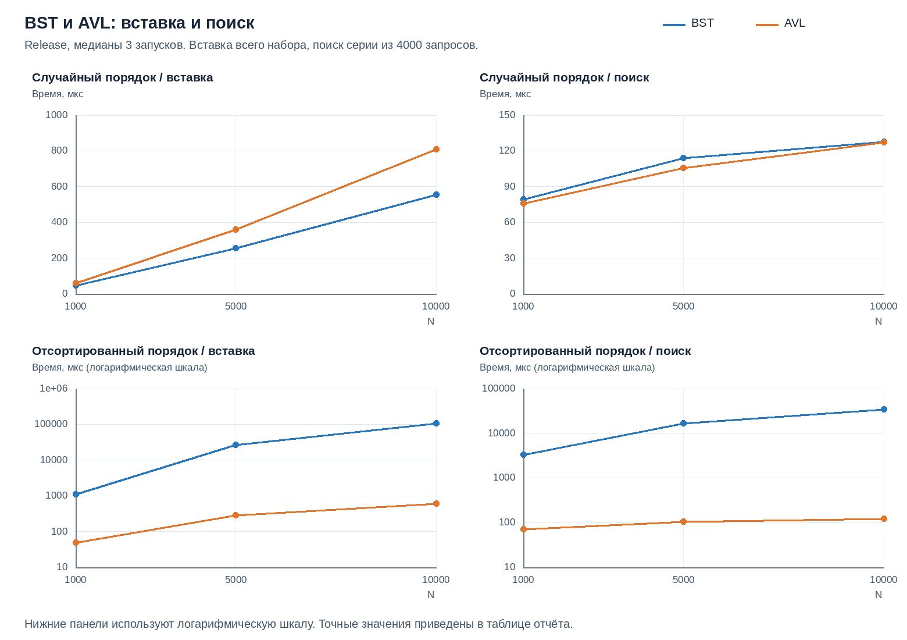
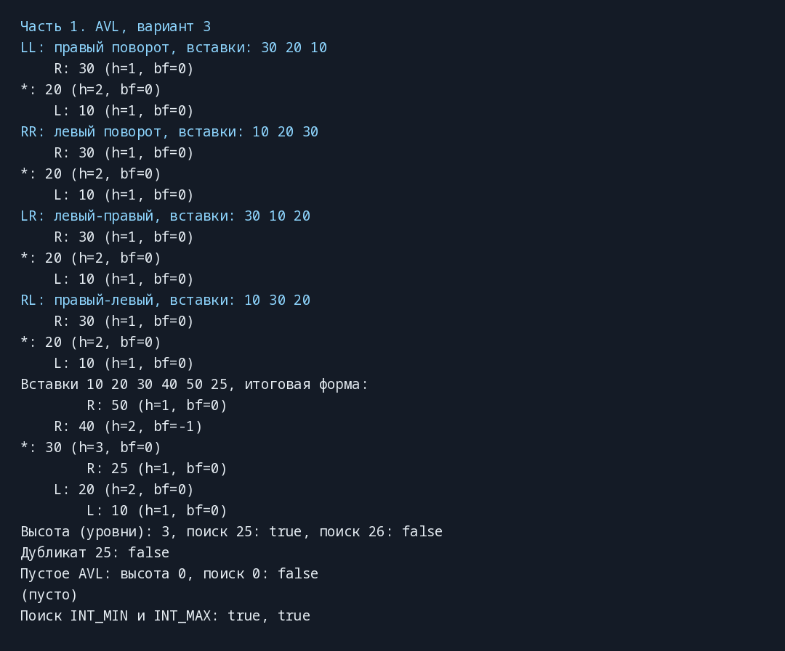
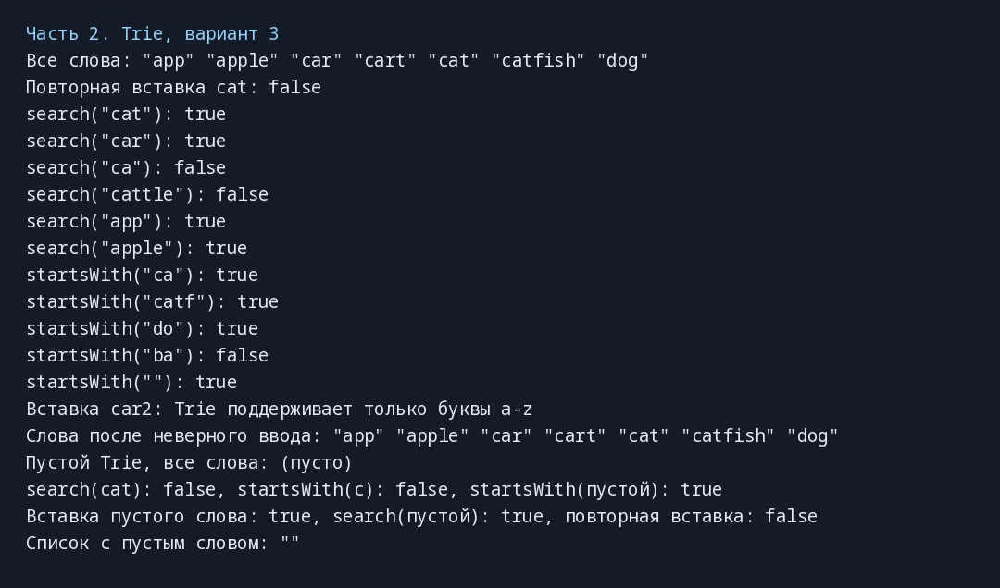
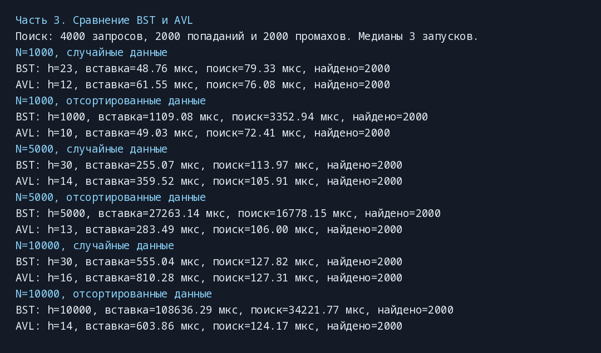

# Отчет по лабораторной работе 10

МИНИСТЕРСТВО НАУКИ И ВЫСШЕГО ОБРАЗОВАНИЯ
РОССИЙСКОЙ ФЕДЕРАЦИИ
Федеральное государственное автономное
образовательное учреждение высшего образования
«СЕВЕРО-КАВКАЗСКИЙ ФЕДЕРАЛЬНЫЙ УНИВЕРСИТЕТ»
Институт информационных технологий и кибер безопасности
Департамент цифровых, робототехнических систем и электроники
Кафедра программной инженерии

**Тема:** AVL-дерево. Префиксное дерево (Trie)

**Вариант:** 3. Все три части, без уровней сложности

**Выполнил:**
Студент группы ПИЖ-б-о-25-2 (2),
направление подготовки: 09.03.04
“Программная инженерия”

Кравцун Михаил Алексеевич

**Проверил:**
Ассистент межинститутской базовой кафедры департамента цифровых,
робототехнических систем и электроники института перспективной
инженерии

Белик Ангелина Игоревна

---

## Репозиторий

[GitHub: Algorithms-Data-structures, лабораторная работа 10 второго курса](https://github.com/WhXteBeXr/Algorithms-Data-structures/tree/main/course-2/lab10)

## Цель работы

Реализовать вставку и поиск в AVL-дереве с четырьмя случаями балансировки. Освоить хранение слов в Trie, поиск слова и префикса, получение всех слов. Сравнить вставку и поиск в AVL и обычном BST при разных порядках данных.

## Постановка задачи

Выполняются вариант 3 обеих индивидуальных частей и общая третья часть. Уровней сложности нет.

| Часть | Требования |
| --- | --- |
| 1. AVL | Вставка, балансировка, поиск элемента |
| 2. Trie | Вставка, поиск, поиск по префиксу, получение всех слов |
| 3. Сравнение | BST и AVL, N = 1000, 5000, 10000, случайные и отсортированные данные, время вставки и поиска, таблица и график |

Удаление в индивидуальных заданиях варианта 3 и в общей части не требуется. AVL и BST хранят различные ключи int, Trie работает с буквами a-z. Дубликаты не создают дополнительных элементов.

## Теоретическая часть

### AVL и повороты

AVL сохраняет свойство BST: все ключи слева меньше ключа узла, справа больше. Дополнительно в каждом узле разность высот детей по модулю не превышает 1. Фактор баланса bf вычисляется как высота слева минус высота справа. Высота хранится в узле, пустое поддерево имеет высоту 0, лист 1.

После вставки на обратном пути к корню обновляются высоты. При bf = 2 или -2 выполняются повороты, меняющие связи без изменения порядка ключей.

| Нарушение | Условие | Исправление |
| --- | --- | --- |
| LL | Узел перегружен слева, левый ребёнок не перегружен справа | Правый поворот |
| RR | Узел перегружен справа, правый ребёнок не перегружен слева | Левый поворот |
| LR | Узел перегружен слева, левый ребёнок перегружен справа | Левый поворот ребёнка, затем правый родителя |
| RL | Узел перегружен справа, правый ребёнок перегружен слева | Правый поворот ребёнка, затем левый родителя |

Поворот переносит среднее поддерево между двумя соседними по порядку корнями. Сначала пересчитывается высота опустившегося узла, затем поднявшегося. AVL ограничивает высоту O(log n), обычное BST на упорядоченных вставках может стать цепочкой высоты n.

### Префиксное дерево

В Trie рёбра соответствуют символам, путь от корня задаёт префикс. Узел содержит 26 связей для a-z и маркер конца слова. Общие начала строк хранятся одним путём. Наличие пути означает существование префикса, наличие маркера в конце пути означает целое слово.

Например, car и cart используют общий путь c-a-r, причём маркеры стоят после r и t. Путь c-a существует, но ca не считается словом. Сбор всех слов идёт в глубину с общим строковым буфером. Перебор детей от a до z формирует лексикографический порядок без сортировки.

## Исходные файлы

[SearchTree.h](SearchTree.h) и [SearchTree.cpp](SearchTree.cpp) реализуют два режима дерева: BST и AVL. Узлы, поиск и печать общие, вставка BST итеративная, вставка AVL рекурсивная с восстановлением баланса. Узлами владеют unique_ptr. Освобождение бинарных деревьев выполнено циклом, чтобы цепочка из 10000 узлов не разрушалась глубокой рекурсией.

[Trie.h](Trie.h) и [Trie.cpp](Trie.cpp) содержат узел с массивом детей, проверку алфавита, операции со строками и сбор слов. [Comparison.h](Comparison.h) и [Comparison.cpp](Comparison.cpp) готовят данные и измеряют время. [main.cpp](main.cpp) демонстрирует все части и граничные случаи, [CMakeLists.txt](CMakeLists.txt) собирает цель c2-lab10 с C++20. Готовые контейнеры поиска не применяются.

## Существенные детали

- Оба режима бинарного дерева используют одинаковый тип узла. Кеш высоты поддерживается только для AVL. Высота BST рассчитывается отдельным обходом вне измерений.
- Дубликат возвращает false. Для AVL это не запускает лишнюю балансировку, в обоих режимах форма остаётся прежней.
- При поворотах владение узлами перемещается между unique_ptr. Промежуточное поддерево сохраняется, новые узлы не выделяются.
- Пустые бинарные деревья имеют высоту 0, поиск в них возвращает false. Сравнения ключей поддерживают INT_MIN и INT_MAX без арифметики над ключами.
- Все строковые операции Trie сначала проверяют допустимость символов. Неверный символ вызывает invalid_argument. Вставка неверной строки не меняет структуру.
- Пустое слово допустимо и отмечается на корне Trie. Пустой префикс всегда существует, в том числе у пустого Trie. Это соглашение отделено от проверки наличия пустого слова.
- Владение детьми Trie также обеспечивается unique_ptr. Его неявный деструктор освобождает все узлы, глубина разрушения зависит от длины пути.

## Сложность и сравнение структур

n - число различных ключей, h - высота бинарного дерева, L - длина строки, P - число узлов Trie. Алфавит A = 26 фиксирован.

| Характеристика | BST | AVL | Trie |
| --- | --- | --- | --- |
| Поиск | O(h), обычно O(log n), худшее O(n) | O(log n) | O(L) |
| Вставка одного элемента | O(h), худшее O(n) | O(log n) | O(L) |
| Балансировка | Нет | Высоты по пути, O(1) поворотов на вставку | Не требуется |
| Основная память | O(n) | O(n) | O(A·P), при фиксированном A это O(P) |
| Поиск префикса | Нет отдельной операции в реализации | Нет отдельной операции в реализации | O(L) |
| Получение всех данных | Потребовался бы обход | Потребовался бы обход | O(A·P + S) |

S в последней строке - суммарный размер результата с учётом длин строк и числа записей. Сбор слов дополнительно использует O(Lmax) стека и строкового буфера, не считая результата. Сам P ограничен единицей плюс суммой длин добавленных слов, общие префиксы уменьшают число узлов. Каждый узел с 26 указателями имеет заметные постоянные затраты памяти.

Сравнение BST и AVL в таблице относится к int. Если хранить строки в бинарном дереве, стоимость сравнения строк также нужно учитывать, верхняя оценка поиска может стать O(Lh). Trie выбирает переход по одному символу и удобен для префиксов. Время Trie в эксперименте не измерялось, общая часть требует численного сравнения BST и AVL.

Построение BST всеми вставками в среднем O(n log n) для случайного порядка различных ключей и O(n²) для отсортированного. Построение AVL гарантированно O(n log n). Высота AVL читается за O(1), высота BST вычисляется за O(n) с явным стеком O(h). Освобождение бинарных деревьев занимает O(n) времени и O(1) дополнительной памяти.

## Сборка и запуск

Из корня репозитория:

```bash
cmake -S course-2/lab10 -B /tmp/algorithms-c2-lab10-release -DCMAKE_BUILD_TYPE=Release
cmake --build /tmp/algorithms-c2-lab10-release
/tmp/algorithms-c2-lab10-release/c2-lab10
```

В общем проекте используется цель c2-lab10. Выполнены сборка и запуск в Debug и Release, GCC 16.2.1, C++20, -Wall, -Wextra, -Wpedantic без предупреждений. Ввод не требуется. Все демонстрации находятся в main.cpp, отдельных тестовых целей нет.

## Результаты

### Части 1 и 2

| Демонстрация | Результат |
| --- | --- |
| LL: 30, 20, 10 | Правый поворот, корень 20 |
| RR: 10, 20, 30 | Левый поворот, корень 20 |
| LR: 30, 10, 20 | Двойной поворот, корень 20 |
| RL: 10, 30, 20 | Двойной поворот, корень 20 |
| Все четыре коротких примера | Высота 2, bf всех узлов 0 |
| AVL после 10, 20, 30, 40, 50, 25 | Корень 30, высота 3, bf каждого узла в пределах нормы |
| Поиск 25 и 26 | true и false |
| Повторная вставка 25 | false |
| Пустое AVL | Высота 0, поиск false |
| INT_MIN и INT_MAX | Оба ключа найдены |
| Получение всех слов Trie | app, apple, car, cart, cat, catfish, dog |
| Поиск cat, car, app, apple | true |
| Поиск ca и cattle | false |
| Префиксы ca, catf, do | true |
| Префикс ba | false |
| Повторная вставка cat | false |
| Вставка car2 | Исключение, набор слов прежний |
| Пустой Trie | Список пуст, поиск cat и префикса c дают false |
| Пустой префикс | true даже без слов |
| Вставка пустого слова | true, поиск пустого слова true, дубликат false |

На боковых схемах * - корень, L/R - сторона ребёнка. Правое поддерево находится выше родителя, глубина задаётся отступом. h - высота в уровнях, bf - фактор баланса.

### Часть 3. Методика измерения

Для каждого N создаются ключи 0..N-1. Генератор mt19937 с seed = 2026+N перемешивает их для случайного порядка. Для второго набора те же ключи сортируются по возрастанию. Обе структуры получают идентичный порядок вставки. Конкретное перемешивание повторяемо в данной среде, но может отличаться между реализациями стандартной библиотеки.

Для каждого N заранее формируются 4000 запросов: 2000 ключей из [0, N-1] и 2000 из [N, 2N-1]. Номера внутри диапазонов выбираются равномерно, затем запросы перемешиваются. Для обоих порядков вставки и обеих структур используется один набор запросов. Повторения запросов допустимы.

Каждое измерение создаёт новое дерево. Steady_clock отдельно измеряет вставку всех N ключей и выполнение всех 4000 запросов. Подготовка данных, вычисление высоты, проверка числа вставок и попаданий, разрушение дерева и вывод не входят в измеряемые интервалы. Число успешных поисков проверяется и выводится, поэтому результат поиска используется программой.

Выполняются три запуска с чередованием порядка BST и AVL. Для вставки и поиска берутся отдельные медианы. Среда сохранённого запуска - GCC 16.2.1, Release с -O3. Время зависит от процессора, кэша, выделения памяти и фоновой нагрузки, небольшую разницу нельзя считать универсальным преимуществом структуры.

| N | Порядок | Высота BST / AVL | Вставка BST, мкс | Вставка AVL, мкс | Поиск BST, мкс | Поиск AVL, мкс |
| ---: | --- | ---: | ---: | ---: | ---: | ---: |
| 1000 | случайные данные | 23 / 12 | 48.76 | 61.55 | 79.33 | 76.08 |
| 1000 | отсортированные данные | 1000 / 10 | 1109.08 | 49.03 | 3352.94 | 72.41 |
| 5000 | случайные данные | 30 / 14 | 255.07 | 359.52 | 113.97 | 105.91 |
| 5000 | отсортированные данные | 5000 / 13 | 27263.14 | 283.49 | 16778.15 | 106.00 |
| 10000 | случайные данные | 30 / 16 | 555.04 | 810.28 | 127.82 | 127.31 |
| 10000 | отсортированные данные | 10000 / 14 | 108636.29 | 603.86 | 34221.77 | 124.17 |

Во всех случаях число попаданий равно 2000. Вставка измеряется для всего набора, поиск для всей серии из 4000 запросов, а не для одного элемента.



На случайных данных BST в этом запуске быстрее при вставке, а время поиска близко к AVL. Для 10000 ключей поиск занимает 127.82 и 127.31 мкс, что не даёт оснований для сильного вывода о разнице скорости. AVL оплачивает обновление высот и повороты, но гарантирует логарифмическую высоту.

На отсортированных данных BST становится цепочкой с высотой N. При N = 10000 его построение занимает 108636.29 мкс против 603.86 мкс у AVL, серия поиска 34221.77 против 124.17 мкс. Высота AVL равна 14. Нижние графики используют логарифмическую шкалу времени, чтобы обе линии оставались различимы.

Полный [вывод программы](media/program-output.txt) сохранён в media.







## Контрольные вопросы

### AVL-дерево

#### 2. Что такое AVL-дерево и чем отличается от BST?

Это BST с ограничением разности высот детей каждого узла по модулю не более 1. Обычное BST не поддерживает такое условие, его высота может стать линейной. AVL восстанавливает баланс после изменений.

#### 3. Что такое фактор баланса?

Разность высот левого и правого поддеревьев. В принятом соглашении bf = h(left)-h(right), допустимы -1, 0 и 1. Знак показывает более высокую сторону.

#### 4. Какие существуют повороты?

Правый, левый и два двойных: левый-правый и правый-левый. Каждый сохраняет симметричный порядок ключей, меняя только связи и высоты.

#### 5. Когда применяются правый и левый повороты?

Правый при bf > 1 и неотрицательном балансе левого ребёнка. Левый при bf < -1 и неположительном балансе правого ребёнка. Это внешние случаи LL и RR.

#### 6. Когда применяются двойные повороты?

LR нужен при перегрузке слева и отрицательном балансе левого ребёнка. RL при перегрузке справа и положительном балансе правого ребёнка. Сначала исправляется внутренняя ветвь ребёнка, затем выполняется поворот родителя.

#### 7. Какова сложность операций AVL?

Поиск, вставка и корректно реализованное удаление имеют O(log n). Высота ограничена логарифмически. Один поворот стоит O(1), для вставки проверка высот идёт по пути O(log n). Удаление в варианте 3 не реализуется.

#### 8. Почему дерево самобалансирующееся?

Баланс восстанавливается самой операцией изменения, пользователь не перестраивает дерево вручную. В этой реализации вставка при возврате по пути обновляет высоты и выполняет необходимые повороты.

#### 9. Как часто выполняется балансировка при вставке?

Высоты проверяются у предков вставленного листа. Реальный поворот нужен только при нарушении ограничения. Для одной вставки достаточно исправить первый снизу несбалансированный узел одним простым или двойным поворотом, после чего высоты остальных предков могут быть обновлены без новых поворотов.

#### 10. Чем AVL отличается от красно-чёрного дерева?

AVL использует высоты и более строгое ограничение их разности. Красно-чёрное дерево использует цвета и ограничения на число чёрных узлов в путях, тоже обеспечивая O(log n). AVL обычно имеет меньшую высоту, а красно-чёрное дерево допускает менее строгую форму и может быть удобнее при частых изменениях. Реальные затраты зависят от реализации и нагрузки.

#### 11. Когда AVL эффективнее обычного BST?

Когда важна гарантия времени поиска и изменения, особенно на упорядоченных или неблагоприятных данных. На удачном случайном BST накладные расходы балансировки могут не окупаться. Измерения этой работы показывают оба случая.

### Префиксное дерево (Trie)

#### 13. Что такое Trie и для чего оно используется?

Это дерево символов, общие префиксы слов разделяют один путь. Применяется для словарей, поиска префиксов и автодополнения. Маркер конца позволяет отличать слово от начала другого слова.

#### 14. Какова сложность поиска в Trie?

O(L) при постоянном времени доступа к переходу. Зависит от длины запроса и способа хранения детей, а не от количества слов напрямую. Здесь доступ выполняется по индексу массива из 26 связей.

#### 15. Что эффективнее для строк: Trie или хеш-таблица?

Для точного поиска таблица часто компактнее и имеет ожидаемое O(L) с учётом вычисления хеша. Trie тоже даёт O(L) и естественно поддерживает префиксы. Выбор зависит от алфавита, общих начал строк, требуемых операций и памяти. Строгого победителя для всех задач нет.

#### 16. Как реализовать автодополнение?

Найти узел заданного префикса, затем собрать слова из его поддерева, начиная буфер с этого префикса. При необходимости ограничить число результатов или учитывать частоту. В данном варианте реализован сбор всех слов от корня, без отдельной операции автодополнения.

#### 17. Каковы недостатки Trie и затраты памяти?

Возможны многочисленные узлы, пустые переходы и длинные одиночные цепочки. Для массива детей память O(A·P), где A - алфавит, P - число узлов. При A = 26 асимптотика линейна по P, но постоянный множитель велик. Разреженные переходы и сжатие путей уменьшают расход в подходящих задачах.

## Вывод

Выполнены все три части варианта 3. AVL поддерживает логарифмическую высоту с помощью четырёх случаев балансировки, Trie различает слова и префиксы и возвращает словарь в лексикографическом порядке. Сравнение показывает цену балансировки на случайных данных и её преимущество при упорядоченной вставке. Одинаковые входы и запросы, контроль результатов и измерение отдельных этапов позволяют связать наблюдаемые времена с формой дерева.
