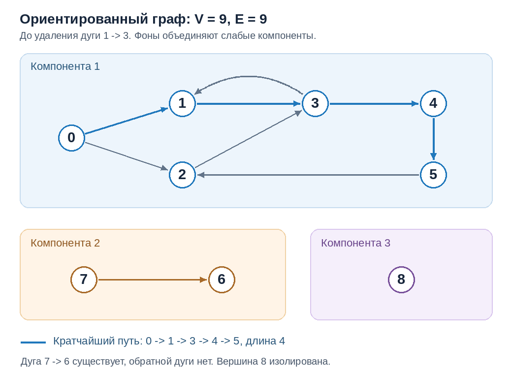
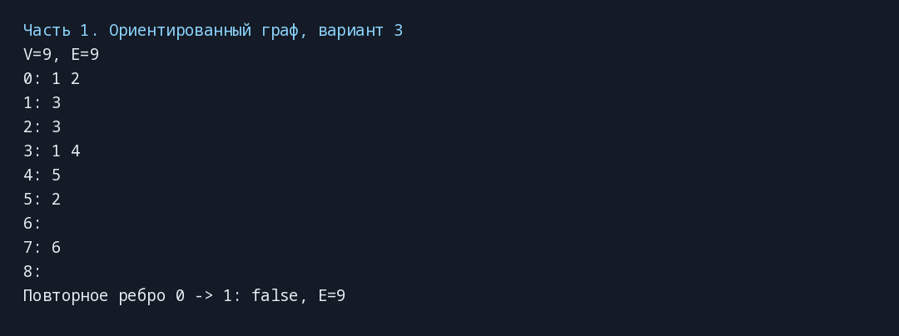
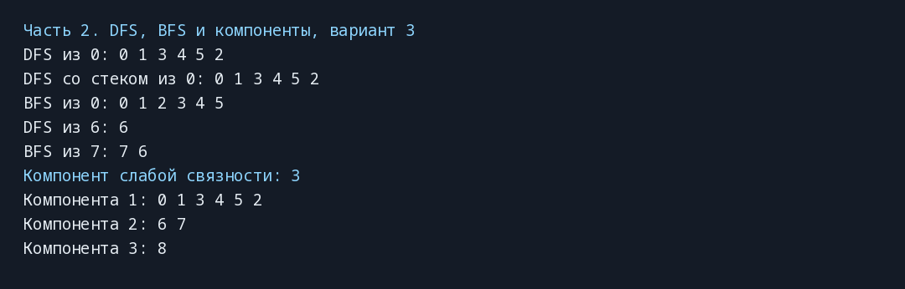
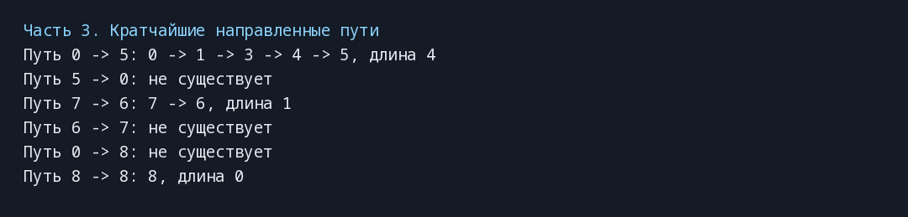
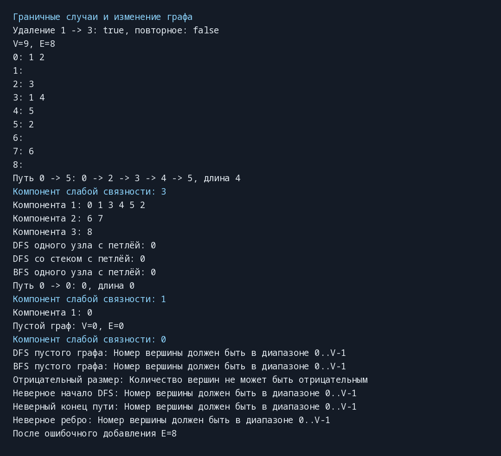

# Отчет по лабораторной работе 11

МИНИСТЕРСТВО НАУКИ И ВЫСШЕГО ОБРАЗОВАНИЯ
РОССИЙСКОЙ ФЕДЕРАЦИИ
Федеральное государственное автономное
образовательное учреждение высшего образования
«СЕВЕРО-КАВКАЗСКИЙ ФЕДЕРАЛЬНЫЙ УНИВЕРСИТЕТ»
Институт информационных технологий и кибер безопасности
Департамент цифровых, робототехнических систем и электроники
Кафедра программной инженерии

**Тема:** Представление графов. DFS и BFS

**Вариант:** 3. Все три части, без уровней сложности

**Выполнил:**
Студент группы ПИЖ-б-о-25-2 (2),
направление подготовки: 09.03.04
“Программная инженерия”

Кравцун Михаил Алексеевич

**Проверил:**
Ассистент межинститутской базовой кафедры департамента цифровых,
робототехнических систем и электроники института перспективной
инженерии

Белик Ангелина Игоревна

---

## Репозиторий

[GitHub: Algorithms-Data-structures, лабораторная работа 11 второго курса](https://github.com/WhXteBeXr/Algorithms-Data-structures/tree/main/course-2/lab11)

## Цель работы

Реализовать ориентированный невзвешенный граф со списком смежности. Освоить DFS и BFS, поиск компонент связности и кратчайшего направленного пути. Сопоставить список и матрицу смежности по памяти и сложности операций.

## Постановка задачи

Выполняются вариант 3 обеих индивидуальных частей и общая третья часть. Разделения заданий на уровни нет.

| Часть | Требования |
| --- | --- |
| 1. Представление | Список смежности, ориентированный граф без весов |
| 2. Обходы | Рекурсивный DFS, BFS и поиск компонент связности |
| 3. Применение | Создать граф, выполнить обходы от выбранной вершины, вывести компоненты и кратчайший путь для выбранной пары |

Для сопоставления способов реализации добавлен итеративный DFS. Поддерживаются добавление и удаление дуг, проверка индексов, пустой граф, циклы, петли и недостижимые вершины. Все данные демонстрации заданы в main.cpp, ввод не требуется.

Для ориентированного графа под компонентами в работе понимаются **компоненты слабой связности**: направления игнорируются только при их определении. DFS, BFS и кратчайший путь выполняются по исходным направлениям. Сильная связность требует взаимной направленной достижимости и является другим понятием.

## Теоретическая часть

Граф состоит из вершин и рёбер. В ориентированном графе дуга u -> v разрешает переход из u в v, но не обязательно обратно. Невзвешенный граф позволяет измерять длину пути количеством дуг. Вершины реализации нумеруются от 0 до V-1, параллельные дуги не хранятся.

Матрица смежности хранит состояние всех пар вершин в V × V ячейках. Список смежности хранит для каждой вершины только её исходящих соседей. Для выбранного ориентированного представления каждая дуга занимает одну запись. Входящую дугу нельзя пройти в обратном направлении без отдельной связи.

DFS помечает вершину и рекурсивно исследует ещё не посещённых соседей. После завершения ветви возвращается к следующему соседу. Итеративная версия хранит собственные кадры с текущей вершиной и индексом следующего соседа, поэтому воспроизводит тот же порядок без рекурсивных вызовов.

BFS использует очередь FIFO. Вершины обнаруживаются слоями по расстоянию от начала, первое обнаружение даёт кратчайший путь в невзвешенном графе. Предшественник сохраняется при добавлении в очередь, одновременно отмечая вершину как обнаруженную. Это не позволяет циклам и нескольким входящим дугам добавлять одну вершину повторно.

Для слабых компонент строится временная неориентированная проекция: к каждой исходной дуге добавляется обратная связь. DFS запускается от каждой ещё не посещённой вершины с одним общим массивом отметок. Каждый такой запуск формирует новую компоненту, изолированная вершина образует отдельную.

## Исходные файлы

[Graph.h](Graph.h) объявляет интерфейс графа и результаты внутреннего BFS. [Graph.cpp](Graph.cpp) реализует список смежности, изменение дуг, печать, два DFS, BFS, слабые компоненты и восстановление кратчайшего пути. Обход и поиск пути используют общий внутренний BFS, а рекурсивный помощник DFS применяется и к исходному графу, и к временной проекции.

[main.cpp](main.cpp) создаёт граф из 9 вершин и 9 дуг, выводит все результаты и граничные случаи. [CMakeLists.txt](CMakeLists.txt) собирает цель c2-lab11 отдельно и в составе общего проекта. Vector хранит смежность и результаты, queue обеспечивает FIFO. Готовая библиотека графов не используется.

## Детали реализации

- Внешний vector содержит V внутренних vector с исходящими соседями. Порядок соседей совпадает с порядком добавления, поэтому порядок обходов воспроизводим.
- Перед изменением дуги проверяются оба конца. Повторное добавление возвращает false, отсутствующая дуга при удалении также даёт false. Остальные записи сохраняют порядок.
- Отрицательный размер вызывает invalid_argument, неверный номер вершины out_of_range. Граф с V = 0 допустим, но вершины 0 в нём нет.
- Число дуг рассчитывается суммированием размеров списков. Отдельного счётчика, который нужно синхронизировать с изменениями, нет.
- DFS помечает вершину до перехода к соседям. Итеративный DFS после добавления кадра не использует старые ссылки на элементы vector, поскольку память могла переразместиться.
- BFS хранит -1 для необнаруженных вершин. Начало получает себя как предшественника. При восстановлении путь заканчивается на начале, поэтому это значение не создаёт бесконечный цикл.
- Если цель недостижима, shortestPath возвращает пустой vector. При совпадении начала и конца возвращается одна вершина, длина пути 0.
- Проекция для слабых компонент не изменяет исходные дуги. Если в исходном графе были обе встречные дуги, в проекции могут появиться повторные записи, но отметки предотвращают повторные посещения и сохраняют линейную оценку.
- Память управляется стандартными контейнерами. Нет владеющих сырых указателей и ручного удаления узлов. Рекурсивный DFS ограничен доступным стеком, для глубокого направленного обхода предусмотрен итеративный вариант.

## Сложность и сравнение представлений

V - число вершин, E - число дуг, deg⁺(u) - число исходящих соседей u. Матрица приведена для теоретического сравнения, реализован список согласно варианту.

| Операция или свойство | Матрица смежности | Список смежности этой реализации |
| --- | --- | --- |
| Хранение | O(V²) | O(V+E) |
| Проверка наличия дуги u -> v | O(1) | O(deg⁺(u)) |
| Перебор соседей u | O(V) | O(deg⁺(u)) |
| Добавление дуги без дубликатов | O(1) | O(deg⁺(u)+1) амортизированно, с учётом поиска |
| Удаление дуги | O(1) | O(deg⁺(u)+1), поиск и сдвиг элементов |
| Полный DFS или BFS | O(V²) | O(V+E) |

Если просто дописывать дугу без проверки дубликата, добавление в vector имеет амортизированную стоимость O(1). Здесь дополнительный просмотр списка выбран намеренно, поэтому для addEdge не заявляется безусловное O(1). При перераспределении памяти единичный push_back также может копировать текущий список.

| Операция программы | Время | Дополнительная память |
| --- | --- | --- |
| Создание пустого графа с V вершинами | O(V) | O(V) под списки |
| vertexCount / edgeCount | O(1) / O(V) | O(1) |
| Печать списка | O(V+E) | O(1) сверх потока |
| dfs, dfsIterative, bfs | O(V+E) | O(V) |
| weakComponents | O(V+E) | O(V+E), включая проекцию |
| shortestPath | O(V+E) | O(V) |

Оценки обходов учитывают инициализацию массивов размера V. Из одного старта просматриваются только исходящие дуги достижимых вершин, остальные компоненты не обходятся. В кратчайшем пути общий BFS проходит всю достижимую часть, затем восстановление требует не более O(V).

Для разреженного графа список экономит память и не проверяет отсутствующие связи при обходе. Для плотного графа оба представления могут занимать O(V²), матрица удобнее при частых проверках отдельных пар. В ориентированном графе сумма исходящих степеней равна E. Эксперимент с измерением времени заданием этой работы не требуется.

## Сборка и запуск

Из корня репозитория:

```bash
cmake -S course-2/lab11 -B /tmp/algorithms-c2-lab11-release -DCMAKE_BUILD_TYPE=Release
cmake --build /tmp/algorithms-c2-lab11-release
/tmp/algorithms-c2-lab11-release/c2-lab11
```

В общем проекте используется цель c2-lab11. Выполнены сборка и запуск в Release отдельно и в Debug через корневой CMake. GCC 16.2.1, C++20, -Wall, -Wextra, -Wpedantic, предупреждений нет. Вывод обеих сборок совпадает. Демонстрации находятся в main.cpp, отдельные тестовые цели не создаются.

## Результаты

### Исходный граф и обходы

Дуги: 0 -> 1, 0 -> 2, 1 -> 3, 2 -> 3, 3 -> 1, 3 -> 4, 4 -> 5, 5 -> 2, 7 -> 6. Вершина 8 изолирована. Циклы позволяют показать, что посещённые вершины не обрабатываются повторно.



| Операция | Фактический результат |
| --- | --- |
| V и E | 9 и 9 |
| Повторная дуга 0 -> 1 | false, E остаётся 9 |
| Рекурсивный DFS из 0 | 0 1 3 4 5 2 |
| Итеративный DFS из 0 | 0 1 3 4 5 2 |
| BFS из 0 | 0 1 2 3 4 5 |
| DFS из 6 | 6 |
| BFS из 7 | 7 6 |
| Слабые компоненты, в порядке вывода | [0 1 3 4 5 2], [6 7], [8] |

### Кратчайшие пути и граничные случаи

| Пример | Результат |
| --- | --- |
| 0 -> 5 | 0 -> 1 -> 3 -> 4 -> 5, длина 4 |
| 5 -> 0 | Пути нет |
| 7 -> 6 | 7 -> 6, длина 1 |
| 6 -> 7 | Пути нет, несмотря на общую слабую компоненту |
| 0 -> 8 | Пути нет |
| 8 -> 8 | [8], длина 0 |
| Удаление 1 -> 3 | true, повторное удаление false, E становится 8 |
| Путь 0 -> 5 после удаления | 0 -> 2 -> 3 -> 4 -> 5, длина 4 |
| Компоненты после удаления | Те же три, обратная дуга 3 -> 1 сохранена |
| Одна вершина с петлёй | Оба DFS и BFS посещают 0 один раз, одна компонента |
| Граф без вершин | V = 0, E = 0, компонент 0 |
| DFS и BFS из 0 пустого графа | Перехвачены исключения |
| Отрицательный размер и неверные индексы | Перехвачены исключения |
| Ошибочная вставка 0 -> 9 | Дуги не меняются, E остаётся 8 |

До удаления существуют два кратчайших пути от 0 к 5 через вершины 1 или 2. BFS выбирает первый по порядку соседей. После удаления дуги 1 -> 3 используется путь через 2. Маршрут из вершины в саму себя не требует пройти хотя бы одну дугу, поэтому его длина равна 0 даже без петли.

Полный [вывод программы](media/program-output.txt) сохранён в media.









## Контрольные вопросы

### 1. Что такое граф и из чего он состоит?

Это множество вершин и связывающих их рёбер. У ориентированного графа ребро задаётся упорядоченной парой, у невзвешенного нет отдельной стоимости перехода. Изолированные вершины входят в граф и без рёбер.

### 2. Чем ориентированный граф отличается от неориентированного?

Дуга u -> v допускает движение только в указанную сторону. Неориентированное ребро соединяет вершины в обе стороны. В списке неориентированного графа обычно хранят обе записи, в нашей реализации добавляется одна направленная запись.

### 3. Что такое матрица смежности, её достоинства и недостатки?

Таблица V × V со значениями наличия ребра или его веса. Даёт O(1) для проверки отдельной пары и проста для плотных графов. Требует O(V²) памяти и O(V) для перебора соседей одной вершины даже при малом числе рёбер.

### 4. Что такое список смежности, его достоинства и недостатки?

Для каждой вершины хранится последовательность её соседей. Память O(V+E), перебираются только реальные рёбра. Проверка конкретного ребра в обычном списке требует линейного поиска по соседям. Изменение vector может перераспределять память или сдвигать элементы.

### 5. Когда выбирать матрицу, а когда список?

Матрица удобна для плотного графа и частых запросов о наличии отдельных рёбер. Список удобен для разреженного графа и обходов. Выбор зависит от плотности, операций и доступной памяти.

### 6. Какова сложность проверки наличия ребра?

В матрице O(1), обращение по двум индексам. В неотсортированном списке O(deg⁺(u)), требуется найти v среди исходящих соседей u.

### 7. Какова сложность перебора соседей?

В матрице O(V), просматривается вся строка. В списке O(deg⁺(u)), просматриваются только записи существующих дуг.

### 8. Как работает DFS?

Помечает текущую вершину, переходит к первому непосещённому соседу и продолжает в глубину. Когда соседи заканчиваются, возвращается к предыдущему узлу обхода. Использует стек вызовов или явный стек.

### 9. Какие задачи решает DFS?

Достижимость, компоненты связности, поиск циклов, топологический порядок для DAG, мосты и точки сочленения в неориентированном графе. Для последних задач одного массива visited недостаточно, нужны дополнительные состояния или времена входа.

### 10. Как работает BFS?

Начало добавляется в очередь, далее извлекается первая вершина и добавляются ещё не обнаруженные соседи. Отметка ставится при добавлении. FIFO обеспечивает порядок по слоям расстояния.

### 11. Какие задачи решает BFS?

Достижимость, кратчайшие пути по числу рёбер, расстояния от начала, вершины на заданном расстоянии, проверка двудольности неориентированного графа. Компоненты неориентированного графа также можно находить повторными BFS.

### 12. Чем рекурсивный DFS отличается от итеративного?

Рекурсивный сохраняет незавершённые вызовы в системном стеке. Итеративный хранит состояние явно. В работе кадр содержит вершину и следующего соседа, поэтому порядок совпадает с рекурсивным. Простой стек только из вершин может дать другой допустимый порядок.

### 13. Почему BFS находит кратчайший путь, а DFS не гарантирует его?

BFS обрабатывает вершины по неубыванию числа переходов. При первом обнаружении цели более короткий слой уже просмотрен. DFS может сначала уйти по длинной ветви и найти цель раньше, чем исследует короткую. Для произвольных разных весов BFS такой гарантии не даёт.

### 14. Как найти компоненты связности через DFS?

В неориентированном графе нужно хранить общий visited и запускать DFS от каждой непосещённой вершины, каждый запуск формирует компоненту. В нашем ориентированном графе так обрабатывается неориентированная проекция для слабых компонент. Для сильных компонент нужны специальные алгоритмы, например Косарайю или Тарьяна.

### 15. Как обнаружить цикл с помощью DFS?

В ориентированном графе хранить состояния «не посещена», «активна» и «завершена». Ребро в активную вершину означает цикл, включая петлю. В неориентированном простом графе посещённый сосед, отличный от родителя DFS, указывает на цикл. Простой visited в текущих обходах предотвращает зацикливание, но отдельный поиск цикла не реализует.

## Вывод

Выполнены все три части варианта 3. Реализованы направленный список смежности, два варианта DFS, BFS, слабые компоненты и кратчайший путь. Примеры показывают различие между принадлежностью слабой компоненте и направленной достижимостью, влияние порядка соседей и корректность работы с циклами, изолированными вершинами и пустым графом. Для выбранного представления обходы имеют O(V+E), а проверка дубликатов при добавлении требует просмотра исходящих соседей.
