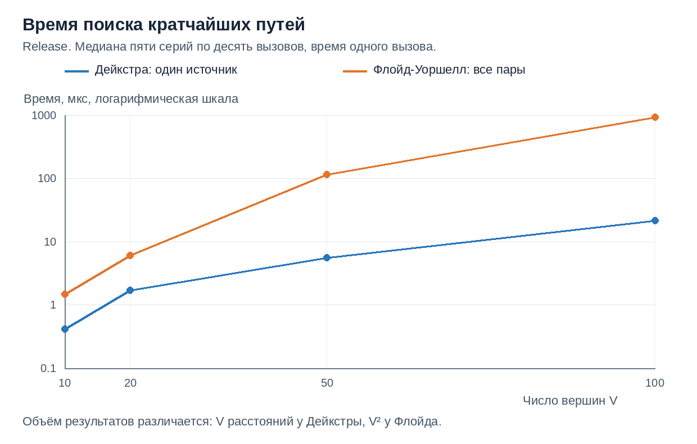
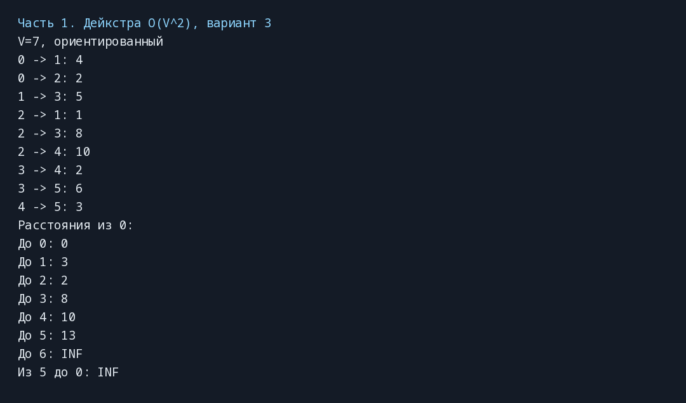
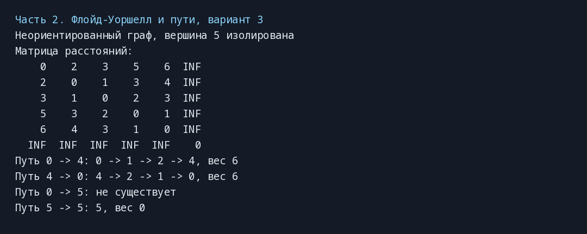
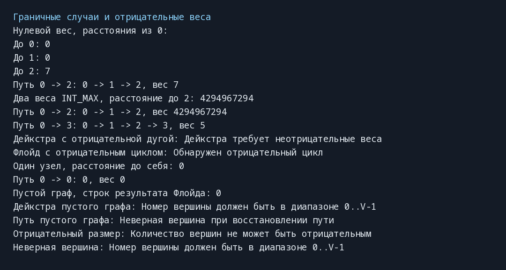
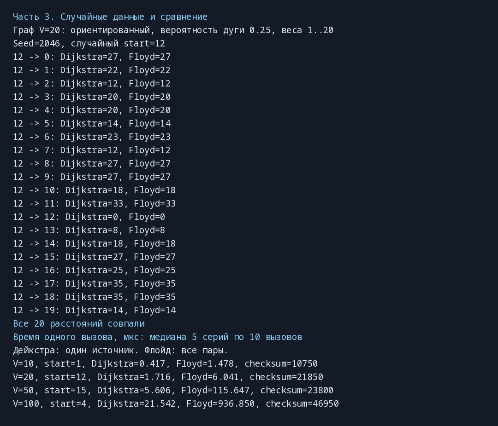

# Отчет по лабораторной работе 12

МИНИСТЕРСТВО НАУКИ И ВЫСШЕГО ОБРАЗОВАНИЯ
РОССИЙСКОЙ ФЕДЕРАЦИИ
Федеральное государственное автономное
образовательное учреждение высшего образования
«СЕВЕРО-КАВКАЗСКИЙ ФЕДЕРАЛЬНЫЙ УНИВЕРСИТЕТ»
Институт информационных технологий и кибер безопасности
Департамент цифровых, робототехнических систем и электроники
Кафедра программной инженерии

**Тема:** Алгоритм Дейкстры. Алгоритм Флойда-Уоршелла

**Вариант:** 3. Все три части, без уровней сложности

**Выполнил:**
Студент группы ПИЖ-б-о-25-2 (2),
направление подготовки: 09.03.04
“Программная инженерия”

Кравцун Михаил Алексеевич

**Проверил:**
Ассистент межинститутской базовой кафедры департамента цифровых,
робототехнических систем и электроники института перспективной
инженерии

Белик Ангелина Игоревна

---

## Репозиторий

[GitHub: Algorithms-Data-structures, лабораторная работа 12 второго курса](https://github.com/WhXteBeXr/Algorithms-Data-structures/tree/main/course-2/lab12)

## Цель работы

Реализовать Дейкстру за O(V²) для ориентированного графа и Флойда-Уоршелла с восстановлением путей для неориентированного. Изучить обработку недостижимых вершин и отрицательных весов. Сравнить результаты и время на одинаковых графах.

## Постановка задачи

Выполняются вариант 3 двух индивидуальных частей и общая третья часть. Уровни сложности отдельно не выделены.

| Часть | Требования |
| --- | --- |
| 1. Дейкстра | Без очереди приоритетов, O(V²), ориентированный граф |
| 2. Флойд-Уоршелл | Неориентированный граф, восстановление путей |
| 3. Сравнение | Случайный граф из 20 вершин и случайный источник, сверка расстояний, замеры для V = 10, 20, 50, 100, таблица и график |

В общей части используется один ориентированный граф для обоих алгоритмов. Дейкстра вычисляет расстояния от одного источника, Флойд - для всех пар. Сравниваются одни и те же пары (start, v). Вторая часть отдельно демонстрирует требуемый неориентированный граф.

## Теоретическая часть

### Дейкстра

Дейкстра хранит текущую оценку расстояния до каждой вершины. На каждом шаге выбирается непосещённая вершина с минимальной оценкой, после чего её исходящие рёбра релаксируются: проверяется, не короче ли путь через выбранную вершину.

Неотрицательность весов позволяет окончательно фиксировать минимальную оценку при выборе вершины. Если есть отрицательные дуги, ещё не обработанная вершина может позднее улучшить уже зафиксированную. В выбранной реализации минимум ищется линейным просмотром, список исходящих рёбер - строка матрицы, суммарное время O(V²).

### Флойд-Уоршелл

Флойд-Уоршелл решает задачу для всех пар динамическим программированием. На этапе k допускается новая промежуточная вершина. Для каждой пары i, j сравниваются прежняя оценка и сумма d[i][k] + d[k][j]. Внешний цикл по промежуточной вершине сохраняет смысл этапов.

Матрица next[i][j] хранит первый шаг выбранного пути от i к j. При улучшении через k первый шаг берётся из next[i][k]. Путь восстанавливается последовательными переходами к next[current][target]. При равной стоимости прежний маршрут сохраняется.

Отрицательные дуги допустимы, если нет отрицательных циклов. Отрицательное значение на диагонали показывает замкнутый маршрут отрицательного веса. В этой реализации наличие такого цикла прекращает весь расчёт с исключением, результат для отдельных незатронутых пар отдельно не выдаётся.

## Исходные файлы

[WeightedGraph.h](WeightedGraph.h) объявляет граф, тип расстояния и результат Флойда с восстановлением пути. [WeightedGraph.cpp](WeightedGraph.cpp) содержит матрицу весов, добавление рёбер, печать, Дейкстру, Флойда и восстановление. Направленность задаётся при создании, оба режима используют одни алгоритмы.

[Comparison.h](Comparison.h) и [Comparison.cpp](Comparison.cpp) создают случайные данные, сравнивают строки расстояний и измеряют время. [main.cpp](main.cpp) демонстрирует индивидуальные части и граничные случаи. [CMakeLists.txt](CMakeLists.txt) собирает цель c2-lab12 отдельно и из общего проекта. Готовая библиотека графов и очередь приоритетов не используются.

## Существенные детали

- Матрица содержит веса или INF, нулевой вес является настоящим ребром. Нумерация вершин 0..V-1. Повторное добавление ребра заменяет вес, в неориентированном режиме обновляются обе стороны.
- Входные веса имеют тип int, расстояния int64_t. INF равен четверти максимального int64_t. Конечные оценки поддерживаются строго между -INF и INF.
- Складываются только конечные оценки. Сумма двух таких оценок помещается в int64_t, выход результата за поддерживаемый диапазон вызывает overflow_error, а не превращается в ложную недостижимость.
- Дейкстра перед запуском проверяет отсутствие отрицательных весов во всём графе. Когда минимум равен INF, обработка заканчивается, недостижимые вершины сохраняют INF.
- Для Флойда диагональ начинается с 0, кроме отрицательной петли, которая должна быть обнаружена как отрицательный цикл. После каждого этапа проверяется диагональ.
- Отсутствующий путь восстанавливается как пустой vector. Для пути из вершины в саму себя получается одна вершина с весом 0. Матрицы результата относятся к состоянию графа на момент расчёта.
- Пустой граф допустим: Флойд возвращает пустые матрицы. Запрос источника или пути в нём вызывает out_of_range. Отрицательный размер вызывает invalid_argument.
- Восстановление маршрутов реализовано для Флойда согласно варианту 3 второй части. Дейкстра возвращает только расстояния согласно первой части.
- Память графа и результатов принадлежит vector, сырых владеющих указателей и ручного удаления нет.

## Анализ сложности

V - число вершин. Представление графа матрицей требует O(V²) памяти.

| Операция | Время | Дополнительная память |
| --- | --- | --- |
| Создание графа | O(V²) | O(V²) матрица |
| Добавление или замена ребра | O(1) | O(1) |
| Печать рёбер по матрице | O(V²) | O(1) |
| Дейкстра из одного источника | O(V²) | O(V) |
| Флойд-Уоршелл, все пары | O(V³) | O(V²), расстояния и next |
| Восстановление одного пути Флойда | O(V) в худшем случае | O(V) результат |

Проверка отрицательных весов у Дейкстры занимает O(V²) и не меняет итоговую оценку. Проверка диагонали после каждого этапа Флойда суммарно O(V²), основной тройной цикл остаётся O(V³). Все алгоритмы итеративные, рекурсивного стека нет.

| Свойство | Дейкстра | Флойд-Уоршелл |
| --- | --- | --- |
| Набор результатов | Один источник, V оценок | Все V² пар |
| Отрицательные веса | Отклоняются | Допускаются без отрицательных циклов |
| Отрицательный цикл | Отсекается условием о весах | Обнаруживается по диагонали, расчёт прекращается |
| Восстановление в работе | Не требуется для части 1 варианта 3 | Через next |
| Подходящая задача | Один или несколько источников с неотрицательными весами | Много запросов между всеми парами небольшого графа |

При запуске матричного Дейкстры из всех V источников общее время также было бы O(V³). Такой эксперимент здесь не выполняется: методичка требует измерять один источник и все пары соответственно. Разница времени не означает, что оба алгоритма выполнили одинаковый объём работы.

## Сборка и запуск

Из корня репозитория:

```bash
cmake -S course-2/lab12 -B /tmp/algorithms-c2-lab12-release -DCMAKE_BUILD_TYPE=Release
cmake --build /tmp/algorithms-c2-lab12-release
/tmp/algorithms-c2-lab12-release/c2-lab12
```

В общем проекте доступна цель c2-lab12. Выполнены сборка и запуск в Release отдельно и в Debug через корневой CMake. GCC 16.2.1, C++20, -Wall, -Wextra, -Wpedantic, предупреждений нет. Ввод не требуется. Демонстрации и расстояния совпадают между конфигурациями, времена различаются. Все примеры находятся в основной программе, отдельных тестовых целей нет.

## Результаты

### Часть 1. Дейкстра на ориентированном графе

Исходные дуги и веса выводятся программой. Вершина 6 изолирована, дуга 2 -> 1 позволяет улучшить путь к 1 через 2.

| Вершина | 0 | 1 | 2 | 3 | 4 | 5 | 6 |
| --- | --- | --- | --- | --- | --- | --- | --- |
| Расстояние из 0 | 0 | 3 | 2 | 8 | 10 | 13 | INF |

Из вершины 5 нельзя попасть в 0, результат INF. Это демонстрирует направленность, а не только несвязность.

### Часть 2. Флойд на неориентированном графе

Матрица расстояний:

| Из / в | 0 | 1 | 2 | 3 | 4 | 5 |
| --- | --- | --- | --- | --- | --- | --- |
| 0 | 0 | 2 | 3 | 5 | 6 | INF |
| 1 | 2 | 0 | 1 | 3 | 4 | INF |
| 2 | 3 | 1 | 0 | 2 | 3 | INF |
| 3 | 5 | 3 | 2 | 0 | 1 | INF |
| 4 | 6 | 4 | 3 | 1 | 0 | INF |
| 5 | INF | INF | INF | INF | INF | 0 |

Путь 0 -> 4 восстановлен как 0 -> 1 -> 2 -> 4 с весом 6, обратный как 4 -> 2 -> 1 -> 0 с тем же весом. Путь через 3 имеет равную стоимость, но не заменяет уже найденный. Путь 0 -> 5 отсутствует, путь 5 -> 5 содержит одну вершину и имеет вес 0.

### Граничные случаи

| Пример | Результат |
| --- | --- |
| Дуга 0 -> 1 с весом 0, затем 1 -> 2 с весом 7 | Расстояния 0, 0, 7, маршрут 0 -> 1 -> 2 |
| Две последовательные дуги веса INT_MAX | Оба алгоритма дают 4294967294, путь восстановлен |
| Отрицательная дуга 1 -> 2 без цикла | Флойд выдаёт 0 -> 1 -> 2 -> 3 с весом 5 |
| Дейкстра на этом графе | Исключение о недопустимых весах |
| Неориентированное ребро веса -1 | Флойд обнаруживает отрицательный замкнутый маршрут |
| Один узел без рёбер | Расстояние до себя 0, путь [0] |
| Пустой граф | Матрицы Флойда пусты, недопустимые запросы перехвачены |
| Отрицательный размер и неверный номер | Перехвачены исключения |

### Часть 3. Случайный граф и сверка

Для каждого V генератор mt19937 получает seed = 2026+V. Для каждой упорядоченной пары различных вершин дуга добавляется независимо с вероятностью 0.25, вес выбирается равномерно из 1..20. После построения тем же генератором выбирается стартовая вершина. Для V = 20 seed равен 2046, в сохранённом запуске start = 12.

Конкретная последовательность повторяема в данной среде, но реализации распределений могут различаться между стандартными библиотеками. Цель генерации - дать обоим алгоритмам один граф, а не обеспечить заранее заданную связность.

Расстояния от 12 к вершинам 0..19: 27, 22, 12, 20, 20, 14, 23, 12, 27, 27, 18, 33, 0, 8, 18, 27, 25, 35, 35, 14. Все 20 оценок совпали. Такая же полная сверка строки проводится для остальных трёх размеров, включая INF при наличии недостижимых пар.

### Методика измерения и время

Steady_clock измеряет пять серий по десять полных вызовов каждого алгоритма. Время серии делится на 10, затем выбирается медиана пяти средних. Порядок запуска алгоритмов чередуется между сериями. Граф, источник и сравнение полных строк подготавливаются вне измерений.

Время включает построение и освобождение возвращаемых контейнеров, а также подсчёт контрольной суммы строки источника. Дейкстра создаёт вектор расстояний, Флойд две матрицы и вычисляет все пары, даже если сумма берётся только по одной строке. Восстановление отдельного пути в интервал не входит.

Сумма строки добавляет d+1 для конечного расстояния и 0 для INF. За 50 вызовов сумма должна равняться 50-кратному ожидаемому значению и совпадать у обоих алгоритмов. Это сохраняет использование результатов каждого вызова. Числа ниже получены в Release с -O3.

| V | Источник | Дейкстра, мкс за вызов | Флойд, мкс за вызов | Сумма за 50 вызовов |
| ---: | ---: | ---: | ---: | ---: |
| 10 | 1 | 0.417 | 1.478 | 10750 |
| 20 | 12 | 1.716 | 6.041 | 21850 |
| 50 | 15 | 5.606 | 115.647 | 23800 |
| 100 | 4 | 21.542 | 936.850 | 46950 |



В сохранённом запуске при V = 100 один источник Дейкстры требует 21.542 мкс, расчёт всех пар Флойда 936.850 мкс. С ростом V время Флойда растёт заметнее, что согласуется с кубическим основным циклом. Точные значения зависят от графа, компилятора, кэша и фоновой нагрузки. Небольшие размеры, пропуск недостижимых промежуточных путей и постоянные расходы не обязаны давать точные отношения V² и V³ в каждом замере.

Полный [вывод программы](media/program-output.txt) сохранён в media.









## Контрольные вопросы

### 1. Какие условия нужны Дейкстре?

Все веса должны быть неотрицательными. Выбор минимума и релаксация должны учитывать недостижимые вершины, арифметика не должна переполняться. Начало получает 0, остальные оценки INF.

### 2. Почему отрицательные веса нарушают алгоритм?

После фиксации вершины ещё не обработанный путь с отрицательной дугой может уменьшить её оценку. Жадное предположение перестаёт работать. Например, при 0 -> 1 веса 2, 0 -> 2 веса 5 и 2 -> 1 веса -4 вершина 1 фиксируется с 2, хотя истинный минимум 1.

### 3. Какова сложность Дейкстры с очередью приоритетов?

Со списком смежности и двоичной кучей O((V+E) log V) для обычного простого графа. Матрица и линейный выбор минимума дают O(V²), как в этой работе. Замена только поиска минимума не устраняет полный просмотр строк матрицы.

### 4. В чём идея Флойда-Уоршелла?

Постепенно расширять множество разрешённых промежуточных вершин. На этапе k путь i -> j либо сохраняется, либо улучшается объединением i -> k и k -> j. Это динамическое программирование для всех пар.

### 5. Какова его сложность?

Три вложенных цикла дают O(V³), две матрицы требуют O(V²). Пропуски недостижимых частей улучшают конкретное время, но не худшую оценку.

### 6. Как обнаруживается отрицательный цикл?

Если после релаксаций d[v][v] < 0, существует отрицательный замкнутый маршрут. В программе диагональ проверяется после каждого этапа, при обнаружении выбрасывается исключение. Пары, которые могут пройти через такой цикл, не имеют конечного кратчайшего расстояния.

### 7. Когда выбирать Дейкстру?

При неотрицательных весах и запросах от одного или немногих источников. Для больших разреженных графов удобна реализация со списком и кучей. Вариант без кучи прост и подходит для небольших или плотных графов.

### 8. Когда выбирать Флойда?

Для небольшого графа с большим числом запросов между разными парами и для отрицательных дуг без отрицательных циклов. После расчёта расстояние любой пары читается за O(1). Нужно учитывать кубическое время и квадратную память.

### 9. Как восстановить путь Дейкстры?

При успешной релаксации сохранять prev[v] = u. После проверки достижимости пройти от цели по prev до начала и развернуть результат. В первой части нашего варианта восстановление не требуется, поэтому хранится только вектор расстояний.

### 10. Как восстановить путь Флойда?

Для прямой дуги next[u][v] = v. При улучшении через k сохранять next[i][j] = next[i][k]. После расчёта начать с u и переходить в next[current][v] до v. Недостижимость проверять заранее, отрицательные циклы исключать.

### 11. Что такое релаксация?

Попытка улучшить текущую оценку расстояния с помощью альтернативного пути. Для дуги u -> v проверяется d[u]+w(u,v) < d[v]. У Флойда вместо одной дуги объединяются два известных пути.

### 12. Как ускорить Дейкстру на разреженном графе?

Использовать список смежности и min-heap, добавлять новые оценки при улучшениях, устаревшие записи пропускать. Тогда не приходится каждый раз просматривать все вершины и все возможные связи. Для варианта 3 сохранена требуемая реализация O(V²).

### 13. Сколько памяти требует Флойд?

O(V²). В этой реализации основное содержимое результата - примерно 8V² байт под int64_t-расстояния и sizeof(int)·V² под next, не считая накладных расходов vector. Матрица исходного графа хранится отдельно.

### 14. При каком V Флойд неприменим?

Универсальной границы нет, она зависит от времени и памяти. При V = 1000 основной цикл имеет порядок 10⁹ итераций, при V = 10000 уже 10¹², а квадратные матрицы становятся крупными. Решение принимается по ограничениям задачи, а не по одному фиксированному порогу.

### 15. Как находить второй кратчайший путь?

Для второго строго большего расстояния маршрута с допустимыми повторениями можно хранить две лучшие различные оценки каждой вершины и обрабатывать их очередью приоритетов. Новая оценка либо сдвигает минимум на второе место, либо улучшает второе. Если нужен второй отличный маршрут той же длины или второй простой путь без повторения вершин, постановку нужно уточнить, двух числовых оценок недостаточно. Для простых путей применяются специальные алгоритмы, например алгоритм Йена.

## Вывод

Выполнены три части варианта 3. Дейкстра за O(V²) корректно работает на направленных неотрицательных графах, Флойд за O(V³) рассчитывает все пары и восстанавливает маршруты на неориентированном графе. Поддержаны нулевые и большие веса, недостижимые вершины и пустой граф, отрицательные циклы не выдаются как корректный результат. Сверка случайных данных подтверждает совпадение расстояний, измерения отражают разный объём вычисляемых результатов.
