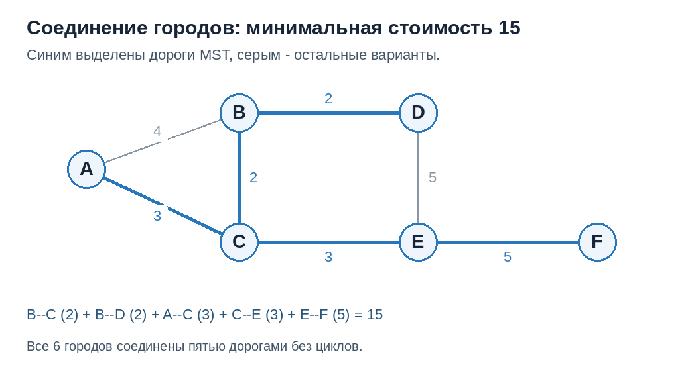
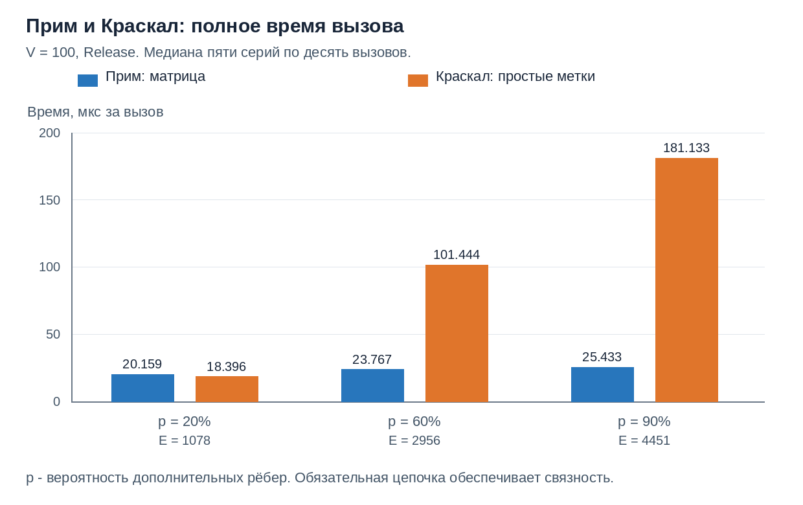
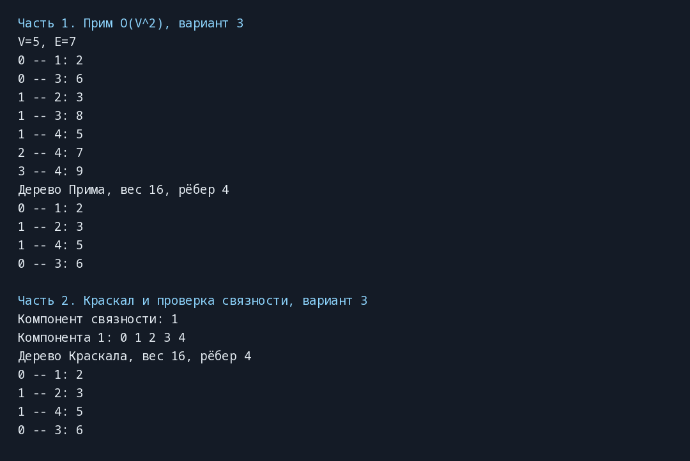
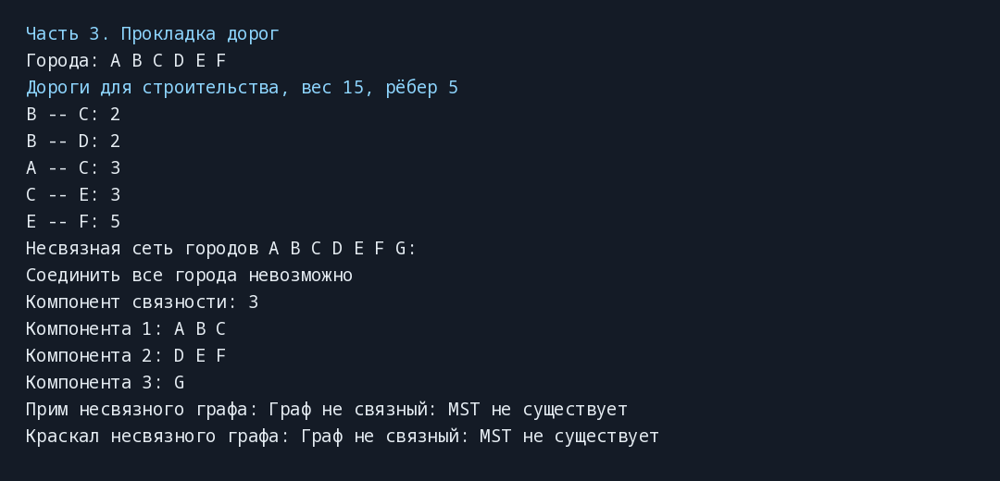
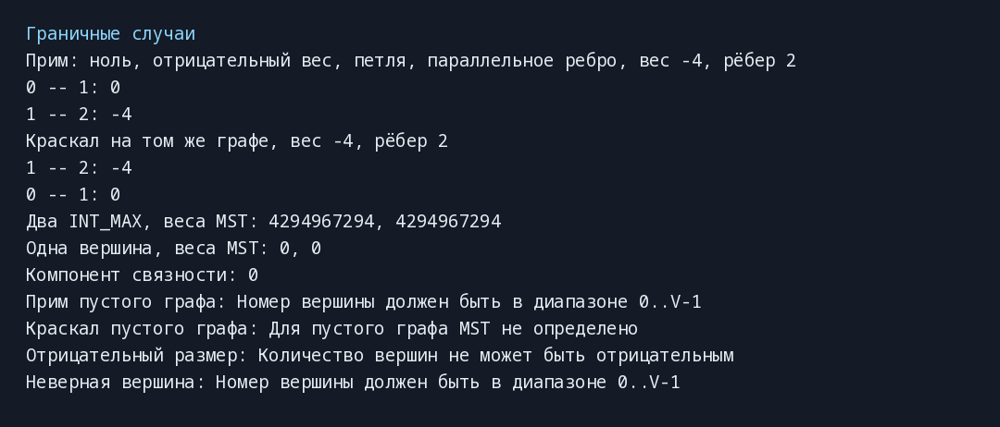

# Отчет по лабораторной работе 13

МИНИСТЕРСТВО НАУКИ И ВЫСШЕГО ОБРАЗОВАНИЯ
РОССИЙСКОЙ ФЕДЕРАЦИИ
Федеральное государственное автономное
образовательное учреждение высшего образования
«СЕВЕРО-КАВКАЗСКИЙ ФЕДЕРАЛЬНЫЙ УНИВЕРСИТЕТ»
Институт информационных технологий и кибер безопасности
Департамент цифровых, робототехнических систем и электроники
Кафедра программной инженерии

**Тема:** Алгоритмы Прима и Краскала. Минимальное остовное дерево

**Вариант:** 3. Все три части, без уровней сложности

**Выполнил:**
Студент группы ПИЖ-б-о-25-2 (2),
направление подготовки: 09.03.04
“Программная инженерия”

Кравцун Михаил Алексеевич

**Проверил:**
Ассистент межинститутской базовой кафедры департамента цифровых,
робототехнических систем и электроники института перспективной
инженерии

Белик Ангелина Игоревна

---

## Репозиторий

[GitHub: Algorithms-Data-structures, лабораторная работа 13 второго курса](https://github.com/WhXteBeXr/Algorithms-Data-structures/tree/main/course-2/lab13)

## Цель работы

Реализовать алгоритмы Прима и Краскала, получить рёбра минимального остовного дерева и проверить связность. Решить задачу соединения городов дорогами минимальной суммарной стоимости и сравнить алгоритмы на графах разной плотности.

## Постановка задачи

Выполнены вариант 3 обеих индивидуальных частей и общая задача. Разделения на уровни сложности нет.

| Часть | Требования |
| --- | --- |
| 1. Прим | Без очереди приоритетов, O(V²), восстановление дерева |
| 2. Краскал | Простая сортировка, проверка связности графа |
| 3. Применение | Соединить все города с минимальной стоимостью, вывести дороги, при несвязности вывести компоненты |

В реализации Краскала сортировка рёбер выполняется std::sort, принадлежность компонентам хранится простыми метками с полным переименованием при объединении. Оптимизированная DSU не добавляется, она отдельно указана в соседних вариантах. Её принцип рассматривается в теории и ответах на вопросы.

Оба алгоритма работают с неориентированным графом. Демонстрации заданы в main.cpp, ввод не требуется. Дополнительно проверяются нулевые и отрицательные веса, петли, параллельные дороги, пустая сеть и большие суммы.

## Теоретическая часть

### Минимальное остовное дерево

Остовное дерево связного графа содержит все V вершин, не имеет циклов и включает V-1 ребро. MST минимизирует сумму весов этих рёбер. Это задача об общей стоимости сети, а не о кратчайших маршрутах между каждой парой городов.

Для любого разреза минимальное пересекающее его ребро можно включить в некоторое MST. Если оно строго легче всех остальных пересекающих рёбер, оно входит в каждое MST. Единственное самое тяжёлое ребро цикла не входит ни в одно MST. При равных максимальных весах нельзя утверждать, что все такие рёбра запрещены. Различные веса всех рёбер гарантируют единственность MST, но это не необходимое условие.

Отрицательные и нулевые веса допустимы: дерево не содержит циклов, повторное прохождение отрицательных циклов не рассматривается. Петля не соединяет разные вершины и в остов не включается. Из параллельных рёбер более тяжёлое не даёт преимущества при прочих равных.

### Прим

Прим наращивает одно дерево. Для каждой внешней вершины minEdge хранит вес самого дешёвого ребра из уже включённых вершин, parent его второй конец. На шаге выбирается минимум среди внешних вершин, соответствующее ребро добавляется в результат, оценки соседей обновляются.

MinEdge не является суммарным расстоянием от старта. В отличие от Дейкстры, здесь сравнивается вес одного ребра, а не сумма пройденного пути. Если все оставшиеся оценки бесконечны, граф несвязный.

### Краскал и компоненты

Краскал сортирует рёбра по возрастанию веса. Ребро принимается, если его концы принадлежат разным компонентам текущего леса. Объединение компонент не создаёт цикл. После V-1 принятого ребра получается остов, а если рёбра закончились раньше, соединить все вершины нельзя.

В выбранной простой реализации метка каждой вершины сразу равна номеру её компоненты. Проверка двух меток O(1), успешное объединение требует просмотра всех V вершин и замены одной метки другой. Всего успешных объединений не более V-1.

DSU хранит дерево родителей, ищет представителя через find и объединяет корни. Сжатие путей и объединение по рангу или размеру дают амортизированное O(α(V)) на операцию. Это ускоряет объединения, но отличается от используемого варианта с простыми метками.

## Исходные файлы

[Graph.h](Graph.h) объявляет граф, ребро и результат MST. [Graph.cpp](Graph.cpp) реализует хранение списка рёбер, Прима, Краскала и выделение компонент через общую операцию объединения меток. Прим строит временную матрицу с минимальным весом каждой пары, Краскал сортирует копию списка.

[Comparison.h](Comparison.h) и [Comparison.cpp](Comparison.cpp) готовят связные случайные графы и измеряют время. [main.cpp](main.cpp) демонстрирует все части, выводит числовые вершины и названия городов. [CMakeLists.txt](CMakeLists.txt) создаёт цель c2-lab13 для отдельной и общей сборки. Готовые алгоритмы MST не используются.

## Существенные детали

- Вершины нумеруются от 0 до V-1. Список хранит каждое неориентированное ребро один раз, концы нормализуются по возрастанию. Параллельные рёбра остаются отдельными возможными дорогами.
- Перед добавлением проверяются оба конца. Ошибочный номер вызывает out_of_range, отрицательное число вершин invalid_argument.
- Временная матрица Прима использует int64_t и отдельную метку INF, поэтому нулевой вес и INT_MAX не путаются с отсутствием ребра.
- Для параллельных дорог матрица сохраняет минимум. Корень Прима не добавляет искусственного ребра, остальные восстанавливаются через parent.
- Краскал при равных весах дополнительно сравнивает номера концов, поэтому результат воспроизводим. Исходный список не сортируется на месте.
- Объединение меток всегда сохраняет меньшую. Итоговые компоненты выводятся по минимальному номеру, вершины внутри по возрастанию.
- Несвязность приводит к domain_error, частичное дерево не выдаётся как MST. Прикладная функция сначала получает компоненты и выводит их вместо попытки построить общую сеть.
- У одной вершины остов содержит 0 рёбер и имеет вес 0. Для пустого графа компонент 0, Прим не имеет допустимого старта, Краскал сообщает, что MST не определено.
- Сумма весов хранится в int64_t. В используемой среде 32-битные int-веса и не более V-1 выбранного ребра при int-размере V укладываются в этот тип. Два INT_MAX дают 4294967294.
- Все буферы принадлежат vector. Алгоритмы не меняют исходный граф, рекурсивных вызовов и ручного управления памятью нет.

## Анализ сложности

V - число вершин, E - число записей рёбер, включая возможные параллельные. Сам граф хранится списком и занимает O(V+E) как верхняя оценка, непосредственно поля объекта и список требуют O(E+1).

| Операция | Время | Дополнительная память |
| --- | --- | --- |
| Создание графа с заданным V | O(1) | O(1), списки на каждую вершину не создаются |
| Добавление ребра | Амортизированное O(1) | Одна запись, при росте vector возможна реаллокация |
| Печать | O(E) | O(1) |
| Прим, включая подготовку матрицы | O(V²+E) | O(V²), плюс O(V) результат и рабочие массивы |
| Краскал с простыми метками | O(E log(E+1)+V²) | O(E+V) |
| Компоненты с теми же метками | O(E+V²) верхняя оценка | O(V) |

Для простого графа E = O(V²), поэтому Прим имеет требуемое O(V²). Если разрешить произвольно много параллельных записей, их чтение добавляет O(E). В Краскале сортировка O(E log(E+1)), проверка всех рёбер O(E), не более V-1 успешных объединений по O(V). Поэтому оценка оптимизированного DSU-варианта O(E log E) без оговорок здесь не используется.

Точнее, выделение компонент занимает O(V+E+U·V), где U - число успешных объединений. Эта верхняя оценка может быть избыточной, например если успешных объединений мало.

| Свойство | Прим в работе | Краскал в работе |
| --- | --- | --- |
| Подход | Рост одного дерева от старта | Объединение компонент леса |
| Подготовка | Матрица из списка рёбер | Копия и сортировка списка |
| Защита от циклов | Добавляется только новая вершина | Различие меток концов |
| Результат | Рёбра через parent | Принятые рёбра отсортированного списка |
| Влияние плотности | Основной цикл зависит от V² | С ростом E дорожает сортировка |

## Сборка и запуск

Из корня репозитория:

```bash
cmake -S course-2/lab13 -B /tmp/algorithms-c2-lab13-release -DCMAKE_BUILD_TYPE=Release
cmake --build /tmp/algorithms-c2-lab13-release
/tmp/algorithms-c2-lab13-release/c2-lab13
```

В общем проекте используется цель c2-lab13. Выполнены сборка и запуск в Release отдельно и в Debug через корневой CMake. GCC 16.2.1, C++20, -Wall, -Wextra, -Wpedantic, предупреждений нет. Демонстрации и математические результаты совпадают, времена различаются. Все примеры находятся в main.cpp, отдельных тестовых целей нет.

## Результаты

### Части 1 и 2

Для графа из 5 вершин и 7 рёбер оба алгоритма выбирают 0--1 веса 2, 1--2 веса 3, 1--4 веса 5, 0--3 веса 6. Общий вес 16, число рёбер 4. Выделение компонент даёт одну группу [0 1 2 3 4].

### Часть 3. Строительство дорог

Исходные варианты дорог: A--B = 4, A--C = 3, B--C = 2, B--D = 2, C--E = 3, D--E = 5, E--F = 5.

| Строящаяся дорога | Стоимость |
| --- | ---: |
| B--C | 2 |
| B--D | 2 |
| A--C | 3 |
| C--E | 3 |
| E--F | 5 |
| **Всего** | **15** |

Минимальная стоимость по этим исходным весам равна 2+2+3+3+5 = 15. В числовом итоге примера методички указано 16, хотя перечисленные там же выбранные дороги дают 15. В работе используется сумма исходных стоимостей.



В отдельной несвязной сети получены три компоненты: [A B C], [D E F], [G]. Программа сообщает, что соединить все города имеющимися дорогами невозможно. Оба прямых вызова MST также отклоняют эту сеть.

### Граничные случаи

| Пример | Результат |
| --- | --- |
| Ребро веса 0 и ребро веса -4 | Оба включаются, общий вес -4 |
| Отрицательная петля веса -100 | Не входит в остов |
| Параллельное ребро 0--1 веса 2 | Предпочтено ребро той же пары веса 0 |
| Две дороги INT_MAX | Вес 4294967294 у обоих алгоритмов |
| Одна вершина | Вес 0 у обоих алгоритмов |
| Пустой граф | Компонент 0, запросы MST перехвачены как ошибки |
| Отрицательный размер и неверный номер | Перехвачены исключения |

### Сравнение производительности

Используются V = 100 и три вероятности дополнительных рёбер p = 20%, 60%, 90%, как в сравнительном примере методички. Обязательная цепочка 0--1--...--99 гарантирует связность. Для остальных пар ребро добавляется независимо с вероятностью p, вес равномерно выбирается из 1..100. Seed генератора mt19937 равен 2026+p, фактическое E выводится отдельно. Значение p не является точно заданной плотностью итогового графа.

Все три набора имеют постоянную вероятность ребра, поэтому в асимптотическом смысле E растёт как V². Название «разреженный» для первого набора означает лишь меньшую плотность относительно двух других, а не E = O(V).

Оба алгоритма получают один объект графа. До замеров сверяются вес и число выбранных рёбер V-1. Далее выполняются пять серий по десять полных вызовов, порядок алгоритмов чередуется. Steady_clock измеряет серию, результат делится на 10, в таблицу идёт медиана пяти средних.

Время включает создание матрицы Прима, копирование и сортировку списка Краскала, рабочие контейнеры, формирование и освобождение результата. Подготовка графа, предварительная сверка и вывод находятся вне измерений. Вес каждого результата добавляется в контрольную сумму, она проверяется против 50-кратного ожидаемого веса и между алгоритмами.

| p | E | Вес MST | Прим, мкс за вызов | Краскал, мкс за вызов | Сумма за 50 вызовов |
| ---: | ---: | ---: | ---: | ---: | ---: |
| 20% | 1078 | 651 | 20.159 | 18.396 | 32550 |
| 60% | 2956 | 215 | 23.767 | 101.444 | 10750 |
| 90% | 4451 | 170 | 25.433 | 181.133 | 8500 |



В сохранённой Release-сборке с -O3 на первом наборе Краскал немного быстрее: 18.396 против 20.159 мкс. При большем числе рёбер его сортировка становится дороже, на третьем наборе получены 181.133 против 25.433 мкс. Это сравнение конкретных реализаций с подготовкой представлений, оно не является универсальной гарантией преимущества одного алгоритма.

Веса двух алгоритмов совпадают на всех трёх графах. Плотность, веса, кэш, распределение памяти и фоновая нагрузка влияют на точные времена. Последовательность повторяется в данной среде, но реализация стандартных случайных распределений может отличаться между библиотеками.

Полный [вывод программы](media/program-output.txt) сохранён в media.








## Контрольные вопросы

### 1. Что такое MST?

Остовное дерево связного неориентированного взвешенного графа с минимальной суммой весов. Содержит все вершины и V-1 ребро, циклов нет. Для несвязного графа общего остовного дерева не существует.

### 2. Какие свойства имеет MST?

Минимальная суммарная стоимость, связность и отсутствие циклов. Безопасное минимальное ребро разреза можно включать жадно. Единственное самое тяжёлое ребро цикла исключается. При равных весах возможны разные MST, разные веса всех рёбер гарантируют единственность.

### 3. В чём идея Прима?

Начать с одной вершины и каждый раз выбирать самое дешёвое ребро между уже построенным деревом и внешними вершинами. Обновлять лучшие связи соседей и сохранять родителей для восстановления.

### 4. Какова сложность Прима на матрице?

O(V²) времени: V раз выбирается минимум линейным просмотром и проверяется строка матрицы. Рабочие массивы O(V), сама матрица O(V²). В данной реализации ещё читается входной список для её подготовки.

### 5. Какова сложность Прима с очередью приоритетов?

Со списком смежности и двоичной кучей O((V+E) log V) для обычного простого графа. При ленивом добавлении обновлённых оценок устаревшие записи пропускаются. Выбранный вариант 3 использует матрицу без очереди.

### 6. В чём идея Краскала?

Отсортировать все рёбра по возрастанию веса и принимать только рёбра между разными текущими компонентами. Каждое такое ребро уменьшает число компонент на одну, циклы не возникают.

### 7. Что такое DSU и как она применяется?

Система непересекающихся множеств хранит представителя каждой компоненты. Find сравнивает компоненты концов, unite объединяет разные. Сжатие путей и объединение по рангу делают операции почти постоянными амортизированно. В нашем варианте вместо деревьев DSU используется массив готовых меток и линейное переименование.

### 8. Какова сложность Краскала?

С оптимизированной DSU O(E log E + (V+E)α(V)), обычно основная стоимость - сортировка. У простой реализации в работе O(E log(E+1)+V²), потому что успешное объединение просматривает все метки. Нельзя переносить оценку DSU-варианта без учёта этого отличия.

### 9. Когда Прим эффективнее?

Для плотного графа, особенно уже заданного матрицей, когда O(V²) удобнее сортировки большого числа рёбер. Конкретный результат зависит от представления и реализации. В опыте это видно при p = 60% и 90%.

### 10. Когда Краскал эффективнее?

Когда граф задан коротким списком рёбер и сортировать его недорого, особенно с оптимизированной DSU. Для большого разреженного графа матрица Прима расходовала бы лишнюю память. Простые метки в данной работе также требуют учитывать стоимость объединений.

### 11. Как проверить минимальность дерева?

Сначала проверить остовность: все вершины, связность и отсутствие циклов. Затем для каждого непетлевого ребра исходного графа, не входящего в дерево, убедиться, что его вес не меньше максимума на пути между его концами в дереве. Иначе заменой можно уменьшить стоимость. Совпадение весов независимых корректных алгоритмов - полезная дополнительная сверка, но одно число без структуры не доказывает минимальность.

### 12. Что произойдёт при несвязности?

Общего MST нет. Краскал мог бы получить минимальный остовный лес, Прима можно запускать отдельно для компонент. В работе оба метода требуют полное MST и сообщают об ошибке, прикладная часть выводит компоненты и не объявляет частичную стоимость решением всей задачи.

### 13. Как получить максимальное остовное дерево?

У Краскала сортировать по убыванию веса и оставить ту же проверку компонент. У Прима выбирать максимальное ребро разреза и хранить лучшие оценки по максимуму с подходящей меткой отсутствия связи. Отрицательные веса также допустимы.

### 14. Где применяются MST?

Прокладка кабелей, дорог и трубопроводов при минимизации общей стоимости соединения, построение базовой сети и некоторые методы кластеризации. MST не обеспечивает резервирование при обрыве ребра и не минимизирует каждый маршрут, дополнительные требования меняют задачу.

### 15. Как найти второе по минимальности дерево?

Построить MST, затем пробовать добавить не входящее в него ребро между различными вершинами. Оно создаёт цикл, удаление подходящего ребра этого цикла даёт другой остов. Для минимальной альтернативы рассматривают максимальные веса на пути и выбирают наименьшую итоговую стоимость. При равных весах другое MST может стоить столько же. Если нужен строго больший вес, для каждого добавления ищут наибольший вес пути, строго меньший веса добавленного ребра, и минимальный положительный прирост. Это требует учитывать не только один максимальный вес, но иногда и следующий отличный от него.

## Вывод

Выполнены все части варианта 3. Получены рёбра и веса MST, реализована проверка связности и вывод компонент для невозможной общей сети. Для примера дорог минимальная стоимость равна 15 по исходным весам. Демонстрации охватывают отрицательные и нулевые веса, петли, параллельные варианты и пустой граф. Измерения показывают влияние числа рёбер и учитывают выбранную простую реализацию объединения компонент.
