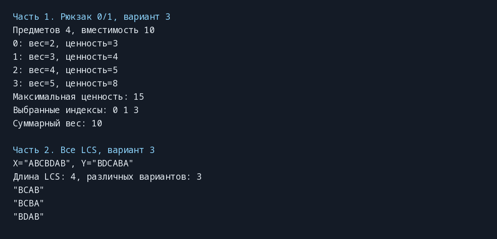
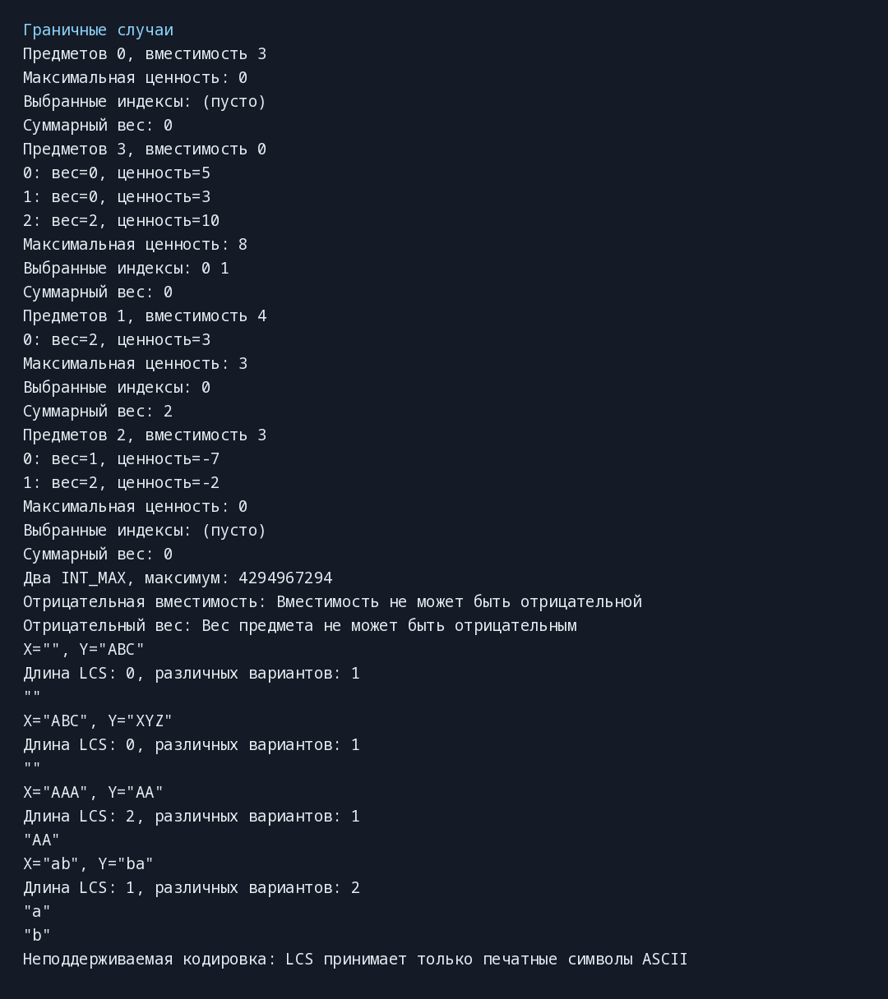
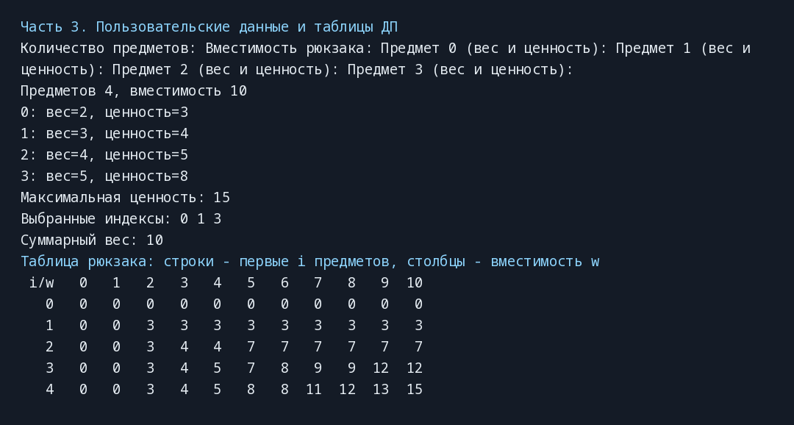
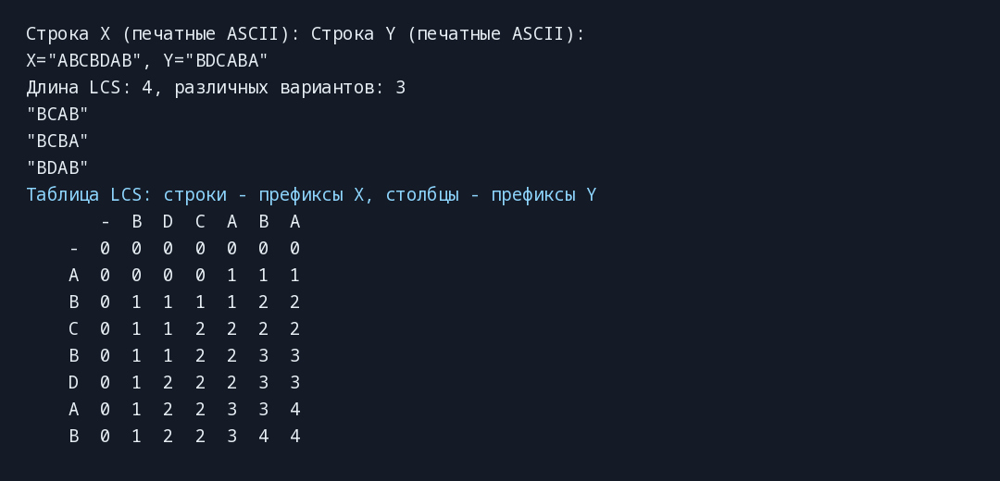

# Отчет по лабораторной работе 14

МИНИСТЕРСТВО НАУКИ И ВЫСШЕГО ОБРАЗОВАНИЯ
РОССИЙСКОЙ ФЕДЕРАЦИИ
Федеральное государственное автономное
образовательное учреждение высшего образования
«СЕВЕРО-КАВКАЗСКИЙ ФЕДЕРАЛЬНЫЙ УНИВЕРСИТЕТ»
Институт информационных технологий и кибер безопасности
Департамент цифровых, робототехнических систем и электроники
Кафедра программной инженерии

**Тема:** Динамическое программирование. Задача о рюкзаке. Наибольшая общая подпоследовательность (LCS)

**Вариант:** 3. Все три части, без уровней сложности

**Выполнил:**
Студент группы ПИЖ-б-о-25-2 (2),
направление подготовки: 09.03.04
“Программная инженерия”

Кравцун Михаил Алексеевич

**Проверил:**
Ассистент межинститутской базовой кафедры департамента цифровых,
робототехнических систем и электроники института перспективной
инженерии

Белик Ангелина Игоревна

---

## Репозиторий

[GitHub: Algorithms-Data-structures, лабораторная работа 14 второго курса](https://github.com/WhXteBeXr/Algorithms-Data-structures/tree/main/course-2/lab14)

## Цель работы

Освоить табличное динамическое программирование, решить рюкзак 0/1 с целыми данными и найти все различные LCS двух строк. Восстановить выбранные предметы и подпоследовательности, вывести таблицы для пользовательских данных.

## Постановка задачи

Выполнены вариант 3 обеих индивидуальных частей и общая третья часть. Уровни сложности отдельно не выделены.

| Часть | Требования |
| --- | --- |
| 1. Рюкзак | Двумерная таблица, целочисленные веса и ценности |
| 2. LCS | Табличный метод, все варианты LCS |
| 3. Применение | Запрос предметов, вместимости и двух строк, оптимальные решения, выбранные предметы, LCS и таблицы ДП |

Рюкзак возвращает один оптимальный набор, LCS - все различные оптимальные строки, без ограничения их количества. Длины LCS вычисляются снизу вверх, мемоизация применяется только к восстановлению всех строк по готовой таблице.

## Теоретическая часть

### Принципы ДП

Динамическое программирование использует оптимальную подструктуру и перекрывающиеся подзадачи. Состояние описывает небольшой фрагмент задачи, переход связывает его с уже решёнными состояниями. Сохранение ответов предотвращает повторное решение одинаковых подзадач.

Top-down начинает с нужного состояния и рекурсивно вычисляет зависимости, сохраняя результаты. Bottom-up заполняет таблицу в порядке зависимостей. Оба подхода могут использовать одну рекуррентную формулу, но отличаются управлением обходом и стеком.

### Рюкзак 0/1

Каждый из N предметов имеет вес и ценность, вместимость W ограничивает суммарный вес. Нужно максимизировать ценность, каждый индекс доступен не более одного раза.

Состояние dp[i][w] - максимальная ценность среди первых i предметов при вместимости w. Сначала сохраняется вариант без предмета i-1. Если его вес не больше w, он сравнивается с dp[i-1][w-weight]+value. Обе альтернативы используют предыдущую строку, поэтому предмет нельзя взять повторно.

В работе допускаются неотрицательные веса, включая 0, и любые int-ценности. Отрицательно ценный предмет можно не брать. Для нулевых весов вычисляется и столбец 0, он не обязан оставаться нулевым. Начальная строка без предметов всегда равна 0.

Восстановление идёт от последней строки к первой. Если значение отличается от предыдущей строки с той же вместимостью, предмет взят, его индекс добавляется, остаток уменьшается на вес. При равенстве выбирается вариант без этого предмета. Индексы разворачиваются в возрастающий порядок.

### Все LCS

Подпоследовательность получается удалением символов с сохранением порядка, непрерывность не нужна. Состояние dp[i][j] - длина LCS префиксов X и Y длины i и j. Для совпавших последних символов берётся диагональ плюс 1, для разных максимум сверху и слева. Нулевые строка и столбец равны 0.

Восстановление всех вариантов следует только переходам, сохраняющим оптимальную длину. При совпадении дописывается общий символ ко всем ответам диагонали. При несовпадении исследуются верхняя и левая ветви, если они имеют текущий оптимум. Set объединяет ответы, удаляет одинаковые строки и задаёт лексикографический порядок.

Для каждого посещённого состояния множество ответов кешируется. Пустая LCS представлена множеством из одной пустой строки: это правильная основа для последующего дописывания символов. Разные выравнивания одной строки не считаются разными LCS.

## Исходные файлы

[Knapsack.h](Knapsack.h) и [Knapsack.cpp](Knapsack.cpp) объявляют предмет и результат, заполняют двумерную таблицу, проверяют данные и восстанавливают один набор. Ценности таблицы имеют тип int64_t, индексы - size_t.

[Lcs.h](Lcs.h) и [Lcs.cpp](Lcs.cpp) содержат результат с длиной, множеством строк и таблицей, проверку алфавита и восстановление с кешем множеств. [main.cpp](main.cpp) показывает примеры, граничные случаи и пользовательский ввод с печатью обеих таблиц. [CMakeLists.txt](CMakeLists.txt) создаёт цель c2-lab14 для отдельной и общей сборки. Готовые решатели задач не используются, set служит только для хранения различных восстановленных строк.

## Детали реализации

- Вместимость и веса должны быть неотрицательными, нарушение вызывает invalid_argument. Размеры таблиц вычисляются после проверки, вместимость преобразуется в size_t до прибавления 1.
- Ценности могут быть отрицательными. Пустой набор допустим, поэтому максимум не меньше 0. Положительное переполнение int64_t проверяется до сложения.
- Обратный проход рюкзака продолжается и при остатке 0, чтобы не потерять выбранные предметы нулевого веса. Число рассматриваемых предметов на каждом шаге уменьшается.
- LCS работает с печатными символами ASCII, учитывает регистр и пробелы. Неподдерживаемые байты вызывают invalid_argument. Кириллица отдельным вариантом не реализуется.
- Кеш восстановления LCS содержит optional<set<string>>. Отсутствующее значение означает «ещё не вычислено», готовое множество хранит уже найденные ответы состояния.
- Таблица и кеш заранее имеют фиксированные размеры, ссылки на множества остаются действительными во время рекурсивных вызовов. Зависимости всегда уменьшают i+j и не образуют циклов.
- Готовое множество последнего состояния переносится из кеша в результат, промежуточные множества освобождаются. Таблицы и строки принадлежат стандартным контейнерам, ручного управления памятью нет.
- Все различные LCS выводятся полностью. Число ответов может быть экспоненциальным, поэтому большие входы могут требовать много времени и памяти. Сама рекурсия восстановления также использует стек глубины O(m+n).
- Числа читаются через cin, строки через getline после удаления остатка числовой строки. Пустые строки допустимы, пробелы сохраняются. Ошибочный ввод завершает программу с сообщением и кодом 1.

## Сложность

N - число предметов, W - вместимость, m и n - длины строк. Для рюкзака обозначим T = (N+1)(W+1), для LCS P = (m+1)(n+1).

| Этап | Время | Память |
| --- | --- | --- |
| Таблица рюкзака | O(T), обычно записывается O(NW) | O(T) |
| Восстановление предметов | O(N) | O(N) под результат |
| Таблица длин LCS | O(P), обычно O(mn) | O(P) |
| Вывод таблиц | Пропорционален числу ячеек и печатаемых цифр | O(1) сверх готовых данных |
| Вывод всех LCS | Пропорционален суммарному размеру строк результата | Результат уже хранится в set |

Сложность перечисления всех LCS нельзя ограничить O(mn). Пусть K - наибольшее число строк в одном из кешируемых множеств, L = min(m,n). Безопасная верхняя оценка времени восстановления O(P·K·(L+1)·log(K+1)), памяти O(P·K·(L+1)) плюс стек O(m+n). Здесь учитываются копирование строк и сравнения в set. K относится ко всем кешируемым состояниям, а не только к окончательному ответу.

Рюкзак имеет псевдополиномиальную сложность по численному W, а не полиномиальную по числу бит его записи. Полная таблица выбрана согласно варианту и позволяет восстановить решение. Одномерная оптимизация уменьшила бы память для стоимости, но потребовала бы отдельного подхода к восстановлению.

### Сопоставление подходов

| Подход | Что сохраняет | Особенность |
| --- | --- | --- |
| Наивная рекурсия | Только стек | Повторно решает одинаковые подзадачи |
| Top-down с мемоизацией | Кеш состояний и стек | Вычисляет запрошенные зависимости |
| Bottom-up | Таблицу состояний | Явный порядок, нет рекурсии при вычислении значений |
| Реализация LCS в работе | Таблицу длин и кеш множеств восстановления | Bottom-up для длин, восстановление только оптимальных ветвей |

## Сборка и запуск

Из корня репозитория:

```bash
cmake -S course-2/lab14 -B /tmp/algorithms-c2-lab14-release -DCMAKE_BUILD_TYPE=Release
cmake --build /tmp/algorithms-c2-lab14-release
/tmp/algorithms-c2-lab14-release/c2-lab14
```

После демонстраций нужно ввести количество предметов, вместимость, пары «вес ценность», затем две отдельные строки ASCII. Для повторения сохранённого примера можно использовать [готовый ввод](media/example-input.txt):

```bash
/tmp/algorithms-c2-lab14-release/c2-lab14 < course-2/lab14/media/example-input.txt
```

В общем проекте используется цель c2-lab14. Выполнены сборка и запуск в Release отдельно и в Debug через корневой CMake. GCC 16.2.1, C++20, -Wall, -Wextra, -Wpedantic, предупреждений нет. Для сохранённого ввода вывод обеих сборок совпадает. Отдельных тестовых целей нет, все демонстрации находятся в main.cpp.

## Результаты

### Основные примеры

| Задача | Данные | Результат |
| --- | --- | --- |
| Рюкзак | Веса 2,3,4,5, ценности 3,4,5,8, W = 10 | Максимум 15, индексы 0,1,3, вес 10 |
| Все LCS | X = ABCBDAB, Y = BDCABA | Длина 4, строки BCAB, BCBA, BDAB |

Для рюкзака выбранные предметы дают вес 2+3+5 = 10 и ценность 3+4+8 = 15. Указанный в примере методички результат 13 не является оптимальным для этих данных. Набор 0 и 3, также приведённый там, имел бы ценность 11. Программа использует фактический максимум.

Для LCS получены все три различные строки. BCBA из примера методички является одним из допустимых оптимумов, а не единственным ответом.

### Граничные случаи

| Пример | Результат |
| --- | --- |
| Нет предметов, W = 3 | Максимум 0, набор пуст |
| Предметы (0,5), (0,3), (2,10), W = 0 | Максимум 8, выбраны 0 и 1 |
| Один предмет (2,3), W = 4 | Максимум 3, повторное использование запрещено |
| Отрицательные ценности -7 и -2 | Выбран пустой набор с ценностью 0 |
| Два предмета ценности INT_MAX | Максимум 4294967294 |
| Отрицательная вместимость или вес | Перехвачены исключения |
| Пустая строка и ABC | Длина 0, единственная LCS - пустая строка |
| ABC и XYZ | Длина 0, единственная LCS - пустая строка |
| AAA и AA | Только AA, несмотря на разные выравнивания |
| ab и ba | Длина 1, варианты a и b |
| Кириллица | Перехвачена ошибка неподдерживаемого алфавита |

### Пользовательская часть

В сохранённом запуске введены четыре предмета и строки основного примера. Максимум рюкзака 15 находится в dp[4][10], восстановлены индексы 0,1,3. Последняя строка таблицы по вместимостям 0..10: 0, 0, 3, 4, 5, 8, 8, 11, 12, 13, 15.

В таблице LCS последний элемент dp[7][6] равен 4. Из равных оптимальных переходов получены три ответа BCAB, BCBA и BDAB. Обе полные таблицы выводятся после соответствующих результатов.

Полный [вывод программы](media/program-output.txt) сохранён в media.









## Контрольные вопросы

### 1. Что такое ДП и на каких принципах основано?

Решение задачи через сохранённые ответы меньших подзадач. Нужны оптимальная подструктура, повторяющиеся состояния и корректный порядок зависимостей. Сохранение ответов устраняет повторные вычисления.

### 2. Чем отличаются top-down и bottom-up?

Top-down рекурсивно запрашивает нужные состояния и кеширует их, bottom-up заполняет таблицу от базовых состояний. Оба могут иметь одинаковую асимптотику, но различаются стеком, порядком и количеством реально вычисленных зависимостей.

### 3. Как формулируется рюкзак 0/1?

Выбрать подмножество предметов с максимальной суммой ценностей при ограничении суммарного веса W. Каждый предмет либо берётся целиком один раз, либо пропускается.

### 4. Какова сложность табличного рюкзака?

O(NW) времени и O(NW) памяти для полной двумерной таблицы при положительных размерах. С учётом нулевых границ точнее O((N+1)(W+1)). Восстановление одного набора добавляет O(N).

### 5. Почему в одномерной оптимизации веса идут назад?

Чтобы dp[w-weight] ещё относилось к предыдущему набору предметов. При проходе вперёд новое значение могло бы снова использовать текущий предмет, что превращает задачу в рюкзак с повторениями. Для нулевого веса каждый элемент строки всё равно должен обрабатываться ровно один раз на предмет.

### 6. Как восстановить предметы?

Идти по i от N к 1. Если dp[i][w] отличается от dp[i-1][w], взять предмет i-1 и уменьшить w на его вес. Иначе пропустить. При равенстве допустим выбор без предмета, после прохода индексы разворачиваются.

### 7. Что такое LCS?

Самая длинная строка, являющаяся подпоследовательностью обеих исходных строк. Символы сохраняют взаимный порядок, но могут быть разделены пропущенными символами. Оптимальных строк может быть несколько.

### 8. Какова сложность LCS?

Вычисление длины стандартной таблицей O(mn) по времени и памяти. Восстановление одной строки занимает O(m+n), перечисление всех различных LCS может потребовать экспоненциального времени и памяти из-за числа ответов.

### 9. Чем подпоследовательность отличается от подстроки?

Подстрока непрерывна, подпоследовательность допускает пропуски. Например, AC - подпоследовательность ABC, но не её подстрока.

### 10. Как восстановить LCS по таблице?

При совпадении последних символов перейти по диагонали и добавить символ. При несовпадении двигаться туда, где сохраняется оптимальная длина. Для одного ответа можно выбрать одну из равных ветвей, для всех нужно объединить обе и удалить одинаковые строки.

### 11. Какие ещё задачи решаются ДП?

Расстояние редактирования, пути в сетке, размен монет, оптимальный порядок умножения матриц, интервальные задачи и подсчёт способов. Состояние и переходы зависят от конкретных ограничений.

### 12. Чем рюкзак 0/1 отличается от рюкзака с повторениями?

В 0/1 каждый индекс используется не более одного раза. В неограниченном варианте один тип предмета можно выбирать много раз, поэтому изменяется зависимость перехода. Нельзя случайно смешивать эти правила при оптимизации таблицы.

### 13. Можно ли вычислить LCS быстрее O(mn)?

Для некоторых входов и моделей - да: используются битовые операции, ограниченное число совпадений или особенности алфавита. Это не означает гарантированное существенно меньшее время для любых двух строк. Перечисление всех ответов в любом случае ограничено их суммарным размером.

### 14. Как адаптировать ДП для трёх строк?

Использовать состояние dp[i][j][k]. При совпадении трёх последних символов брать диагональ плюс 1, иначе максимум после удаления последнего символа одного из трёх префиксов. Стандартные время и память O(mnp).

### 15. Как разрешить брать предмет несколько раз?

Для неограниченного рюкзака переход «взять» обращается к тому же набору типов с меньшей вместимостью, либо одномерный массив просматривается по вместимости вперёд. Для ограничения K используются дополнительные состояния или разложение количества на группы. Нулевой вес с положительной ценностью в неограниченном варианте даёт неограниченный максимум, в 0/1 остаётся конечным.

## Вывод

Выполнены все три части варианта 3. Рюкзак на двумерной таблице восстанавливает один оптимальный набор, LCS возвращает все различные оптимальные строки. Пользовательская часть читает данные и выводит полные таблицы. Проверены нулевые веса, пустые данные, отрицательные ценности и повторяющиеся символы. Отдельно учтено, что квадратичное вычисление длины LCS не делает перечисление всех ответов квадратичным.
