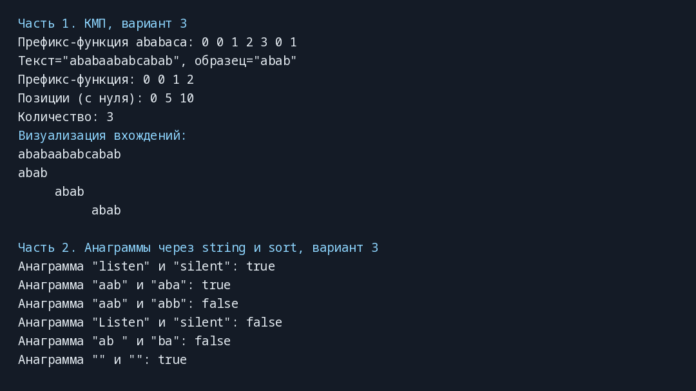
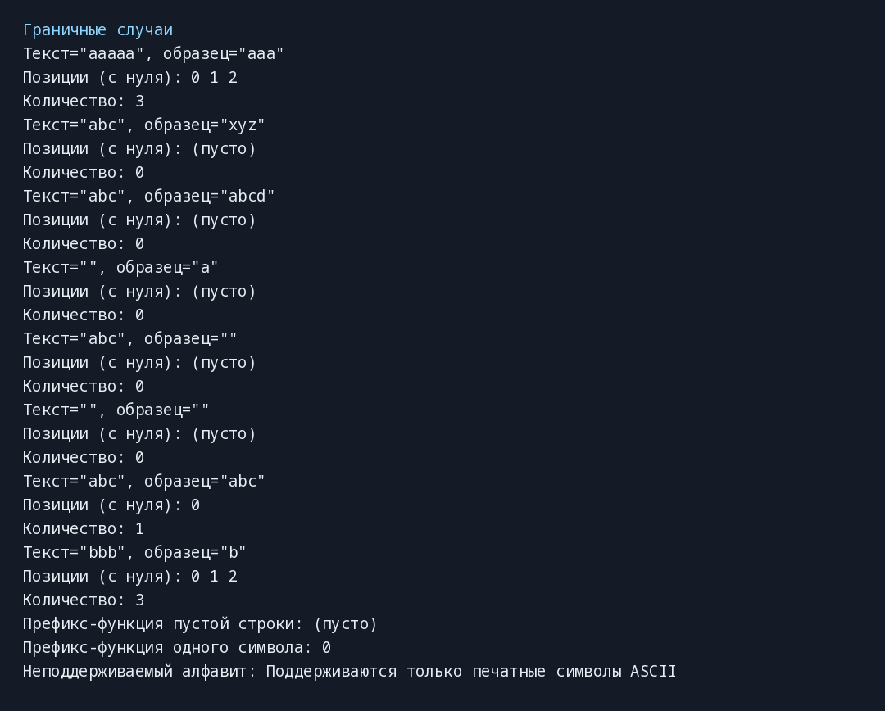
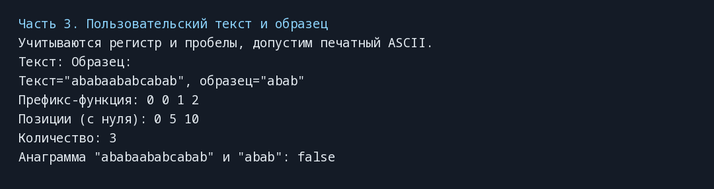

# Отчет по лабораторной работе 15

МИНИСТЕРСТВО НАУКИ И ВЫСШЕГО ОБРАЗОВАНИЯ
РОССИЙСКОЙ ФЕДЕРАЦИИ
Федеральное государственное автономное
образовательное учреждение высшего образования
«СЕВЕРО-КАВКАЗСКИЙ ФЕДЕРАЛЬНЫЙ УНИВЕРСИТЕТ»
Институт информационных технологий и кибер безопасности
Департамент цифровых, робототехнических систем и электроники
Кафедра программной инженерии

**Тема:** Алгоритм Кнута-Морриса-Пратта. STL (обзор)

**Вариант:** 3. Все три части, без уровней сложности

**Выполнил:**
Студент группы ПИЖ-б-о-25-2 (2),
направление подготовки: 09.03.04
“Программная инженерия”

Кравцун Михаил Алексеевич

**Проверил:**
Ассистент межинститутской базовой кафедры департамента цифровых,
робототехнических систем и электроники института перспективной
инженерии

Белик Ангелина Игоревна

---

## Репозиторий

[GitHub: Algorithms-Data-structures, лабораторная работа 15 второго курса](https://github.com/WhXteBeXr/Algorithms-Data-structures/tree/main/course-2/lab15)

## Цель работы

Реализовать префикс-функцию и поиск всех вхождений КМП. Применить string и sort для проверки анаграммы. Объединить алгоритмы в программе, которая читает текст и образец с клавиатуры и выводит результаты обработки.

## Постановка задачи

Выполнены вариант 3 обеих индивидуальных частей и общая третья часть. Уровни сложности отдельно не выделены.

| Часть | Требования |
| --- | --- |
| 1. КМП | Найти и вывести все вхождения образца |
| 2. STL | Проверить анаграмму через sort и string |
| 3. Применение | Считать текст и образец, найти позиции КМП, выполнить дополнительную обработку варианта |

Общая часть использует ввод с клавиатуры. Проверка анаграммы применяется к тем же тексту и образцу. Позиции считаются с нуля, перекрытия сохраняются. Пустой образец даёт пустой список согласно соглашению примеров алгоритма в методичке.

## Теоретическая часть

### Префикс-функция

Префикс-функция π[i] равна длине наибольшего собственного префикса строки pattern[0..i], который также является её суффиксом. Собственный префикс короче всей рассматриваемой строки. Для первого символа значение 0.

Для ababaca результат 0, 0, 1, 2, 3, 0, 1. При переходе к i используется π[i-1]. Если следующий символ не совпал, длина уменьшается до π[j-1], затем проверяется более короткая граница. При совпадении длина увеличивается на один.

### Поиск КМП

КМП хранит длину matched совпавшего префикса образца. Текст просматривается слева направо без возврата его индекса назад. При несовпадении matched уменьшается по префикс-функции, сохраняя уже известное совпадение суффикса текста с префиксом образца.

Когда matched достигает длины образца, начало равно i+1-m. После записи позиции matched получает π[m-1], поэтому возможные перекрывающиеся вхождения не теряются. Например, aaa в aaaaa начинается в 0, 1 и 2.

Хотя внутри прохода есть while, суммарное число откатов линейно: длина совпадения увеличивается не более одного раза на символ и не может стать отрицательной. Построение префикс-функции аналогично занимает линейное время.

### Анаграммы и STL

Две строки являются анаграммами, если состоят из одинаковых символов с одинаковой кратностью. При равной длине сортировка обеих строк даёт одинаковую последовательность тогда и только тогда, когда наборы символов совпадают. В работе сортируются копии, исходные данные не изменяются.

STL объединяет контейнеры, итераторы, алгоритмы и функциональные объекты. Vector хранит таблицу префиксов и позиции, string владеет копиями символов, sort работает с диапазоном итераторов строк. Общий интерфейс итераторов позволяет алгоритму не зависеть от конкретного объекта строки.

## Исходные файлы

[StringAlgorithms.h](StringAlgorithms.h) объявляет prefixFunction, kmpSearch и areAnagrams. [StringAlgorithms.cpp](StringAlgorithms.cpp) содержит проверку алфавита, построение префиксов, поиск и сортировку копий для анаграммы. Логика поиска написана самостоятельно, готовый поиск подстроки не используется.

[main.cpp](main.cpp) демонстрирует алгоритмы и граничные случаи, читает пользовательские строки и выводит результаты. [CMakeLists.txt](CMakeLists.txt) собирает цель c2-lab15 отдельно и в составе общего проекта. Классы с изменяемым состоянием не требуются, функции получают string_view и возвращают самостоятельные значения.

## Детали реализации

- Поддерживаются печатные символы ASCII. Регистр и пробелы значимы, неподдерживаемые символы вызывают invalid_argument. Обработка кириллицы отдельно не добавляется.
- Размеры, значения префикс-функции и позиции имеют тип size_t. При образце длиннее текста поиск возвращает пустой vector, вычитания отрицательных длин нет.
- Пустой образец проверяется до обращения к pattern[matched]. Пустая строка имеет пустую префикс-функцию, строка из одного символа - [0].
- После полного совпадения matched сразу уменьшается к собственной границе образца. Это сохраняет перекрытия и предотвращает обращение к pattern[m] на следующем символе.
- Проверка анаграммы учитывает частоты: aab и aba совпадают, aab и abb нет. Listen и silent не считаются анаграммами, пробелы автоматически не удаляются.
- При разных длинах анаграмма сразу отвергается после проверки допустимости символов. Для одинаковой длины создаются две string-копии и сортируются через std::sort.
- Getline сохраняет пробелы и допускает пустую строку. Отсутствие ввода или недопустимый алфавит завершают программу с сообщением и кодом 1.
- Все буферы принадлежат vector и string. Невладеющие string_view и span используются только во время вызовов, результаты не содержат ссылок на входные строки.

## Анализ сложности

n - длина текста, m - длина образца, r - число найденных позиций. Для анаграммы длины двух строк обозначены a и b, одинаковая длина q.

| Операция | Время | Дополнительная память |
| --- | --- | --- |
| Проверка алфавита | O(n+m) для пары | O(1) |
| Префикс-функция | O(m) | O(m) под возвращаемую таблицу |
| КМП | O(n+m) | O(m) рабочая таблица и O(r) результат |
| Анаграмма при разных длинах | O(a+b) с учётом проверки алфавита | O(1) |
| Анаграмма при одинаковой длине | O(q log(q+1)) | O(q) на две копии |

Для непустого образца r не больше n. Динамическое добавление позиций имеет амортизированную O(1) стоимость, префикс-функция не меняет текст. Линейная валидация сохраняется и в ранних ответах.

| Способ поиска | Худшая оценка | Особенность |
| --- | --- | --- |
| Наивный | O(nm) | Заново проверяет образец после сдвига |
| КМП | O(n+m) | Переиспользует известные границы по π |

Линейная оценка КМП относится к вычислению позиций. Вывод чисел дополнительно зависит от числа цифр, а демонстрационное выравнивание пробелами от суммы позиций. Поэтому выравнивание печатается только для короткого примера, пользовательские вхождения выводятся списком. На коротком образце подготовка таблицы может влиять на практическое время, асимптотика не является обещанием выигрыша в каждом запуске.

## Сборка и запуск

Из корня репозитория:

```bash
cmake -S course-2/lab15 -B /tmp/algorithms-c2-lab15-release -DCMAKE_BUILD_TYPE=Release
cmake --build /tmp/algorithms-c2-lab15-release
/tmp/algorithms-c2-lab15-release/c2-lab15
```

После демонстраций нужно ввести две отдельные строки: сначала текст, затем образец. Для повторения сохранённого запуска есть [пример ввода](media/example-input.txt):

```bash
/tmp/algorithms-c2-lab15-release/c2-lab15 < course-2/lab15/media/example-input.txt
```

В общем проекте используется цель c2-lab15. Выполнены сборка и запуск в Release отдельно и в Debug через корневой CMake. GCC 16.2.1, C++20, -Wall, -Wextra, -Wpedantic, предупреждений нет. Для сохранённого ввода вывод совпадает. Все демонстрации находятся в main.cpp, отдельных тестовых целей нет.

## Результаты

### Основные примеры

| Пример | Фактический результат |
| --- | --- |
| Префикс-функция ababaca | 0 0 1 2 3 0 1 |
| Префикс-функция abab | 0 0 1 2 |
| abab в ababaababcabab | Позиции 0, 5, 10, всего 3 |
| listen и silent | true |
| aab и aba | true |
| aab и abb | false |
| Listen и silent | false |
| «ab » и «ba» | false, пробел значим |
| Две пустые строки как анаграммы | true |

В примере поиска методички для текста ababaababcabab указаны позиции 0, 2, 6, 10. При фактической проверке подстрока abab присутствует только в 0, 5, 10. Программа выводит позиции, соответствующие исходному тексту.

### Граничные случаи

| Текст / образец | Позиции |
| --- | --- |
| aaaaa / aaa | 0, 1, 2, перекрытия сохранены |
| abc / xyz | Пустой результат |
| abc / abcd | Пустой результат |
| Пустой текст / a | Пустой результат |
| abc / пустой образец | Пустой результат по принятому соглашению |
| Оба пустые | Пустой результат поиска |
| abc / abc | 0 |
| bbb / b | 0, 1, 2 |

Для пустой строки префикс-функция пуста, для a равна [0]. Неподдерживаемый алфавит перехвачен как ошибка. Пустой образец в некоторых интерфейсах мог бы трактоваться как совпадение на всех границах, но здесь используется явное соглашение методички о пустом результате.

### Пользовательская часть

Введены текст ababaababcabab и образец abab. Получена префикс-функция [0,0,1,2], позиции [0,5,10], количество 3. Проверка этих же строк на анаграмму вернула false, поскольку их длины и наборы символов различаются.

Полный [вывод программы](media/program-output.txt) сохранён в media.







## Контрольные вопросы

### 1. В чём идея КМП?

При несовпадении не начинать проверку заново, а перейти к более короткому совпадающему префиксу с помощью таблицы π. Индекс текста остаётся на месте, затем продолжает двигаться вперёд.

### 2. Что такое префикс-функция и как она вычисляется?

Длина наибольшего собственного префикса, совпадающего с суффиксом текущего префикса строки. Для нового символа берётся π[i-1], при несовпадении происходят откаты по π[j-1], при совпадении длина увеличивается.

### 3. Какова сложность КМП и почему?

O(n+m). Подготовка таблицы линейна по m, текст просматривается один раз. Суммарное число уменьшений matched ограничено числом его предыдущих увеличений, поэтому внутренний while не даёт квадратичного времени.

### 4. Как работает откат при несовпадении?

Для совпавшего префикса длины j его самая длинная собственная граница имеет длину π[j-1]. Она уже совпадает с концом просмотренного текста. Проверяется возможность продолжить с этой длины, без повторного чтения всей совпавшей части.

### 5. В чём преимущество перед наивным поиском?

Наивный поиск может многократно сравнивать одни и те же символы, особенно на повторяющихся началах. КМП сохраняет линейную верхнюю оценку, используя предварительную обработку образца. Для маленьких данных важны также постоянные расходы.

### 6. Какие контейнеры STL существуют и когда их выбирать?

Vector для компактной последовательности и доступа по индексу, deque для работы с концами, list для вставок по известной позиции списка. Set и map для упорядоченных ключей, unordered-контейнеры для хешированного доступа. Stack, queue и priority_queue ограничивают интерфейс под конкретную дисциплину обработки.

### 7. Чем vector отличается от list?

Vector хранит элементы непрерывно и даёт O(1) доступ по индексу, но вставка в середину сдвигает элементы, а расширение может инвалидировать адреса и итераторы. List хранит узлы, даёт O(1) вставку или удаление по известному итератору, но доступ к произвольной позиции требует прохода. У него больше затрат на узлы и слабее локальность.

### 8. Чем set отличается от unordered_set?

Set хранит уникальные ключи в порядке сравнения и гарантирует O(log n) основные операции. Unordered_set использует хеширование, обычно даёт ожидаемое O(1), но худшее O(n), порядок обхода не отсортирован и может меняться при рехешировании.

### 9. Чем map отличается от unordered_map?

Оба хранят пары ключ-значение. Map упорядочен по ключу, имеет логарифмические операции и поиск границ. Unordered_map не сохраняет порядок и использует хеш-функцию с ожидаемым постоянным доступом при подходящем распределении.

### 10. Как работают итераторы?

Описывают позиции диапазона и позволяют обращаться к элементам и переходить дальше. End обозначает границу после последнего, разыменовывать его нельзя. Возможные операции зависят от категории: например, sort требует произвольного доступа, а list предоставляет двунаправленные итераторы.

### 11. Какие алгоритмы STL используются для типичных задач?

Алгоритм sort упорядочивает, find и find_if ищут, count_if считает по условию, transform преобразует, copy_if фильтрует, reverse меняет порядок, accumulate суммирует. В работе sort применяется к итераторам двух string-копий для проверки анаграммы.

### 12. Что такое лямбда-выражение?

Безымянный функциональный объект с параметрами, телом и возможными захватами внешних значений. Его удобно передавать в find_if, count_if, transform или как компаратор sort. В демонстрации лямбда передаёт ожидаемый ошибочный вызов в showError.

### 13. Как удалять элементы при обходе?

Для контейнеров с возвращаемым следующим итератором использовать it = container.erase(it), а иначе выполнять ++it. Нельзя после удаления увеличивать уже недействительный итератор. Для vector при массовом удалении обычно удобнее erase-remove или std::erase_if.

### 14. Что такое erase-remove?

Алгоритм remove или remove_if сдвигает сохраняемые элементы в начало и возвращает новый логический конец, но не меняет размер контейнера. Последующий erase удаляет хвост физически. В C++20 для vector это также можно выразить через std::erase или std::erase_if.

### 15. Как изменить порядок обхода?

Использовать rbegin/rend для обратного направления, reverse или rotate для изменения самой последовательности, sort для упорядочивания. У set/map порядок задаёт компаратор, у unordered-контейнеров он не гарантирован. Для нужного порядка их значения можно скопировать в vector и отсортировать.

## Вывод

Выполнены все три части варианта 3. Префикс-функция обеспечивает КМП линейное время поиска, все вхождения и перекрытия сохраняются. Проверка анаграммы использует требуемые string и sort с учётом кратности символов. Пользовательская программа читает строки целиком, выводит позиции и результат дополнительной обработки. Граничные случаи демонстрируют явное соглашение для пустого образца и корректную работу с короткими строками.
