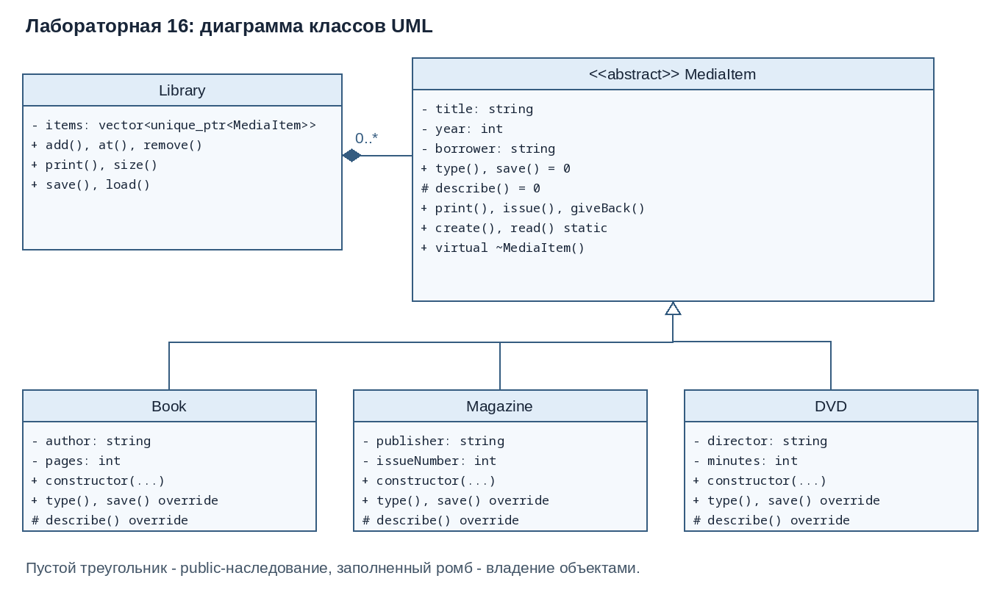
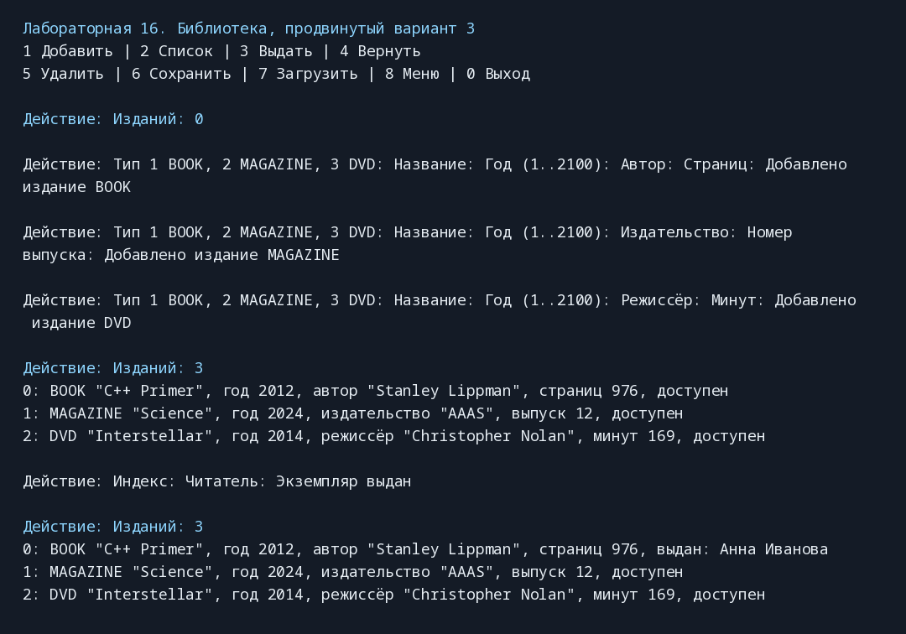
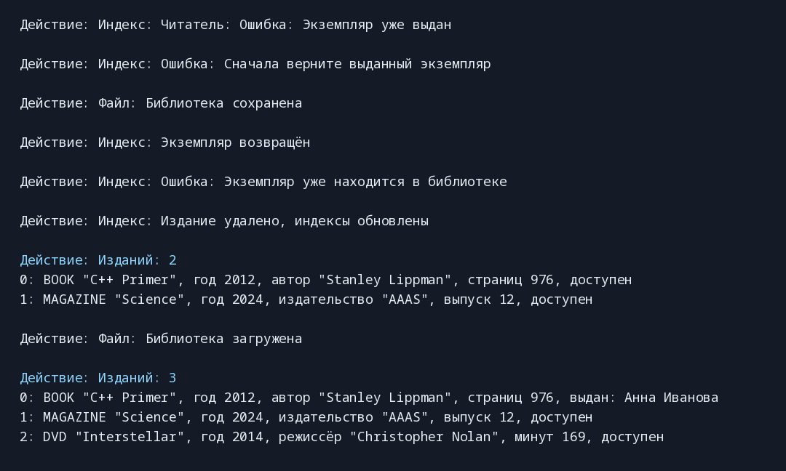
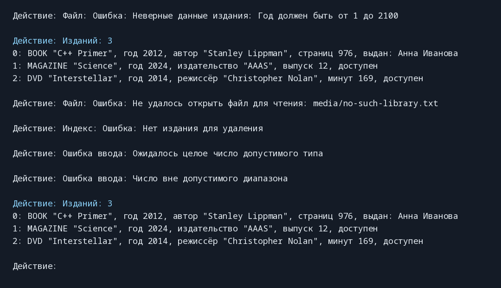

# Отчет по лабораторной работе 16

МИНИСТЕРСТВО НАУКИ И ВЫСШЕГО ОБРАЗОВАНИЯ
РОССИЙСКОЙ ФЕДЕРАЦИИ
Федеральное государственное автономное
образовательное учреждение высшего образования
«СЕВЕРО-КАВКАЗСКИЙ ФЕДЕРАЛЬНЫЙ УНИВЕРСИТЕТ»
Институт информационных технологий и кибер безопасности
Департамент цифровых, робототехнических систем и электроники
Кафедра программной инженерии

**Тема:** Проектирование иерархии классов. Наследование и полиморфизм

**Вариант:** 3. Продвинутый уровень

**Выполнил:**
Студент группы ПИЖ-б-о-25-2 (2),
направление подготовки: 09.03.04
“Программная инженерия”

Кравцун Михаил Алексеевич

**Проверил:**
Ассистент межинститутской базовой кафедры департамента цифровых,
робототехнических систем и электроники института перспективной
инженерии

Белик Ангелина Игоревна

---

## Репозиторий

[GitHub: Algorithms-Data-structures, лабораторная работа 16 второго курса](https://github.com/WhXteBeXr/Algorithms-Data-structures/tree/main/course-2/lab16)

## Цель работы

Спроектировать полиморфную иерархию библиотечных изданий и мини-систему учёта. Реализовать выдачу, возврат, текстовое сохранение и загрузку, меню и UML-диаграмму.

## Постановка задачи

Продвинутый вариант 3 - система управления библиотекой: книги, журналы, DVD, выдача и возврат. Общее задание требует наследование, полиморфизм, паттерны, сериализацию и меню. Темы варианта 3 предыдущих уровней самостоятельны и в библиотечный проект не добавляются.

Система поддерживает добавление, просмотр, удаление, выдачу читателю, возврат и сохранение/загрузку всей коллекции. Выданный экземпляр нельзя удалить до возврата.

## Теория и архитектура

Public-наследование задаёт отношение «является»: Book, Magazine и DVD являются MediaItem. Абстрактный базовый класс задаёт общий интерфейс, конкретные реализации выбираются виртуально. Создать сам MediaItem нельзя.

Коллекция vector<unique_ptr<MediaItem>> единолично владеет объектами. Виртуальный деструктор гарантирует корректное удаление наследника через базовый указатель. Владение выражено композицией, ручного new/delete нет.

Статическая фабрика MediaItem::create создаёт конкретный тип по тегу. При загрузке тот же механизм восстанавливает тип из файла. Метод print задаёт общую схему вывода и вызывает виртуальный describe, что соответствует идее шаблонного метода: общая последовательность сохраняется, детали зависят от наследника.



| Класс | Состояние и назначение |
| --- | --- |
| MediaItem | Название, год, читатель, выдача/возврат, общий вывод и фабрика |
| Book | Автор, страницы, специфичный вывод и запись |
| Magazine | Издательство, номер выпуска, специфичный вывод и запись |
| DVD | Режиссёр, длительность в минутах, специфичный вывод и запись |
| Library | Владение коллекцией, доступ, удаление, сохранение и загрузка |

## Исходные файлы

[MediaItem.h](MediaItem.h) и [MediaItem.cpp](MediaItem.cpp) содержат абстрактную основу, проверки и фабрику. [Book.h](Book.h), [Book.cpp](Book.cpp), [Magazine.h](Magazine.h), [Magazine.cpp](Magazine.cpp), [DVD.h](DVD.h), [DVD.cpp](DVD.cpp) задают конкретные типы.

[Library.h](Library.h) и [Library.cpp](Library.cpp) управляют коллекцией и файлами. [Input.h](Input.h) и [Input.cpp](Input.cpp) читают строки и проверяют числа. [main.cpp](main.cpp) реализует меню, [CMakeLists.txt](CMakeLists.txt) собирает c2-lab16. Короткие геттеры находятся в заголовках, основная логика в .cpp.

## Данные и сериализация

Каждый объект имеет название, год 1..2100 и читателя. Пустой читатель означает доступность. Автор, издательство или режиссёр должны быть непустыми однострочными строками. Страницы, номер выпуска и длительность находятся в учебном диапазоне 1..100000.

Формат начинается с LIBRARY, версии 1 и количества записей. Каждая следующая строка содержит тег типа, название, год, читателя и два специфичных поля. Строковые поля записываются через quoted, поэтому пробелы, кавычки и обратные косые черты сохраняются. Названия и читатели могут содержать UTF-8, байты сохраняются без преобразования регистра.

При чтении проверяются версия, число записей, типы, поля и отсутствие лишних данных. Все новые объекты сначала помещаются во временный vector, только после полной проверки выполняется swap. Ошибочная загрузка сохраняет действующую коллекцию. Сохранение заменяет файл по указанному пути, ошибки открытия, записи и закрытия проверяются.

Индексы 0..N-1 относятся к текущему порядку коллекции. После удаления последующие индексы сдвигаются. Данные одного объекта не дублируются в отдельной таблице выдач, статус хранится внутри издания и сериализуется вместе с ним.

## Меню и ошибки

| Команда | Действие |
| --- | --- |
| 1 | Добавить BOOK, MAGAZINE или DVD |
| 2 | Показать коллекцию полиморфно |
| 3 / 4 | Выдать читателю / вернуть |
| 5 | Удалить доступное издание |
| 6 / 7 | Сохранить / загрузить |
| 8 / 0 | Повторить меню / выйти |

Числа читаются из целых строк через istringstream. Нечисловой ввод, лишние символы и нарушение диапазона приводят к сообщению и повторному запросу. Отдельная ошибочная операция не завершает меню. Конец ввода завершает работу корректно.

Invalid_argument означает неверные данные, out_of_range неверный индекс или диапазон, logic_error недопустимую выдачу/возврат/удаление, runtime_error файловую проблему. Проверки доменных классов действуют также при загрузке, независимо от меню.

## Сложность

Добавление в vector амортизированно O(1), доступ по индексу O(1), удаление O(N) из-за сдвига владельцев. Выдача и возврат не обходят коллекцию, работа со строкой читателя зависит от её длины. Печать, сохранение и загрузка линейны по общему объёму данных. Во время загрузки одновременно существуют старая и новая коллекции, дополнительная память соответствует размеру загружаемых данных.

## Сборка и демонстрация

Из корня репозитория:

```bash
cmake -S course-2/lab16 -B /tmp/algorithms-c2-lab16-release -DCMAKE_BUILD_TYPE=Release
cmake --build /tmp/algorithms-c2-lab16-release
/tmp/algorithms-c2-lab16-release/c2-lab16
```

Для воспроизведения [сценария меню](media/example-input.txt) нужно перейти в каталог работы, поскольку пути в нём относительные:

```bash
cd course-2/lab16
/tmp/algorithms-c2-lab16-release/c2-lab16 < media/example-input.txt
```

Сценарий сохраняет [пример библиотеки](media/library-example.txt) и использует [неверный файл](media/invalid-library.txt) для демонстрации отказа загрузки. Сборки Debug и Release с -Wall -Wextra -Wpedantic прошли без предупреждений, вывод сценария совпал. Отдельных автоматических тестов нет.

## Результаты

Добавлены BOOK C++ Primer, MAGAZINE Science и DVD Interstellar. При выводе каждый тип показывает собственные поля через общий интерфейс. Книга выдана Анне Ивановой, повторная выдача и удаление выданной книги отклонены.

После сохранения книга возвращена, DVD удалён, коллекция уменьшилась до двух объектов. Загрузка восстановила три типа и первоначальный статус книги «выдана». При загрузке файла с неверным годом после одной правильной записи все три текущих объекта сохранились.

| Ситуация | Результат |
| --- | --- |
| Повторный возврат | Logic_error, состояние не меняется |
| Индекс 99 | Out_of_range, меню продолжается |
| Отсутствующий файл | Runtime_error, данные остаются |
| Команда oops | Ошибка разбора и повтор запроса |
| Команда 9 | Ошибка диапазона и повтор запроса |
| Неверная запись файла | Новая коллекция не устанавливается |

Полный [вывод](media/program-output.txt) сохранён в media.







## Контрольные вопросы

### 1. Что такое наследование и какие виды есть в C++?

Создание производного типа на основе базового. Доступ при наследовании может быть public, protected или private, также бывают одиночное, множественное и виртуальное наследование. В работе используется одиночное public.

### 2. Что означает public-наследование?

Производный объект можно использовать через доступный базовый интерфейс, отношение «является». Закрытые поля основы остаются недоступны напрямую, открытые методы доступны пользователю.

### 3. Зачем виртуальные методы?

Чтобы вызов через базовый указатель или ссылку выбирал реализацию фактического типа. В работе так выбираются type, describe и save.

### 4. Что такое абстрактный класс?

Класс с чисто виртуальными методами, которые должны быть реализованы конкретным наследником. MediaItem содержит методы с = 0 и не создаётся непосредственно.

### 5. Почему деструктор основы должен быть виртуальным?

При удалении наследника через базовый указатель нужно выполнить деструктор фактического типа. Без виртуального деструктора такое удаление для этой иерархии было бы некорректным.

### 6. Что такое позднее связывание?

Выбор виртуальной реализации во время выполнения по динамическому типу объекта. Vector хранит unique_ptr<MediaItem>, но выводятся поля Book, Magazine и DVD.

### 7. Как переопределить метод и зачем override?

Объявить в наследнике метод с подходящей сигнатурой и отметить override. Компилятор проверит, что это настоящее переопределение, а не случайно иной метод.

### 8. Что такое RTTI и dynamic_cast?

Механизм информации о типах во время выполнения. Для полиморфной основы dynamic_cast может проверить преобразование к наследнику. Неудачный указатель даст nullptr, ссылка bad_cast. В этой программе специальных приведений не требуется, используются виртуальные методы.

### 9. Как вызвать метод основы из наследника?

Указать квалифицированное имя, например MediaItem::saveCommon(out). Открытый или защищённый доступ должен разрешать вызов. Конструктор основы вызывается в списке инициализации.

### 10. Что показывает UML?

Классы, поля, операции, доступ и связи. Пустая треугольная стрелка обозначает наследование, заполненный ромб композицию. Library владеет MediaItem, три конкретных типа наследуют его.

### 11. Что такое Стратегия?

Паттерн для взаимозаменяемых алгоритмов за общим интерфейсом. Например, разные способы сортировки. В библиотеке применены простая фабрика и шаблонный метод вывода, отдельная стратегия не нужна предметной задаче.

### 12. Почему важен виртуальный деструктор?

Он обеспечивает полное разрушение объекта при удалении через основу. Unique_ptr<MediaItem> вызывает delete базового указателя, виртуальный деструктор направляет разрушение к правильному типу, затем уничтожается базовая часть.

## Вывод

Разработана библиотека продвинутого варианта 3 с тремя конкретными типами, полиморфным поведением, фабрикой и владением через unique_ptr. Выдача и возврат сохраняются в текстовом файле, ошибочная загрузка не заменяет действующие данные. Меню позволяет последовательно продемонстрировать все функции и обработку ошибок.
