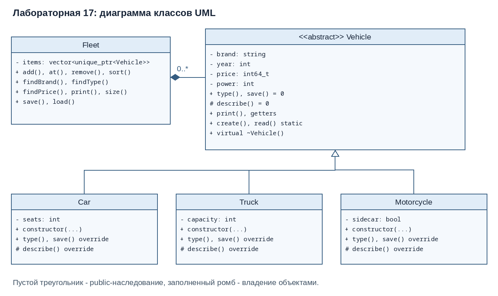
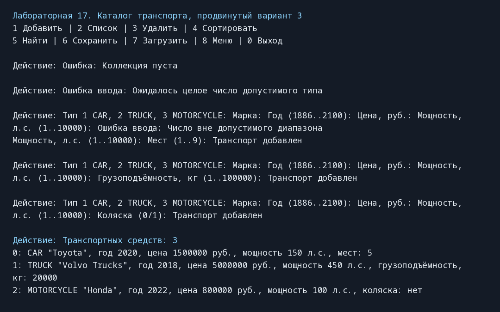
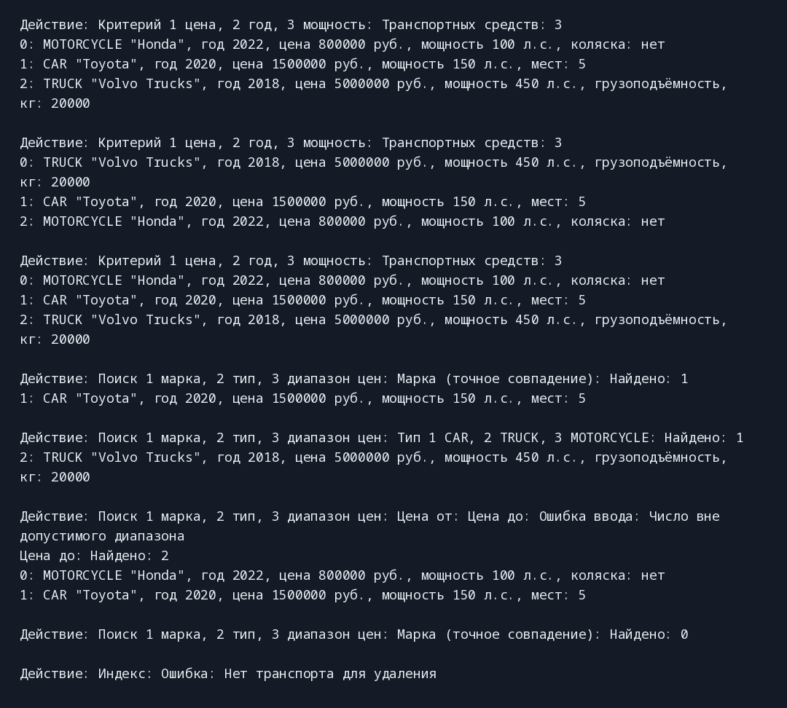
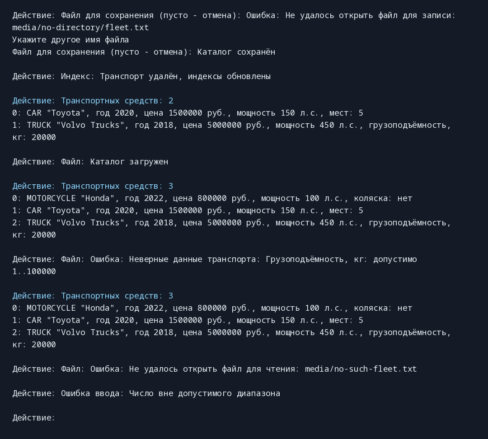

# Отчет по лабораторной работе 17

МИНИСТЕРСТВО НАУКИ И ВЫСШЕГО ОБРАЗОВАНИЯ
РОССИЙСКОЙ ФЕДЕРАЦИИ
Федеральное государственное автономное
образовательное учреждение высшего образования
«СЕВЕРО-КАВКАЗСКИЙ ФЕДЕРАЛЬНЫЙ УНИВЕРСИТЕТ»
Институт информационных технологий и кибер безопасности
Департамент цифровых, робототехнических систем и электроники
Кафедра программной инженерии

**Тема:** Реализация мини-проекта с использованием алгоритмов и структур данных

**Вариант:** 3. Продвинутый уровень

**Выполнил:**
Студент группы ПИЖ-б-о-25-2 (2),
направление подготовки: 09.03.04
“Программная инженерия”

Кравцун Михаил Алексеевич

**Проверил:**
Ассистент межинститутской базовой кафедры департамента цифровых,
робототехнических систем и электроники института перспективной
инженерии

Белик Ангелина Игоревна

---

## Репозиторий

[GitHub: Algorithms-Data-structures, лабораторная работа 17 второго курса](https://github.com/WhXteBeXr/Algorithms-Data-structures/tree/main/course-2/lab17)

## Цель работы

Создать мини-проект с полиморфной иерархией транспорта, контейнером STL, сортировкой, поиском, текстовой сериализацией и обработкой исключений.

## Постановка задачи

Продвинутый вариант 3 - транспорт: автомобиль, грузовик и мотоцикл. Сортировка выполняется по цене, году и мощности, поиск - по марке, типу и цене. Общее задание требует абстрактный базовый класс, минимум два наследника, виртуальные методы, коллекцию STL, сохранение/загрузку, исключения и консольное меню.

Реализованы все три типа. Меню позволяет добавлять и удалять транспорт, просматривать коллекцию, сортировать, искать и работать с файлами. Предметная область задаётся вариантом этой работы. Каталог транспорта является самостоятельным проектом.

## Теоретическая часть

### Наследование и контейнер

Абстрактный Vehicle содержит марку, год, цену и мощность. Car, Truck и Motorcycle расширяют его количеством мест, грузоподъёмностью и наличием коляски соответственно. Виртуальные type, describe и save выбирают поведение по фактическому типу, даже если обращение идёт через базовый указатель.

Fleet хранит vector<unique_ptr<Vehicle>>. Единоличное владение и виртуальный деструктор обеспечивают корректное освобождение производных объектов. std::sort переставляет указатели по выбранному числовому ключу. Поиск использует std::find_if и возвращает индексы всех совпадений.

### Сериализация

Сериализация преобразует состояние объектов в последовательность данных, десериализация восстанавливает объекты. Текстовый формат удобен для чтения и проверки, но требует разбора и обычно занимает больше места, чем бинарный.

Заголовок файла имеет вид `FLEET 1 N`, где 1 - версия, N - количество записей. Каждая следующая строка содержит тег типа, марку в кавычках, год, цену, мощность и дополнительное целое поле. Теги CAR, TRUCK и MOTORCYCLE определяют, как трактовать последнее поле. Для марки используется std::quoted, сохраняющий пробелы, кавычки и обратные косые черты. Цена хранится в целых рублях типа int64_t.

При загрузке проверяются заголовок, поля и количество записей. Все объекты сначала создаются во временном vector. Замена действующего каталога через swap происходит только после успешного чтения всего файла. При ошибке временные объекты освобождаются автоматически, текущая коллекция остаётся прежней.

### Исключения и RAII

Throw сообщает об ошибке, catch выбирает обработчик, try ограничивает защищённый участок. Исключение прерывает текущую операцию и при раскрутке стека вызывает деструкторы локальных объектов. RAII связывает ресурс с временем жизни владельца. Здесь потоки закрывают файлы, unique_ptr освобождает транспорт, vector освобождает элементы.

Ошибки отдельной операции перехватываются в цикле меню. Числовой ввод разбирается в отдельном istringstream, поэтому нечисловая строка не переводит основной cin в состояние ошибки. Ошибка записи обрабатывается локально с предложением другого имени файла.

## Диаграмма классов



Vehicle абстрактный, наследование public. Заполненный ромб у Fleet обозначает владение объектами. Исходная схема также сохранена в [classes.mmd](media/classes.mmd).

## Реализация

[Vehicle.h](Vehicle.h) и [Vehicle.cpp](Vehicle.cpp) задают общий интерфейс, проверку общих полей, вывод и фабрику восстановления типов. Наследники находятся в [Car.h](Car.h), [Car.cpp](Car.cpp), [Truck.h](Truck.h), [Truck.cpp](Truck.cpp), [Motorcycle.h](Motorcycle.h) и [Motorcycle.cpp](Motorcycle.cpp). Каждый проверяет своё поле и реализует виртуальное поведение.

[Fleet.h](Fleet.h) и [Fleet.cpp](Fleet.cpp) управляют коллекцией, сортировкой, поиском и файлами. [Input.h](Input.h) и [Input.cpp](Input.cpp) реализуют проверяемый ввод. [main.cpp](main.cpp) связывает методы с меню, выводит результаты и обрабатывает ошибки операций. [CMakeLists.txt](CMakeLists.txt) задаёт цель c2-lab17.

### Ограничения и поведение

- Марка - непустая однострочная строка. Поиск точный, с учётом регистра.
- Год - 1886..2100, мощность - 1..10000 л.с., цена - 0..1000000000000 руб.
- Car содержит 1..9 мест, Truck имеет грузоподъёмность 1..100000 кг, Motorcycle принимает признак коляски 0 или 1.
- Сортировки возрастающие. Порядок равных ключей не гарантируется.
- Ценовой поиск включает обе границы. Нижняя граница не должна превышать верхнюю.
- Индексы начинаются с нуля и меняются после сортировки, удаления и загрузки. Найденные индексы выводятся сразу.
- Отсутствие совпадений является нормальным результатом поиска. Просмотр пустого каталога сообщает об ошибке доступа.
- Загрузка заменяет весь каталог. Сохранение перезаписывает указанный файл. При ошибке записи старое содержимое файла не гарантируется, каталог в памяти не меняется.

### Сложность

Для N объектов без учёта длины текстовых полей:

| Операция | Время | Дополнительная память |
| --- | --- | --- |
| Добавление в vector | O(1) амортизированно | O(1), при росте буфера O(N) |
| Доступ по индексу | O(1) | O(1) |
| Удаление | O(N) | O(1) |
| Сортировка | O(N log N) сравнений | Зависит от реализации std::sort |
| Поиск всех совпадений | O(N) проверок | O(K) для K индексов |
| Просмотр и сохранение | O(N) | Размер текущей записи и буферов потока |
| Загрузка | O(N) | O(N) для нового каталога до замены |

Сравнение марок дополнительно зависит от длины строк. Чтение и запись зависят от полного объёма текстовых данных.

## Анализ использования исключений

| Ситуация | Исключение | Реакция |
| --- | --- | --- |
| Файл загрузки не открылся | std::runtime_error | Сообщение, возврат в меню |
| Не удалось открыть, записать или закрыть выходной файл | std::runtime_error | Предложение другого имени, пустая строка отменяет запись |
| Введено не число или есть лишние символы | std::invalid_argument | Повтор того же запроса |
| Число вне заданного диапазона | std::out_of_range | Повтор того же запроса |
| Удаление по отсутствующему индексу | std::out_of_range | Сообщение, коллекция не меняется |
| Просмотр или at для пустой коллекции | std::logic_error | Сообщение, продолжение работы |
| Повреждённый заголовок, запись или лишние данные файла | std::runtime_error | Отказ от загрузки, текущий каталог сохраняется |
| Неверные параметры объекта или неизвестный тип | std::invalid_argument или std::out_of_range | Объект не добавляется, при загрузке ошибка преобразуется в runtime_error |

Завершение входного потока обрабатывается выходом из меню. Перехват по const std::exception& сохраняет полиморфное сообщение what(). Отдельный класс исключений не нужен, стандартные типы описывают все ситуации задания.

## Сборка и запуск

Из корня репозитория:

```bash
cmake -S course-2/lab17 -B /tmp/c2-lab17 -DCMAKE_BUILD_TYPE=Release
cmake --build /tmp/c2-lab17
cd course-2/lab17
/tmp/c2-lab17/c2-lab17 < media/example-input.txt
```

Для интерактивного режима перенаправление ввода убирается. Пути в демонстрационном сценарии рассчитаны на рабочий каталог course-2/lab17. Из общего проекта доступна цель c2-lab17. Сборки Debug и Release выполнены с -Wall -Wextra -Wpedantic без предупреждений, вывод сценария в обеих конфигурациях совпал.

## Результаты работы

Сценарий [example-input.txt](media/example-input.txt) демонстрирует все пункты задания. Полный результат находится в [program-output.txt](media/program-output.txt). Сохранённый каталог - [fleet-example.txt](media/fleet-example.txt), файл с ошибкой во второй записи - [invalid-fleet.txt](media/invalid-fleet.txt).

Сначала запрос списка пустой коллекции выдаёт logic_error. После ошибочной команды abc повторяется ввод. При добавлении Toyota мощность 0 отклоняется, 150 принимается. Созданы Toyota 2020 года за 1500000 руб., Volvo Trucks 2018 года за 5000000 руб. и Honda 2022 года за 800000 руб.



Сортировка по цене даёт Honda, Toyota, Volvo Trucks, по году - Volvo Trucks, Toyota, Honda, по мощности - Honda, Toyota, Volvo Trucks. Поиск марки Toyota находит автомобиль, поиск TRUCK - грузовик. Диапазон 700000..1600000 возвращает Honda и Toyota. Верхняя граница 600000 отклоняется, поиск Missing даёт ноль результатов. Удаление индекса 99 выдаёт out_of_range.



При сохранении в отсутствующий подкаталог программа предлагает другое имя. Повтор с media/fleet-example.txt успешен. После удаления Honda остаются два объекта, загрузка сохранённого файла восстанавливает все три типа и их параметры. Файл с нулевой грузоподъёмностью второй записи отклоняется целиком, каталог остаётся из трёх объектов. Отсутствующий файл загрузки и команда 9 дают сообщения об ошибках, работа меню продолжается.



## Ответы на контрольные вопросы

1. **Что такое сериализация и зачем она нужна?** Это преобразование состояния объектов в сохраняемые или передаваемые данные. Она позволяет восстановить каталог после завершения программы.
2. **Какие способы сериализации есть в C++?** Ручная запись текстовых полей через потоки, двоичная запись явно заданного формата, библиотеки JSON, XML и других форматов. Язык не предоставляет универсальной встроенной сериализации произвольных классов.
3. **Плюсы и минусы текстового формата?** Его легко прочитать, проверить и перенести между платформами. Он занимает больше места, требует разбора и правил экранирования.
4. **Плюсы и минусы бинарного формата?** Он может быть компактнее и быстрее. Необходимы явные правила размеров, порядка байтов и версий, отладка сложнее. Запись сырых байтов полиморфного объекта не сохраняет корректно строки, указатели и динамический тип.
5. **Что такое исключение?** Объект, сообщающий об ошибке и передающий управление подходящему обработчику. Это отделяет обычный ход операции от обработки нештатной ситуации.
6. **Как работают try, catch, throw?** Try содержит операцию, throw возбуждает исключение, catch принимает подходящий тип. По пути к обработчику разрушаются уже созданные локальные объекты.
7. **Чем catch(const std::exception&) отличается от catch(...)?** Первый принимает стандартные исключения и их наследников, позволяет вызвать what(). Второй принимает любое исключение, но не даёт типизированного объекта для анализа.
8. **Какие стандартные исключения используются?** Invalid_argument описывает неверный аргумент, out_of_range выход за границы, logic_error недопустимое состояние, runtime_error внешнюю ошибку, bad_alloc ошибку выделения памяти. Первые два наследуются от logic_error.
9. **Как создать собственное исключение?** Унаследовать класс от std::runtime_error или другого подходящего типа и передать сообщение базовому конструктору. При необходимости добавить поля с контекстом. В проекте достаточно стандартных классов.
10. **Почему деструктор не должен бросать исключение?** Второе исключение при раскрутке стека приводит к std::terminate. Деструкторы освобождают ресурсы без выброса ошибок, проверяемое закрытие выходного файла выполняется явно внутри save.
11. **Как обрабатывать ошибки ввода?** Прочитать строку, отдельно разобрать число, проверить конец строки и диапазон. Неверный формат вызывает invalid_argument, неверное значение out_of_range, после перехвата запрос повторяется.
12. **Как обрабатывать файловые ошибки?** Проверять открытие, разбор, состояние чтения, записи и закрытия. В проекте ошибки превращаются в runtime_error, пользователь получает сообщение, после ошибки сохранения может выбрать другое имя.
13. **Что такое RAII и связь с исключениями?** Владелец получает ресурс при создании и освобождает в деструкторе. При исключении деструкторы вызываются автоматически, поэтому временный vector, unique_ptr и файловые потоки не оставляют ресурсы незакрытыми.
14. **Как обрабатывать bad_alloc?** Ловить по const std::bad_alloc&, когда можно освободить ресурсы или завершить операцию. Здесь общий обработчик std::exception принимает и bad_alloc, временные объекты очищаются автоматически. Возможность продолжить работу при полном исчерпании памяти не гарантируется.
15. **Где используются исключения проекта?** При неправильном вводе, недопустимых полях, неизвестном типе, пустом доступе, неверном удалении, ошибках файлов и повреждённых записях. Все шесть обязательных ситуаций методички показаны в сценарии.

## Выводы

Создан каталог транспорта с абстрактной основой и тремя производными классами. Использованы vector, unique_ptr, std::sort, std::find_if и предикаты. Реализованы все заданные критерии сортировки и поиска, текстовое восстановление типов, проверки данных и меню. Демонстрация подтвердила продолжение работы после ошибок и сохранение действующей коллекции при неудачной загрузке.
