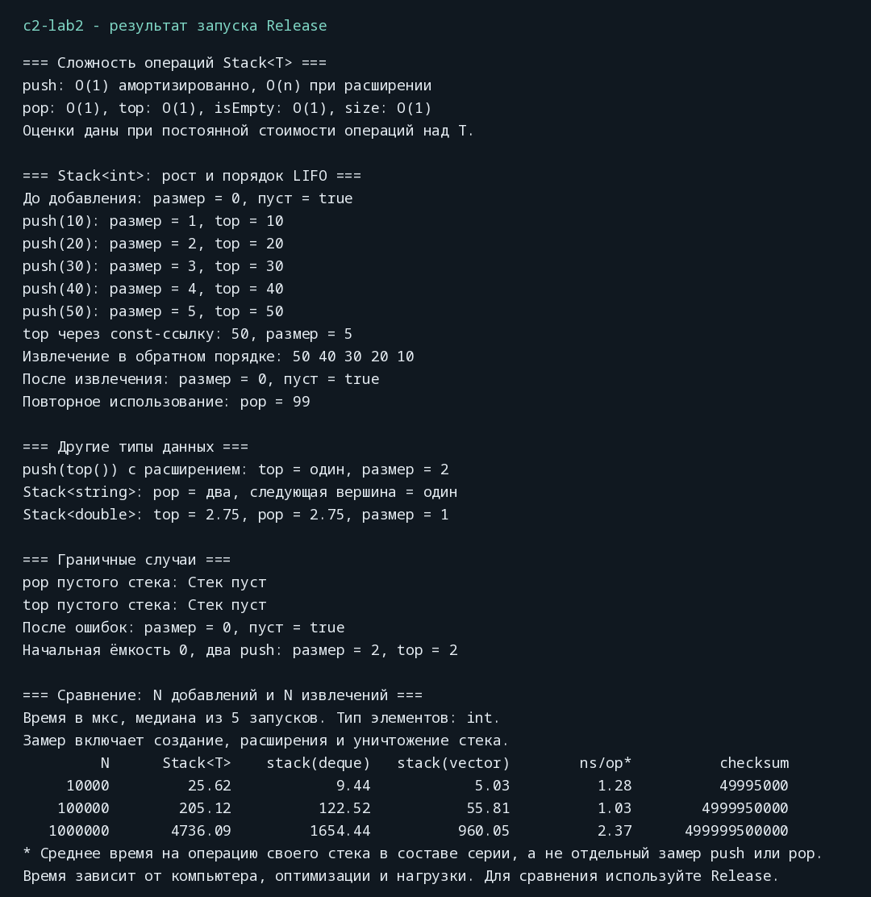
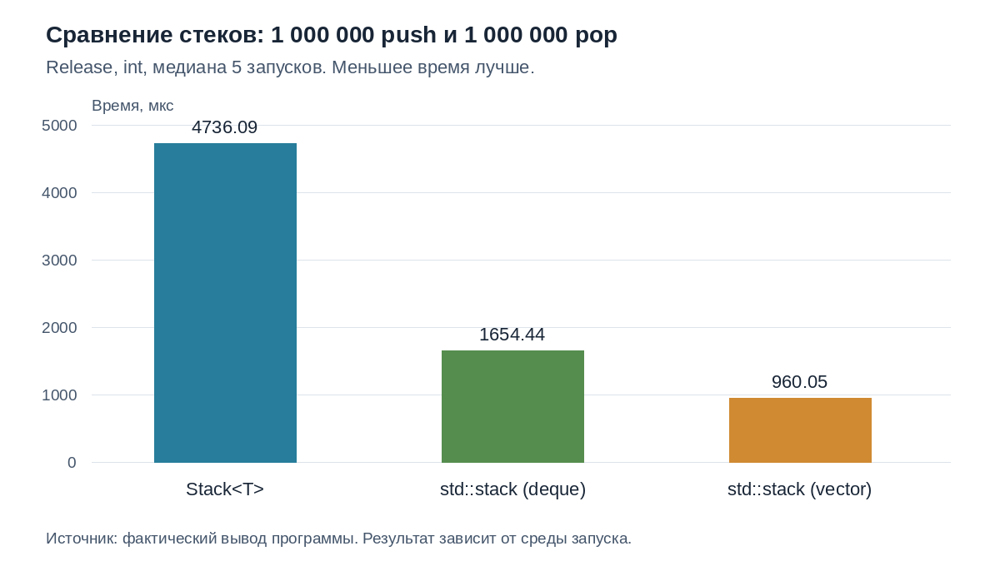

# Отчет по лабораторной работе 2

МИНИСТЕРСТВО НАУКИ И ВЫСШЕГО ОБРАЗОВАНИЯ
РОССИЙСКОЙ ФЕДЕРАЦИИ
Федеральное государственное автономное
образовательное учреждение высшего образования
«СЕВЕРО-КАВКАЗСКИЙ ФЕДЕРАЛЬНЫЙ УНИВЕРСИТЕТ»
Институт перспективной инженерии
Департамент цифровых, робототехнических систем и электроники
Межинститутская базовая кафедра

**Тема:** Анализ сложности алгоритмов. Шаблоны классов

**Вариант:** 3. Продвинутый уровень

**Выполнил:**
Студент группы ПИЖ-б-о-25-2 (2),
направление подготовки: 09.03.04
“Программная инженерия”

Кравцун Михаил Алексеевич

**Проверил:**
Ассистент межинститутской базовой кафедры департамента цифровых,
робототехнических систем и электроники института перспективной
инженерии

Белик Ангелина Игоревна

---
## Цель работы

Освоить анализ сложности операций контейнера, реализовать шаблонный стек на C++20 и экспериментально сравнить его с аналогами стандартной библиотеки на нескольких объёмах данных.

## Постановка задачи

Общее задание продвинутого уровня: реализовать шаблонный контейнер с заданной функциональностью, проанализировать сложность каждой операции и экспериментально сравнить производительность с аналогом из STL.

Вариант 3: `Stack<T>` с операциями `push`, `pop`, `top`, `isEmpty`, `size`.

## Теоретическое обоснование

**Временная сложность** описывает, как объём работы зависит от размера данных. **Пространственная сложность** оценивает используемую память. Big O задаёт асимптотическую верхнюю границу, без постоянных множителей и младших слагаемых.

Основные классы сложности:

| Сложность | Пример |
| --- | --- |
| O(1) | Доступ к элементу массива по индексу |
| O(log n) | Бинарный поиск в упорядоченном массиве |
| O(n) | Последовательный обход массива |
| O(n log n) | Сортировка слиянием |
| O(n²) | Два вложенных цикла по n итераций |

**Шаблон класса** позволяет описать контейнер один раз и создавать его версии для разных типов. Например, `Stack<int>` и `Stack<std::string>` используют общую реализацию алгоритма, но хранят разные элементы.

**Стек** работает по правилу LIFO: последним добавлен, первым извлечён. Добавление, просмотр и удаление выполняются на вершине стека.

**Амортизированный анализ** оценивает суммарную стоимость последовательности операций. Буфер стека удваивается, поэтому копирования при расширениях образуют геометрическую сумму. Для n добавлений из фиксированной начальной ёмкости суммарная работа составляет O(n), а амортизированная стоимость одного добавления равна O(1). Отдельное добавление с расширением имеет сложность O(n).

## Реализация

### Структура файлов

- `Stack.h` - объявление шаблонного класса и его интерфейса.
- `Stack.tpp` - определения методов шаблона, подключаемые в конце заголовка.
- `Benchmark.h`, `Benchmark.cpp` - сравнение производительности собственного стека и двух STL-аналогов.
- `main.cpp` - демонстрация операций, разных типов и граничных случаев.
- `CMakeLists.txt` - сборка программы `c2-lab2` с C++20.
- `media` - сохранённый вывод и диаграмма измерений.

Шаблон нельзя просто перенести в отдельный `.cpp` без дополнительных мер: компилятор должен видеть определения методов при создании конкретной версии `Stack<T>`. Поэтому реализация находится в подключаемом `.tpp`.

### Хранение элементов

Контейнер хранит динамический массив ячеек `std::optional<T>`, размер стека `elementCount` и ёмкость буфера `bufferCapacity`. Буфером владеет `std::unique_ptr`, который автоматически освобождает память. Сам стек не реализован через готовый STL-контейнер.

`optional` позволяет иметь свободные ячейки без создания объектов T. Метод `emplace()` создаёт элемент в ячейке, `reset()` уничтожает его при извлечении. Тип T должен поддерживать копирование, конструктор по умолчанию не обязателен. Копирование и перемещение самого стека запрещены в этой реализации.

Нулевая начальная ёмкость заменяется единицей. При заполнении выделяется буфер вдвое больше, существующие элементы и новый элемент копируются в него, затем буферы заменяются. Проверка размера защищает вычисление новой ёмкости от переполнения. Если выделение или копирование во время `push()` завершается исключением, исходный стек сохраняется.

Новый элемент копируется до освобождения старого массива. Поэтому `stack.push(stack.top())` корректен даже при расширении. `top()` возвращает константную ссылку, которая становится недействительной после удаления соответствующего элемента, расширения буфера или уничтожения стека.

`pop()` возвращает копию вершины и удаляет её из буфера. В STL `pop()` ничего не возвращает, поэтому для аналогичной работы используются `top()` и `pop()`. Пустые `top()` и `pop()` выбрасывают `std::out_of_range`.

### Анализ сложности

Здесь n - текущий размер, c - ёмкость буфера. Операции копирования и уничтожения одного T условно считаются O(1). Для строк и других сложных типов нужно дополнительно учитывать стоимость работы с самим элементом.

| Операция | Время | Дополнительная память | Обоснование |
| --- | --- | --- | --- |
| Конструктор | O(c) | O(c) | Выделение и инициализация ячеек optional |
| Деструктор | O(c) | O(1) | Уничтожение массива и оставшихся элементов |
| `push` без расширения | O(1) | O(1) | Создание одного элемента в свободной ячейке |
| `push` с расширением | O(n) | O(n) | Новый массив и копирование элементов |
| `push` амортизированно | O(1) | Зависит от расширения | Геометрический рост буфера |
| `pop` | O(1) | O(1) | Копирование и удаление одной вершины |
| `top` | O(1) | O(1) | Возвращение ссылки на последнюю занятую ячейку |
| `isEmpty` | O(1) | O(1) | Сравнение размера с нулём |
| `size` | O(1) | O(1) | Возвращение сохранённого размера |

Вся память контейнера составляет O(c). Буфер не уменьшается после `pop()`, поэтому ёмкость зависит от максимального достигнутого размера, а не только от текущего числа элементов. Одна серия n добавлений и n извлечений имеет сложность O(n) при фиксированной начальной ёмкости.

## Сборка и запуск

Независимая сборка из корня репозитория:

```bash
cmake -S course-2/lab2 -B /tmp/algorithms-c2-lab2-release -DCMAKE_BUILD_TYPE=Release
cmake --build /tmp/algorithms-c2-lab2-release
/tmp/algorithms-c2-lab2-release/c2-lab2
```

Сборка в составе общего проекта:

```bash
cmake -S . -B /tmp/algorithms-c2-lab2-project -DCMAKE_BUILD_TYPE=Release
cmake --build /tmp/algorithms-c2-lab2-project --target c2-lab2
/tmp/algorithms-c2-lab2-project/course-2/lab2/c2-lab2
```

Все демонстрации выполняются в `main.cpp`, ввод с клавиатуры не требуется. Программа собрана и запущена в конфигурациях Debug и Release без предупреждений компилятора.

## Результаты работы

### Демонстрация контейнера

- `Stack<int>` расширяется при добавлении пяти элементов в буфер начальной ёмкости 2.
- Значения 10, 20, 30, 40, 50 извлекаются в порядке 50, 40, 30, 20, 10.
- `top()` не меняет размер и доступен через константную ссылку на стек.
- После извлечения всех элементов `size()` возвращает 0, `isEmpty()` возвращает `true`.
- Опустошённый стек принимает новый элемент 99.
- `Stack<std::string>` демонстрирует копирование собственной вершины при расширении и извлечение строки.
- `Stack<double>` хранит и извлекает дробные значения 1.5 и 2.75.
- `pop()` и `top()` пустого стека вызывают исключения, которые перехватываются без завершения демонстрации.
- Стек с начальной ёмкостью 0 успешно принимает два элемента.

Фактический stdout сохранён в [текстовом файле](media/program-output.txt). Изображение ниже сформировано из этого вывода и не является снимком окна терминала.



### Методика сравнения

Сравниваются собственный `Stack<int>`, `std::stack<int>` на `std::deque<int>` и `std::stack<int, std::vector<int>>`.

Для каждого N выполняются N добавлений значений от 0 до N-1, затем N извлечений с накоплением суммы. Замер включает создание, расширения и уничтожение контейнера. Время измеряется монотонными часами `std::chrono::steady_clock`, единица измерения - микросекунда. Для каждого размера проводится пять запусков, в таблицу выводится медиана. Порядок трёх реализаций между запусками меняется, вывод в консоль выполняется вне замеряемого участка.

Контрольная сумма каждого запуска сравнивается с N(N-1)/2. Для её вычисления используется 64-битный целый тип. Это дополнительная проверка результата самой демонстрации, отдельные тестовые программы не используются.

Среда измерения: GCC 16.2.1, C++20, конфигурация Release с оптимизацией `-O3`, процессор AMD Ryzen 7 7735U. Данные ниже относятся к одному запуску и могут меняться при изменении нагрузки и среды.

### Измеренные значения

| N | Stack, мкс | std::stack/deque, мкс | std::stack/vector, мкс | Stack, нс/операцию | Контрольная сумма |
| ---: | ---: | ---: | ---: | ---: | ---: |
| 10000 | 25.62 | 9.44 | 5.03 | 1.28 | 49995000 |
| 100000 | 205.12 | 122.52 | 55.81 | 1.03 | 4999950000 |
| 1000000 | 4736.09 | 1654.44 | 960.05 | 2.37 | 499999500000 |

Значение нс/операцию получено делением времени всей серии на 2N. Оно включает накладные расходы создания, расширения и освобождения памяти, поэтому не является отдельным измерением стоимости `push()` или `pop()`.



В измеренном запуске собственный стек медленнее обоих STL-аналогов. `optional` хранит признак наличия элемента и требует дополнительных действий при создании и удалении. Отличаются также стратегии выделения памяти и реализации контейнеров. Измерение всей серии не позволяет отдельно определить вклад каждого фактора.

Одинаковая сложность O(n) для серии не означает одинакового времени. Существенны постоянные множители, локальность памяти, перераспределения и работа кэша. Изменения времени на операцию при росте N не опровергают амортизированную оценку. Конечное число замеров иллюстрирует производительность, но не доказывает асимптотику.

## Листинг программы

### Stack.h

```cpp
#pragma once

#include <cstddef>
#include <memory>
#include <optional>

// LIFO: последним добавлен, первым извлечён.
// T должен поддерживать копирование. Конструктор T по умолчанию не требуется.
template <typename T>
class Stack
{
public:
  explicit Stack(std::size_t initialCapacity = 10);
  ~Stack() = default;

  // Стек единолично владеет буфером. Копирование и перемещение в работе не реализуются.
  Stack(const Stack&) = delete;
  Stack& operator=(const Stack&) = delete;
  Stack(Stack&&) = delete;
  Stack& operator=(Stack&&) = delete;

  void push(const T& value);
  T pop();
  const T& top() const;
  bool isEmpty() const;
  std::size_t size() const;

private:
  // optional отличает свободную ячейку от живого T. reset() уничтожает
  // извлечённый элемент сразу, не дожидаясь уничтожения всего стека.
  std::unique_ptr<std::optional<T>[]> data;
  std::size_t elementCount = 0;
  std::size_t bufferCapacity;
};

// Определения шаблона нужны компилятору в месте использования Stack<T>.
#include "Stack.tpp"
```

### Stack.tpp

```cpp
#pragma once

#include <limits>
#include <stdexcept>
#include <utility>

template <typename T>
Stack<T>::Stack(std::size_t initialCapacity) : bufferCapacity(initialCapacity == 0 ? 1 : initialCapacity)
{
  // Нулевая начальная ёмкость превращается в единицу, чтобы удвоение давало рост.
  data = std::make_unique<std::optional<T>[]>(bufferCapacity);
}

template <typename T>
void Stack<T>::push(const T& value)
{
  if (elementCount == bufferCapacity)
  {
    // Проверяем удвоение и размер массива до вычисления новой ёмкости.
    const std::size_t maxCapacity = std::numeric_limits<std::size_t>::max() / sizeof(std::optional<T>);
    if (bufferCapacity > maxCapacity / 2)
    {
      throw std::length_error("Достигнута предельная ёмкость стека");
    }

    const std::size_t newCapacity = bufferCapacity * 2;
    auto newData = std::make_unique<std::optional<T>[]>(newCapacity);
    for (std::size_t i = 0; i < elementCount; ++i)
    {
      newData[i].emplace(*data[i]);
    }

    // value может ссылаться на top() этого же стека. Старый буфер сохраняем
    // до копирования нового элемента, иначе такая ссылка стала бы висячей.
    newData[elementCount].emplace(value);

    // Если выделение или копирование выбросили исключение, старый стек не изменён.
    // unique_ptr автоматически освобождает временный буфер при ошибке.
    data = std::move(newData);
    bufferCapacity = newCapacity;
  }
  else
  {
    data[elementCount].emplace(value);
  }
  ++elementCount; // Увеличиваем размер только после успешного создания элемента.
}

template <typename T>
T Stack<T>::pop()
{
  if (isEmpty())
  {
    throw std::out_of_range("Стек пуст");
  }
  // Сначала получаем возвращаемое значение, затем уничтожаем вершину в буфере.
  T value = *data[elementCount - 1];
  data[elementCount - 1].reset();
  --elementCount;
  return value;
}

template <typename T>
const T& Stack<T>::top() const
{
  if (isEmpty())
  {
    throw std::out_of_range("Стек пуст");
  }
  // Ссылка позволяет посмотреть вершину без копирования и без удаления.
  // Она недействительна после удаления элемента, расширения или уничтожения стека.
  return *data[elementCount - 1];
}

template <typename T>
bool Stack<T>::isEmpty() const
{
  return elementCount == 0;
}

template <typename T>
std::size_t Stack<T>::size() const
{
  return elementCount;
}
```

### Benchmark.h

```cpp
#pragma once

#include <iosfwd>

// Выполняет одинаковую серию push/pop для своего стека и двух STL-аналогов.
void runStackBenchmark(std::ostream& out);
```

### Benchmark.cpp

```cpp
#include "Benchmark.h"
#include "Stack.h"

#include <algorithm>
#include <array>
#include <chrono>
#include <cstdint>
#include <deque>
#include <iomanip>
#include <ostream>
#include <stack>
#include <stdexcept>
#include <vector>

namespace
{
  constexpr std::size_t repeatCount = 5;

  template <typename Action>
  double measureMicroseconds(Action action, std::int64_t expectedSum)
  {
    // steady_clock монотонны, перевод системных часов не искажает интервал.
    const auto start = std::chrono::steady_clock::now();
    const std::int64_t sum = action();
    const auto finish = std::chrono::steady_clock::now();

    // Результат вычисления используется. Проверка выполняется за пределами замера.
    if (sum != expectedSum)
    {
      throw std::runtime_error("Контрольная сумма извлечённых элементов неверна");
    }
    return std::chrono::duration<double, std::micro>(finish - start).count();
  }

  std::int64_t runCustomStack(int count)
  {
    Stack<int> stack;
    for (int i = 0; i < count; ++i)
    {
      stack.push(i);
    }
    std::int64_t sum = 0;
    while (!stack.isEmpty())
    {
      sum += stack.pop();
    }
    return sum;
  }

  template <typename Container>
  std::int64_t runStandardStack(int count)
  {
    std::stack<int, Container> stack;
    for (int i = 0; i < count; ++i)
    {
      stack.push(i);
    }
    std::int64_t sum = 0;
    while (!stack.empty())
    {
      // В STL pop() не возвращает значение, поэтому сначала вызывается top().
      sum += stack.top();
      stack.pop();
    }
    return sum;
  }

  double median(std::array<double, repeatCount> values)
  {
    std::sort(values.begin(), values.end());
    return values[repeatCount / 2];
  }
}

void runStackBenchmark(std::ostream& out)
{
  out << "\n=== Сравнение: N добавлений и N извлечений ===\n"
      << "Время в мкс, медиана из " << repeatCount << " запусков. Тип элементов: int.\n"
      << "Замер включает создание, расширения и уничтожение стека.\n";
  out << std::setw(10) << "N" << std::setw(14) << "Stack<T>" << std::setw(16) << "stack(deque)"
      << std::setw(16) << "stack(vector)" << std::setw(14) << "ns/op*" << std::setw(18) << "checksum" << '\n';

  for (int count : {10000, 100000, 1000000})
  {
    const std::int64_t expectedSum = static_cast<std::int64_t>(count) * (count - 1) / 2;
    std::array<std::array<double, repeatCount>, 3> times{};
    for (std::size_t repeat = 0; repeat < repeatCount; ++repeat)
    {
      // Меняем порядок запусков, чтобы один контейнер не измерялся всегда первым.
      for (std::size_t offset = 0; offset < times.size(); ++offset)
      {
        const std::size_t implementation = (repeat + offset) % times.size();
        if (implementation == 0)
        {
          times[0][repeat] = measureMicroseconds([count] { return runCustomStack(count); }, expectedSum);
        }
        else if (implementation == 1)
        {
          times[1][repeat] = measureMicroseconds(
              [count] { return runStandardStack<std::deque<int>>(count); }, expectedSum);
        }
        else
        {
          times[2][repeat] = measureMicroseconds(
              [count] { return runStandardStack<std::vector<int>>(count); }, expectedSum);
        }
      }
    }

    const double customTime = median(times[0]);
    // Условное среднее на операцию включает накладные расходы всей серии.
    const double nanosecondsPerOperation = customTime * 1000.0 / (2.0 * count);
    out << std::fixed << std::setprecision(2) << std::setw(10) << count << std::setw(14) << customTime
        << std::setw(16) << median(times[1]) << std::setw(16) << median(times[2])
        << std::setw(14) << nanosecondsPerOperation << std::setw(18) << expectedSum << '\n';
  }
  out << "* Среднее время на операцию своего стека в составе серии, а не отдельный замер push или pop.\n"
      << "Время зависит от компьютера, оптимизации и нагрузки. Для сравнения используйте Release.\n";
}
```

### main.cpp

```cpp
#include "Benchmark.h"
#include "Stack.h"

#include <exception>
#include <iostream>
#include <stdexcept>
#include <string>

namespace
{
  void printComplexity()
  {
    std::cout << "=== Сложность операций Stack<T> ===\n"
              << "push: O(1) амортизированно, O(n) при расширении\n"
              << "pop: O(1), top: O(1), isEmpty: O(1), size: O(1)\n"
              << "Оценки даны при постоянной стоимости операций над T.\n\n";
  }

  void demonstrateIntegers()
  {
    // Маленькая ёмкость заставляет стек расширяться уже в коротком примере.
    Stack<int> numbers(2);
    std::cout << "=== Stack<int>: рост и порядок LIFO ===\n";
    std::cout << "До добавления: размер = " << numbers.size() << ", пуст = " << numbers.isEmpty() << '\n';
    for (int value : {10, 20, 30, 40, 50})
    {
      numbers.push(value);
      std::cout << "push(" << value << "): размер = " << numbers.size() << ", top = " << numbers.top() << '\n';
    }

    const Stack<int>& view = numbers;
    std::cout << "top через const-ссылку: " << view.top() << ", размер = " << view.size() << '\n';
    std::cout << "Извлечение в обратном порядке:";
    while (!numbers.isEmpty())
    {
      std::cout << ' ' << numbers.pop();
    }
    std::cout << "\nПосле извлечения: размер = " << numbers.size() << ", пуст = " << numbers.isEmpty() << '\n';
    numbers.push(99); // Освободившиеся ячейки можно использовать повторно.
    std::cout << "Повторное использование: pop = " << numbers.pop() << '\n';
  }

  void demonstrateOtherTypes()
  {
    std::cout << "\n=== Другие типы данных ===\n";
    Stack<std::string> words(1);
    words.push("один");
    // Вершина находится в старом буфере. push сохраняет её до завершения расширения.
    words.push(words.top());
    std::cout << "push(top()) с расширением: top = " << words.top() << ", размер = " << words.size() << '\n';
    words.push("два");
    const auto lastWord = words.pop();
    std::cout << "Stack<string>: pop = " << lastWord << ", следующая вершина = " << words.top() << '\n';

    Stack<double> fractions;
    fractions.push(1.5);
    fractions.push(2.75);
    std::cout << "Stack<double>: top = " << fractions.top();
    const double lastFraction = fractions.pop();
    std::cout << ", pop = " << lastFraction << ", размер = " << fractions.size() << '\n';
  }

  void demonstrateBoundaries()
  {
    std::cout << "\n=== Граничные случаи ===\n";
    Stack<int> empty;
    // Ошибки перехватываются отдельно, после каждой программа продолжает работу.
    try
    {
      empty.pop();
    }
    catch (const std::out_of_range& error)
    {
      std::cout << "pop пустого стека: " << error.what() << '\n';
    }
    try
    {
      empty.top();
    }
    catch (const std::out_of_range& error)
    {
      std::cout << "top пустого стека: " << error.what() << '\n';
    }
    std::cout << "После ошибок: размер = " << empty.size() << ", пуст = " << empty.isEmpty() << '\n';

    Stack<int> tiny(0); // Нулевая ёмкость исправляется на единицу.
    tiny.push(1);
    tiny.push(2);
    std::cout << "Начальная ёмкость 0, два push: размер = " << tiny.size() << ", top = " << tiny.top() << '\n';
  }
}

int main()
{
  std::cout << std::boolalpha;
  try
  {
    printComplexity();
    demonstrateIntegers();
    demonstrateOtherTypes();
    demonstrateBoundaries();
    // Замеры отделены от демонстрационного вывода, чтобы печать не влияла на время.
    runStackBenchmark(std::cout);
  }
  catch (const std::exception& error)
  {
    std::cerr << "Ошибка выполнения: " << error.what() << '\n';
    return 1;
  }
}
```

### CMakeLists.txt

```cmake
cmake_minimum_required(VERSION 3.20)

# Лабораторную можно собрать отдельно или из общего проекта.
if(CMAKE_SOURCE_DIR STREQUAL CMAKE_CURRENT_SOURCE_DIR)
    project(Course2Lab2 LANGUAGES CXX)
endif()

add_executable(c2-lab2 main.cpp Benchmark.cpp Stack.h Stack.tpp Benchmark.h)
target_compile_features(c2-lab2 PRIVATE cxx_std_20)
set_target_properties(c2-lab2 PROPERTIES CXX_EXTENSIONS OFF)

# Оптимизацию задаёт конфигурация Debug/Release, а не принудительный флаг -O0.
if(CMAKE_CXX_COMPILER_ID MATCHES "GNU|Clang")
    target_compile_options(c2-lab2 PRIVATE -Wall -Wextra -Wpedantic)
endif()
```

## Контрольные вопросы

### 1. Что такое О-нотация (Big O) и зачем она нужна?

Big O описывает асимптотическую верхнюю границу роста затрат алгоритма. Формально f(n) = O(g(n)), если существуют положительные c и n₀, для которых 0 ≤ f(n) ≤ c·g(n) при всех n ≥ n₀. Она позволяет сравнивать масштабируемость алгоритмов независимо от конкретного компьютера. Константы и младшие слагаемые при такой оценке отбрасываются.

### 2. Какая сложность у доступа к элементу массива по индексу? Почему?

O(1), потому что адрес элемента вычисляется по началу массива, индексу и размеру элемента. Для нахождения адреса не нужно обходить предшествующие элементы. Индекс должен находиться в допустимых границах.

### 3. Какая сложность у бинарного поиска? Почему?

O(log n), потому что после каждого сравнения остаётся примерно половина области поиска. После k шагов размер области составляет около n/2ᵏ. Для сокращения области до одного элемента нужно порядка log₂n шагов. Бинарный поиск предполагает упорядоченные данные и эффективный доступ к середине.

### 4. Что означает сложность O(n log n)? Приведите пример алгоритма.

Объём работы растёт пропорционально произведению n и логарифма n. Пример - сортировка слиянием: на каждом уровне рекурсии обрабатываются O(n) элементов, а уровней O(log n). Такая оценка лучше квадратичной для больших n.

### 5. Что такое амортизированный анализ? Приведите пример.

Это оценка затрат на последовательность операций с учётом редких дорогих действий. В стеке расширение копирует все элементы, но ёмкость удваивается, поэтому расширения происходят всё реже. Суммарные затраты на n добавлений составляют O(n), значит одно добавление имеет амортизированную сложность O(1). Это не вероятностное среднее, а оценка суммарных затрат последовательности.

### 6. Какая сложность у двух вложенных циклов по n итераций каждый?

O(n²), если тело внутреннего цикла выполняется за O(1). Для каждой из n итераций внешнего цикла внутренний делает n итераций, всего n·n. Если границы циклов или стоимость тела отличаются, оценку нужно пересчитать.

### 7. Какая сложность у рекурсивного вычисления чисел Фибоначчи?

Наивная рекурсия F(n) = F(n-1) + F(n-2) многократно вычисляет одинаковые подзадачи. Её временная сложность экспоненциальная, обычно указывают верхнюю границу O(2ⁿ), более точная оценка - Θ(φⁿ), где φ ≈ 1.618. Глубина рекурсии и дополнительная память составляют O(n). Мемоизация или итеративное вычисление сокращают время до O(n).

### 8. Что такое шаблоны функций? Как их объявить и использовать?

Шаблон функции описывает алгоритм с параметром типа. При вызове компилятор выводит тип аргументов или получает его явно. Например:

```cpp
template <typename T>
T larger(const T& first, const T& second)
{
  return first < second ? second : first;
}

// larger(2, 5) создаёт версию для int.
// larger<double>(2.5, 1.5) явно задаёт тип double.
```

Для выбранного типа должны быть определены используемые операции, здесь сравнение и копирование.

### 9. Что такое шаблоны классов? Как их объявить и использовать?

Это описание семейства классов, зависящих от параметров шаблона. Объявление начинается с `template <typename T>`. В работе `Stack<int> numbers` создаёт стек целых чисел, а `Stack<std::string> words` - стек строк. Каждый экземпляр класса имеет собственные данные, а алгоритмы методов описаны общей реализацией.

### 10. В чём преимущество шаблонов перед перегрузкой функций?

Шаблон позволяет один раз написать одинаковый алгоритм для нескольких типов. Это уменьшает дублирование и помогает сохранять единое поведение. Перегрузки полезны, когда для разных типов нужны существенно разные действия. Шаблоны и перегрузки могут использоваться совместно.

### 11. Как указать, что шаблонный параметр - тип?

Использовать `typename` или `class` в списке параметров, например `template <typename T>`. В этом контексте обе формы равнозначны. Внутри определения T используется как имя типа.

### 12. Можно ли создать шаблон с несколькими параметрами типов?

Да, например `template <typename Key, typename Value>`. Конкретная версия может использовать `int` для ключа и `std::string` для значения. STL также использует несколько параметров, например у `std::stack<T, Container>` задаются тип элемента и базовый контейнер.

### 13. Как провести экспериментальное измерение времени выполнения?

Зафиксировать конфигурацию сборки и одинаковую нагрузку, получить время перед выполнением и после него, вычислить разность. Для интервалов подходят монотонные `steady_clock`. В работе используется `duration<double, std::micro>`. Печать и проверку результатов нужно выполнять вне измеряемого участка, а границы замера явно описывать.

### 14. Почему при измерении времени нужно выполнять операцию многократно?

Одиночная операция может занимать меньше разрешения часов. На замер влияют планировщик, кэш и фоновая нагрузка. Серия операций увеличивает длительность измеряемого участка, несколько запусков позволяют оценить характерный результат. Медиана снижает влияние отдельных выбросов, но не устраняет все источники погрешности.

### 15. Что важнее: сложность алгоритма или константа?

Для больших размеров обычно решающей становится асимптотика, поскольку разные классы сложности растут с разной скоростью. Для небольших или ограниченных размеров важны постоянные множители, выделение памяти и кэш. Выбор следует обосновывать и теоретической оценкой, и измерением на характерной нагрузке.

## Вывод

Реализован шаблонный стек с динамическим расширением, обработкой пустого состояния и поддержкой разных типов. Для каждой операции определены временные и пространственные затраты. Показано, почему `push()` имеет амортизированную сложность O(1), хотя отдельное расширение требует O(n). Сравнение со STL выполнено на трёх объёмах данных и показало различие фактического времени при одинаковой асимптотике. Освоены управление временем жизни элементов, разделение шаблона на объявление и реализацию, проведение и интерпретация измерений.

## Репозиторий

[GitHub: Algorithms-Data-structures, лабораторная работа 2 второго курса](https://github.com/WhXteBeXr/Algorithms-Data-structures/tree/main/course-2/lab2)
