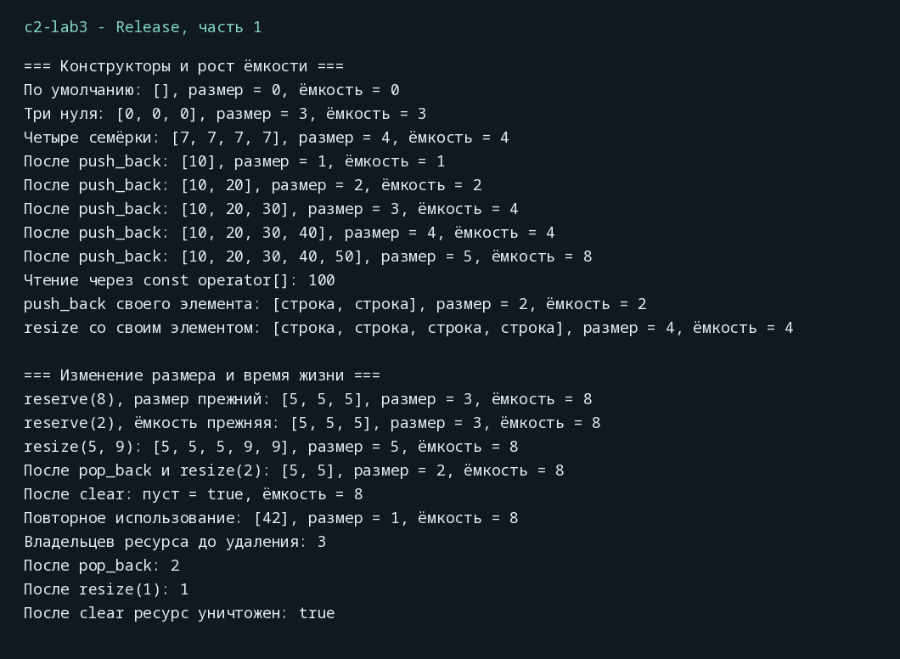
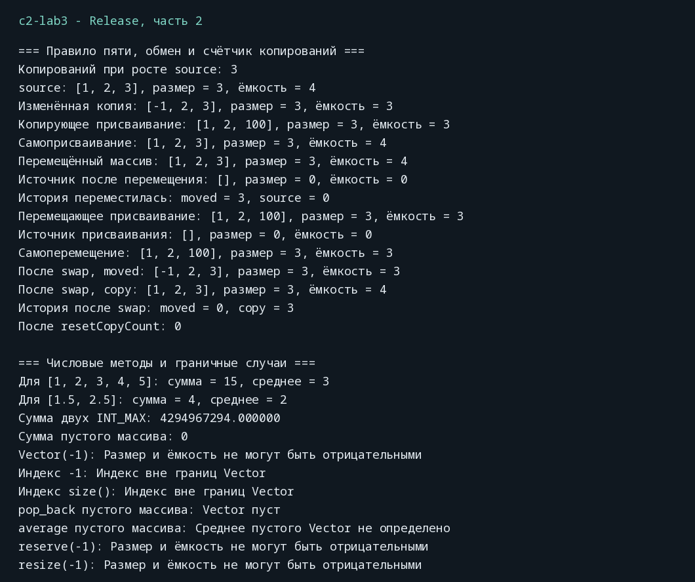
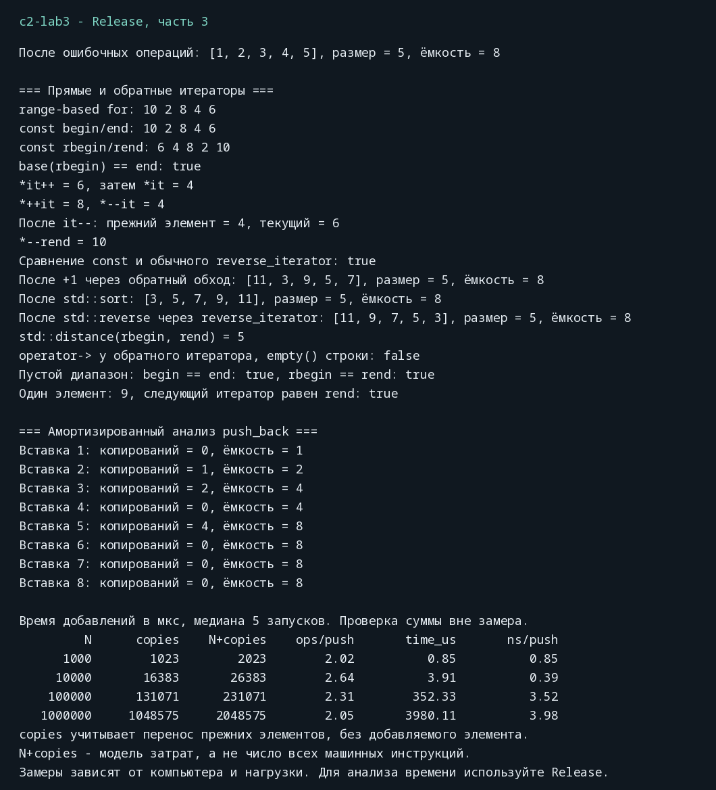
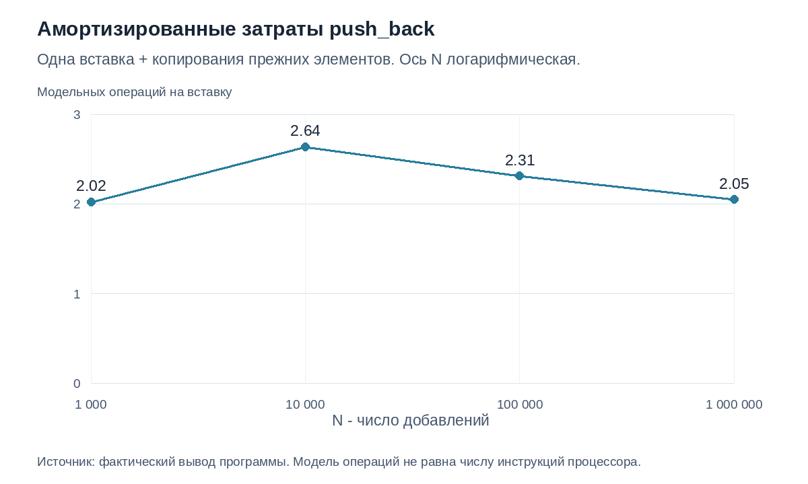
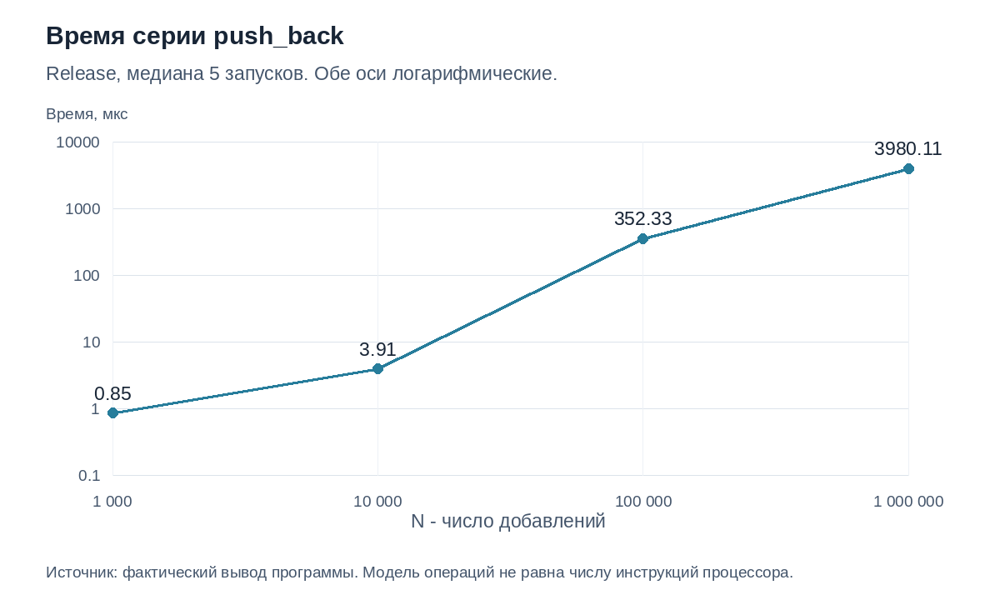

# Отчет по лабораторной работе 3

МИНИСТЕРСТВО НАУКИ И ВЫСШЕГО ОБРАЗОВАНИЯ
РОССИЙСКОЙ ФЕДЕРАЦИИ
Федеральное государственное автономное
образовательное учреждение высшего образования
«СЕВЕРО-КАВКАЗСКИЙ ФЕДЕРАЛЬНЫЙ УНИВЕРСИТЕТ»
Институт информационных технологий и кибер безопасности
Департамент цифровых, робототехнических систем и электроники
Кафедра программной инженерии

**Тема:** Реализация динамического массива (аналог vector). Итераторы

**Вариант:** 3. Продвинутый уровень

**Выполнил:**
Студент группы ПИЖ-б-о-25-2 (2),
направление подготовки: 09.03.04
“Программная инженерия”

Кравцун Михаил Алексеевич

**Проверил:**
Ассистент межинститутской базовой кафедры департамента цифровых,
робототехнических систем и электроники института перспективной
инженерии

Белик Ангелина Игоревна

---
## Репозиторий

[GitHub: Algorithms-Data-structures, лабораторная работа 3 второго курса](https://github.com/WhXteBeXr/Algorithms-Data-structures/tree/main/course-2/lab3)


## Цель работы

Реализовать шаблонный динамический массив на C++20, освоить разделение памяти и времени жизни элементов, глубокое копирование и перемещение, прямые и обратные итераторы. Обосновать амортизированную сложность добавления и продемонстрировать корректность операций на разных типах данных.

## Постановка задачи

Общее задание продвинутого уровня: реализовать класс `Vector` с поддержкой правила пяти, итераторами и дополнительной функциональностью согласно варианту.

Вариант 3: реализовать собственный `reverse_iterator` и методы `rbegin()` и `rend()`.

Работа развивает одну реализацию Vector. Для варианта 3 также реализованы конструкторы по умолчанию и с размером и значением, `push_back`, `size`, `operator[]`, `print`, числовые методы `sum` и `average`. Дополнительно поддерживаются `pop_back`, `capacity`, `empty`, `reserve`, `resize`, `clear` и `swap`.

## Теоретическое обоснование

### Динамический массив, размер и ёмкость

Динамический массив хранит элементы в непрерывной области памяти. При нехватке места выделяется новый блок, элементы переносятся в него, старый блок освобождается. Размер `size` равен числу живых элементов, ёмкость `capacity` - числу доступных ячеек памяти.

В данной реализации выделение памяти не создаёт объекты T в свободных ячейках. `std::allocator<T>` выделяет блок, `std::construct_at` создаёт элемент в выбранной ячейке, `std::destroy_at` вызывает его деструктор, а `deallocate` освобождает сам блок. Это позволяет уничтожать удалённые элементы сразу, сохраняя ёмкость.

### Правило пяти и RAII

Класс, который владеет ресурсом, должен согласованно определять деструктор, конструктор копирования, копирующее присваивание, конструктор перемещения и перемещающее присваивание. Копирование создаёт независимый ресурс, перемещение передаёт владение уже существующим ресурсом.

RAII связывает освобождение ресурса с уничтожением объекта-владельца. В этой программе внутренний `VectorBuffer<T>` освобождает созданные элементы и выделенную память, в том числе при исключении. Сам Vector использует автоматически сформированный деструктор, который вызывает деструктор поля-буфера. Для типов T предполагается, что их деструктор не выбрасывает исключений.

### Итераторы

Итератор обозначает позицию в диапазоне и позволяет обращаться к элементам. Прямой диапазон задаётся как `[begin(), end())`, где `end()` - граница после последнего элемента, которую нельзя разыменовывать.

Для непрерывного массива прямыми итераторами служат `T*` и `const T*`. Они поддерживают произвольный доступ и подходят для `std::sort`. Константный итератор не позволяет менять элемент через него.

Собственный обратный итератор хранит прямую базовую позицию после своего элемента. При разыменовании читается элемент перед ней. `rbegin()` строится на `end()`, `rend()` - на `begin()`. Поэтому не нужно формировать адрес перед началом массива. Обратный диапазон также полуоткрытый: `[rbegin(), rend())`.

### Амортизированный анализ

При росте 1, 2, 4, 8 и далее копирования существующих элементов образуют геометрическую сумму. В серии N добавлений из пустого массива суммарное количество таких копирований меньше 2N. Вместе с N добавляемыми элементами получается меньше 3N модельных операций. Следовательно, `push_back` имеет амортизированную сложность O(1), хотя отдельное расширение требует O(n).

## Реализация

### Структура файлов

- `Vector.h` - публичный интерфейс и поля шаблонного класса.
- `Vector.tpp` - определения его методов, подключаемые в конце заголовка.
- `VectorBuffer.h` - внутренний владелец неинициализированной памяти и живых элементов.
- `ReverseIterator.h` - собственный двунаправленный обратный итератор.
- `AmortizedAnalysis.h`, `AmortizedAnalysis.cpp` - подсчёт копирований и измерение серии добавлений.
- `main.cpp` - демонстрации всех возможностей и граничных случаев.
- `CMakeLists.txt` - независимая сборка и подключение к общему проекту.
- `media` - фактический вывод и диаграммы результатов.

Шаблонные определения подключаются через заголовки, чтобы компилятор мог создавать Vector для нужного T. Внутренний буфер расположен в пространстве имён `vector_detail` и не является самостоятельным пользовательским контейнером.

### Управление памятью и изменение размера

Vector содержит поле `buffer` с адресом, размером и ёмкостью, а также `copyCount`. Буфер единолично владеет памятью. Класс рассчитан на копируемые T, конструктор по умолчанию нужен только для операций, явно использующих `T{}`.

`push_back()` при наличии места создаёт один элемент. При расширении формирует временный буфер, копирует прежние элементы, затем добавляет значение и только после успеха обменивает буферы. До обмена старый массив остаётся живым. Поэтому добавление собственного элемента, например `v.push_back(v[0])`, корректно и при расширении.

`reserve()` увеличивает только ёмкость. `resize()` меняет число живых элементов, уничтожая удалённые или создавая новые из переданного значения. При уменьшении и очистке ёмкость сохраняется. У `pop_back()` вызывается деструктор удаляемого T.

При неудачном копировании временный буфер автоматически уничтожается. При росте resize внутри существующей ёмкости уже созданные новые элементы удаляются в обработчике ошибки. Успешные изменения основного буфера и счётчика публикуются после завершения необходимого копирования.

### Копирование, перемещение и статистика

Конструктор копирования создаёт независимый массив с ёмкостью, равной размеру источника. Копирующее присваивание использует copy-and-swap: сначала создаётся копия, затем выполняется обмен. Если создание копии не удалось, получатель остаётся прежним.

Конструктор перемещения забирает буфер и историю копирований за O(1), оставляя источник пустым. Перемещающее присваивание также забирает буфер, но дополнительно уничтожает прежние элементы получателя. Поэтому его общая сложность зависит от старого размера получателя. Оба присваивания проверяют `this != &other`, самоприсваивание и самоперемещение сохраняют объект.

`copyCount` учитывает только копирования уже существующих элементов при смене буфера в `push_back`, `reserve` и растущем `resize`. Добавляемый элемент в него не входит. Глубокая копия начинает историю с нуля. При move и swap история передаётся вместе с буфером. `resetCopyCount()` обнуляет счётчик без изменения содержимого.

### Доступ, числовые методы и ошибки

Обе версии `operator[]` проверяют границы, включая отрицательный индекс. Это более строгий договор, чем у непроверяемого `std::vector::operator[]`. Неконстантная версия возвращает `T&`, константная - `const T&`.

`sum()` и `average()` доступны только для арифметических типов через ограничение `requires std::is_arithmetic_v<T>`. Суммирование выполняется в `long double`, без сложения в типе int. Это предотвращает переполнение промежуточного int, но расчёт с плавающей точкой остаётся приближённым и не гарантирует точного представления произвольной большой суммы. Сумма пустого массива равна нулю, среднее пустого массива не определено и вызывает исключение.

Отрицательные размеры и ёмкости отклоняются через `std::invalid_argument`, слишком большие запросы - через `std::length_error`. Выход за границы вызывает `std::out_of_range`, удаление из пустого массива - `std::underflow_error`. Ошибка выделения памяти может быть передана стандартным аллокатором. В демонстрации ожидаемые ошибки перехватываются, программа продолжает работу.

### Обратный итератор и совместимость со STL

`ReverseIterator<Ptr>` хранит `current`. Для `T*` разыменование возвращает `T&`, для `const T*` - `const T&`. `base()` возвращает сохранённую прямую позицию. Операторы `*` и `->` обращаются к позиции `current - 1`, префиксный `++` уменьшает current, `--` увеличивает его. Постфиксные формы возвращают прежнее состояние.

Поддерживаются сравнения и преобразование обычного обратного итератора в константный, обратное преобразование запрещено. Объявлены стандартные типы и категория `bidirectional_iterator_tag`. Такой итератор подходит для `std::copy`, `std::distance` и `std::reverse`. Произвольный доступ в нём не реализован, поэтому `std::sort` применяется к прямым итераторам.

Для пустого массива `begin() == end()` и `rbegin() == rend()`. Границы нельзя разыменовывать. Переходы итераторов должны оставаться в допустимом диапазоне. Проверка индексов Vector не делает произвольную арифметику указателей безопасной.

При смене буфера все старые итераторы и ссылки на элементы становятся недействительными. Без смены буфера нельзя использовать ссылки на уничтоженные элементы и прежнюю границу диапазона как актуальный end. При swap буферы переходят другому контейнеру.

## Анализ сложности

Оценки даны при O(1) для создания, копирования и уничтожения одного T. Время системного выделения памяти отдельно не моделируется. n - текущий размер, m - размер источника, k - прежний размер получателя, c - новая ёмкость.

| Операция | Время | Дополнительная память |
| --- | --- | --- |
| Конструктор по умолчанию | O(1) | O(1) |
| Конструктор размера или заполнения | O(n) | O(n) |
| Конструктор копирования | O(m) | O(m) |
| Конструктор перемещения | O(1) | O(1) |
| Деструктор | O(n) | O(1) |
| Присваивание копированием | O(m + k) | O(m) |
| Присваивание перемещением | O(k) для непустого старого получателя | O(1) |
| `operator[]`, `size`, `capacity`, `empty` | O(1) | O(1) |
| `push_back` без расширения | O(1) | O(1) |
| `push_back` с расширением | O(n) | O(n) |
| `push_back` амортизированно | O(1) | Зависит от расширения |
| `pop_back` | O(1) | O(1) |
| `reserve` без роста | O(1) | O(1) |
| `reserve` с ростом | O(n) | O(c) |
| `resize` с уменьшением | O(числа удаляемых элементов) | O(1) |
| `resize` с ростом без смены буфера | O(числа новых элементов) | O(1) |
| `resize` с ростом и сменой буфера | O(нового размера) | O(нового размера) |
| `clear` | O(n) | O(1) |
| `swap`, чтение и сброс счётчика | O(1) | O(1) |
| `sum`, `average`, `print` | O(n) | O(1) |
| Получение begin/end/rbegin/rend | O(1) | O(1) |
| Одна операция обратного итератора | O(1) | O(1) |
| `std::distance` для обратных итераторов | O(n) | O(1) |

Самоприсваивание и самоперемещение обрабатываются за O(1). Общая память массива равна O(capacity), она не обязана уменьшаться вместе с размером. Внутренние append/removeLast и проверки размеров выполняют O(1) действий над элементами, очистка буфера уничтожает все его живые элементы.

## Сборка и запуск

Независимая сборка из корня репозитория:

```bash
cmake -S course-2/lab3 -B /tmp/algorithms-c2-lab3-release -DCMAKE_BUILD_TYPE=Release
cmake --build /tmp/algorithms-c2-lab3-release
/tmp/algorithms-c2-lab3-release/c2-lab3
```

В составе общего проекта:

```bash
cmake -S . -B /tmp/algorithms-c2-lab3-project -DCMAKE_BUILD_TYPE=Debug
cmake --build /tmp/algorithms-c2-lab3-project --target c2-lab3
/tmp/algorithms-c2-lab3-project/course-2/lab3/c2-lab3
```

Все примеры находятся в main.cpp. Ввод с клавиатуры не требуется. Отдельные тестовые программы и тестовые цели CMake не используются. Программа собрана и запущена в Debug и Release без предупреждений `-Wall -Wextra -Wpedantic`.

## Результаты работы

### Демонстрация возможностей

- Начальный размер и ёмкость пустого вектора равны нулю.
- При пяти добавлениях ёмкость меняется как 1, 2, 4, 4, 8.
- Изменение глубокой копии не меняет источник. После перемещения источник пуст и снова принимает элементы.
- Самоприсваивание и самоперемещение сохраняют содержимое.
- Счётчик копирований переносится и обменивается вместе с буфером, отдельно сбрасывается в ноль.
- Reserve сохраняет размер, а clear сохраняет ёмкость.
- В примере с shared_ptr число владельцев меняется с 3 до 2 и 1 после удаления ячеек. После clear наблюдатель weak_ptr сообщает об уничтожении ресурса.
- Для `[1, 2, 3, 4, 5]` сумма равна 15, среднее равно 3. Для `[1.5, 2.5]` получены 4 и 2.
- Отрицательные параметры, неверные индексы, удаление и среднее пустого массива обрабатываются исключениями.
- Прямой обход `[10, 2, 8, 4, 6]` даёт обратный порядок `[6, 4, 8, 2, 10]` через const rbegin/rend.
- Продемонстрированы обе формы ++/--, base(), operator->, константное преобразование, запись через обратный итератор, пустой и одноэлементный диапазоны.
- STL-алгоритмы copy, sort, reverse и distance работают с соответствующими категориями итераторов.

[Фактический stdout программы](media/program-output.txt) сохранён полностью. Изображения ниже сформированы из него и не являются снимками окна терминала.







### Амортизированный анализ и измерение времени

Для N добавлений в пустой Vector учитываются N новых элементов и копирования существующих элементов при расширениях. Первые восемь добавлений дают приращения счётчика `0, 1, 2, 0, 4, 0, 0, 0`.

Для каждого большого N выполняются пять запусков, в таблице приведена медиана времени только цикла push_back. Создание пустого контейнера, последующая проверка суммы и уничтожение контейнера находятся вне интервала. Расширения и освобождение старых буферов внутри push_back входят в замер. Часы - `std::chrono::steady_clock`, время - микросекунды с дробной частью. Сумма проверяется по формуле N(N-1)/2, печать выполняется вне замера.

Среда: GCC 16.2.1, C++20, Release с `-O3`, AMD Ryzen 7 7735U. Время относится к одному сохранённому запуску и зависит от нагрузки компьютера.

| N | Копирования прежних элементов | N + копирования | Модельных операций на вставку | Время серии, мкс | нс на вставку |
| ---: | ---: | ---: | ---: | ---: | ---: |
| 1000 | 1023 | 2023 | 2.02 | 0.85 | 0.85 |
| 10000 | 16383 | 26383 | 2.64 | 3.91 | 0.39 |
| 100000 | 131071 | 231071 | 2.31 | 352.33 | 3.52 |
| 1000000 | 1048575 | 2048575 | 2.05 | 3980.11 | 3.98 |





Средние модельные затраты остаются меньше трёх на добавление, что согласуется с геометрической суммой. Между расширениями накопленная стоимость распределяется по большему числу вставок, поэтому значения могут колебаться.

Число N + copies не является количеством машинных инструкций: оно не учитывает проверки, управление памятью и другие накладные расходы. Замеры времени иллюстрируют работу программы, но не доказывают Big O. На малых интервалах заметны точность часов и шум измерения, на больших размерах - влияние памяти и кэша. Колонка нс на вставку получена делением времени серии на N.

## Листинг программы

### VectorBuffer.h

```cpp
#pragma once

#include <cstddef>
#include <memory>
#include <utility>

namespace vector_detail
{
  // Внутренний владелец памяти. Только первые size ячеек содержат живые T.
  // Оставшаяся capacity - свободная память, конструкторы T для неё не вызываются.
  template <typename T>
  struct VectorBuffer
  {
    T* data = nullptr;
    std::size_t size = 0;
    std::size_t capacity = 0;

    explicit VectorBuffer(std::size_t capacity = 0) : capacity(capacity)
    {
      if (capacity != 0)
      {
        data = std::allocator<T>{}.allocate(capacity);
      }
    }

    VectorBuffer(const VectorBuffer&) = delete;
    VectorBuffer& operator=(const VectorBuffer&) = delete;

    ~VectorBuffer()
    {
      clear();
      if (data != nullptr)
      {
        // Освобождаем блок тем же способом, которым он был выделен.
        std::allocator<T>{}.deallocate(data, capacity);
      }
    }

    void append(const T& value)
    {
      // Вызывающий Vector заранее обеспечивает свободное место.
      // При ошибке конструктора размер остаётся прежним.
      std::construct_at(data + size, value);
      ++size;
    }

    void removeLast() noexcept
    {
      // Вызывающий код гарантирует size > 0. Память ячейки остаётся в буфере.
      --size;
      std::destroy_at(data + size);
    }

    void clear() noexcept
    {
      while (size != 0)
      {
        removeLast();
      }
    }

    void swap(VectorBuffer& other) noexcept
    {
      // Переставляем описание блоков, сами элементы не копируем.
      std::swap(data, other.data);
      std::swap(size, other.size);
      std::swap(capacity, other.capacity);
    }
  };
}
```

### ReverseIterator.h

```cpp
#pragma once

#include <iterator>
#include <type_traits>

// Ptr равен T* или const T*. Итератор хранит позицию после своего элемента,
// поэтому rend() не требует создания недопустимого адреса перед массивом.
template <typename Ptr>
class ReverseIterator
{
public:
  using iterator_category = std::bidirectional_iterator_tag;
  using iterator_concept = std::bidirectional_iterator_tag;
  using value_type = typename std::iterator_traits<Ptr>::value_type;
  using difference_type = std::ptrdiff_t;
  using pointer = Ptr;
  using reference = typename std::iterator_traits<Ptr>::reference;

  explicit ReverseIterator(Ptr position = nullptr) : current(position) {}

  // Обычный итератор можно превратить в константный, обратное запрещено.
  template <typename OtherPtr>
    requires std::is_convertible_v<OtherPtr, Ptr>
  ReverseIterator(const ReverseIterator<OtherPtr>& other) : current(other.base()) {}

  Ptr base() const
  {
    return current;
  }

  reference operator*() const
  {
    // Разыменование допустимо только внутри обратного диапазона, не для rend().
    return *(current - 1);
  }

  pointer operator->() const
  {
    return current - 1;
  }

  ReverseIterator& operator++()
  {
    // Следующий элемент обратного обхода расположен левее в памяти.
    --current;
    return *this;
  }

  ReverseIterator operator++(int)
  {
    ReverseIterator previous = *this;
    ++(*this);
    return previous;
  }

  ReverseIterator& operator--()
  {
    ++current;
    return *this;
  }

  ReverseIterator operator--(int)
  {
    ReverseIterator previous = *this;
    --(*this);
    return previous;
  }

  template <typename OtherPtr>
  bool operator==(const ReverseIterator<OtherPtr>& other) const
  {
    return current == other.base();
  }

  template <typename OtherPtr>
  bool operator!=(const ReverseIterator<OtherPtr>& other) const
  {
    return !(*this == other);
  }

private:
  Ptr current;
};
```

### Vector.h

```cpp
#pragma once

#include "ReverseIterator.h"
#include "VectorBuffer.h"

#include <cstddef>
#include <iosfwd>
#include <type_traits>

// Учебный непрерывный динамический массив. T должен поддерживать копирование,
// а его деструктор не должен выбрасывать исключения.
template <typename T>
class Vector
{
public:
  using iterator = T*;
  using const_iterator = const T*;
  using reverse_iterator = ReverseIterator<T*>;
  using const_reverse_iterator = ReverseIterator<const T*>;

  Vector() = default;
  explicit Vector(std::ptrdiff_t count);
  Vector(std::ptrdiff_t count, const T& value);
  Vector(const Vector& other);
  Vector(Vector&& other) noexcept;
  ~Vector() = default;

  Vector& operator=(const Vector& other);
  Vector& operator=(Vector&& other) noexcept;

  // В этой реализации operator[] проверяет границы, включая отрицательный индекс.
  T& operator[](std::ptrdiff_t index);
  const T& operator[](std::ptrdiff_t index) const;
  std::size_t size() const;
  std::size_t capacity() const;
  bool empty() const;

  void push_back(const T& value);
  void pop_back();
  void reserve(std::ptrdiff_t newCapacity);
  // Версия без value требует, чтобы T можно было создать как T{}.
  void resize(std::ptrdiff_t newSize, const T& value = T{});
  void clear() noexcept;
  void swap(Vector& other) noexcept;

  // Считаются только копирования существующих элементов при смене буфера.
  // История переносится вместе с буфером при move/swap, копия начинает с нуля.
  std::size_t getCopyCount() const;
  void resetCopyCount();

  long double sum() const requires std::is_arithmetic_v<T>;
  long double average() const requires std::is_arithmetic_v<T>;
  void print(std::ostream& out) const;

  iterator begin();
  iterator end();
  const_iterator begin() const;
  const_iterator end() const;
  reverse_iterator rbegin();
  reverse_iterator rend();
  const_reverse_iterator rbegin() const;
  const_reverse_iterator rend() const;

private:
  vector_detail::VectorBuffer<T> buffer;
  std::size_t copyCount = 0;

  static std::size_t checkedSize(std::ptrdiff_t requested);
  static std::size_t maxSize();
  std::size_t nextCapacity() const;
};

// Методы шаблона должны быть видны при создании Vector<T> в другом файле.
#include "Vector.tpp"
```

### Vector.tpp

```cpp
#pragma once

#include <limits>
#include <ostream>
#include <stdexcept>
#include <utility>

template <typename T>
std::size_t Vector<T>::maxSize()
{
  // Ограничиваем объём и разности адресов представимым знаковым размером.
  return static_cast<std::size_t>(std::numeric_limits<std::ptrdiff_t>::max()) / sizeof(T);
}

template <typename T>
std::size_t Vector<T>::checkedSize(std::ptrdiff_t requested)
{
  if (requested < 0)
  {
    throw std::invalid_argument("Размер и ёмкость не могут быть отрицательными");
  }
  const auto result = static_cast<std::size_t>(requested);
  if (result > maxSize())
  {
    throw std::length_error("Превышен допустимый размер Vector");
  }
  return result;
}

template <typename T>
std::size_t Vector<T>::nextCapacity() const
{
  if (buffer.capacity == maxSize())
  {
    throw std::length_error("Достигнута предельная ёмкость Vector");
  }
  if (buffer.capacity == 0)
  {
    return 1;
  }
  // Не вычисляем удвоение, если оно может выйти за разрешённый предел.
  return buffer.capacity > maxSize() / 2 ? maxSize() : buffer.capacity * 2;
}

template <typename T>
Vector<T>::Vector(std::ptrdiff_t count) : Vector(count, T{}) {}

template <typename T>
Vector<T>::Vector(std::ptrdiff_t count, const T& value) : buffer(checkedSize(count))
{
  while (buffer.size < buffer.capacity)
  {
    buffer.append(value);
  }
  // При ошибке копирования уже созданное поле buffer само освобождает ресурс.
}

template <typename T>
Vector<T>::Vector(const Vector& other) : buffer(other.size())
{
  // Глубокая копия: создаём собственные элементы в отдельном блоке памяти.
  for (const T& value : other)
  {
    buffer.append(value);
  }
}

template <typename T>
Vector<T>::Vector(Vector&& other) noexcept : copyCount(std::exchange(other.copyCount, 0))
{
  // Наш буфер изначально пуст. После обмена источник становится пустым.
  buffer.swap(other.buffer);
}

template <typename T>
Vector<T>& Vector<T>::operator=(const Vector& other)
{
  if (this != &other)
  {
    Vector replacement(other);
    swap(replacement); // Старый буфер освободится при уничтожении replacement.
  }
  return *this;
}

template <typename T>
Vector<T>& Vector<T>::operator=(Vector&& other) noexcept
{
  if (this != &other)
  {
    Vector replacement(std::move(other));
    swap(replacement);
  }
  return *this;
}

template <typename T>
T& Vector<T>::operator[](std::ptrdiff_t index)
{
  // Общая проверка находится в const-версии, чтобы условия не расходились.
  return const_cast<T&>(std::as_const(*this)[index]);
}

template <typename T>
const T& Vector<T>::operator[](std::ptrdiff_t index) const
{
  if (index < 0 || static_cast<std::size_t>(index) >= buffer.size)
  {
    throw std::out_of_range("Индекс вне границ Vector");
  }
  return buffer.data[index];
}

template <typename T>
std::size_t Vector<T>::size() const
{
  return buffer.size;
}

template <typename T>
std::size_t Vector<T>::capacity() const
{
  return buffer.capacity;
}

template <typename T>
bool Vector<T>::empty() const
{
  return buffer.size == 0;
}

template <typename T>
void Vector<T>::reserve(std::ptrdiff_t newCapacity)
{
  const std::size_t requested = checkedSize(newCapacity);
  if (requested <= buffer.capacity)
  {
    return;
  }

  vector_detail::VectorBuffer<T> replacement(requested);
  for (const T& value : *this)
  {
    replacement.append(value);
  }
  // Меняем основной буфер и статистику только после успешного копирования.
  copyCount += buffer.size;
  buffer.swap(replacement);
}

template <typename T>
void Vector<T>::push_back(const T& value)
{
  if (buffer.size == buffer.capacity)
  {
    vector_detail::VectorBuffer<T> replacement(nextCapacity());
    for (const T& existing : *this)
    {
      replacement.append(existing);
    }
    // value может ссылаться на наш элемент. Старый буфер пока ещё существует.
    replacement.append(value);
    copyCount += buffer.size;
    buffer.swap(replacement);
  }
  else
  {
    buffer.append(value);
  }
}

template <typename T>
void Vector<T>::pop_back()
{
  if (empty())
  {
    throw std::underflow_error("Vector пуст");
  }
  buffer.removeLast(); // Вызывается деструктор T, а не только уменьшается размер.
}

template <typename T>
void Vector<T>::resize(std::ptrdiff_t newSize, const T& value)
{
  const std::size_t requested = checkedSize(newSize);
  if (requested <= buffer.size)
  {
    while (buffer.size > requested)
    {
      buffer.removeLast();
    }
    return;
  }

  if (requested > buffer.capacity)
  {
    vector_detail::VectorBuffer<T> replacement(requested);
    for (const T& existing : *this)
    {
      replacement.append(existing);
    }
    // value остаётся допустимым даже при ссылке на элемент старого буфера.
    while (replacement.size < requested)
    {
      replacement.append(value);
    }
    copyCount += buffer.size;
    buffer.swap(replacement);
  }
  else
  {
    const std::size_t oldSize = buffer.size;
    try
    {
      while (buffer.size < requested)
      {
        buffer.append(value);
      }
    }
    catch (...)
    {
      // При ошибке роста без перевыделения удаляем только новые элементы.
      while (buffer.size > oldSize)
      {
        buffer.removeLast();
      }
      throw;
    }
  }
}

template <typename T>
void Vector<T>::clear() noexcept
{
  buffer.clear(); // Уничтожаем элементы, ёмкость сохраняется для повторного использования.
}

template <typename T>
void Vector<T>::swap(Vector& other) noexcept
{
  buffer.swap(other.buffer);
  std::swap(copyCount, other.copyCount);
}

template <typename T>
std::size_t Vector<T>::getCopyCount() const
{
  return copyCount;
}

template <typename T>
void Vector<T>::resetCopyCount()
{
  copyCount = 0;
}

template <typename T>
long double Vector<T>::sum() const requires std::is_arithmetic_v<T>
{
  // Расширенный тип накопления исключает переполнение арифметики самого int.
  long double result = 0;
  for (const T& value : *this)
  {
    result += static_cast<long double>(value);
  }
  return result;
}

template <typename T>
long double Vector<T>::average() const requires std::is_arithmetic_v<T>
{
  if (empty())
  {
    throw std::underflow_error("Среднее пустого Vector не определено");
  }
  return sum() / static_cast<long double>(buffer.size);
}

template <typename T>
void Vector<T>::print(std::ostream& out) const
{
  out << '[';
  for (std::size_t i = 0; i < buffer.size; ++i)
  {
    if (i != 0)
    {
      out << ", ";
    }
    out << buffer.data[i];
  }
  out << ']';
}

template <typename T>
typename Vector<T>::iterator Vector<T>::begin()
{
  return buffer.data;
}

template <typename T>
typename Vector<T>::iterator Vector<T>::end()
{
  // Не выполняем арифметику с nullptr у вектора, ещё не выделявшего память.
  return empty() ? buffer.data : buffer.data + buffer.size;
}

template <typename T>
typename Vector<T>::const_iterator Vector<T>::begin() const
{
  return buffer.data;
}

template <typename T>
typename Vector<T>::const_iterator Vector<T>::end() const
{
  return empty() ? buffer.data : buffer.data + buffer.size;
}

template <typename T>
typename Vector<T>::reverse_iterator Vector<T>::rbegin()
{
  return reverse_iterator(end());
}

template <typename T>
typename Vector<T>::reverse_iterator Vector<T>::rend()
{
  return reverse_iterator(begin());
}

template <typename T>
typename Vector<T>::const_reverse_iterator Vector<T>::rbegin() const
{
  return const_reverse_iterator(end());
}

template <typename T>
typename Vector<T>::const_reverse_iterator Vector<T>::rend() const
{
  return const_reverse_iterator(begin());
}
```

### AmortizedAnalysis.h

```cpp
#pragma once

#include <iosfwd>

// Показывает отдельные расширения и суммарные затраты серии push_back.
void runAmortizedAnalysis(std::ostream& out);
```

### AmortizedAnalysis.cpp

```cpp
#include "AmortizedAnalysis.h"
#include "Vector.h"

#include <algorithm>
#include <array>
#include <chrono>
#include <cstdint>
#include <iomanip>
#include <ostream>
#include <stdexcept>

void runAmortizedAnalysis(std::ostream& out)
{
  out << "\n=== Амортизированный анализ push_back ===\n";
  Vector<int> example;
  for (int value = 1; value <= 8; ++value)
  {
    const std::size_t before = example.getCopyCount();
    example.push_back(value);
    out << "Вставка " << value << ": копирований = " << example.getCopyCount() - before
        << ", ёмкость = " << example.capacity() << '\n';
  }

  out << "\nВремя добавлений в мкс, медиана 5 запусков. Проверка суммы вне замера.\n"
      << std::setw(10) << "N" << std::setw(12) << "copies" << std::setw(12) << "N+copies"
      << std::setw(12) << "ops/push" << std::setw(14) << "time_us" << std::setw(14) << "ns/push" << '\n';

  for (int count : {1000, 10000, 100000, 1000000})
  {
    std::array<double, 5> times{};
    std::size_t copies = 0;
    for (double& time : times)
    {
      Vector<int> values;
      const auto start = std::chrono::steady_clock::now();
      for (int i = 0; i < count; ++i)
      {
        values.push_back(i);
      }
      const auto finish = std::chrono::steady_clock::now();
      time = std::chrono::duration<double, std::micro>(finish - start).count();
      copies = values.getCopyCount();

      // Сумма использует фактическое содержимое массива. Её расчёт и удаление
      // контейнера не входят в замер, включающий только серию push_back.
      const std::int64_t expected = static_cast<std::int64_t>(count) * (count - 1) / 2;
      if (values.sum() != static_cast<long double>(expected))
      {
        throw std::runtime_error("Неверная сумма элементов после добавления");
      }
    }

    std::sort(times.begin(), times.end());
    const double medianTime = times[times.size() / 2];
    const std::size_t operations = static_cast<std::size_t>(count) + copies;
    out << std::fixed << std::setprecision(2) << std::setw(10) << count << std::setw(12) << copies
        << std::setw(12) << operations << std::setw(12) << static_cast<double>(operations) / count
        << std::setw(14) << medianTime << std::setw(14) << medianTime * 1000.0 / count << '\n';
  }
  out << "copies учитывает перенос прежних элементов, без добавляемого элемента.\n"
      << "N+copies - модель затрат, а не число всех машинных инструкций.\n"
      << "Замеры зависят от компьютера и нагрузки. Для анализа времени используйте Release.\n";
}
```

### main.cpp

```cpp
#include "AmortizedAnalysis.h"
#include "Vector.h"

#include <algorithm>
#include <exception>
#include <iostream>
#include <iterator>
#include <limits>
#include <memory>
#include <string>
#include <utility>

namespace
{
  template <typename T>
  void printVector(const char* label, const Vector<T>& values)
  {
    std::cout << label;
    values.print(std::cout);
    std::cout << ", размер = " << values.size() << ", ёмкость = " << values.capacity() << '\n';
  }

  // Общая обёртка только для демонстрации ожидаемых ошибок.
  // После catch следующий пример продолжает выполняться.
  template <typename Action>
  void showError(const char* label, Action action)
  {
    try
    {
      action();
    }
    catch (const std::exception& error)
    {
      std::cout << label << ": " << error.what() << '\n';
    }
  }

  void demonstrateConstructionAndGrowth()
  {
    std::cout << "=== Конструкторы и рост ёмкости ===\n";
    Vector<int> empty;
    Vector<int> zeros(3);
    Vector<int> filled(4, 7);
    printVector("По умолчанию: ", empty);
    printVector("Три нуля: ", zeros);
    printVector("Четыре семёрки: ", filled);

    Vector<int> values;
    for (int value = 10; value <= 50; value += 10)
    {
      values.push_back(value);
      printVector("После push_back: ", values);
    }
    values[0] = 100; // Неконстантный operator[] разрешает изменять элемент.
    const Vector<int>& view = values;
    std::cout << "Чтение через const operator[]: " << view[0] << '\n';

    Vector<std::string> words;
    words.push_back("строка");
    words.push_back(words[0]); // Расширение должно сохранить аргумент из старого массива.
    printVector("push_back своего элемента: ", words);
    words.resize(4, words[0]); // То же условие важно при заполнении новых ячеек.
    printVector("resize со своим элементом: ", words);
  }

  void demonstrateModificationAndLifetime()
  {
    std::cout << "\n=== Изменение размера и время жизни ===\n";
    Vector<int> values(3, 5);
    values.reserve(8);
    printVector("reserve(8), размер прежний: ", values);
    values.reserve(2); // reserve никогда не уменьшает ёмкость.
    printVector("reserve(2), ёмкость прежняя: ", values);
    values.resize(5, 9); // Рост внутри уже выделенной памяти.
    printVector("resize(5, 9): ", values);
    values.pop_back();
    values.resize(2);
    printVector("После pop_back и resize(2): ", values);
    values.clear();
    std::cout << "После clear: пуст = " << values.empty() << ", ёмкость = " << values.capacity() << '\n';
    values.push_back(42);
    printVector("Повторное использование: ", values);

    // Три shared_ptr владеют одним числом. weak_ptr наблюдает за его жизнью,
    // но сам не удерживает объект. Удаление ячеек должно уменьшать число владельцев.
    Vector<std::shared_ptr<int>> owners(3, std::make_shared<int>(7));
    std::weak_ptr<int> observer = owners[0];
    std::cout << "Владельцев ресурса до удаления: " << observer.use_count() << '\n';
    owners.pop_back();
    std::cout << "После pop_back: " << observer.use_count() << '\n';
    owners.resize(1);
    std::cout << "После resize(1): " << observer.use_count() << '\n';
    owners.clear();
    std::cout << "После clear ресурс уничтожен: " << observer.expired() << '\n';
  }

  void demonstrateRuleOfFive()
  {
    std::cout << "\n=== Правило пяти, обмен и счётчик копирований ===\n";
    Vector<int> source;
    for (int value : {1, 2, 3})
    {
      source.push_back(value);
    }
    std::cout << "Копирований при росте source: " << source.getCopyCount() << '\n';

    Vector<int> copy(source); // Новый независимый буфер.
    copy[0] = -1;
    printVector("source: ", source);
    printVector("Изменённая копия: ", copy);
    Vector<int> assigned(2, 99);
    assigned = source;
    assigned[2] = 100;
    printVector("Копирующее присваивание: ", assigned);

    Vector<int>& alias = source;
    source = alias; // Проверка адресов защищает от самоприсваивания.
    printVector("Самоприсваивание: ", source);
    Vector<int> moved(std::move(source));
    printVector("Перемещённый массив: ", moved);
    printVector("Источник после перемещения: ", source);
    std::cout << "История переместилась: moved = " << moved.getCopyCount()
              << ", source = " << source.getCopyCount() << '\n';
    source.push_back(77); // Перемещённый объект остаётся пригодным к использованию.

    Vector<int> target(2, 8);
    target = std::move(assigned); // Старые элементы target уничтожаются.
    printVector("Перемещающее присваивание: ", target);
    printVector("Источник присваивания: ", assigned);
    Vector<int>& sameTarget = target;
    target = std::move(sameTarget);
    printVector("Самоперемещение: ", target);

    moved.swap(copy); // Содержимое и история меняются вместе, элементы не копируются.
    printVector("После swap, moved: ", moved);
    printVector("После swap, copy: ", copy);
    std::cout << "История после swap: moved = " << moved.getCopyCount()
              << ", copy = " << copy.getCopyCount() << '\n';
    copy.resetCopyCount();
    std::cout << "После resetCopyCount: " << copy.getCopyCount() << '\n';
  }

  void demonstrateArithmeticAndErrors()
  {
    std::cout << "\n=== Числовые методы и граничные случаи ===\n";
    Vector<int> integers;
    for (int value : {1, 2, 3, 4, 5})
    {
      integers.push_back(value);
    }
    std::cout << "Для [1, 2, 3, 4, 5]: сумма = " << integers.sum()
              << ", среднее = " << integers.average() << '\n';
    Vector<double> fractions;
    fractions.push_back(1.5);
    fractions.push_back(2.5);
    std::cout << "Для [1.5, 2.5]: сумма = " << fractions.sum() << ", среднее = " << fractions.average() << '\n';
    Vector<int> large(2, std::numeric_limits<int>::max());
    std::cout << "Сумма двух INT_MAX: " << std::fixed << large.sum() << std::defaultfloat << '\n';

    Vector<int> empty;
    std::cout << "Сумма пустого массива: " << empty.sum() << '\n';
    showError("Vector(-1)", [] { Vector<int> invalid(-1); });
    showError("Индекс -1", [&] { integers[-1]; });
    showError("Индекс size()", [&] { integers[static_cast<std::ptrdiff_t>(integers.size())]; });
    showError("pop_back пустого массива", [&] { empty.pop_back(); });
    showError("average пустого массива", [&] { empty.average(); });
    showError("reserve(-1)", [&] { integers.reserve(-1); });
    showError("resize(-1)", [&] { integers.resize(-1); });
    printVector("После ошибочных операций: ", integers);
  }

  void demonstrateIterators()
  {
    std::cout << "\n=== Прямые и обратные итераторы ===\n";
    Vector<int> values;
    for (int value : {5, 1, 4, 2, 3})
    {
      values.push_back(value);
    }
    std::cout << "range-based for:";
    for (int& value : values)
    {
      value *= 2;
      std::cout << ' ' << value;
    }
    std::cout << '\n';
    const Vector<int>& view = values;
    std::cout << "const begin/end: ";
    std::copy(view.begin(), view.end(), std::ostream_iterator<int>(std::cout, " "));
    std::cout << "\nconst rbegin/rend: ";
    std::copy(view.rbegin(), view.rend(), std::ostream_iterator<int>(std::cout, " "));
    std::cout << '\n';

    auto it = values.rbegin();
    std::cout << "base(rbegin) == end: " << (it.base() == values.end()) << '\n';
    std::cout << "*it++ = " << *it++ << ", затем *it = " << *it << '\n';
    std::cout << "*++it = " << *++it << ", *--it = " << *--it << '\n';
    const auto previous = it--;
    std::cout << "После it--: прежний элемент = " << *previous << ", текущий = " << *it << '\n';
    auto first = values.rend();
    std::cout << "*--rend = " << *--first << '\n';
    Vector<int>::const_reverse_iterator readOnly = values.rbegin();
    std::cout << "Сравнение const и обычного reverse_iterator: " << (readOnly == values.rbegin()) << '\n';

    for (auto reverse = values.rbegin(); reverse != values.rend(); ++reverse)
    {
      *reverse += 1; // Неконстантный обратный итератор позволяет менять исходный массив.
    }
    printVector("После +1 через обратный обход: ", values);
    std::sort(values.begin(), values.end()); // Прямые указатели поддерживают random access.
    printVector("После std::sort: ", values);
    std::reverse(values.rbegin(), values.rend()); // Обратному итератору достаточно bidirectional.
    printVector("После std::reverse через reverse_iterator: ", values);
    std::cout << "std::distance(rbegin, rend) = " << std::distance(view.rbegin(), view.rend()) << '\n';

    Vector<std::string> words(2, "слово");
    std::cout << "operator-> у обратного итератора, empty() строки: " << words.rbegin()->empty() << '\n';
    Vector<int> empty;
    Vector<int> one(1, 9);
    std::cout << "Пустой диапазон: begin == end: " << (empty.begin() == empty.end())
              << ", rbegin == rend: " << (empty.rbegin() == empty.rend()) << '\n';
    auto single = one.rbegin();
    std::cout << "Один элемент: " << *single;
    ++single;
    std::cout << ", следующий итератор равен rend: " << (single == one.rend()) << '\n';
  }
}

int main()
{
  std::cout << std::boolalpha;
  try
  {
    demonstrateConstructionAndGrowth();
    demonstrateModificationAndLifetime();
    demonstrateRuleOfFive();
    demonstrateArithmeticAndErrors();
    demonstrateIterators();
    runAmortizedAnalysis(std::cout);
  }
  catch (const std::exception& error)
  {
    std::cerr << "Ошибка выполнения: " << error.what() << '\n';
    return 1;
  }
}
```

### CMakeLists.txt

```cmake
cmake_minimum_required(VERSION 3.20)

if(CMAKE_SOURCE_DIR STREQUAL CMAKE_CURRENT_SOURCE_DIR)
    project(Course2Lab3 LANGUAGES CXX)
endif()

# Реализации шаблонов подключаются через Vector.h, отдельно компилируются два .cpp.
add_executable(c2-lab3
    main.cpp
    AmortizedAnalysis.cpp
    AmortizedAnalysis.h
    Vector.h
    Vector.tpp
    VectorBuffer.h
    ReverseIterator.h
)
target_compile_features(c2-lab3 PRIVATE cxx_std_20)
set_target_properties(c2-lab3 PROPERTIES CXX_EXTENSIONS OFF)

if(CMAKE_CXX_COMPILER_ID MATCHES "GNU|Clang")
    target_compile_options(c2-lab3 PRIVATE -Wall -Wextra -Wpedantic)
endif()
```

## Контрольные вопросы

### 1. Почему динамический массив называется динамическим?

Его размер и выделяемая память могут изменяться во время выполнения программы. При расширении контейнер выделяет другой блок и переносит элементы. Непрерывность расположения сохраняется в текущем блоке, но сам адрес блока может измениться.

### 2. Что такое ёмкость capacity и чем она отличается от размера size?

Размер - число существующих элементов. Ёмкость - число ячеек, под которые выделена память. Всегда size ≤ capacity. После reserve ёмкость может увеличиться без изменения размера, после clear размер становится нулевым, но память остаётся выделенной.

### 3. Почему при расширении ёмкость удваивается, а не увеличивается на фиксированное число?

Если каждый раз прибавлять фиксированное число ячеек, приходится часто переносить растущий массив, суммарно получаются квадратичные затраты серии добавлений. Геометрический рост делает число расширений логарифмическим, а суммарное число переносимых элементов линейным. Удвоение - один из вариантов такого роста, оно обменивает запас памяти на меньшее число перевыделений.

### 4. Какова амортизированная сложность push_back? Почему?

O(1), если ёмкость растёт геометрически и стоимость работы с одним элементом постоянна. Расширение требует O(n), но происходит редко. В серии N вставок сумма всех копирований при удвоении составляет O(N), поэтому средняя по этой последовательности стоимость ограничена константой. Амортизированная оценка не является вероятностным средним.

### 5. Что такое правило трёх? Когда оно применяется?

Если класс сам управляет ресурсом и определяет деструктор, обычно нужно согласованно продумать конструктор копирования и копирующее присваивание. Эти три функции образуют правило трёх. Обычное копирование сырого владеющего указателя копирует адрес, а не ресурс, что может привести к двойному освобождению. Возможное решение - глубокая копия или явный запрет копирования.

### 6. Что такое правило пяти? Чем оно отличается от правила трёх?

К трём операциям добавляются конструктор перемещения и перемещающее присваивание. Они передают владение ресурсом вместо его глубокого копирования. В данной реализации Vector явно определяет четыре операции копирования и перемещения, а деструктор объявляет default и делегирует освобождение полю VectorBuffer. Для классов, полностью состоящих из подходящих RAII-компонентов, часто достаточно правила нуля, но здесь поведение специальных методов задано явно по заданию.

### 7. В чём разница между конструктором копирования и оператором присваивания?

Конструктор создаёт новый объект на основе существующего, например `Vector<int> copy(source)`. Оператор присваивания заменяет состояние уже существующего объекта, например `target = source`. У получателя при присваивании уже могут быть собственные ресурсы, которые нужно корректно освободить.

### 8. Зачем нужна проверка if (this != &other) в операторе присваивания?

Она проверяет, что источник и получатель не один объект. При совпадении операция может сразу вернуть текущий объект, сохранив содержимое. Это предотвращает ненужную работу и ошибки алгоритма, который мог бы удалить собственный ресурс до чтения данных. Для copy-and-swap копирующая версия может быть безопасна и без такой проверки, но проверка устраняет лишнее копирование. В перемещающем присваивании она явно задаёт безопасное самоперемещение.

### 9. Что такое итератор? Как он связан с указателем?

Итератор - объект, обозначающий позицию в диапазоне и поддерживающий предусмотренные своей категорией операции. Указатель на элемент массива является итератором произвольного доступа. Итератор также может быть отдельным классом с перегруженными операторами, как собственный ReverseIterator в этой работе.

### 10. Зачем нужны begin() и end()?

Они задают полуоткрытый диапазон от первого элемента до позиции после последнего. Алгоритм идёт от begin до end, не разыменовывая end. Такая форма одинаково описывает непустой и пустой диапазоны. Эти методы нужны и для стандартных алгоритмов, и для range-based for.

### 11. Как реализовать range-based for для своего контейнера?

Нужно предоставить подходящие begin и end, а итератор должен поддерживать сравнение с границей, разыменование и переход к следующей позиции. Здесь используются обычные указатели, которые уже имеют эти операции. Для изменения элементов цикл использует `T&`, для чтения без копирования - `const T&`. Константные перегрузки begin/end позволяют обходить const Vector.

### 12. Что такое глубокое копирование? Чем оно отличается от поверхностного?

Глубокое копирование создаёт независимые элементы в новом блоке. Поверхностное копирование сырого указателя переносит только адрес, оставляя общий ресурс. У независимых владельцев такой общий адрес опасен двойным удалением. Глубокая копия Vector делает независимыми его буфер и объекты T, но смысл копирования самого T зависит от его типа. Например, копия shared_ptr всё ещё разделяет владение указанным объектом.

### 13. Что такое семантика перемещения и зачем она нужна?

Она позволяет передать владение ресурсом из объекта, который допускается изменить. Вместо выделения памяти и копирования всех элементов новый Vector получает существующий буфер. `std::move` сам не перемещает данные, а позволяет выбрать перемещающую перегрузку. В этой реализации источник после перемещения пуст и пригоден к повторному использованию. Перемещающее присваивание дополнительно удаляет старое содержимое получателя.

### 14. Почему конструктор перемещения помечается noexcept?

Потому что передача адреса, размера, ёмкости и счётчика в этой реализации не требует выделения памяти и не должна выбрасывать исключение. noexcept выражает этот договор и позволяет стандартным контейнерам предпочитать безопасное перемещение при перераспределении. Если функция с noexcept всё же выбросит исключение наружу, программа завершится через std::terminate, поэтому пометка должна соответствовать реализации.

### 15. Как правильно освобождать память в деструкторе?

Нужно уничтожить принадлежащие объекту элементы и освободить память соответствующим способом. Для `new[]` применяется `delete[]`, для одиночного `new` - `delete`. В данной работе память выделена через allocator, поэтому сначала вызываются деструкторы только живых элементов через destroy_at, затем блок освобождается через deallocate с исходной ёмкостью. Смешивать эти способы нельзя. Владелец ресурса должен быть единственным, чтобы исключить двойное освобождение.

## Вывод

Реализован шаблонный Vector с управляемым временем жизни элементов, глубоким копированием и безопасным перемещением. Поддержаны прямые итераторы и собственный двунаправленный reverse_iterator, включая константный обход и STL-алгоритмы подходящих категорий. На демонстрациях показаны корректное уничтожение элементов, независимость копий, состояние источника после перемещения и обработка ошибочных запросов. Геометрический рост и подсчёт копирований подтверждают модель амортизированной стоимости push_back, а измерения показывают влияние размера данных на фактическое время.
