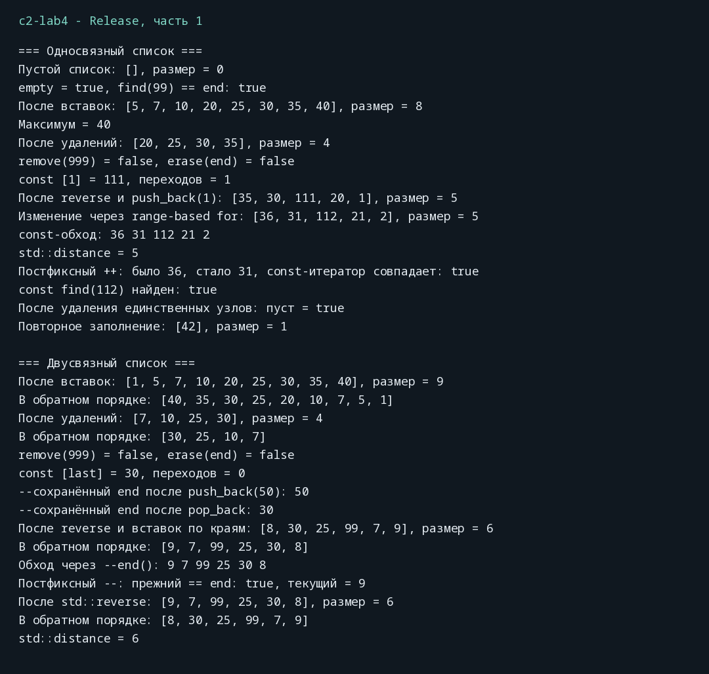
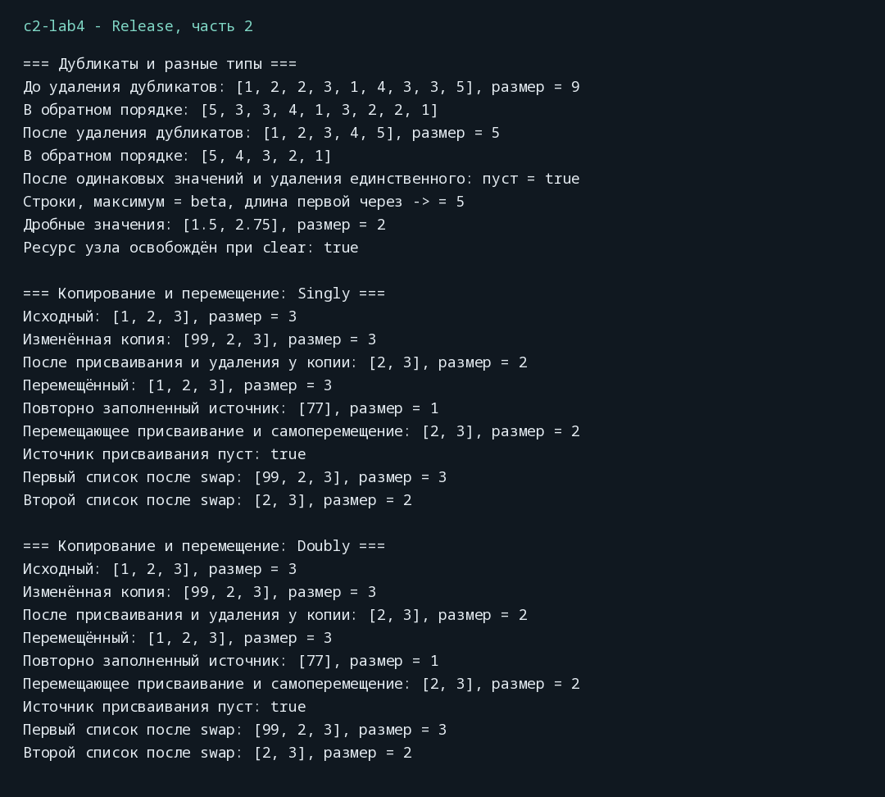
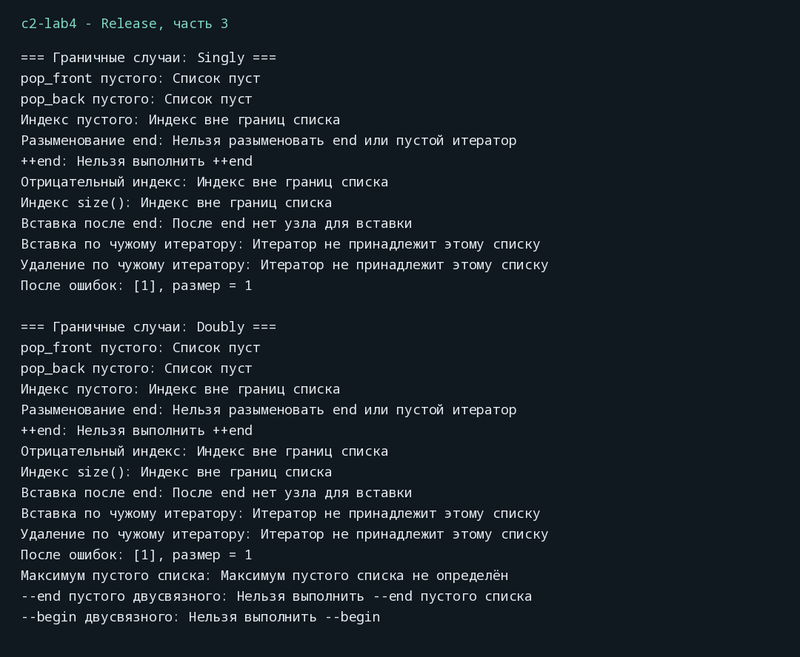
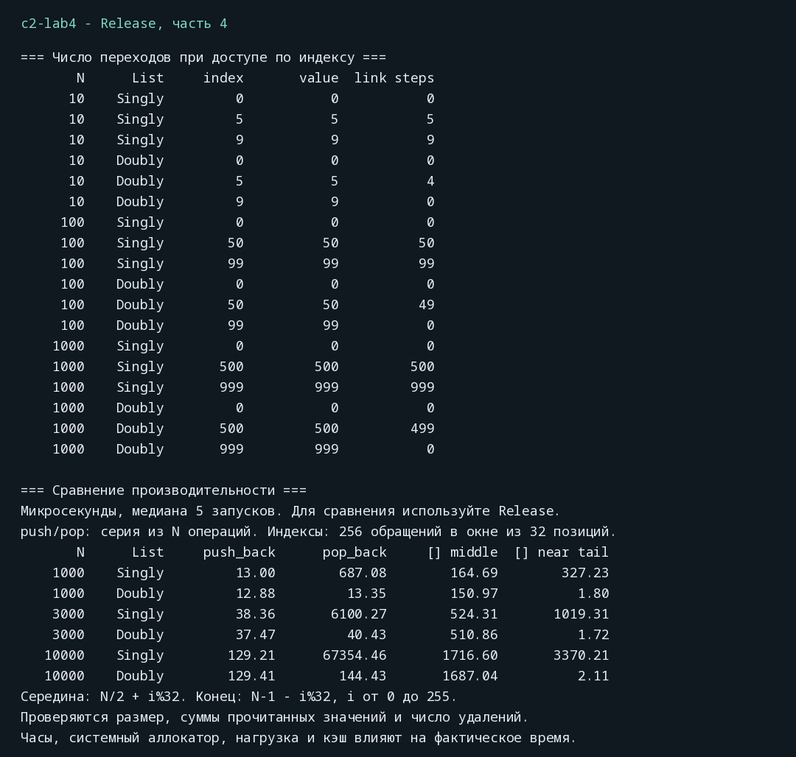
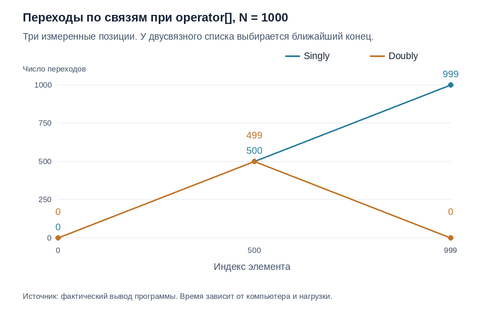
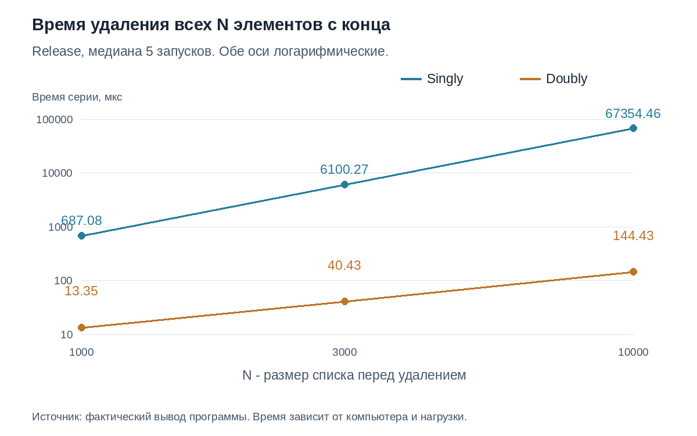

# Отчет по лабораторной работе 4

МИНИСТЕРСТВО НАУКИ И ВЫСШЕГО ОБРАЗОВАНИЯ
РОССИЙСКОЙ ФЕДЕРАЦИИ
Федеральное государственное автономное
образовательное учреждение высшего образования
«СЕВЕРО-КАВКАЗСКИЙ ФЕДЕРАЛЬНЫЙ УНИВЕРСИТЕТ»
Институт информационных технологий и кибер безопасности
Департамент цифровых, робототехнических систем и электроники
Кафедра программной инженерии

**Тема:** Односвязный и двусвязный списки

**Вариант:** 3. Продвинутый уровень

**Выполнил:**
Студент группы ПИЖ-б-о-25-2 (2),
направление подготовки: 09.03.04
“Программная инженерия”

Кравцун Михаил Алексеевич

**Проверил:**
Ассистент межинститутской базовой кафедры департамента цифровых,
робототехнических систем и электроники института перспективной
инженерии

Белик Ангелина Игоревна

---

## Репозиторий

[GitHub: Algorithms-Data-structures, лабораторная работа 4 второго курса](https://github.com/WhXteBeXr/Algorithms-Data-structures/tree/main/course-2/lab4)

## Цель работы

Реализовать односвязный и двусвязный списки на C++20, освоить изменение связей при вставке, удалении и развороте, обеспечить корректное владение узлами. Показать сложность доступа по индексу и сравнить производительность одинаковых операций двух структур.

## Постановка задачи

Общее задание продвинутого уровня: реализовать оба класса `SinglyLinkedList` и `DoublyLinkedList` с полной функциональностью и дополнительными требованиями варианта.

Вариант 3: реализовать оператор `[]` для доступа по индексу с проверкой сложности. Поскольку уровни дополняют общую работу, также реализованы поиск максимума односвязного списка и удаление дубликатов двусвязного списка из варианта 3 предыдущих уровней.

Поддерживаются вставка и удаление по краям и в заданной позиции, поиск, удаление по значению, очистка, размер, проверка пустоты, разворот, копирование, перемещение, итераторы и сравнение производительности. Для двусвязного списка доступен вывод в обе стороны.

## Теоретическое обоснование

### Узлы, голова и хвост

Связный список хранит элементы в отдельных узлах. Переход между ними выполняется по адресам. Узлы не обязаны находиться в непрерывной области памяти, поэтому адрес i-го элемента нельзя получить арифметикой над адресом головы.

Узел `Node<T>` содержит значение и ссылку `next`. Узел `DNode<T>` дополнительно содержит `prev`. `head` указывает на первый узел, `tail` - на последний. У пустого списка обе границы равны nullptr. У непустого `tail->next` равен nullptr, у двусвязного также `head->prev` равен nullptr.

```text
Односвязный: head -> [10] -> [20] -> [30] -> nullptr
                                     ^
                                    tail

Двусвязный:  nullptr <- [10] <-> [20] <-> [30] -> nullptr
                        ^                 ^
                       head              tail
```

### Время жизни и копирование

Каждый список единолично владеет своими узлами. Операция new создаёт узел вместе с T, delete уничтожает T и освобождает память узла. Деструктор списка очищает всю цепочку итеративно, без рекурсивного удаления.

Поверхностная копия адресов привела бы к нескольким владельцам одной цепочки. Поэтому копирование создаёт независимые узлы. Копирующее присваивание использует copy-and-swap, перемещение передаёт цепочку и оставляет источник пустым. В обоих классах поддержано правило пяти. Деструктор T предполагается не выбрасывающим исключений.

### Доступ по индексу

В односвязном списке для индекса i нужно пройти i связей от головы. С учётом проверки границ время равно O(1 + i), в худшем случае O(n).

В двусвязном списке выбирается ближайшая граница. Число переходов равно `min(i, n - 1 - i)`, время - O(1 + min(i, n - 1 - i)). Для крайних элементов это O(1), для середины - O(n). Наличие operator[] не превращает список в контейнер произвольного доступа.

### Итераторы

Прямой диапазон задаётся полуоткрытыми границами begin/end. End не содержит узла. Односвязный итератор поддерживает движение вперёд, двусвязный - в обе стороны. Константный итератор разрешает чтение, но не изменение значения.

Итератор хранит текущий узел и адрес поля tail владельца. Эта связь позволяет отличать позиции разных списков и получать актуальный хвост при --end. В отличие от сохранённой копии адреса хвоста она остаётся актуальной после вставок и удалений по краям.

## Реализация

### Структура файлов

- `Node.h` - узлы обоих списков.
- `ListIterator.h` - общий шаблон итератора с выбором константности и направления.
- `SinglyLinkedList.h`, `SinglyLinkedList.tpp` - интерфейс и методы односвязного списка.
- `DoublyLinkedList.h`, `DoublyLinkedList.tpp` - интерфейс и методы двусвязного списка.
- `Benchmark.h`, `Benchmark.cpp` - одинаковые измеряемые нагрузки и таблица времени.
- `main.cpp` - демонстрации операций, граничных случаев и числа переходов.
- `CMakeLists.txt` - сборка программы c2-lab4.
- `media` - фактический вывод и диаграммы.

Реализации шаблонов находятся в подключаемых tpp-файлах, чтобы компилятор видел определения при создании конкретного типа списка. В обычном cpp расположен модуль измерений.

### Вставка, удаление и владение позициями

Новый узел полностью создаётся до изменения цепочки. Затем перенаправляются связи соседей и, при необходимости, head и tail. Если выделение памяти или копирование T при создании узла не удалось, структура списка остаётся прежней.

Поиск возвращает итератор, а не открытый указатель на узел. Вставки и erase принимают позицию в виде ConstIterator, в которую автоматически преобразуется обычный итератор. Принадлежность позиции проверяется по адресу поля tail за O(1), без скрытого прохода списка.

Договор операций:

- find возвращает первое совпадение или end.
- insert_after требует существующий узел, передача end вызывает исключение.
- insert_before(end, value) добавляет элемент в конец.
- erase(end) возвращает false, удалять нечего.
- remove(value) удаляет только первое совпадение и сообщает результат через bool.
- Чужой или не связанный со списком итератор отклоняется через invalid_argument.

Использовать итератор уже удалённого узла нельзя. Проверка владельца не является проверкой времени жизни удалённого узла. После clear, swap и перемещения прежние итераторы в этой реализации не используются. Вставка сохраняет итераторы на существующие узлы, удаление другого узла не перемещает оставшиеся значения. Разворот сохраняет узлы и меняет порядок переходов.

### Односвязный список

`push_front` соединяет новый узел со старой головой, push_back использует сохранённый tail. Оба действия выполняются за O(1).

Для insert_after достаточно позиции узла и его next. Для insert_before и удаления узла без известного предшественника нужен проход от head. `pop_back` тоже ищет предпоследний узел, поскольку обратной ссылки нет.

Закрытый unlink получает узел и уже найденного предшественника. Он исключает узел из цепочки, корректирует границы и только затем удаляет память. `remove` ищет значение и предшественника за один проход.

`findMax` проходит список и возвращает константную ссылку на максимальное значение. Список должен быть непустым, T должен поддерживать используемое сравнение. `reverse` последовательно меняет направление next, сохраняя адрес продолжения до перезаписи связи. Прежняя голова становится хвостом.

### Двусвязный список

Каждая вставка согласованно обновляет связи в обе стороны. Закрытый unlink соединяет левого и правого соседа, отдельно учитывая отсутствие одного из них на границах. При известном узле его удаление занимает O(1), как и pop_back.

`removeDuplicates` сохраняет первое вхождение каждого значения. Для него просматриваются все следующие узлы, совпадающие удаляются. Следующий адрес сохраняется до удаления текущего проверяемого узла. Порядок первых вхождений не меняется. Худшая сложность O(n²), дополнительная память O(1), хеширование и сортировка не требуются.

`reverse` меняет next и prev в каждом узле, затем обменивает head и tail. `printReverse` обходит цепочку по prev, не меняя её.

### Копирование, перемещение и ошибки

Конструктор копирования сначала строит локальный список replacement. Если копирование элемента прервётся, его деструктор освободит частично созданную цепочку. После успешного заполнения происходит swap. Это обеспечивает RAII даже при использовании raw-указателей внутри владельца.

Оба присваивания проверяют this != &other. Самоприсваивание и самоперемещение сохраняют содержимое. Перемещающий конструктор работает за O(1), перемещающее присваивание дополнительно уничтожает старые узлы получателя и занимает O(k) для k его прежних элементов.

Отрицательные и слишком большие индексы вызывают out_of_range. Удаление из пустого списка и максимум пустого списка вызывают underflow_error. Итератор отклоняет разыменование end, ++end, а двусвязный также --begin и --end пустого списка. Операции, использующие сравнение T, могут передать исключение самого сравнения. Например, removeDuplicates в таком случае сохраняет корректную цепочку, но уже удалённые дубликаты не восстанавливает.

### Проверка сложности operator[]

`nodeAt` проверяет индекс, находит узел и считает переходы next/prev. `getLastAccessSteps` возвращает их число для последнего успешного обращения. Поле mutable позволяет обновлять только диагностический счётчик при чтении const-списка, не меняя значения и связи.

Считаются именно переходы, а не все инструкции или проверки границ. Ноль переходов означает непосредственный доступ через head или tail, но не нулевое время операции. Диагностика очищается при clear, обменивается и переносится вместе с состоянием списка. После неудачного индекса остаётся результат прежнего успешного обращения.

## Анализ сложности

Оценки предполагают O(1) для используемых операций над T. n - размер списка, m - размер источника, k - прежний размер получателя. Поиск позиции и изменение связей различаются: выражение insert_after(find(value), added) включает O(n) поиска, хотя сама вставка по уже известному итератору имеет O(1).

| Операция | Односвязный | Двусвязный |
| --- | --- | --- |
| Создание пустого списка | O(1) | O(1) |
| Конструктор копирования | O(m) | O(m) |
| Конструктор перемещения | O(1) | O(1) |
| Деструктор, clear | O(n) | O(n) |
| Копирующее присваивание | O(m + k) | O(m + k) |
| Перемещающее присваивание | O(k) для непустого получателя | O(k) для непустого получателя |
| swap | O(1) | O(1) |
| push_front, push_back | O(1) | O(1) |
| insert_after по известной позиции | O(1) | O(1) |
| insert_before по известной позиции | O(n) в общем случае | O(1) |
| pop_front | O(1) | O(1) |
| pop_back | O(n) | O(1) |
| erase по известной позиции | O(n) в общем случае | O(1) |
| remove по значению, find | O(n) | O(n) |
| findMax | O(n) | Не входит в интерфейс |
| removeDuplicates | Не входит в интерфейс | O(n²) в худшем случае |
| operator[] для индекса i | O(1 + i) | O(1 + min(i, n - 1 - i)) |
| reverse, print | O(n) | O(n) |
| printReverse | Не входит в интерфейс | O(n) |
| size, empty, begin, end, счётчик переходов | O(1) | O(1) |
| Одна операция итератора | O(1) | O(1) |
| std::distance по полному диапазону | O(n) | O(n) |

Для позиции head, а также insert_before(end), у односвязного списка не нужен поиск предшественника. `erase`(end), самоприсваивание и самоперемещение имеют O(1). Проверка принадлежности итератора и сам unlink выполняются за O(1).

Оба списка требуют O(n) памяти. Односвязный узел содержит T и один указатель, двусвязный - T и два указателя, дополнительно возможны выравнивание и служебные расходы аллокатора. Копирование списка требует O(m) новой памяти. Вставка требует одного нового узла. Удаление, поиск, разворот и удаление дубликатов используют O(1) дополнительной памяти.

## Сборка и запуск

Независимая сборка из корня репозитория:

```bash
cmake -S course-2/lab4 -B /tmp/algorithms-c2-lab4-release -DCMAKE_BUILD_TYPE=Release
cmake --build /tmp/algorithms-c2-lab4-release
/tmp/algorithms-c2-lab4-release/c2-lab4
```

В составе общего проекта:

```bash
cmake -S . -B /tmp/algorithms-c2-lab4-project -DCMAKE_BUILD_TYPE=Debug
cmake --build /tmp/algorithms-c2-lab4-project --target c2-lab4
/tmp/algorithms-c2-lab4-project/course-2/lab4/c2-lab4
```

Ввод с клавиатуры не требуется. Демонстрации находятся в main.cpp, отдельные тестовые программы и тестовые цели CMake не используются. Сборка и запуск выполнены в Debug и Release без предупреждений -Wall, -Wextra, -Wpedantic.

## Результаты работы

### Демонстрация возможностей

- Односвязный список после вставок содержит `[5, 7, 10, 20, 25, 30, 35, 40]`, максимум равен 40.
- Удаление головы, хвоста и внутренних узлов сохраняет цепочку и размер. После удаления единственного элемента список снова принимает значения.
- Двусвязный список выводится в обе стороны после вставок, удалений и разворота, связи next/prev остаются согласованными.
- Сохранённый end при -- возвращает 50 после добавления нового хвоста и 30 после его удаления.
- Из `[1, 2, 2, 3, 1, 4, 3, 3, 5]` получен `[1, 2, 3, 4, 5]`. Показаны повторный вызов, пустой список и одинаковые значения.
- Работают строки, дробные числа, константные итераторы, operator-> и STL-алгоритмы copy, reverse и distance подходящих категорий.
- Копии имеют независимые узлы. После перемещения источник пуст и допускает повторное заполнение. Показаны настоящее присваивание в уже существующий объект, самоприсваивание, самоперемещение и swap.
- Ресурс, удерживаемый shared_ptr в узле, освобождается после clear.
- Ожидаемые ошибки перехватываются без остановки программы. Чужая позиция отклоняется, содержимое получателя остаётся прежним.

[Фактический stdout программы](media/program-output.txt) сохранён полностью. Следующие изображения сформированы из него и не являются снимками окна терминала.









### Измеренное число переходов

В каждом списке находятся значения от 0 до N-1. Через константный operator[] читаются начало, середина и конец, сразу после обращения выводится число переходов по связям.

| N | Список | Индекс | Значение | Переходы |
| ---: | --- | ---: | ---: | ---: |
| 10 | Singly | 0 | 0 | 0 |
| 10 | Singly | 5 | 5 | 5 |
| 10 | Singly | 9 | 9 | 9 |
| 10 | Doubly | 0 | 0 | 0 |
| 10 | Doubly | 5 | 5 | 4 |
| 10 | Doubly | 9 | 9 | 0 |
| 100 | Singly | 0 | 0 | 0 |
| 100 | Singly | 50 | 50 | 50 |
| 100 | Singly | 99 | 99 | 99 |
| 100 | Doubly | 0 | 0 | 0 |
| 100 | Doubly | 50 | 50 | 49 |
| 100 | Doubly | 99 | 99 | 0 |
| 1000 | Singly | 0 | 0 | 0 |
| 1000 | Singly | 500 | 500 | 500 |
| 1000 | Singly | 999 | 999 | 999 |
| 1000 | Doubly | 0 | 0 | 0 |
| 1000 | Doubly | 500 | 500 | 499 |
| 1000 | Doubly | 999 | 999 | 0 |



При N = 1000 доступ к последнему элементу требует 999 переходов у односвязного списка и 0 у двусвязного. Доступ к середине требует 500 и 499 переходов соответственно. Это подтверждает O(n) в худшем случае для обоих списков, хотя доступ к краям двусвязного списка имеет O(1).

### Методика измерения времени

Для N = 1000, 3000 и 10000 сравниваются одинаковые серии:

- N добавлений в конец пустого списка.
- 256 обращений по индексам `N/2 + i%32`, то есть в окне рядом с серединой.
- 256 обращений по индексам `N-1 - i%32`, то есть в окне у хвоста.
- N удалений с конца до опустошения списка.

Здесь i меняется от 0 до 255. У всех размеров окно индексов находится в допустимых границах. Счётчик переходов остаётся включённым, поэтому измерения [] относятся к этой инструментированной реализации.

Используются std::chrono::steady_clock и микросекунды с дробной частью. Для каждого размера и списка выполняются пять запусков, порядок списков чередуется. Для каждого столбца отдельно выбирается медиана, то есть средний по позиции результат после сортировки пяти времён. Столбцы могут происходить из разных повторов.

Создание пустого списка находится вне замера. `push_back` включает выделение и создание узлов, pop_back - их уничтожение и освобождение. Для индексных серий измеряется сумма прочитанных элементов. Проверка размеров, контрольных сумм и числа удалений, печать и уничтожение уже пустого списка выполняются вне соответствующих интервалов.

Среда сохранённого запуска: GCC 16.2.1, C++20, Release с -O3, AMD Ryzen 7 7735U. Время зависит от нагрузки, кэша и аллокатора. Медиана уменьшает влияние отдельных выбросов, но не устраняет всю погрешность.

| N | Список | N push_back, мкс | N pop_back, мкс | 256 обращений к середине, мкс | 256 обращений у хвоста, мкс |
| ---: | --- | ---: | ---: | ---: | ---: |
| 1000 | Singly | 13.00 | 687.08 | 164.69 | 327.23 |
| 1000 | Doubly | 12.88 | 13.35 | 150.97 | 1.80 |
| 3000 | Singly | 38.36 | 6100.27 | 524.31 | 1019.31 |
| 3000 | Doubly | 37.47 | 40.43 | 510.86 | 1.72 |
| 10000 | Singly | 129.21 | 67354.46 | 1716.60 | 3370.21 |
| 10000 | Doubly | 129.41 | 144.43 | 1687.04 | 2.11 |



Серия N push_back имеет O(N) у обоих списков благодаря tail. У односвязного каждый pop_back ищет предшественника, поэтому полное удаление с конца требует O(N²). У двусвязного prev позволяет выполнить такую серию за O(N).

Для середины число переходов у обоих пропорционально N. В окне у хвоста двусвязный список выполняет не более 31 перехода на обращение, независимо от N. Односвязный доходит почти через весь список. При этом произвольный доступ по индексу у двусвязного по-прежнему O(N) в худшем случае.

Измерения иллюстрируют теоретические оценки, но не заменяют их доказательство. Отличия отдельных времён добавления не означают различия класса сложности, на константы влияют память узла и системный аллокатор.

## Листинг программы

### Node.h

```cpp
#pragma once

// Узел хранит значение отдельно от остальных узлов. Адреса связей могут быть
// nullptr, но сам узел всегда содержит уже созданный объект T.
template <typename T>
struct Node
{
  T data;
  Node* next = nullptr;

  explicit Node(const T& value) : data(value) {}
};

template <typename T>
struct DNode
{
  T data;
  DNode* prev = nullptr;
  DNode* next = nullptr;

  explicit DNode(const T& value) : data(value) {}
};
```

### ListIterator.h

```cpp
#pragma once

#include <cstddef>
#include <iterator>
#include <memory>
#include <stdexcept>
#include <type_traits>

template <typename T>
class SinglyLinkedList;
template <typename T>
class DoublyLinkedList;

// Один шаблон описывает const/обычный итератор и одно/двунаправленный обход.
// Узел скрыт от пользователя, чтобы нельзя было изменить связи через find().
template <typename NodeType, bool IsConst, bool IsDoubly>
class ListIterator
{
public:
  using iterator_category = std::conditional_t<IsDoubly, std::bidirectional_iterator_tag, std::forward_iterator_tag>;
  using iterator_concept = iterator_category;
  using value_type = std::remove_cvref_t<decltype(NodeType::data)>;
  using difference_type = std::ptrdiff_t;
  using pointer = std::conditional_t<IsConst, const value_type*, value_type*>;
  using reference = std::conditional_t<IsConst, const value_type&, value_type&>;

  ListIterator() = default;

  // Разрешён переход от изменяемого доступа к чтению, но не наоборот.
  template <bool OtherConst>
    requires (IsConst && !OtherConst)
  ListIterator(const ListIterator<NodeType, OtherConst, IsDoubly>& other) :
      current(other.current), tailLink(other.tailLink) {}

  reference operator*() const
  {
    if (current == nullptr)
    {
      throw std::out_of_range("Нельзя разыменовать end или пустой итератор");
    }
    return current->data;
  }

  pointer operator->() const
  {
    return std::addressof(operator*());
  }

  ListIterator& operator++()
  {
    if (current == nullptr)
    {
      throw std::out_of_range("Нельзя выполнить ++end");
    }
    current = current->next;
    return *this;
  }

  ListIterator operator++(int)
  {
    ListIterator previous = *this;
    ++(*this);
    return previous;
  }

  ListIterator& operator--() requires IsDoubly
  {
    if (current == nullptr)
    {
      // Храним адрес поля tail, а не копию старого хвоста. Поэтому сохранённый
      // end() учитывает новый хвост после push_back и pop_back.
      if (tailLink == nullptr || *tailLink == nullptr)
      {
        throw std::out_of_range("Нельзя выполнить --end пустого списка");
      }
      current = *tailLink;
    }
    else
    {
      if (current->prev == nullptr)
      {
        throw std::out_of_range("Нельзя выполнить --begin");
      }
      current = current->prev;
    }
    return *this;
  }

  ListIterator operator--(int) requires IsDoubly
  {
    ListIterator previous = *this;
    --(*this);
    return previous;
  }

  template <bool OtherConst>
  bool operator==(const ListIterator<NodeType, OtherConst, IsDoubly>& other) const
  {
    // Конечные итераторы разных списков различаются владельцем.
    return current == other.current && tailLink == other.tailLink;
  }

  template <bool OtherConst>
  bool operator!=(const ListIterator<NodeType, OtherConst, IsDoubly>& other) const
  {
    return !(*this == other);
  }

private:
  NodeType* current = nullptr;
  NodeType* const* tailLink = nullptr;

  ListIterator(NodeType* node, NodeType* const* ownerTail) : current(node), tailLink(ownerTail) {}

  template <typename>
  friend class SinglyLinkedList;
  template <typename>
  friend class DoublyLinkedList;
  template <typename, bool, bool>
  friend class ListIterator;
};
```

### SinglyLinkedList.h

```cpp
#pragma once

#include "ListIterator.h"
#include "Node.h"

#include <cstddef>
#include <iosfwd>

// Список владеет узлами. T должен поддерживать используемые операции:
// копирование, равенство для поиска и сравнение для findMax.
template <typename T>
class SinglyLinkedList
{
public:
  using Iterator = ListIterator<Node<T>, false, false>;
  using ConstIterator = ListIterator<Node<T>, true, false>;

  SinglyLinkedList() = default;
  SinglyLinkedList(const SinglyLinkedList& other);
  SinglyLinkedList(SinglyLinkedList&& other) noexcept;
  ~SinglyLinkedList();
  SinglyLinkedList& operator=(const SinglyLinkedList& other);
  SinglyLinkedList& operator=(SinglyLinkedList&& other) noexcept;
  void swap(SinglyLinkedList& other) noexcept;

  void push_front(const T& value);
  void push_back(const T& value);
  // position должен быть живым итератором этого списка. После end вставка запрещена.
  void insert_after(ConstIterator position, const T& value);
  // Вставка перед end добавляет в конец, erase(end) возвращает false.
  void insert_before(ConstIterator position, const T& value);
  void pop_front();
  void pop_back();
  bool erase(ConstIterator position);
  bool remove(const T& value);
  void clear() noexcept;

  // Ненайденное значение обозначается end(), а не раскрытым указателем на узел.
  Iterator find(const T& value);
  ConstIterator find(const T& value) const;
  const T& findMax() const;
  T& operator[](std::ptrdiff_t index);
  const T& operator[](std::ptrdiff_t index) const;
  // Число переходов next/prev при последнем успешном operator[], без проверки индекса.
  std::size_t getLastAccessSteps() const;

  void reverse() noexcept;
  void print(std::ostream& out) const;
  std::size_t size() const;
  bool empty() const;
  // Вставка сохраняет итераторы на существующие узлы. После удаления узла,
  // clear, swap и перемещения недействительные итераторы не используются.
  Iterator begin();
  Iterator end();
  ConstIterator begin() const;
  ConstIterator end() const;

private:
  Node<T>* head = nullptr;
  Node<T>* tail = nullptr;
  std::size_t count = 0;
  // Измерение не меняет содержимое списка, поэтому доступно и при const-чтении.
  mutable std::size_t lastAccessSteps = 0;

  Node<T>* nodeAt(std::ptrdiff_t index) const;
  void validatePosition(ConstIterator position) const;
  void unlink(Node<T>* previous, Node<T>* node) noexcept;
};

#include "SinglyLinkedList.tpp"
```

### SinglyLinkedList.tpp

```cpp
#pragma once

#include <ostream>
#include <stdexcept>
#include <utility>

template <typename T>
SinglyLinkedList<T>::SinglyLinkedList(const SinglyLinkedList& other)
{
  // Локальный владелец удалит частичную копию, если копирование T прервётся.
  SinglyLinkedList replacement;
  for (const T& value : other)
  {
    replacement.push_back(value);
  }
  swap(replacement);
}

template <typename T>
SinglyLinkedList<T>::SinglyLinkedList(SinglyLinkedList&& other) noexcept
{
  swap(other); // Наши начальные поля пусты, поэтому источник станет пустым.
}

template <typename T>
SinglyLinkedList<T>::~SinglyLinkedList()
{
  clear();
}

template <typename T>
SinglyLinkedList<T>& SinglyLinkedList<T>::operator=(const SinglyLinkedList& other)
{
  if (this != &other)
  {
    SinglyLinkedList replacement(other);
    swap(replacement); // Старые узлы теперь принадлежат локальному replacement.
  }
  return *this;
}

template <typename T>
SinglyLinkedList<T>& SinglyLinkedList<T>::operator=(SinglyLinkedList&& other) noexcept
{
  if (this != &other)
  {
    SinglyLinkedList replacement(std::move(other));
    swap(replacement);
  }
  return *this;
}

template <typename T>
void SinglyLinkedList<T>::swap(SinglyLinkedList& other) noexcept
{
  // Меняем владельцев цепочек без копирования T. Старые итераторы после swap
  // не используются: их сведения о владельце относятся к прежнему объекту.
  std::swap(head, other.head);
  std::swap(tail, other.tail);
  std::swap(count, other.count);
  std::swap(lastAccessSteps, other.lastAccessSteps);
}

template <typename T>
void SinglyLinkedList<T>::push_front(const T& value)
{
  // Создаём значение до изменения связей. При ошибке new список не изменён.
  auto* added = new Node<T>(value);
  added->next = head;
  head = added;
  if (tail == nullptr)
  {
    tail = added; // Первый узел одновременно является последним.
  }
  ++count;
}

template <typename T>
void SinglyLinkedList<T>::push_back(const T& value)
{
  auto* added = new Node<T>(value);
  if (tail == nullptr)
  {
    head = added;
  }
  else
  {
    tail->next = added; // Прежний хвост теперь связан с новым узлом.
  }
  tail = added;
  ++count;
}

template <typename T>
void SinglyLinkedList<T>::validatePosition(ConstIterator position) const
{
  if (position.tailLink != &tail)
  {
    throw std::invalid_argument("Итератор не принадлежит этому списку");
  }
}

template <typename T>
void SinglyLinkedList<T>::insert_after(ConstIterator position, const T& value)
{
  validatePosition(position);
  if (position.current == nullptr)
  {
    throw std::out_of_range("После end нет узла для вставки");
  }
  auto* added = new Node<T>(value);
  // Сначала сохраняем продолжение цепочки в новом узле, затем подключаем узел.
  added->next = position.current->next;
  position.current->next = added;
  if (tail == position.current)
  {
    tail = added;
  }
  ++count;
}

template <typename T>
void SinglyLinkedList<T>::insert_before(ConstIterator position, const T& value)
{
  validatePosition(position);
  if (position.current == nullptr)
  {
    push_back(value); // Вставка перед end означает добавление в конец.
    return;
  }
  if (position.current == head)
  {
    push_front(value);
    return;
  }
  // Обратной ссылки нет: предшественника приходится искать от головы.
  Node<T>* previous = head;
  while (previous->next != position.current)
  {
    previous = previous->next;
  }
  auto* added = new Node<T>(value);
  added->next = position.current;
  previous->next = added;
  ++count;
}

template <typename T>
void SinglyLinkedList<T>::unlink(Node<T>* previous, Node<T>* node) noexcept
{
  // Закрытый помощник получает живой узел и его известного предшественника.
  if (previous == nullptr)
  {
    head = node->next;
  }
  else
  {
    previous->next = node->next; // Исключаем узел из цепочки до освобождения памяти.
  }
  if (node == tail)
  {
    tail = previous; // При удалении единственного узла previous равен nullptr.
  }
  delete node;
  --count;
}

template <typename T>
void SinglyLinkedList<T>::pop_front()
{
  if (empty())
  {
    throw std::underflow_error("Список пуст");
  }
  unlink(nullptr, head);
}

template <typename T>
void SinglyLinkedList<T>::pop_back()
{
  if (empty())
  {
    throw std::underflow_error("Список пуст");
  }
  Node<T>* previous = nullptr;
  if (head != tail)
  {
    previous = head;
    while (previous->next != tail)
    {
      previous = previous->next;
    }
  }
  unlink(previous, tail);
}

template <typename T>
bool SinglyLinkedList<T>::erase(ConstIterator position)
{
  validatePosition(position);
  if (position.current == nullptr)
  {
    return false; // end допустим как обозначение отсутствующего результата поиска.
  }
  Node<T>* previous = nullptr;
  if (position.current != head)
  {
    previous = head;
    while (previous->next != position.current)
    {
      previous = previous->next;
    }
  }
  unlink(previous, position.current);
  return true;
}

template <typename T>
bool SinglyLinkedList<T>::remove(const T& value)
{
  // Ищем узел и его предшественника одновременно, чтобы не проходить список дважды.
  Node<T>* previous = nullptr;
  Node<T>* current = head;
  while (current != nullptr && !(current->data == value))
  {
    previous = current;
    current = current->next;
  }
  if (current == nullptr)
  {
    return false;
  }
  unlink(previous, current);
  return true;
}

template <typename T>
void SinglyLinkedList<T>::clear() noexcept
{
  while (head != nullptr)
  {
    Node<T>* removed = head;
    head = head->next; // Адрес следующего узла нужен до удаления текущего.
    delete removed;
  }
  tail = nullptr;
  count = 0;
  lastAccessSteps = 0;
}

template <typename T>
typename SinglyLinkedList<T>::Iterator SinglyLinkedList<T>::find(const T& value)
{
  for (auto it = begin(); it != end(); ++it)
  {
    if (*it == value)
    {
      return it;
    }
  }
  return end();
}

template <typename T>
typename SinglyLinkedList<T>::ConstIterator SinglyLinkedList<T>::find(const T& value) const
{
  for (auto it = begin(); it != end(); ++it)
  {
    if (*it == value)
    {
      return it;
    }
  }
  return end();
}

template <typename T>
const T& SinglyLinkedList<T>::findMax() const
{
  if (empty())
  {
    throw std::underflow_error("Максимум пустого списка не определён");
  }
  const Node<T>* maximum = head;
  for (const Node<T>* current = head->next; current != nullptr; current = current->next)
  {
    if (maximum->data < current->data)
    {
      maximum = current;
    }
  }
  return maximum->data;
}

template <typename T>
Node<T>* SinglyLinkedList<T>::nodeAt(std::ptrdiff_t index) const
{
  if (index < 0 || static_cast<std::size_t>(index) >= count)
  {
    throw std::out_of_range("Индекс вне границ списка");
  }
  lastAccessSteps = 0;
  Node<T>* current = head;
  for (std::ptrdiff_t position = 0; position < index; ++position)
  {
    current = current->next;
    ++lastAccessSteps; // Считаем именно переходы по связям, а не проверки условий.
  }
  return current;
}

template <typename T>
T& SinglyLinkedList<T>::operator[](std::ptrdiff_t index)
{
  return nodeAt(index)->data;
}

template <typename T>
const T& SinglyLinkedList<T>::operator[](std::ptrdiff_t index) const
{
  return nodeAt(index)->data;
}

template <typename T>
std::size_t SinglyLinkedList<T>::getLastAccessSteps() const
{
  return lastAccessSteps;
}

template <typename T>
void SinglyLinkedList<T>::reverse() noexcept
{
  Node<T>* previous = nullptr;
  Node<T>* current = head;
  tail = head; // Прежняя голова станет хвостом после переворота всех связей.
  while (current != nullptr)
  {
    Node<T>* next = current->next;
    current->next = previous;
    previous = current;
    current = next; // Продолжаем по сохранённой, ещё не перевёрнутой цепочке.
  }
  head = previous;
}

template <typename T>
void SinglyLinkedList<T>::print(std::ostream& out) const
{
  out << '[';
  for (const Node<T>* current = head; current != nullptr; current = current->next)
  {
    if (current != head)
    {
      out << ", ";
    }
    out << current->data;
  }
  out << ']';
}

template <typename T>
std::size_t SinglyLinkedList<T>::size() const
{
  return count;
}

template <typename T>
bool SinglyLinkedList<T>::empty() const
{
  return head == nullptr;
}

template <typename T>
typename SinglyLinkedList<T>::Iterator SinglyLinkedList<T>::begin()
{
  return Iterator(head, &tail);
}

template <typename T>
typename SinglyLinkedList<T>::Iterator SinglyLinkedList<T>::end()
{
  // Граница диапазона не указывает на элемент, но сохраняет связь с владельцем.
  return Iterator(nullptr, &tail);
}

template <typename T>
typename SinglyLinkedList<T>::ConstIterator SinglyLinkedList<T>::begin() const
{
  return ConstIterator(head, &tail);
}

template <typename T>
typename SinglyLinkedList<T>::ConstIterator SinglyLinkedList<T>::end() const
{
  return ConstIterator(nullptr, &tail);
}
```

### DoublyLinkedList.h

```cpp
#pragma once

#include "ListIterator.h"
#include "Node.h"

#include <cstddef>
#include <iosfwd>

template <typename T>
class DoublyLinkedList
{
public:
  using Iterator = ListIterator<DNode<T>, false, true>;
  using ConstIterator = ListIterator<DNode<T>, true, true>;

  DoublyLinkedList() = default;
  DoublyLinkedList(const DoublyLinkedList& other);
  DoublyLinkedList(DoublyLinkedList&& other) noexcept;
  ~DoublyLinkedList();
  DoublyLinkedList& operator=(const DoublyLinkedList& other);
  DoublyLinkedList& operator=(DoublyLinkedList&& other) noexcept;
  void swap(DoublyLinkedList& other) noexcept;

  void push_front(const T& value);
  void push_back(const T& value);
  // position должен быть живым итератором этого списка. После end вставка запрещена.
  void insert_after(ConstIterator position, const T& value);
  // Вставка перед end добавляет в конец, erase(end) возвращает false.
  void insert_before(ConstIterator position, const T& value);
  void pop_front();
  void pop_back();
  bool erase(ConstIterator position);
  bool remove(const T& value);
  void clear() noexcept;

  Iterator find(const T& value);
  ConstIterator find(const T& value) const;
  T& operator[](std::ptrdiff_t index);
  const T& operator[](std::ptrdiff_t index) const;
  // Число переходов next/prev при последнем успешном operator[], без проверки индекса.
  std::size_t getLastAccessSteps() const;

  void removeDuplicates();
  void reverse() noexcept;
  void print(std::ostream& out) const;
  void printReverse(std::ostream& out) const;
  std::size_t size() const;
  bool empty() const;
  // Вставка сохраняет итераторы на существующие узлы. После удаления узла,
  // clear, swap и перемещения недействительные итераторы не используются.
  Iterator begin();
  Iterator end();
  ConstIterator begin() const;
  ConstIterator end() const;

private:
  DNode<T>* head = nullptr;
  DNode<T>* tail = nullptr;
  std::size_t count = 0;
  mutable std::size_t lastAccessSteps = 0;

  DNode<T>* nodeAt(std::ptrdiff_t index) const;
  void validatePosition(ConstIterator position) const;
  void unlink(DNode<T>* node) noexcept;
};

#include "DoublyLinkedList.tpp"
```

### DoublyLinkedList.tpp

```cpp
#pragma once

#include <ostream>
#include <stdexcept>
#include <utility>

template <typename T>
DoublyLinkedList<T>::DoublyLinkedList(const DoublyLinkedList& other)
{
  // Частичная цепочка принадлежит локальному списку, который умеет её очистить.
  DoublyLinkedList replacement;
  for (const T& value : other)
  {
    replacement.push_back(value);
  }
  swap(replacement);
}

template <typename T>
DoublyLinkedList<T>::DoublyLinkedList(DoublyLinkedList&& other) noexcept
{
  swap(other);
}

template <typename T>
DoublyLinkedList<T>::~DoublyLinkedList()
{
  clear();
}

template <typename T>
DoublyLinkedList<T>& DoublyLinkedList<T>::operator=(const DoublyLinkedList& other)
{
  if (this != &other)
  {
    DoublyLinkedList replacement(other);
    swap(replacement); // Старая цепочка будет удалена деструктором replacement.
  }
  return *this;
}

template <typename T>
DoublyLinkedList<T>& DoublyLinkedList<T>::operator=(DoublyLinkedList&& other) noexcept
{
  if (this != &other)
  {
    DoublyLinkedList replacement(std::move(other));
    swap(replacement);
  }
  return *this;
}

template <typename T>
void DoublyLinkedList<T>::swap(DoublyLinkedList& other) noexcept
{
  // После обмена/перемещения прежние итераторы не используются: связь с
  // полем tail относится к старому владельцу. Сами T при обмене не копируются.
  std::swap(head, other.head);
  std::swap(tail, other.tail);
  std::swap(count, other.count);
  std::swap(lastAccessSteps, other.lastAccessSteps);
}

template <typename T>
void DoublyLinkedList<T>::push_front(const T& value)
{
  auto* added = new DNode<T>(value);
  added->next = head;
  if (head == nullptr)
  {
    tail = added;
  }
  else
  {
    head->prev = added; // У прежней головы появляется предшественник.
  }
  head = added;
  ++count;
}

template <typename T>
void DoublyLinkedList<T>::push_back(const T& value)
{
  auto* added = new DNode<T>(value);
  added->prev = tail;
  if (tail == nullptr)
  {
    head = added;
  }
  else
  {
    tail->next = added;
  }
  tail = added;
  ++count;
}

template <typename T>
void DoublyLinkedList<T>::validatePosition(ConstIterator position) const
{
  // Проверяем владельца за O(1), не добавляя скрытого обхода перед вставкой.
  if (position.tailLink != &tail)
  {
    throw std::invalid_argument("Итератор не принадлежит этому списку");
  }
}

template <typename T>
void DoublyLinkedList<T>::insert_after(ConstIterator position, const T& value)
{
  validatePosition(position);
  DNode<T>* left = position.current;
  if (left == nullptr)
  {
    throw std::out_of_range("После end нет узла для вставки");
  }
  auto* added = new DNode<T>(value);
  // Новый узел сначала получает обе связи с соседями.
  added->prev = left;
  added->next = left->next;
  if (left->next == nullptr)
  {
    tail = added;
  }
  else
  {
    left->next->prev = added; // Сосед справа должен ссылаться назад на новый узел.
  }
  left->next = added;
  ++count;
}

template <typename T>
void DoublyLinkedList<T>::insert_before(ConstIterator position, const T& value)
{
  validatePosition(position);
  DNode<T>* right = position.current;
  if (right == nullptr)
  {
    push_back(value);
    return;
  }
  if (right == head)
  {
    push_front(value);
    return;
  }
  auto* added = new DNode<T>(value);
  added->prev = right->prev;
  added->next = right;
  // Связь prev сразу даёт левого соседа, искать его от head не нужно.
  right->prev->next = added;
  right->prev = added;
  ++count;
}

template <typename T>
void DoublyLinkedList<T>::unlink(DNode<T>* node) noexcept
{
  // Перенаправляем связи с обеих сторон. Отсутствие соседа означает,
  // что удаляемый узел был головой или хвостом.
  if (node->prev == nullptr)
  {
    head = node->next;
  }
  else
  {
    node->prev->next = node->next;
  }
  if (node->next == nullptr)
  {
    tail = node->prev;
  }
  else
  {
    node->next->prev = node->prev;
  }
  delete node;
  --count;
}

template <typename T>
void DoublyLinkedList<T>::pop_front()
{
  if (empty())
  {
    throw std::underflow_error("Список пуст");
  }
  unlink(head);
}

template <typename T>
void DoublyLinkedList<T>::pop_back()
{
  if (empty())
  {
    throw std::underflow_error("Список пуст");
  }
  unlink(tail); // Предшественник уже доступен через prev, поиск не требуется.
}

template <typename T>
bool DoublyLinkedList<T>::erase(ConstIterator position)
{
  validatePosition(position);
  if (position.current == nullptr)
  {
    return false;
  }
  unlink(position.current);
  return true;
}

template <typename T>
bool DoublyLinkedList<T>::remove(const T& value)
{
  // find выполняет O(n) поиска, само исключение найденного узла занимает O(1).
  return erase(find(value));
}

template <typename T>
void DoublyLinkedList<T>::clear() noexcept
{
  while (head != nullptr)
  {
    DNode<T>* removed = head;
    head = head->next;
    delete removed;
  }
  // Во время очистки prev не используется, после неё обе границы пусты.
  tail = nullptr;
  count = 0;
  lastAccessSteps = 0;
}

template <typename T>
typename DoublyLinkedList<T>::Iterator DoublyLinkedList<T>::find(const T& value)
{
  for (auto it = begin(); it != end(); ++it)
  {
    if (*it == value)
    {
      return it;
    }
  }
  return end();
}

template <typename T>
typename DoublyLinkedList<T>::ConstIterator DoublyLinkedList<T>::find(const T& value) const
{
  for (auto it = begin(); it != end(); ++it)
  {
    if (*it == value)
    {
      return it;
    }
  }
  return end();
}

template <typename T>
DNode<T>* DoublyLinkedList<T>::nodeAt(std::ptrdiff_t index) const
{
  if (index < 0 || static_cast<std::size_t>(index) >= count)
  {
    throw std::out_of_range("Индекс вне границ списка");
  }
  lastAccessSteps = 0;
  const auto target = static_cast<std::size_t>(index);
  DNode<T>* current;
  if (target < count / 2)
  {
    current = head;
    for (std::size_t position = 0; position < target; ++position)
    {
      current = current->next;
      ++lastAccessSteps;
    }
  }
  else
  {
    current = tail;
    for (std::size_t position = count - 1; position > target; --position)
    {
      current = current->prev;
      ++lastAccessSteps;
    }
  }
  return current;
}

template <typename T>
T& DoublyLinkedList<T>::operator[](std::ptrdiff_t index)
{
  return nodeAt(index)->data;
}

template <typename T>
const T& DoublyLinkedList<T>::operator[](std::ptrdiff_t index) const
{
  return nodeAt(index)->data;
}

template <typename T>
std::size_t DoublyLinkedList<T>::getLastAccessSteps() const
{
  return lastAccessSteps;
}

template <typename T>
void DoublyLinkedList<T>::removeDuplicates()
{
  // Для каждого первого вхождения просматриваем оставшуюся часть списка.
  // Требуется только равенство T, сортировка или хеширование не нужны.
  for (DNode<T>* current = head; current != nullptr; current = current->next)
  {
    DNode<T>* runner = current->next;
    while (runner != nullptr)
    {
      DNode<T>* next = runner->next; // После unlink сам runner уже недействителен.
      if (runner->data == current->data)
      {
        unlink(runner);
      }
      runner = next;
    }
  }
}

template <typename T>
void DoublyLinkedList<T>::reverse() noexcept
{
  DNode<T>* current = head;
  while (current != nullptr)
  {
    std::swap(current->next, current->prev);
    current = current->prev; // После обмена здесь находится прежний next.
  }
  std::swap(head, tail);
}

template <typename T>
void DoublyLinkedList<T>::print(std::ostream& out) const
{
  out << '[';
  for (const DNode<T>* current = head; current != nullptr; current = current->next)
  {
    if (current != head)
    {
      out << ", ";
    }
    out << current->data;
  }
  out << ']';
}

template <typename T>
void DoublyLinkedList<T>::printReverse(std::ostream& out) const
{
  out << '[';
  for (const DNode<T>* current = tail; current != nullptr; current = current->prev)
  {
    if (current != tail)
    {
      out << ", ";
    }
    out << current->data;
  }
  out << ']';
}

template <typename T>
std::size_t DoublyLinkedList<T>::size() const
{
  return count;
}

template <typename T>
bool DoublyLinkedList<T>::empty() const
{
  return head == nullptr;
}

template <typename T>
typename DoublyLinkedList<T>::Iterator DoublyLinkedList<T>::begin()
{
  return Iterator(head, &tail);
}

template <typename T>
typename DoublyLinkedList<T>::Iterator DoublyLinkedList<T>::end()
{
  // Граница диапазона не указывает на элемент, но сохраняет связь с владельцем.
  return Iterator(nullptr, &tail);
}

template <typename T>
typename DoublyLinkedList<T>::ConstIterator DoublyLinkedList<T>::begin() const
{
  return ConstIterator(head, &tail);
}

template <typename T>
typename DoublyLinkedList<T>::ConstIterator DoublyLinkedList<T>::end() const
{
  return ConstIterator(nullptr, &tail);
}
```

### Benchmark.h

```cpp
#pragma once

#include <iosfwd>

// Одинаковая нагрузка на оба списка, результаты в микросекундах.
void runListComparison(std::ostream& out);
```

### Benchmark.cpp

```cpp
#include "Benchmark.h"
#include "DoublyLinkedList.h"
#include "SinglyLinkedList.h"

#include <algorithm>
#include <array>
#include <chrono>
#include <cstdint>
#include <iomanip>
#include <ostream>
#include <stdexcept>

namespace
{
  constexpr std::size_t repeatCount = 5;
  constexpr int accessCount = 256;
  constexpr int indexSpread = 32;

  struct Measurements
  {
    double pushBack;
    double popBack;
    double middle;
    double nearTail;
  };

  template <typename Action>
  double measure(Action action, std::int64_t expected)
  {
    const auto start = std::chrono::steady_clock::now();
    const std::int64_t result = action();
    const auto finish = std::chrono::steady_clock::now();
    // Проверка и печать находятся за границами измеряемого интервала.
    if (result != expected)
    {
      throw std::runtime_error("Неверный результат измеряемой серии");
    }
    return std::chrono::duration<double, std::micro>(finish - start).count();
  }

  template <typename List>
  Measurements runScenario(int count)
  {
    List values;
    Measurements result{};
    result.pushBack = measure([&]
    {
      for (int i = 0; i < count; ++i)
      {
        values.push_back(i);
      }
      return static_cast<std::int64_t>(values.size());
    }, count);

    // 256 обращений проходят восемь раз по 32 соседним индексам. Так нагрузка
    // не сводится к повторному чтению одного и того же элемента.
    constexpr std::int64_t offsetSum = (accessCount / indexSpread) * (indexSpread - 1) * indexSpread / 2;
    result.middle = measure([&]
    {
      std::int64_t sum = 0;
      for (int i = 0; i < accessCount; ++i)
      {
        sum += values[count / 2 + i % indexSpread];
      }
      return sum;
    }, static_cast<std::int64_t>(accessCount) * (count / 2) + offsetSum);

    result.nearTail = measure([&]
    {
      std::int64_t sum = 0;
      for (int i = 0; i < accessCount; ++i)
      {
        sum += values[count - 1 - i % indexSpread];
      }
      return sum;
    }, static_cast<std::int64_t>(accessCount) * (count - 1) - offsetSum);

    // Удаляем весь список с конца. Именно здесь n отдельных O(n) операций
    // односвязного списка дают O(n^2) для серии, у двусвязного получается O(n).
    result.popBack = measure([&]
    {
      std::int64_t removed = 0;
      while (!values.empty())
      {
        values.pop_back();
        ++removed;
      }
      return removed;
    }, count);
    return result;
  }

  double median(std::array<double, repeatCount> values)
  {
    std::sort(values.begin(), values.end());
    return values[repeatCount / 2];
  }

  Measurements collect(const std::array<Measurements, repeatCount>& samples)
  {
    std::array<double, repeatCount> push{}, pop{}, middle{}, tail{};
    for (std::size_t i = 0; i < repeatCount; ++i)
    {
      push[i] = samples[i].pushBack;
      pop[i] = samples[i].popBack;
      middle[i] = samples[i].middle;
      tail[i] = samples[i].nearTail;
    }
    return {median(push), median(pop), median(middle), median(tail)};
  }

  void printRow(std::ostream& out, int count, const char* kind, const Measurements& result)
  {
    out << std::fixed << std::setprecision(2) << std::setw(8) << count << std::setw(10) << kind
        << std::setw(14) << result.pushBack << std::setw(14) << result.popBack
        << std::setw(14) << result.middle << std::setw(14) << result.nearTail << '\n';
  }
}

void runListComparison(std::ostream& out)
{
  out << "\n=== Сравнение производительности ===\n"
      << "Микросекунды, медиана 5 запусков. Для сравнения используйте Release.\n"
      << "push/pop: серия из N операций. Индексы: 256 обращений в окне из 32 позиций.\n"
      << std::setw(8) << "N" << std::setw(10) << "List" << std::setw(14) << "push_back"
      << std::setw(14) << "pop_back" << std::setw(14) << "[] middle" << std::setw(14) << "[] near tail" << '\n';
  for (int count : {1000, 3000, 10000})
  {
    std::array<Measurements, repeatCount> singly{}, doubly{};
    for (std::size_t repeat = 0; repeat < repeatCount; ++repeat)
    {
      // Чередование уменьшает влияние постоянного первого/второго места запуска.
      if (repeat % 2 == 0)
      {
        singly[repeat] = runScenario<SinglyLinkedList<int>>(count);
        doubly[repeat] = runScenario<DoublyLinkedList<int>>(count);
      }
      else
      {
        doubly[repeat] = runScenario<DoublyLinkedList<int>>(count);
        singly[repeat] = runScenario<SinglyLinkedList<int>>(count);
      }
    }
    printRow(out, count, "Singly", collect(singly));
    printRow(out, count, "Doubly", collect(doubly));
  }
  out << "Середина: N/2 + i%32. Конец: N-1 - i%32, i от 0 до 255.\n"
      << "Проверяются размер, суммы прочитанных значений и число удалений.\n"
      << "Часы, системный аллокатор, нагрузка и кэш влияют на фактическое время.\n";
}
```

### main.cpp

```cpp
#include "Benchmark.h"
#include "DoublyLinkedList.h"
#include "SinglyLinkedList.h"

#include <algorithm>
#include <exception>
#include <iomanip>
#include <iostream>
#include <iterator>
#include <memory>
#include <string>
#include <utility>

namespace
{
  template <typename List>
  void printList(const char* label, const List& values)
  {
    std::cout << label;
    values.print(std::cout);
    std::cout << ", размер = " << values.size() << '\n';
  }

  template <typename Action>
  void showError(const char* label, Action action)
  {
    try
    {
      action();
    }
    catch (const std::exception& error)
    {
      std::cout << label << ": " << error.what() << '\n';
    }
  }

  void demonstrateSingly()
  {
    std::cout << "=== Односвязный список ===\n";
    SinglyLinkedList<int> values;
    printList("Пустой список: ", values);
    std::cout << "empty = " << values.empty() << ", find(99) == end: " << (values.find(99) == values.end()) << '\n';

    // Сначала создаём границы цепочки, затем вставляем между существующими узлами.
    values.push_back(10);
    values.push_back(20);
    values.push_back(30);
    values.push_front(5);
    values.insert_after(values.find(20), 25);
    values.insert_before(values.find(10), 7);
    values.insert_after(values.find(30), 35); // Меняется tail.
    values.insert_before(values.end(), 40);
    printList("После вставок: ", values);
    std::cout << "Максимум = " << values.findMax() << '\n';

    // Удаление из середины, головы и хвоста должно сохранять всю оставшуюся цепочку.
    values.remove(7);
    values.erase(values.find(5));
    values.remove(40);
    values.push_back(50); // Используем обновлённый хвост после удаления.
    values.pop_front();
    values.pop_back();
    printList("После удалений: ", values);
    std::cout << "remove(999) = " << values.remove(999) << ", erase(end) = " << values.erase(values.end()) << '\n';

    values[1] = 111;
    const auto& view = values;
    std::cout << "const [1] = " << view[1] << ", переходов = " << view.getLastAccessSteps() << '\n';
    // Разворачиваем связи, не копируя значения. Проверяем новый tail добавлением.
    values.reverse();
    values.push_back(1);
    printList("После reverse и push_back(1): ", values);
    for (int& value : values)
    {
      ++value;
    }
    printList("Изменение через range-based for: ", values);
    std::cout << "const-обход: ";
    std::copy(view.begin(), view.end(), std::ostream_iterator<int>(std::cout, " "));
    std::cout << "\nstd::distance = " << std::distance(view.begin(), view.end()) << '\n';

    auto it = values.begin();
    auto previous = it++;
    SinglyLinkedList<int>::ConstIterator readOnly = it;
    std::cout << "Постфиксный ++: было " << *previous << ", стало " << *it
              << ", const-итератор совпадает: " << (readOnly == it) << '\n';
    const auto found = view.find(111 + 1);
    std::cout << "const find(112) найден: " << (found != view.end()) << '\n';

    // Пограничный случай одного узла: после удаления обе границы должны обнулиться.
    values.clear();
    values.reverse();
    values.push_front(9);
    values.pop_back();
    values.push_back(8);
    values.pop_front();
    std::cout << "После удаления единственных узлов: пуст = " << values.empty() << '\n';
    values.push_back(42);
    printList("Повторное заполнение: ", values);
  }

  void printBoth(const char* label, const DoublyLinkedList<int>& values)
  {
    printList(label, values);
    std::cout << "В обратном порядке: ";
    values.printReverse(std::cout);
    std::cout << '\n';
  }

  void demonstrateDoubly()
  {
    std::cout << "\n=== Двусвязный список ===\n";
    DoublyLinkedList<int> values;
    values.push_back(10);
    values.push_back(20);
    values.push_back(30);
    values.push_front(5);
    values.insert_after(values.find(20), 25);
    values.insert_before(values.find(10), 7);
    values.insert_before(values.begin(), 1);
    values.insert_after(values.find(30), 35);
    values.insert_before(values.end(), 40);
    printBoth("После вставок: ", values);

    values.erase(values.find(20));
    values.erase(values.begin());
    values.remove(40);
    values.pop_front();
    values.pop_back();
    printBoth("После удалений: ", values);
    std::cout << "remove(999) = " << values.remove(999) << ", erase(end) = " << values.erase(values.end()) << '\n';
    values[1] = 99;
    const auto& view = values;
    const auto last = static_cast<std::ptrdiff_t>(values.size()) - 1;
    std::cout << "const [last] = " << view[last] << ", переходов = " << view.getLastAccessSteps() << '\n';

    // Сохранённый end не содержит старую копию tail, поэтому видит новый хвост.
    auto savedEnd = values.end();
    values.push_back(50);
    auto tail = savedEnd;
    --tail;
    std::cout << "--сохранённый end после push_back(50): " << *tail << '\n';
    values.pop_back();
    tail = savedEnd;
    std::cout << "--сохранённый end после pop_back: " << *--tail << '\n';

    // Изменение связей сохраняет узлы, вывод в обе стороны показывает их согласованность.
    values.reverse();
    values.push_front(8);
    values.push_back(9);
    printBoth("После reverse и вставок по краям: ", values);
    std::cout << "Обход через --end(): ";
    for (auto it = view.end(); it != view.begin();)
    {
      std::cout << *--it << ' ';
    }
    std::cout << '\n';
    auto it = values.end();
    auto oldEnd = it--;
    DoublyLinkedList<int>::ConstIterator readOnly = it;
    std::cout << "Постфиксный --: прежний == end: " << (oldEnd == values.end())
              << ", текущий = " << *readOnly << '\n';
    std::reverse(values.begin(), values.end()); // Алгоритм меняет значения, а не связи узлов.
    printBoth("После std::reverse: ", values);
    std::cout << "std::distance = " << std::distance(values.begin(), values.end()) << '\n';
  }

  void demonstrateDuplicatesAndTypes()
  {
    std::cout << "\n=== Дубликаты и разные типы ===\n";
    DoublyLinkedList<int> repeated;
    for (int value : {1, 2, 2, 3, 1, 4, 3, 3, 5})
    {
      repeated.push_back(value);
    }
    printBoth("До удаления дубликатов: ", repeated);
    repeated.removeDuplicates();
    printBoth("После удаления дубликатов: ", repeated);
    repeated.removeDuplicates(); // Повторный вызов уже не меняет список.
    repeated.clear();
    repeated.removeDuplicates();
    repeated.reverse();
    repeated.push_back(7);
    repeated.push_back(7);
    repeated.push_back(7);
    repeated.removeDuplicates();
    repeated.pop_back();
    std::cout << "После одинаковых значений и удаления единственного: пуст = " << repeated.empty() << '\n';

    SinglyLinkedList<std::string> words;
    words.push_back("alpha");
    words.push_back("beta");
    std::cout << "Строки, максимум = " << words.findMax() << ", длина первой через -> = " << words.begin()->size() << '\n';
    DoublyLinkedList<double> fractions;
    fractions.push_front(1.5);
    fractions.push_back(2.75);
    printList("Дробные значения: ", fractions);

    // Умный указатель в узле позволяет увидеть освобождение ресурса без
    // диагностических деструкторов и без отдельных тестовых программ.
    DoublyLinkedList<std::shared_ptr<int>> owners;
    auto resource = std::make_shared<int>(7);
    std::weak_ptr<int> observer = resource;
    owners.push_back(resource);
    resource.reset();
    owners.clear();
    std::cout << "Ресурс узла освобождён при clear: " << observer.expired() << '\n';
  }

  template <typename List>
  void demonstrateOwnership(const char* name)
  {
    std::cout << "\n=== Копирование и перемещение: " << name << " ===\n";
    List original;
    for (int value : {1, 2, 3})
    {
      original.push_back(value);
    }
    List copy(original);
    copy[0] = 99;
    printList("Исходный: ", original);
    printList("Изменённая копия: ", copy);
    List assigned;
    assigned.push_back(8);
    assigned = original; // Здесь вызывается присваивание, а не конструктор копии.
    assigned.pop_front();
    printList("После присваивания и удаления у копии: ", assigned);
    List& same = original;
    original = same;
    List moved(std::move(original));
    original.push_back(77);
    printList("Перемещённый: ", moved);
    printList("Повторно заполненный источник: ", original);
    List target;
    target.push_back(-1);
    target = std::move(assigned);
    List& targetAlias = target;
    target = std::move(targetAlias);
    printList("Перемещающее присваивание и самоперемещение: ", target);
    std::cout << "Источник присваивания пуст: " << assigned.empty() << '\n';
    target.swap(copy);
    printList("Первый список после swap: ", target);
    printList("Второй список после swap: ", copy);
  }

  template <typename List>
  void demonstrateErrors(const char* name)
  {
    std::cout << "\n=== Граничные случаи: " << name << " ===\n";
    List values;
    showError("pop_front пустого", [&] { values.pop_front(); });
    showError("pop_back пустого", [&] { values.pop_back(); });
    showError("Индекс пустого", [&] { values[0]; });
    showError("Разыменование end", [&] { *values.end(); });
    showError("++end", [&] { ++values.end(); });
    values.push_back(1);
    showError("Отрицательный индекс", [&] { values[-1]; });
    showError("Индекс size()", [&] { values[static_cast<std::ptrdiff_t>(values.size())]; });
    showError("Вставка после end", [&] { values.insert_after(values.end(), 5); });
    List foreign;
    foreign.push_back(2);
    showError("Вставка по чужому итератору", [&] { values.insert_before(foreign.begin(), 3); });
    showError("Удаление по чужому итератору", [&] { values.erase(foreign.begin()); });
    printList("После ошибок: ", values);
  }

  template <typename List>
  void printAccess(const char* kind, int count)
  {
    List values;
    for (int i = 0; i < count; ++i)
    {
      values.push_back(i);
    }
    // После каждого [] сразу читаем счётчик, пока его не заменил следующий доступ.
    for (int index : {0, count / 2, count - 1})
    {
      const List& view = values;
      const int result = view[index];
      std::cout << std::setw(8) << count << std::setw(10) << kind << std::setw(10) << index
                << std::setw(12) << result << std::setw(12) << view.getLastAccessSteps() << '\n';
    }
  }

  void demonstrateIndexComplexity()
  {
    std::cout << "\n=== Число переходов при доступе по индексу ===\n"
              << std::setw(8) << "N" << std::setw(10) << "List" << std::setw(10) << "index"
              << std::setw(12) << "value" << std::setw(12) << "link steps" << '\n';
    for (int count : {10, 100, 1000})
    {
      printAccess<SinglyLinkedList<int>>("Singly", count);
      printAccess<DoublyLinkedList<int>>("Doubly", count);
    }
  }
}

int main()
{
  std::cout << std::boolalpha;
  try
  {
    demonstrateSingly();
    demonstrateDoubly();
    demonstrateDuplicatesAndTypes();
    demonstrateOwnership<SinglyLinkedList<int>>("Singly");
    demonstrateOwnership<DoublyLinkedList<int>>("Doubly");
    demonstrateErrors<SinglyLinkedList<int>>("Singly");
    demonstrateErrors<DoublyLinkedList<int>>("Doubly");
    SinglyLinkedList<int> emptySingly;
    showError("Максимум пустого списка", [&] { emptySingly.findMax(); });
    DoublyLinkedList<int> emptyDoubly;
    showError("--end пустого двусвязного", [&] { --emptyDoubly.end(); });
    emptyDoubly.push_back(1);
    showError("--begin двусвязного", [&] { --emptyDoubly.begin(); });
    demonstrateIndexComplexity();
    runListComparison(std::cout);
  }
  catch (const std::exception& error)
  {
    std::cerr << "Ошибка выполнения: " << error.what() << '\n';
    return 1;
  }
}
```

### CMakeLists.txt

```cmake
cmake_minimum_required(VERSION 3.20)

if(CMAKE_SOURCE_DIR STREQUAL CMAKE_CURRENT_SOURCE_DIR)
    project(Course2Lab4 LANGUAGES CXX)
endif()

# Определения шаблонов подключаются через заголовки, отдельно собираются два .cpp.
add_executable(c2-lab4
    main.cpp
    Benchmark.cpp
    Benchmark.h
    Node.h
    ListIterator.h
    SinglyLinkedList.h
    SinglyLinkedList.tpp
    DoublyLinkedList.h
    DoublyLinkedList.tpp
)
target_compile_features(c2-lab4 PRIVATE cxx_std_20)
set_target_properties(c2-lab4 PROPERTIES CXX_EXTENSIONS OFF)

if(CMAKE_CXX_COMPILER_ID MATCHES "GNU|Clang")
    target_compile_options(c2-lab4 PRIVATE -Wall -Wextra -Wpedantic)
endif()
```

## Контрольные вопросы

### 1. Чем связный список отличается от динамического массива?

Массив хранит элементы непрерывно и предоставляет O(1) доступа по индексу. Список хранит отдельные узлы, связанные адресами, доступ требует переходов. Список может вставлять и удалять узлы без сдвига остальных элементов, если нужные связи уже известны. Он расходует дополнительную память на указатели и обычно хуже использует кэш процессора.

### 2. Какие операции в односвязном списке выполняются за O(1)?

Вставка и удаление в начале, вставка после известного узла, чтение размера и проверка пустоты. При сохранённом tail добавление в конец тоже O(1). Получение begin/end и переход ++ итератора имеют O(1). Поиск узла для операции может отдельно потребовать O(n).

### 3. Почему удаление из конца односвязного списка требует O(n) времени?

Tail указывает на последний узел, но не даёт его предшественника. Чтобы новый хвост получил next = nullptr, нужно найти предпоследний узел проходом от head. Для одноэлементного случая удаление O(1), но в худшем случае число переходов линейно.

### 4. Какие преимущества даёт хранение tail в односвязном списке?

Добавление в конец не требует обхода цепочки и выполняется за O(1). Tail также сразу определяет последний узел. Однако без обратной ссылки он не ускоряет поиск предшественника при pop_back. После удаления, разворота и вставки за прежним хвостом его нужно согласованно обновлять.

### 5. Чем двусвязный список отличается от односвязного?

У каждого узла кроме next есть prev. Это даёт движение в обе стороны и прямой доступ к предшественнику известного узла. Цена - дополнительная память и необходимость обновлять две стороны связей. Голова имеет prev = nullptr, хвост - next = nullptr.

### 6. Какие операции в двусвязном списке выполняются быстрее, чем в односвязном?

Удаление с конца, удаление известного внутреннего узла и вставка перед известным узлом занимают O(1) вместо линейного поиска предшественника. Доступ по индексу может идти от ближайшего конца, поэтому рядом с хвостом он быстрее. Поиск значения и доступ к середине остаются O(n).

### 7. Что такое голова head и хвост tail списка?

Head обозначает первый узел, tail - последний. Для пустого списка оба равны nullptr. Для единственного узла они совпадают. Это служебные границы, которые не являются отдельными узлами и не владеют разными копиями элементов.

### 8. Как удалить узел из середины односвязного списка?

Нужно знать удаляемый узел и его предшественника. Ссылка next предшественника перенаправляется на следующего после удаляемого, затем удаляемый узел освобождается и размер уменьшается. Если предшественник неизвестен, его нужно найти от головы за O(n). Адрес продолжения сохраняют до delete.

### 9. Как удалить узел из середины двусвязного списка? Почему это проще?

Узел уже содержит адреса обоих соседей. Нужно установить `left->next = right` и `right->prev = left`, затем удалить узел. Для крайних узлов вместо отсутствующего соседа обновляется head или tail. Поиск предшественника не нужен, поэтому исключение известного узла имеет O(1).

### 10. Что произойдёт, если забыть обновить tail при удалении?

Он может остаться указателем на освобождённый узел. Следующее добавление, обратный обход или другая операция с хвостом обратится к недействительной памяти, поведение не определено. Если удалён единственный узел, должны обнулиться обе границы.

### 11. Как реализовать реверс односвязного списка?

Использовать previous, current и сохранённый next. Перед изменением current->next сохраняется исходное продолжение, затем связь направляется на previous. После этого оба текущих указателя передвигаются. В конце новая голова равна последнему обработанному узлу, а старая голова становится хвостом. Время O(n), дополнительная память O(1).

### 12. Как обнаружить цикл в связном списке?

Алгоритм Флойда использует два указателя: медленный делает один переход, быстрый - два. Если они встретились, цикл существует. Если быстрый достиг nullptr или узла без следующего, цикла нет. Время O(n), дополнительная память O(1). В этой работе создание циклов не является частью интерфейса, обычные методы сохраняют линейную цепочку.

### 13. В каких случаях стоит использовать список вместо массива?

Когда нужны частые вставки и удаления по уже известным позициям и важна стабильность адресов остальных элементов. Двусвязный список удобен для изменения последовательности с обеих сторон. Для частого доступа по индексу и последовательной обработки больших объёмов массив обычно выгоднее из-за O(1) индексации и локальности памяти. Если позицию каждый раз приходится искать, преимущество O(1) изменения связей может теряться.

### 14. Какая дополнительная память требуется для каждого узла списка?

Односвязный узел хранит один указатель next, двусвязный - два, next и prev. Кроме размера T и указателей возможны выравнивание структуры и служебные данные распределителя памяти. Сам список дополнительно хранит head, tail и счётчик, а в этой реализации ещё и диагностику доступа.

### 15. Почему доступ по индексу в списке имеет сложность O(n)?

Узлы не образуют непрерывный массив, поэтому нельзя вычислить нужный адрес по индексу. Нужно последовательно идти по связям. Односвязный делает i переходов, двусвязный - min(i, n-1-i). Для середины количество переходов пропорционально n, поэтому худшая сложность O(n) даже при удобном синтаксисе [].

## Вывод

Реализованы оба шаблонных списка с корректной работой границ, управлением памятью и независимым копированием. Поддержаны итераторы, перемещение, доступ по индексу и функциональность варианта 3 предыдущих уровней. Счётчик переходов наглядно показал линейный доступ к середине и преимущество двусвязного списка у хвоста. Экспериментальные серии подтвердили различие полного удаления с конца: O(N²) для односвязного и O(N) для двусвязного. Освоены порядок изменения связей, контроль времени жизни узлов и интерпретация измерений.

