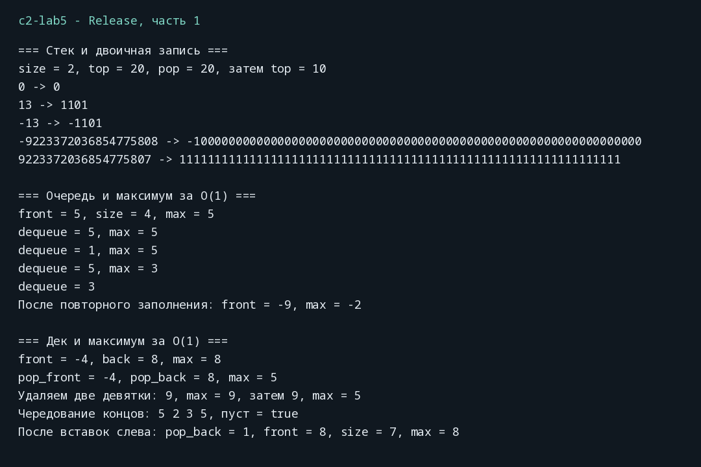
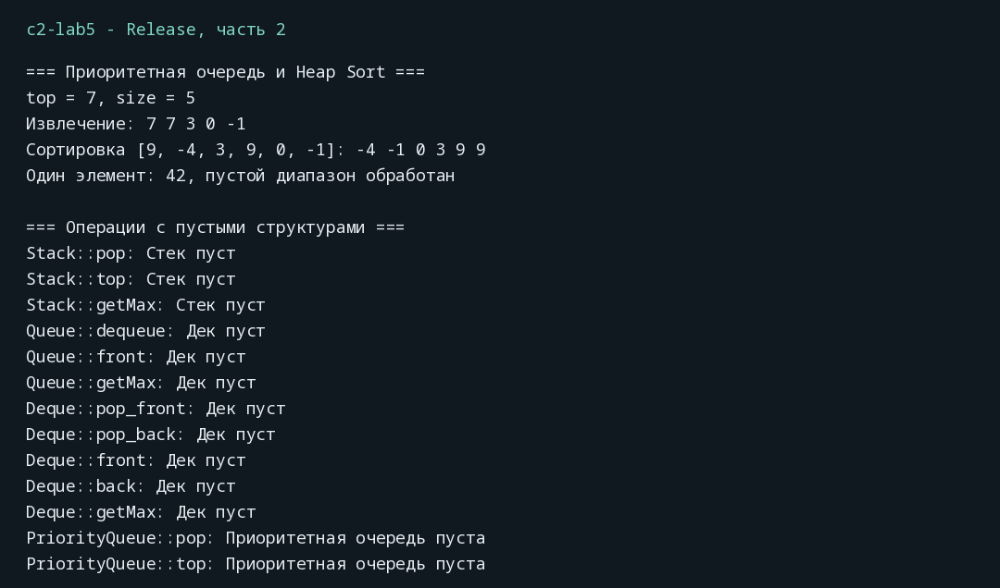

# Отчет по лабораторной работе 5

МИНИСТЕРСТВО НАУКИ И ВЫСШЕГО ОБРАЗОВАНИЯ
РОССИЙСКОЙ ФЕДЕРАЦИИ
Федеральное государственное автономное
образовательное учреждение высшего образования
«СЕВЕРО-КАВКАЗСКИЙ ФЕДЕРАЛЬНЫЙ УНИВЕРСИТЕТ»
Институт информационных технологий и кибер безопасности
Департамент цифровых, робототехнических систем и электроники
Кафедра программной инженерии

**Тема:** Стек, очередь, дек, приоритетная очередь

**Вариант:** 3. Четыре задания без разделения на уровни

**Выполнил:**
Студент группы ПИЖ-б-о-25-2 (2),
направление подготовки: 09.03.04
“Программная инженерия”

Кравцун Михаил Алексеевич

**Проверил:**
Ассистент межинститутской базовой кафедры департамента цифровых,
робототехнических систем и электроники института перспективной
инженерии

Белик Ангелина Игоревна

---

## Репозиторий

[GitHub: Algorithms-Data-structures, лабораторная работа 5 второго курса](https://github.com/WhXteBeXr/Algorithms-Data-structures/tree/main/course-2/lab5)

## Цель работы

Реализовать собственные линейные структуры и двоичную кучу, применить их к четырём задачам варианта 3. Получать максимум очереди и дека за O(1), переиспользуя общую реализацию и сохраняя компактный интерфейс.

## Постановка задачи

Методичка задаёт четыре обязательные части без разделения на уровни:

| Структура | Задание варианта 3 |
| --- | --- |
| Стек | Перевести число из десятичной системы в двоичную |
| Очередь | Находить максимальный элемент за O(1) |
| Дек | Находить максимальный элемент за O(1) |
| Приоритетная очередь | Выполнить сортировку Heap Sort через приоритетную очередь |

Реализованы основные операции каждой структуры, размер, проверка пустоты и обработка ошибок. Контейнеры работают с int, перевод числа принимает int64_t. Копирование и перемещение контейнеров не входят в интерфейс.

## Теоретическая часть

Стек работает по LIFO: последним добавлен, первым извлечён. При делении числа на 2 остатки появляются от младшего бита к старшему. Стек позволяет извлечь их в порядке записи двоичного числа. Отрицательные числа записываются со знаком минуса перед модулем, без представления в дополнительном коде.

Очередь работает по FIFO: первым добавлен, первым извлечён. Дек допускает вставки и удаления с обоих концов. В этой реализации дек хранит две части последовательности в стеках: вершина левого соответствует началу, вершина правого - концу.

Каждая запись стека хранит значение и максимум от дна до этой записи. Поэтому максимум стека доступен в вершине. Максимум дека получается сравнением максимумов двух стеков за O(1). При удалении значения прежние максимумы автоматически восстанавливаются из оставшихся записей, повторяющиеся максимумы обрабатываются корректно.

Если для удаления нужный стек пуст, элементы второго перераспределяются примерно пополам с помощью временного стека. Одно перераспределение линейно, но после балансировки до следующего большого перекоса требуется много обычных операций. Это даёт O(1) амортизированно на операции дека. Очередь использует тот же дек, добавляя только справа и извлекая только слева.

Приоритетная очередь реализована как max-heap в массиве: родитель не меньше детей. Добавление восстанавливает порядок подъёмом, удаление максимума - спуском заменённого корня. Последовательные извлечения дают убывающие значения, запись с конца массива формирует сортировку по возрастанию.

## Исходные файлы

Стек объявлен в [Stack.h](Stack.h), операции и сохранение максимумов реализованы в [Stack.cpp](Stack.cpp). Дек описан в [Deque.h](Deque.h), балансировка его двух сторон и получение максимума находятся в [Deque.cpp](Deque.cpp). [Queue.h](Queue.h) содержит короткую обёртку над собственным деком с интерфейсом FIFO. Общий помощник расширения массивов расположен в [ArrayGrowth.h](ArrayGrowth.h), память освобождается через unique_ptr. Готовые STL-контейнеры не используются.

Двоичная куча объявлена в [PriorityQueue.h](PriorityQueue.h), подъём и спуск реализованы в [PriorityQueue.cpp](PriorityQueue.cpp). Объявления задач находятся в [Tasks.h](Tasks.h), перевод числа и сортировка - в [Tasks.cpp](Tasks.cpp). [main.cpp](main.cpp) демонстрирует все структуры, задачи и ошибки. [CMakeLists.txt](CMakeLists.txt) собирает программу c2-lab5 независимо или в составе общего проекта.

## Существенные детали реализации

- Массивы растут геометрически. Буфер заменяется после успешного выделения и копирования. Вспомогательный шаблон используется только для int и простых записей стека.
- Перед перераспределением дека заранее выделяется всё необходимое место. После начала перестановки переносы int уже не требуют выделения памяти.
- Front и back не запускают балансировку. Если соответствующая сторона пуста, крайний элемент читается со дна другого стека за O(1).
- Получение максимума строго O(1), без скрытого обхода или перераспределения.
- Для минимального int64_t модуль вычисляется без переполняющего отрицания этого значения.
- Heap Sort здесь использует отдельную приоритетную очередь, поэтому требует O(n) дополнительной памяти. Это не внутримассивная версия с O(1) дополнительной памяти.
- Пустые pop, dequeue, top, front, back и getMax выбрасывают underflow_error. Queue делегирует проверки деку, поэтому текст его исключения также сообщает о пустом деке.

## Анализ сложности

n - число элементов, k - число двоичных цифр. Указана амортизированная стоимость там, где возможны расширение или балансировка.

| Операция | Время |
| --- | --- |
| Stack push | O(1) амортизированно, O(n) при расширении |
| Stack pop, top, getMax | O(1) |
| Queue enqueue, dequeue | O(1) амортизированно, отдельная операция может иметь O(n) |
| Queue front, getMax | O(1) |
| Deque push_front, push_back, pop_front, pop_back | O(1) амортизированно, O(n) при расширении или балансировке |
| Deque front, back, getMax | O(1) |
| PriorityQueue push | O(log(n + 1)) амортизированно, O(n) при расширении массива |
| PriorityQueue pop | O(log(n + 1)) |
| PriorityQueue top | O(1) |
| size, isEmpty всех структур | O(1) |
| toBinary | O(k) времени и памяти |
| heapSort | O(n log(n + 1)) времени, O(n) дополнительной памяти |

Число двоичных цифр ненулевого числа пропорционально логарифму его модуля, для int64_t оно не превышает 64. Возвращаемая строка тоже занимает O(k).

Сохранённые ёмкости массивов зависят от максимального достигнутого размера, а не только от текущего числа элементов. Память стека, дека и очереди составляет O(m), где m - максимальный размер за время их жизни. Приоритетная очередь сохраняет ёмкость по тому же правилу. Освобождение буферов выполняется автоматически при уничтожении владельцев.

## Сборка и демонстрация

Из корня репозитория:

```bash
cmake -S course-2/lab5 -B /tmp/algorithms-c2-lab5-release -DCMAKE_BUILD_TYPE=Release
cmake --build /tmp/algorithms-c2-lab5-release
/tmp/algorithms-c2-lab5-release/c2-lab5
```

В общем проекте используется цель c2-lab5. Программа собрана и запущена в Debug и Release с C++20 без предупреждений -Wall, -Wextra, -Wpedantic. Отдельные тесты не используются, демонстрация находится в main.cpp и не требует ввода.

## Результаты

| Пример | Полученный результат |
| --- | --- |
| Двоичная запись 0, 13 и -13 | 0, 1101 и -1101 |
| Минимальный и максимальный int64_t | Преобразованы без переполнения |
| Очередь 5, 1, 5, 3 | Извлечение в порядке FIFO, максимумы после удалений: 5, 5, 3 |
| Отрицательные значения -9 и -2 | Максимум равен -2 |
| Дек с двумя девятками по краям | После удаления первой максимум 9, после второй 5 |
| Чередование удалений по краям | 5, 2, 3, 5, затем пустой дек |
| Все вставки слева, затем удаление справа | Извлечено 1, впереди 8, максимум 8 |
| Куча 3, -1, 7, 7, 0 | Извлечение 7, 7, 3, 0, -1 |
| Сортировка 9, -4, 3, 9, 0, -1 | -4, -1, 0, 3, 9, 9 |
| Пустой и одноэлементный диапазоны | Обработаны корректно |
| Доступ и извлечение из пустых структур | Исключения перехвачены, программа продолжила работу |

Полный [фактический вывод](media/program-output.txt) сохранён в media. Изображения сформированы из stdout и не являются снимками окна терминала.





## Контрольные вопросы

### 1. В чём заключается принцип работы стека LIFO?

Последним добавлен, первым извлечён. Добавление, чтение и удаление происходят на одной вершине. Стек подходит для вложенных действий, отмены операций и разворота порядка данных.

### 2. В чём заключается принцип работы очереди FIFO?

Первым добавлен, первым извлечён. Элементы поступают с одного конца, удаляются с другого. Такой порядок применяется при обработке поступивших заявок.

### 3. Чем дек отличается от обычной очереди?

В деке вставка и удаление разрешены с обоих концов. Очередь ограничивает эти действия добавлением в конец и удалением из начала. Поэтому её можно реализовать ограниченным интерфейсом собственного дека.

### 4. Что такое приоритетная очередь и где она применяется?

Она извлекает элемент с наибольшим или наименьшим приоритетом, а не обязательно самый старый. Применяется в планировании задач, обработке событий и алгоритмах на графах. В работе больший int означает больший приоритет.

### 5. Как реализовать стек на динамическом массиве?

Хранить массив, размер и ёмкость. Push добавляет в свободную позицию и при необходимости расширяет массив, pop уменьшает размер. Top обращается к последней занятой позиции, предварительно проверив непустоту.

### 6. Как реализовать очередь на кольцевом буфере?

Хранить индекс начала, размер и ёмкость. Логическая позиция переводится в физическую по модулю ёмкости. При расширении элементы копируются в логическом порядке, начало переносится в нулевую позицию. В данной работе выбран другой способ - дек на двух стеках.

### 7. Почему приоритетную очередь обычно реализуют на куче?

Корень сразу содержит приоритетный элемент, а высота дерева логарифмическая. После вставки или удаления порядок восстанавливается вдоль одного пути. Кучу удобно хранить массивом без отдельных узлов и ссылок.

### 8. Какова сложность push и pop в стеке?

В массивном стеке push имеет O(1) амортизированно, отдельное расширение O(n). Pop и top здесь O(1). У связного стека обе операции имеют O(1) без перераспределения массива.

### 9. Какова сложность enqueue и dequeue в очереди?

У связной очереди с обоими концами O(1), у расширяемого кольцевого буфера обычно O(1) амортизированно. В этой реализации обе операции O(1) амортизированно из-за расширений и редких перераспределений дека. Front и getMax строго O(1).

### 10. Какова сложность операций приоритетной очереди и почему?

Top читает корень за O(1). Подъём и спуск идут по высоте кучи за O(log(n + 1)). Расширение динамического массива может сделать отдельный push линейным, но амортизированная оценка остаётся логарифмической.

### 11. Как проверить скобки с помощью стека?

Открывающие скобки кладутся в стек. Для закрывающей проверяются непустота и соответствие вершины, затем вершина удаляется. После обхода стек должен быть пуст. Время O(n), дополнительная память O(n) в худшем случае.

### 12. Как реализовать очередь на двух стеках и какова сложность?

Добавлять во входной стек, извлекать из выходного. Если выходной пуст, все входные элементы перекладываются в него с обращением порядка. Каждый элемент проходит ограниченное число переносов, поэтому операции O(1) амортизированно. В работе очередь использует общий дек с перераспределением половин.

### 13. Как реализовать дек на двусвязном списке?

Хранить head и tail, в каждом узле next и prev. Вставка и удаление с любого края требуют изменения ограниченного числа связей за O(1). При удалении единственного узла обе границы обнуляются.

### 14. Как реализовать дек на кольцевом буфере?

Хранить массив, индекс начала и размер. Начало и конец передвигаются по модулю ёмкости, с обеих сторон доступны вставки и удаления. При заполнении новый массив получает элементы в логическом порядке. Сам по себе кольцевой буфер не обеспечивает максимум за O(1), для этого нужна дополнительная структура.

### 15. Как реализовать стек с минимумом за O(1)?

В каждой записи хранить значение и минимум от дна до этой позиции. При добавлении новый минимум сравнивается с предыдущим, при удалении достаточно вернуться к предыдущей записи. Запрос читает минимум вершины за O(1). В работе этот принцип применён к максимуму.

## Вывод

Созданы четыре собственные структуры и выполнены задания варианта 3. Сохранённые максимумы обеспечили O(1) запроса для очереди и дека, балансировка двух сторон - амортизированную эффективность изменения дека. Куча использована для сортировки по возрастанию. Общие компоненты уменьшили дублирование, обработка пустых состояний и граничных чисел продемонстрирована в main.cpp.
