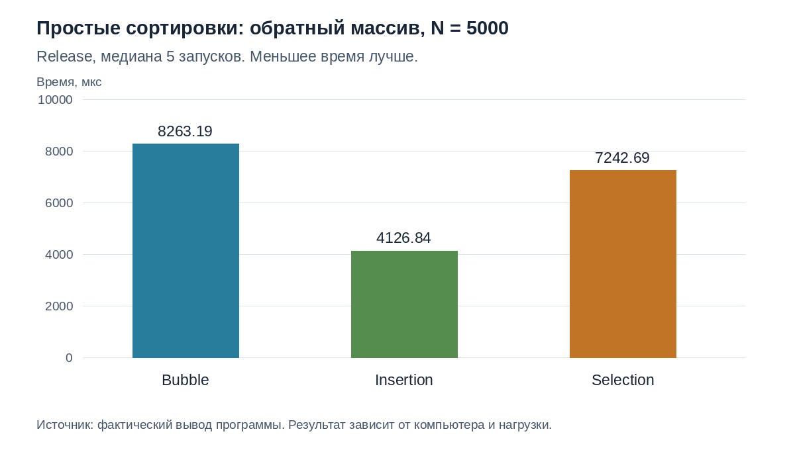
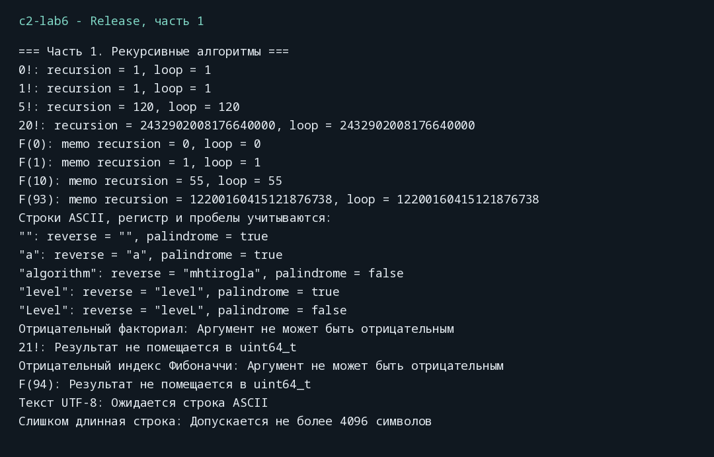
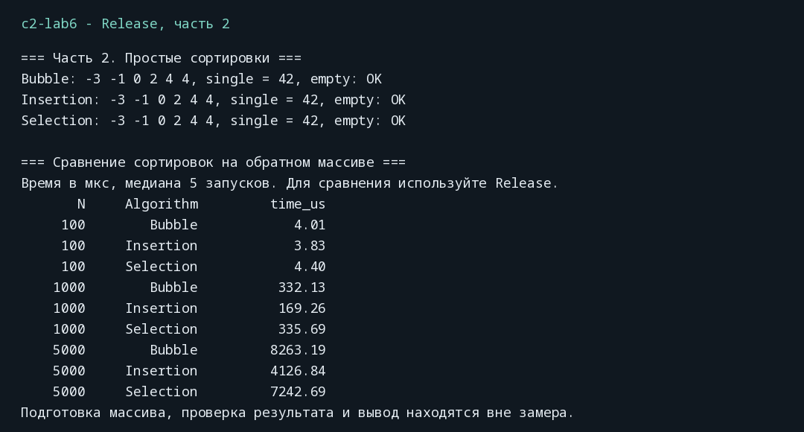

# Отчет по лабораторной работе 6

МИНИСТЕРСТВО НАУКИ И ВЫСШЕГО ОБРАЗОВАНИЯ
РОССИЙСКОЙ ФЕДЕРАЦИИ
Федеральное государственное автономное
образовательное учреждение высшего образования
«СЕВЕРО-КАВКАЗСКИЙ ФЕДЕРАЛЬНЫЙ УНИВЕРСИТЕТ»
Институт информационных технологий и кибер безопасности
Департамент цифровых, робототехнических систем и электроники
Кафедра программной инженерии

**Тема:** Рекурсивные алгоритмы. Простые сортировки

**Вариант:** 3. Обе части задания

**Выполнил:**
Студент группы ПИЖ-б-о-25-2 (2),
направление подготовки: 09.03.04
“Программная инженерия”

Кравцун Михаил Алексеевич

**Проверил:**
Ассистент межинститутской базовой кафедры департамента цифровых,
робототехнических систем и электроники института перспективной
инженерии

Белик Ангелина Игоревна


---

## Репозиторий

[GitHub: Algorithms-Data-structures, лабораторная работа 6 второго курса](https://github.com/WhXteBeXr/Algorithms-Data-structures/tree/main/course-2/lab6)

## Цель работы

Освоить рекурсию, сравнить её с итеративными реализациями и самостоятельно реализовать три простые сортировки. Измерить время сортировок на одинаковых массивах, изначально упорядоченных по убыванию.

## Постановка задачи

В методичке нет разделения на уровни, но каждая из двух частей содержит таблицу вариантов. Выполняется вариант 3 обеих частей.

| Часть | Задание |
| --- | --- |
| 1. Рекурсивные алгоритмы | Факториал, числа Фибоначчи, переворот строки, проверка палиндрома |
| 2. Простые сортировки | Пузырьковая, вставками и выбором, сравнение на обратном массиве |

Для факториала и Фибоначчи дополнительно реализованы итеративные версии. Вычисления используют uint64_t: факториал определён для n от 0 до 20, Фибоначчи - от 0 до 93, с F(0)=0 и F(1)=1. Строковые функции работают с ASCII длиной до 4096 символов, учитывают регистр и пробелы. Ограничения проверяются явно.

## Теоретическая часть

Рекурсивная функция решает задачу через вызов самой себя для меньшего аргумента. Базовый случай останавливает вызовы, шаг рекурсии приближает аргумент к нему. Незавершённые вызовы используют стек выполнения. Итерация повторяет действия циклом, обычно без роста глубины стека.

Факториал использует равенство n! = n·(n-1)! и базовое значение 0! = 1. Числа Фибоначчи задаются суммой двух предыдущих. Наивная рекурсия повторяет одни и те же подзадачи и работает экспоненциально. Здесь рекурсивная версия сохраняет результаты в кэше, поэтому каждое новое значение вычисляется один раз.

При перевороте строки рекурсивно меняются местами крайние символы и обрабатывается середина. Палиндром проверяется сравнением краёв и рекурсивной проверкой внутренней части. Пустая и односимвольная строки являются базовыми случаями. String_view представляет часть строки без копирования.

Пузырьковая сортировка перемещает большие элементы вправо соседними обменами. Сортировка вставками помещает очередное значение в уже упорядоченный префикс. Выбором - находит минимум оставшейся части и ставит его на текущую позицию.

Пузырьковая и вставками устойчивы в этих реализациях: равные значения не обмениваются и не сдвигаются относительно друг друга. Выбором неустойчива из-за дальнего обмена. На обратном массиве все три имеют квадратичное время.

## Исходные файлы

[Recursion.h](Recursion.h) объявляет функции первой части, [Recursion.cpp](Recursion.cpp) содержит рекурсивные и итеративные вычисления, кэш Фибоначчи и обработку строк. [Sorts.h](Sorts.h) объявляет три сортировки и общую таблицу их имён и функций, [Sorts.cpp](Sorts.cpp) реализует сами алгоритмы над диапазонами int.

[Comparison.h](Comparison.h) и [Comparison.cpp](Comparison.cpp) организуют измерения на одинаковых обратных массивах. [main.cpp](main.cpp) показывает результаты, граничные случаи и перехват ошибок. [CMakeLists.txt](CMakeLists.txt) собирает цель c2-lab6 отдельно и в составе общего проекта. Стандартные контейнеры используются только для данных и кэша, алгоритмы сортировки реализованы самостоятельно.

## Анализ сложности

n - числовой аргумент или длина строки, для сортировок - размер массива. Оценки учитывают выбранные реализации и не предполагают обязательную оптимизацию хвостовых вызовов компилятором.

| Алгоритм | Время | Дополнительная память |
| --- | --- | --- |
| Рекурсивный факториал | O(n) | O(n) на стек вызовов |
| Итеративный факториал | O(n) | O(1) |
| Рекурсивный Фибоначчи с кэшем | O(n) | O(n) на вызовы и кэш |
| Итеративный Фибоначчи | O(n) | O(1) |
| Переворот строки | O(n) | O(n) на копию строки и вызовы |
| Проверка палиндрома | O(n) в худшем случае | O(n) на вызовы в худшем случае |

Кэш имеет 94 ячейки из-за фиксированной границы uint64_t. Стек рекурсивной версии растёт с n. Валидация ASCII сама проходит по тексту, поэтому внешний вызов проверки палиндрома имеет O(n) времени и при раннем несовпадении краёв. Переворот принимает строку по значению и сохраняет исходный аргумент.

| Сортировка | Лучший случай | Средний | Худший | Память | Устойчива |
| --- | --- | --- | --- | --- | --- |
| Пузырьковая с ранним выходом | O(n) | O(n²) | O(n²) | O(1) | Да |
| Вставками | O(n) | O(n²) | O(n²) | O(1) | Да |
| Выбором | O(n²) | O(n²) | O(n²) | O(1) | Нет |

Для обратного массива пузырьковая выполняет n(n-1)/2 соседних обменов, вставками - столько же сдвигов. Выбором выполняет n(n-1)/2 сравнений при любом порядке входных данных, но не более n-1 обменов. Одинаковый класс сложности не означает одинаковое фактическое время.

## Сборка и запуск

Из корня репозитория:

```bash
cmake -S course-2/lab6 -B /tmp/algorithms-c2-lab6-release -DCMAKE_BUILD_TYPE=Release
cmake --build /tmp/algorithms-c2-lab6-release
/tmp/algorithms-c2-lab6-release/c2-lab6
```

В общем проекте лабораторная доступна как цель c2-lab6. Программа собрана и запущена в Debug и Release с C++20 без предупреждений -Wall, -Wextra, -Wpedantic. Отдельные тесты не используются, демонстрация не требует ввода.

## Результаты

### Рекурсия и граничные случаи

| Пример | Результат |
| --- | --- |
| 0!, 1!, 5!, 20! | 1, 1, 120, 2432902008176640000, обе реализации совпадают |
| F(0), F(1), F(10), F(93) | 0, 1, 55, 12200160415121876738, обе реализации совпадают |
| Пустая строка, один символ | Переворот сохраняет строку, палиндром true |
| algorithm | mhtirogla, палиндром false |
| level | level, палиндром true |
| Level | leveL, палиндром false |
| Отрицательные аргументы, 21!, F(94) | Исключения вместо некорректного результата |
| UTF-8 и строка длиннее 4096 | Отклонены как неподдерживаемый ввод |
| Все три сортировки для 4, -1, 4, 0, 2, -3 | -3, -1, 0, 2, 4, 4 |
| Пустой диапазон и один элемент | Обработаны без выхода за границы |

### Сравнение сортировок

Для каждого N формируется исходный массив N, N-1, ..., 1. Все алгоритмы получают отдельные одинаковые копии. Пять раз измеряется только вызов сортировки через std::chrono::steady_clock, в таблице приведена медиана. Подготовка копии, проверка результата и вывод находятся вне интервала.

После каждого запуска проверяется весь результат: на позиции i должно быть значение i+1. Std::sort применяется только к пяти временам для выбора медианы, исходные данные сортируются собственными функциями. Порядок алгоритмов фиксирован. Среда запуска: GCC 16.2.1, C++20, Release с -O3.

| N | Алгоритм | Медиана времени, мкс |
| ---: | --- | ---: |
| 100 | Bubble | 4.01 |
| 100 | Insertion | 3.83 |
| 100 | Selection | 4.40 |
| 1000 | Bubble | 332.13 |
| 1000 | Insertion | 169.26 |
| 1000 | Selection | 335.69 |
| 5000 | Bubble | 8263.19 |
| 5000 | Insertion | 4126.84 |
| 5000 | Selection | 7242.69 |



В сохранённом запуске вставки быстрее двух других реализаций, но все три выполняют квадратичный объём работы на обратных массивах. Результат зависит от компьютера, оптимизации, кэша и нагрузки. Для малого N относительная погрешность короткого замера заметнее. Несколько измерений иллюстрируют производительность, но не заменяют теоретическое доказательство сложности.

Полный [фактический вывод](media/program-output.txt) сохранён в media. Изображения сформированы из stdout и не являются снимками окна терминала.





## Контрольные вопросы

### 1. Что такое рекурсия и из каких компонентов состоит рекурсивная функция?

Это решение задачи через вызов той же функции для меньшей подзадачи. Необходимы базовый случай и рекурсивный шаг, приближающий к нему аргумент. Результат может формироваться при спуске или возврате из вызовов.

### 2. Что такое базовый случай и почему он важен?

Это ситуация, в которой ответ получается без нового рекурсивного вызова. Без достижимой остановки рекурсия продолжается до исчерпания стека. Например, факториал для 0 и 1 равен 1.

### 3. Чем прямая рекурсия отличается от косвенной?

При прямой функция вызывает саму себя. При косвенной функции вызывают друг друга по цепочке, которая возвращается к исходной. У обеих должен существовать путь к базовому случаю.

### 4. Что такое хвостовая рекурсия и в чём её преимущество?

Рекурсивный вызов является последним действием функции, результат не требует последующей обработки. Компилятор иногда может заменить его циклом и не наращивать стек. C++ не гарантирует такую оптимизацию, поэтому полагаться на неё для неограниченной глубины нельзя.

### 5. Какова сложность рекурсивного Фибоначчи и почему?

Наивное вычисление двух предыдущих чисел повторяет одинаковые подзадачи и имеет экспоненциальную сложность, верхняя оценка O(2ⁿ), точнее Θ(φⁿ). В данной работе используется кэш, поэтому рекурсивная реализация имеет O(n) времени.

### 6. Как оптимизировать рекурсивное вычисление Фибоначчи?

Запоминать уже вычисленные значения и возвращать их из кэша. Тогда каждая подзадача вычисляется один раз. Итеративный подход сохраняет линейное время и использует только два предыдущих числа.

### 7. Чем рекурсивная реализация отличается от итеративной?

Рекурсия использует стек вызовов и часто ближе к математическому определению. Итерация хранит состояние в переменных цикла, обычно требует меньше памяти и расходов на вызовы. При одинаковом алгоритме временная сложность может совпадать.

### 8. Какова сложность пузырьковой сортировки и когда она O(n)?

Средняя и худшая сложности O(n²). Если реализован флаг обменов, уже отсортированный массив завершает обработку после одного прохода за O(n). Без этой оптимизации даже такой случай остаётся квадратичным.

### 9. Чем вставки отличаются от выбора?

Вставки помещают очередной элемент внутрь отсортированного префикса сдвигом больших значений. Выбор находит минимум оставшегося суффикса и делает один обмен. Вставки используют существующий порядок, выбор всё равно просматривает весь остаток.

### 10. Какие простые сортировки устойчивы и что это значит?

Устойчивость сохраняет относительный порядок элементов с одинаковым ключом. Здесь пузырьковая и вставками устойчивы, так как используют строгое сравнение. Обычный выбор неустойчив: дальний обмен может переставить равные ключи.

### 11. Какая сортировка лучше на почти отсортированных данных?

Обычно вставками, поскольку каждый элемент требует небольшого числа сдвигов. Пузырьковая с ранним выходом тоже использует порядок, но её поведение зависит от расположения нарушений. Выбор не уменьшает число сравнений.

### 12. Как оптимизировать пузырьковую сортировку?

Уменьшать правую границу после каждого прохода, поскольку максимум уже находится на своём месте. Дополнительно завершать алгоритм при отсутствии обменов. Обе оптимизации присутствуют в программе.

### 13. Что такое поиск с возвратом backtracking?

Он перебирает допустимые шаги и рекурсивно продолжает выбранный вариант. Если вариант не приводит к решению, выполнение возвращается к предыдущему состоянию для следующей попытки. Изменения состояния при необходимости отменяются.

### 14. Как рекурсивно обойти лабиринт?

Проверить границы, стену и посещённость клетки, затем условие финиша. Отметить клетку посещённой и попробовать соседей. Метки предотвращают циклы, возврат по успешным вызовам позволяет восстановить путь. Такой поиск в глубину не гарантирует кратчайший путь.

### 15. Какова сложность Ханойских башен и сколько нужно ходов?

Рекуррентность T(n)=2T(n-1)+1 даёт 2ⁿ-1 ходов. Время экспоненциальное O(2ⁿ), глубина стека O(n). Для нуля дисков перемещений нет, для одного нужен один ход.

## Вывод

Реализованы четыре рекурсивные задачи варианта 3 и итеративные версии числовых алгоритмов. Кэширование сократило рекурсивный Фибоначчи до линейного времени, границы типов проверяются до вычислений. Три простые сортировки дали одинаковый результат, а сравнение на обратных массивах показало разные константы при общей квадратичной сложности. Освоены базовые случаи, уменьшение подзадачи и корректные границы измерений.
