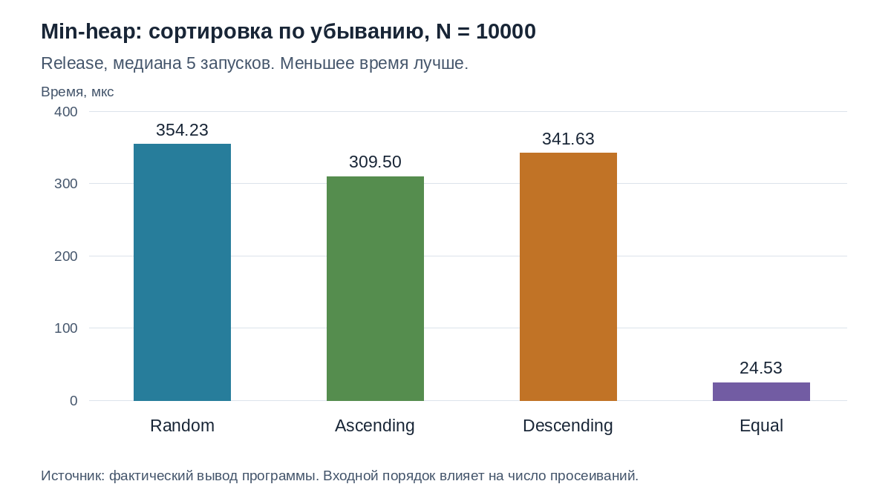
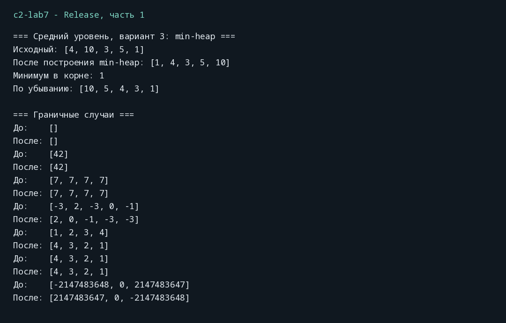
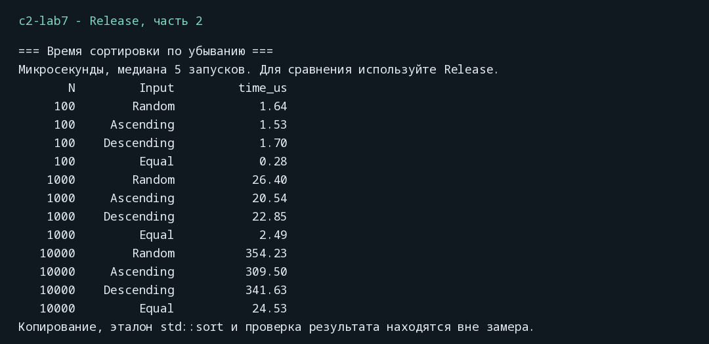

# Отчет по лабораторной работе 7

МИНИСТЕРСТВО НАУКИ И ВЫСШЕГО ОБРАЗОВАНИЯ
РОССИЙСКОЙ ФЕДЕРАЦИИ
Федеральное государственное автономное
образовательное учреждение высшего образования
«СЕВЕРО-КАВКАЗСКИЙ ФЕДЕРАЛЬНЫЙ УНИВЕРСИТЕТ»
Институт информационных технологий и кибер безопасности
Департамент цифровых, робототехнических систем и электроники
Кафедра программной инженерии

**Тема:** Быстрая сортировка, сортировка слиянием, пирамидальная сортировка

**Вариант:** 3. Средний уровень

**Выполнил:**
Студент группы ПИЖ-б-о-25-2 (2),
направление подготовки: 09.03.04
“Программная инженерия”

Кравцун Михаил Алексеевич

**Проверил:**
Ассистент межинститутской базовой кафедры департамента цифровых,
робототехнических систем и электроники института перспективной
инженерии

Белик Ангелина Игоревна

---

## Репозиторий

[GitHub: Algorithms-Data-structures, лабораторная работа 7 второго курса](https://github.com/WhXteBeXr/Algorithms-Data-structures/tree/main/course-2/lab7)

## Цель работы

Реализовать пирамидальную сортировку на min-heap для получения убывающей последовательности. Изучить построение кучи снизу вверх, итеративное просеивание и влияние входного порядка на время выполнения при O(1) дополнительной памяти.

## Постановка задачи

Общее задание среднего уровня: реализовать указанный алгоритм с дополнительными требованиями и провести детальный анализ.

Вариант 3: пирамидальная сортировка, реализовать min-heap для сортировки по убыванию. Используются размеры 100, 1000 и 10000, а также случайные, возрастающие, убывающие и одинаковые входные значения.

## Теоретическая часть

Двоичная куча хранится в непрерывном массиве. У позиции i левый ребёнок имеет индекс 2i+1, правый - 2i+2, родитель для i > 0 - (i-1)/2. В min-heap родитель не больше детей, поэтому корень содержит минимум всего рабочего диапазона. При этом массив кучи не обязан быть полностью отсортирован.

При построении обрабатываются внутренние вершины от последней к корню. Дети к этому моменту уже возглавляют корректные подкучи. Просеивание выбирает меньшего ребёнка, меняет его с большим родителем и продолжает ниже. Построение снизу вверх требует O(n), поскольку большинство вершин расположено на малой высоте.

Сортировка меняет корень с последним элементом рабочей части и уменьшает её границу. Минимум остаётся справа, а заменённый корень просеивается в оставшейся куче. Последовательное размещение минимумов справа налево формирует невозрастающий порядок. Операции выполняются в исходном массиве.

Для общей темы работы быстрая сортировка использует разбиение относительно опорного элемента, слиянием - разделение на половины и последующее объединение. В реализации среднего варианта 3 используется именно пирамидальная сортировка.

## Исходные файлы

[HeapSort.h](HeapSort.h) объявляет построение min-heap и сортировку, [HeapSort.cpp](HeapSort.cpp) реализует закрытый помощник siftDown, построение снизу вверх и последовательное размещение минимумов. Интерфейс span<int> обозначает переданный изменяемый диапазон, не владея им и не создавая копии.

[Comparison.h](Comparison.h) и [Comparison.cpp](Comparison.cpp) формируют входы и измеряют время. [main.cpp](main.cpp) показывает промежуточную кучу, итоговый порядок и граничные случаи. [CMakeLists.txt](CMakeLists.txt) собирает цель c2-lab7 отдельно или из общего проекта. Реализация не требует классов, шаблонного контейнера или дополнительных режимов сортировки.

## Анализ сложности

| Операция | Время | Дополнительная память |
| --- | --- | --- |
| Одно siftDown | O(log(n+1)) в худшем случае | O(1) |
| buildMinHeap | O(n) | O(1) |
| heapSortDescending | O(n log(n+1)) в худшем случае | O(1) |
| Сортировка одинаковых значений в этой реализации | O(n) | O(1) |

Просеивание итеративное, поэтому скрытый рекурсивный стек не требуется. Входные буферы и их копии в модуле измерений занимают O(n), но не относятся к дополнительной памяти самой сортировки.

Линейное построение не противоречит логарифмической стоимости одного просеивания: листья не просеиваются, у половины внутренних вершин малая высота, число вершин быстро убывает с её ростом. Сумма работ по высотам линейна.

У одинаковых значений первое сравнение родителя с выбранным ребёнком сразу завершает просеивание. Построение и n-1 размещений выполняют линейное число действий. Общая верхняя оценка O(n log n) сохраняется, но она не является точной оценкой для каждого конкретного входа.

Теоретическое сопоставление трёх алгоритмов темы:

| Алгоритм | Среднее время | Худшее время | Дополнительная память | Устойчивость |
| --- | --- | --- | --- | --- |
| Обычная рекурсивная быстрая | O(n log n) | O(n²) | В среднем O(log n), в худшем O(n) | Нет |
| Слиянием для массива | O(n log n) | O(n log n) | O(n) | Да при выборе левого при равенстве |
| Пирамидальная с итеративным просеиванием | O(n log n) | O(n log n) | O(1) | Нет |

Пирамидальная неустойчива: дальний обмен корня с концом может изменить относительный порядок равных ключей. В массиве int равные значения неразличимы, но свойство важно для записей с дополнительными полями.

## Сборка и запуск

Из корня репозитория:

```bash
cmake -S course-2/lab7 -B /tmp/algorithms-c2-lab7-release -DCMAKE_BUILD_TYPE=Release
cmake --build /tmp/algorithms-c2-lab7-release
/tmp/algorithms-c2-lab7-release/c2-lab7
```

В общем проекте доступна цель c2-lab7. Программа собрана и запущена в Debug и Release с C++20 без предупреждений -Wall, -Wextra, -Wpedantic. Отдельные тестовые программы не создаются, демонстрация находится в main.cpp и не требует ввода.

## Результаты работы

Исходный массив `[4, 10, 3, 5, 1]` после построения кучи стал `[1, 4, 3, 5, 10]`, корень равен минимуму 1. После сортировки получен `[10, 5, 4, 3, 1]`.

Показаны пустой массив, один элемент, одинаковые значения, повторы с отрицательными числами, оба исходных порядка и границы int. Для `[-3, 2, -3, 0, -1]` получен `[2, 0, -1, -3, -3]`. Граничные значения упорядочиваются без вычитания ключей, поэтому сравнение не вызывает переполнения int.

### Методика измерения

Для каждого N формируются четыре вида входа: Random - равномерные значения от -N до N, Ascending - 0..N-1, Descending - N..1, Equal - все значения 7. Генератор mt19937 использует seed 2026, что делает входы воспроизводимыми в используемой среде.

Каждый набор сортируется пять раз на новых одинаковых копиях. Монотонные steady_clock измеряют весь вызов heapSortDescending, включая построение кучи. Медиана выбирается после сортировки пяти времён. Копирование, проверка и печать находятся вне интервала.

Эталон заранее создаётся std::sort с убывающим компаратором. После каждого запуска сравнивается весь массив, что проверяет и порядок, и сохранение значений. Время std::sort не измеряется, он не заменяет собственную реализацию. Виды входа обрабатываются в фиксированном порядке.

Среда сохранённого запуска: GCC 16.2.1, C++20, Release с -O3. Кэш, нагрузка и очень короткие интервалы влияют на точность измерения.

| N | Вход | Медиана времени, мкс |
| ---: | --- | ---: |
| 100 | Random | 1.64 |
| 100 | Ascending | 1.53 |
| 100 | Descending | 1.70 |
| 100 | Equal | 0.28 |
| 1000 | Random | 26.40 |
| 1000 | Ascending | 20.54 |
| 1000 | Descending | 22.85 |
| 1000 | Equal | 2.49 |
| 10000 | Random | 354.23 |
| 10000 | Ascending | 309.50 |
| 10000 | Descending | 341.63 |
| 10000 | Equal | 24.53 |



На одинаковых данных время заметно меньше из-за ранней остановки просеивания. На остальных наборах растёт объём работы по восстановлению кучи. Отсортированность по убыванию не позволяет пропустить алгоритм: проверка всего массива на этот порядок отдельно не выполняется. Несколько измерений иллюстрируют поведение, но не заменяют оценку сложности.

Полный [фактический вывод](media/program-output.txt) сохранён в media. Изображения сформированы из stdout и не являются снимками окна терминала.





## Контрольные вопросы

### 1. Какова сложность быстрой сортировки в лучшем, среднем и худшем случае?

При сбалансированных разбиениях лучшая и средняя сложности O(n log n). Худшая O(n²), если разбиения систематически крайне неравномерны. Дополнительная память обычной рекурсивной реализации зависит от глубины вызовов.

### 2. Когда возникает худший случай быстрой сортировки?

Когда опорный элемент каждый раз оставляет одну почти пустую часть и вторую почти исходного размера. Например, крайний pivot на уже упорядоченных различных значениях может дать такую ситуацию. Простое двухчастное разделение также бывает неэффективно при множестве равных ключей.

### 3. Как улучшить быструю сортировку для защиты от худшего случая?

Выбирать pivot случайно или медианой нескольких элементов, использовать трёхчастное разделение для повторов. Эти меры уменьшают вероятность плохих разбиений. Гарантию O(n log n) в худшем случае может дать переход на пирамидальную сортировку при большой глубине, как в интроспективном подходе.

### 4. Какова сложность сортировки слиянием и почему она O(n log n)?

Обычная версия делит массив пополам и линейно сливает части на каждом уровне. Уровней O(log n), работы на каждом O(n). Это даёт O(n log n) для стандартной реализации, хотя оптимизированные версии могут использовать уже имеющийся порядок.

### 5. Каковы преимущества и недостатки слияния перед быстрой сортировкой?

Слияние даёт гарантированное O(n log n) и может быть устойчивым, удобно для последовательной обработки и внешней сортировки. Для массивов обычно требует O(n) дополнительной памяти. Быстрая часто имеет меньшие накладные расходы и работает на месте, но без защиты допускает O(n²).

### 6. Как работает пирамидальная сортировка и какова её сложность?

Сначала строится куча за O(n), затем корень переносится в конец рабочей части, а куча восстанавливается. Худшая сложность всей сортировки O(n log n). В работе корень минимальный, поэтому итоговый порядок убывающий, просеивание итеративное и память O(1).

### 7. Какая из трёх сортировок устойчива и почему?

Обычная сортировка слиянием устойчива, если при равенстве первым берётся элемент левой половины. Обычные быстрая и пирамидальная не гарантируют сохранение порядка равных ключей из-за перестановок удалённых элементов.

### 8. Какая из трёх требует дополнительной памяти и сколько?

Слияние массива обычно требует O(n) буфера. Рекурсивная быстрая - стек в среднем O(log n), в худшем O(n) для обычной реализации. Пирамидальная с итеративным просеиванием требует O(1), с рекурсивным просеиванием появляется стек O(log n).

### 9. Какая лучше работает на почти отсортированных данных?

Универсального победителя нет, важны реализация и выбор pivot. Простая быстрая с крайним pivot может выродиться, слияние и пирамидальная сохраняют верхнюю оценку O(n log n). Алгоритмы, специально использующие упорядоченные серии, могут выиграть на таком входе.

### 10. Зачем сначала строится куча?

Чтобы корень гарантированно содержал минимальный или максимальный элемент всей рабочей части. Тогда каждый перенос корня фиксирует очередную готовую позицию, а восстановить нужно только один путь. Без свойства кучи корень мог бы не быть нужным экстремумом.

### 11. Что такое разделяй и властвуй и как применяется в Quick и Merge Sort?

Задача разбивается на меньшие подзадачи, они решаются, затем результаты объединяются. В быстрой сортировке основная работа - разделение по pivot перед рекурсией. В слиянии - объединение уже отсортированных половин после рекурсии.

### 12. Можно ли сделать быструю сортировку без рекурсии?

Да, хранить границы необработанных частей в явном стеке. На каждом шаге извлекать диапазон, делить и добавлять оставшиеся подзадачи. Выбор порядка обработки позволяет контролировать размер стека.

### 13. Почему быстрая часто быстрее слияния на практике?

Она часто сортирует на месте с небольшими накладными расходами и без отдельного массива слияния. Но это не универсальная гарантия: слияние тоже хорошо использует последовательный доступ, а результат зависит от данных и реализации.

### 14. Когда выгодна пирамидальная сортировка?

Когда нужны ограниченная дополнительная память и гарантированное O(n log n) в худшем случае, а устойчивость не обязательна. Также она подходит как запасной алгоритм для защиты другой сортировки от вырождения.

### 15. Что выбрать для встроенной системы с ограниченной памятью?

Для общего массива без требования устойчивости подходит пирамидальная с итеративным просеиванием: O(1) памяти и ограниченная худшая трудоёмкость. Для очень маленьких наборов могут быть выгоднее более простые алгоритмы, решение зависит от размера и требований.

## Вывод

Реализован средний вариант 3: сортировка по убыванию через min-heap. Показаны линейное построение, логарифмическое просеивание и постоянная дополнительная память. Граничные примеры и полное сравнение с эталоном в демонстрации подтвердили правильный порядок и сохранение значений. Измерения показали влияние повторов и ранней остановки при неизменной общей верхней оценке алгоритма.
