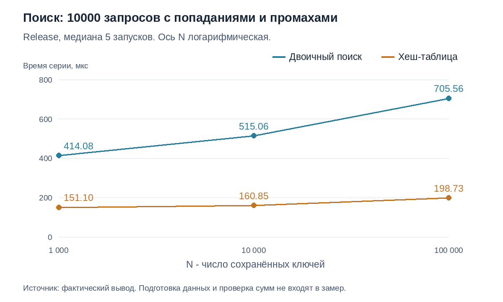
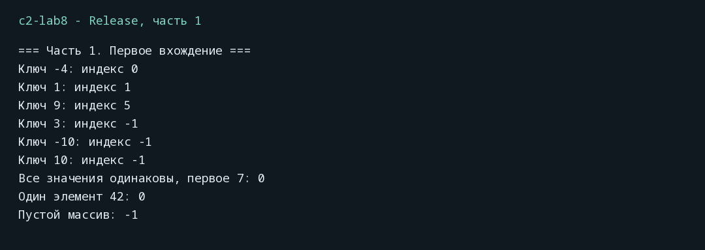
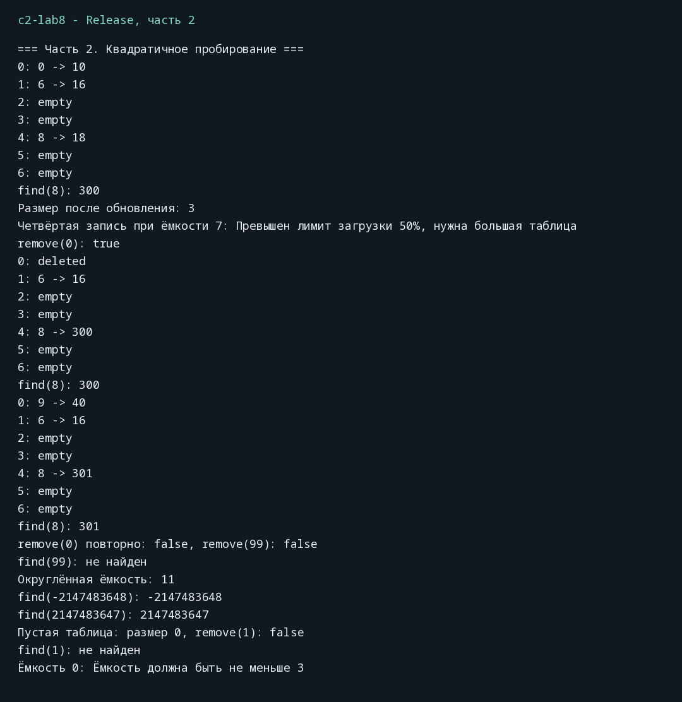
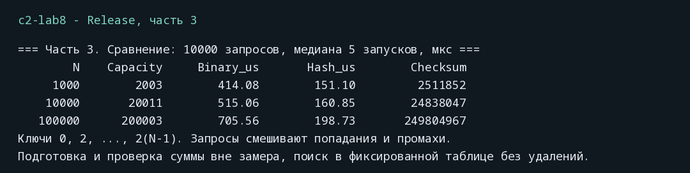

# Отчет по лабораторной работе 8

МИНИСТЕРСТВО НАУКИ И ВЫСШЕГО ОБРАЗОВАНИЯ
РОССИЙСКОЙ ФЕДЕРАЦИИ
Федеральное государственное автономное
образовательное учреждение высшего образования
«СЕВЕРО-КАВКАЗСКИЙ ФЕДЕРАЛЬНЫЙ УНИВЕРСИТЕТ»
Институт информационных технологий и кибер безопасности
Департамент цифровых, робототехнических систем и электроники
Кафедра программной инженерии

**Тема:** Двоичный поиск. Хеш-таблицы

**Вариант:** 3. Все три части, без уровней сложности

**Выполнил:**
Студент группы ПИЖ-б-о-25-2 (2),
направление подготовки: 09.03.04
“Программная инженерия”

Кравцун Михаил Алексеевич

**Проверил:**
Ассистент межинститутской базовой кафедры департамента цифровых,
робототехнических систем и электроники института перспективной
инженерии

Белик Ангелина Игоревна


---

## Репозиторий

[GitHub: Algorithms-Data-structures, лабораторная работа 8 второго курса](https://github.com/WhXteBeXr/Algorithms-Data-structures/tree/main/course-2/lab8)

## Цель работы

Реализовать поиск первого вхождения и собственную хеш-таблицу с квадратичным пробированием. Освоить удаление при открытой адресации и сравнить стоимость поиска на трёх объёмах данных.

## Постановка задачи

Вариант 3 выполняется во всех частях:

| Часть | Требование |
| --- | --- |
| 1. Двоичный поиск | int, поиск первого вхождения |
| 2. Хеш-таблица | Квадратичное пробирование, ключ и значение int, insert/find/remove |
| 3. Общий анализ | Итеративный двоичный поиск и поиск в таблице при N = 1000, 10000, 100000, таблица и график |

Для компактности таблица имеет фиксированную ёмкость без автоматического расширения. Число записей ограничено половиной её простого размера, обновление существующего ключа не расходует дополнительное место.

## Теоретическая часть

Двоичный поиск требует упорядоченных данных и сокращает рабочий интервал примерно вдвое. Для первого вхождения совпадение в середине не завершает алгоритм: поиск продолжается влево. После сужения проверяется, что найденная первая позиция со значением не меньше ключа действительно равна ему.

Хеш-таблица переводит ключ в начальный индекс. Разные ключи могут дать один индекс, это коллизия. При открытой адресации все записи находятся в одном массиве, свободная позиция выбирается последовательностью проб.

В этой реализации используется формула `(h(key) + i²) mod m`, где i - номер попытки, m - простая ёмкость. Для нечётного простого m первые (m+1)/2 квадратичных смещений различны. Если занято не более половины таблицы, доступная для вставки ячейка существует в этой последовательности. Произвольная ёмкость и высокая загрузка такой гарантии не дают.

Удалённая запись получает состояние Deleted вместо Empty. Поиск проходит через Deleted, иначе элемент, вытесненный коллизией дальше, мог бы стать недоступным. Повторная вставка может использовать удалённую ячейку. Долгая история удалений способна увеличить время поиска даже при небольшом числе живых записей.

## Исходные файлы

[BinarySearch.h](BinarySearch.h) и [BinarySearch.cpp](BinarySearch.cpp) содержат итеративный поиск первого вхождения с результатом -1 при отсутствии. [HashTable.h](HashTable.h) объявляет таблицу, состояния ячеек и операции, [HashTable.cpp](HashTable.cpp) реализует подбор простого размера, хеширование, ограниченные квадратичные пробы и удаление.

[Comparison.h](Comparison.h) и [Comparison.cpp](Comparison.cpp) готовят одинаковые ключи и запросы, измеряют время и проверяют суммы. [main.cpp](main.cpp) демонстрирует все части, коллизии и граничные случаи. [CMakeLists.txt](CMakeLists.txt) собирает цель c2-lab8 отдельно и в составе общего проекта. Vector используется только как массив ячеек, готовые ассоциативные контейнеры не применяются.

## Существенные детали

- Массив двоичного поиска должен быть неубывающим. Проверка отсортированности не включена в каждый запрос, чтобы не превращать O(log n) в O(n).
- Границы поиска полуоткрытые, середина вычисляется как left + (right-left)/2. Пустой массив не требует вычитания единицы из нулевого размера.
- Хеш-функция перемешивает 32 бита ключа через сдвиги и умножения в uint32_t, затем берёт остаток по ёмкости. Переполнение беззнакового типа определено, отрицательные ключи поддерживаются.
- Ёмкость не меньше 3 округляется до ближайшего простого числа сверху. Ошибка исходного размера вызывает invalid_argument, превышение лимита новых записей - overflow_error.
- Insert сначала ищет существующий ключ, поэтому обновляет его и при предельной загрузке, в том числе за удалённой ячейкой.
- Каждый цикл проб ограничен m попытками. Это предотвращает бесконечное зацикливание, если среди посещаемых ячеек нет настоящей Empty.
- Find возвращает const int* или nullptr. Значение 0 не смешивается с отсутствием. Указатель не владеет данными, после удаления соответствующего ключа или уничтожения таблицы он не используется.
- Копирование и перемещение таблицы не входят в интерфейс. Память массива освобождается автоматически.

## Анализ сложности

n - число элементов массива, m - ёмкость таблицы, α - число живых записей, делённое на m.

| Операция | Ожидаемое время | Худшее время | Дополнительная память операции |
| --- | --- | --- | --- |
| Поиск первого вхождения | O(log(n+1)) | O(log(n+1)) | O(1) |
| HashTable insert/find/remove | O(1) при хорошем распределении и умеренном числе Deleted | O(m) | O(1) |
| Чтение size/capacity | O(1) | O(1) | O(1) |
| Вывод всех ячеек | O(m) | O(m) | O(1) |

Поиск первого вхождения не возвращает ответ при первом совпадении, поэтому его поведение отличается от обычного поиска любого вхождения. Таблица занимает O(m) памяти, инициализация её массива O(m) плюс работа подбора простого размера. При m, пропорциональном числу записей, худшая оценка O(m) также линейна по масштабу набора.

Ограничение загрузки сохраняет возможность вставки, но не обещает строго O(1) каждого поиска. Удалённые метки не убираются автоматически. При их накоплении реорганизация могла бы улучшить скорость, но в данном фиксированном интерфейсе она не реализована.

## Сборка и запуск

Из корня репозитория:

```bash
cmake -S course-2/lab8 -B /tmp/algorithms-c2-lab8-release -DCMAKE_BUILD_TYPE=Release
cmake --build /tmp/algorithms-c2-lab8-release
/tmp/algorithms-c2-lab8-release/c2-lab8
```

В общем проекте используется цель c2-lab8. Программа собрана и запущена в Debug и Release с C++20 без предупреждений -Wall, -Wextra, -Wpedantic. Отдельных тестовых программ нет, все демонстрации находятся в main.cpp и не требуют ввода.

## Результаты

### Части 1 и 2

| Пример | Результат |
| --- | --- |
| Поиск 1 в [-4, 1, 1, 1, 5, 9] | Индекс 1, а не любое из повторений |
| Первый и последний элементы | Индексы 0 и 5 |
| Отсутствующий ключ, пустой массив | -1 |
| Все элементы 7, один элемент 42 | Первый индекс 0 |
| Ключи 0, 6, 8 при ёмкости 7 | Один начальный бакет 0, размещение в позициях 0, 1, 4 |
| Обновление 8 при трёх записях | Новое значение 300, размер остаётся 3 |
| Четвёртая запись | Отклонена по лимиту загрузки |
| Удаление 0 перед другими коллизиями | Ячейка Deleted, ключ 8 по-прежнему найден |
| Повторное обновление 8 и вставка 9 | Дубликат не создан, удалённое место использовано заново |
| Ёмкость 8 | Округлена до 11 |
| INT_MIN и INT_MAX | Значения найдены корректно |
| Пустая таблица и повторное удаление | nullptr и false соответственно |
| Ёмкость 0 | Исключение перехвачено |

### Часть 3. Методика сравнения

Для каждого N массив содержит ключи 0, 2, ..., 2(N-1) в возрастающем порядке. Та же таблица хранит пары (2i, i), поэтому индекс найденного элемента и соответствующее значение таблицы совпадают. Ёмкость выбирается как ближайшее простое число не меньше 2N+1, загрузка близка к 0.5.

Генератор mt19937 с seed 2026 создаёт 10000 запросов из диапазона 0..2N-1. Чётные ключи присутствуют, нечётные отсутствуют, поэтому попадания и промахи встречаются примерно поровну. Оба алгоритма получают одну и ту же последовательность.

Каждая серия повторяется пять раз с чередованием порядка алгоритмов, выводится медиана. Steady_clock измеряет только цикл поиска. Подготовка, вставка, проверка суммы и вывод не входят в интервал. У найденного элемента в сумму добавляется индекс+1 или значение+1, промах даёт 0. Ожидаемая сумма рассчитывается заранее по чётности запросов и проверяется после каждого замера.

Измеряется серия из 10000 запросов, а не один поиск. В таблице нет удалённых меток, найденные значения читаются без копирования. Среда сохранённого запуска: GCC 16.2.1, C++20, Release с -O3. Память, кэш и фоновая нагрузка влияют на время.

| N | Ёмкость таблицы | Двоичный поиск, мкс | Хеш-таблица, мкс | Контрольная сумма |
| ---: | ---: | ---: | ---: | ---: |
| 1000 | 2003 | 414.08 | 151.10 | 2511852 |
| 10000 | 20011 | 515.06 | 160.85 | 24838047 |
| 100000 | 200003 | 705.56 | 198.73 | 249804967 |



В сохранённом запуске таблица быстрее на всех трёх размерах при выбранной загрузке и без удалений. Этот результат не включает её построение и не является гарантией для любых ключей. Массив требует предварительной упорядоченности, таблица - дополнительного места и подходящей хеш-функции. Оба способа имеют O(N) общего хранения в данном сравнении, но таблица использует больше памяти на запись и свободные ячейки.

Полный [фактический вывод](media/program-output.txt) сохранён в media. Изображения сформированы из stdout и не являются снимками окна терминала.







## Контрольные вопросы

### 1. Какое условие необходимо для двоичного поиска?

Данные должны быть упорядочены согласно тому же отношению, которое используется при поиске. В работе массив неубывающий. Эффективный доступ к середине также важен, поэтому используется массив, а не связный список.

### 2. Какова сложность двоичного поиска и почему логарифмическая?

Каждый шаг сокращает диапазон примерно вдвое, для n элементов требуется порядка log₂n шагов. Худшая сложность O(log n). Обычный поиск любого вхождения может завершиться за O(1) при совпадении в середине, наш поиск первой позиции продолжает сужение.

### 3. В чём разница итеративной и рекурсивной реализаций?

Итеративная меняет границы в цикле и использует O(1) памяти. Рекурсивная передаёт меньший диапазон новому вызову и обычно использует стек O(log n). Время обеих версий логарифмическое.

### 4. Чем опасно mid = (left + right) / 2?

Сумма индексов может переполниться. Выражение left + (right-left)/2 избегает этой суммы при допустимых упорядоченных границах. Полуоткрытый диапазон также упрощает обработку пустого массива.

### 5. Что такое хеш-таблица и её компоненты?

Это структура для хранения пар ключ-значение. Она содержит массив ячеек или бакетов, хеш-функцию, проверку равенства ключей и способ разрешения коллизий. В открытой адресации состояние ячейки также влияет на поиск и удаление.

### 6. Какие требования предъявляются к хеш-функции?

Детерминированность, быстрое вычисление и достаточно равномерное распределение ключей. Равные ключи обязаны давать одинаковый хеш. Равенство хешей не означает равенства ключей, поэтому сами ключи всё равно сравниваются.

### 7. Что такое коллизия и как с ней бороться?

Разные ключи получают одинаковый начальный индекс. Метод цепочек хранит их в отдельной последовательности, открытая адресация ищет другую ячейку по формуле проб. В работе используется квадратичное пробирование.

### 8. Чем цепочки отличаются от открытой адресации?

В цепочках бакет связан с набором записей, часто списком. В открытой адресации записи находятся непосредственно в общем массиве. Открытая адресация требует свободного места и специальной обработки удаления, зато не нуждается в отдельных указателях на узлы.

### 9. Что такое первичная и вторичная кластеризация?

Первичная - образование длинных соседних скоплений, характерное для линейного пробирования. Вторичная - одинаковые последовательности проб у разных ключей с одним начальным хешем. Квадратичное пробирование уменьшает первичную проблему, но сохраняет вторичную.

### 10. Какова средняя и худшая сложность операций хеш-таблицы?

Ожидаемо O(1) при хорошем распределении и контролируемой загрузке. В худшем случае возникает линейный просмотр цепочки или массива. Для этой фиксированной таблицы предел поиска O(m), где m - ёмкость, особенно при накоплении удалённых меток.

### 11. Когда лучше двоичный поиск, а когда хеш-таблица?

Двоичный удобен для уже упорядоченного компактного массива и задач с границами или порядком ключей. Таблица удобна для частого точного поиска и обновления по ключу без требования упорядоченности. Выбор учитывает память, подготовку, удаления и характер запросов.

### 12. Что такое коэффициент загрузки и почему он важен?

Это отношение числа живых записей к количеству ячеек. При высокой загрузке обычно растёт число коллизий и проб. Для квадратичной схемы данной работы поддерживается загрузка не больше половины, а накопленные Deleted дополнительно влияют на поиск.

### 13. Как работает рехеширование?

Выделяется новый массив, часто большей ёмкости, и все живые пары заново вставляются по новому модулю и последовательности проб. Простое копирование по старым индексам неверно. Это также убирает удалённые метки. В данном варианте расширение не реализовано.

### 14. Как выбрать размер таблицы и зачем простое число?

Нужно учитывать предполагаемую загрузку и формулу проб. Здесь нечётный простой размер обеспечивает достаточно различных квадратичных смещений при заполнении до половины. Само по себе простое число не гарантирует отсутствие коллизий или посещение всех ячеек.

### 15. Как реализовать хеш-функцию для строк?

Последовательно смешивать коды символов, например умножать накопленный беззнаковый хеш на фиксированное основание и добавлять код очередного символа. Важно определить обработку кодировки и равенство ключей. После получения хеша индекс вычисляется по ёмкости, коллизии всё равно должны разрешаться.

## Вывод

Выполнены все три части варианта 3. Итеративный поиск корректно возвращает первое вхождение, открытая адресация использует квадратичные смещения и сохраняет достижимость ключей после удаления. Показана роль простого размера и ограничения загрузки. Сравнение на трёх объёмах данных продемонстрировало различие стоимости поиска и необходимость учитывать память и подготовку структуры.
