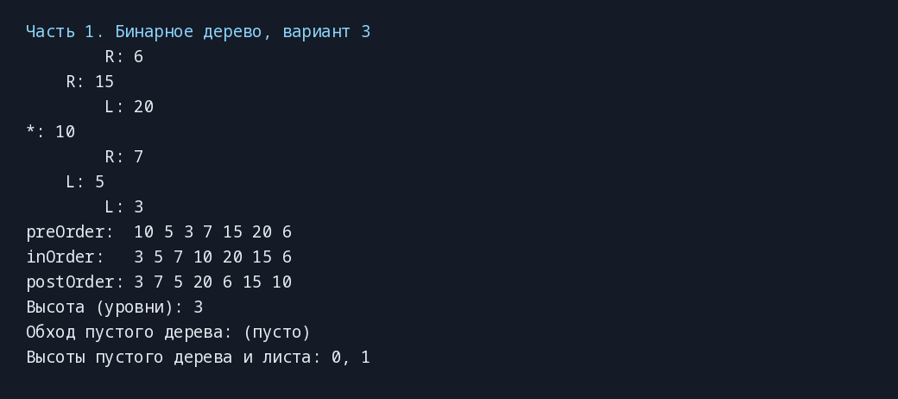
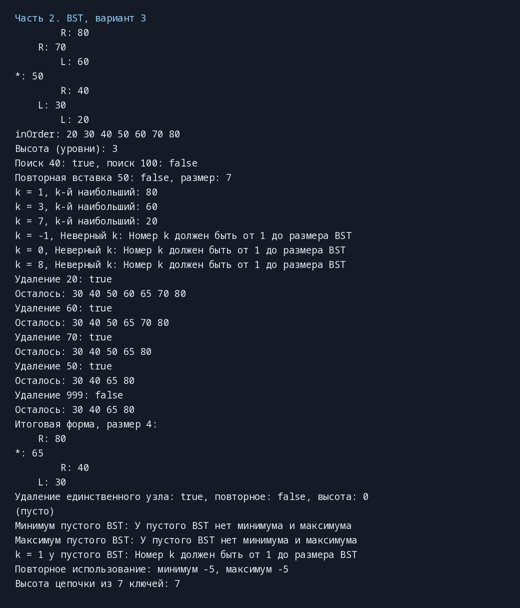
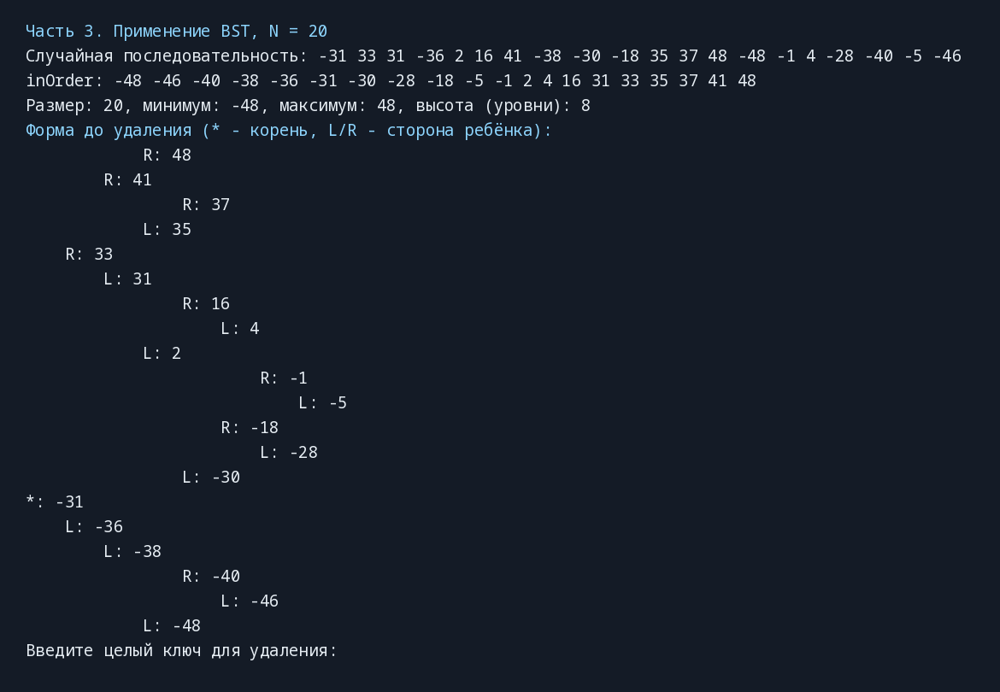
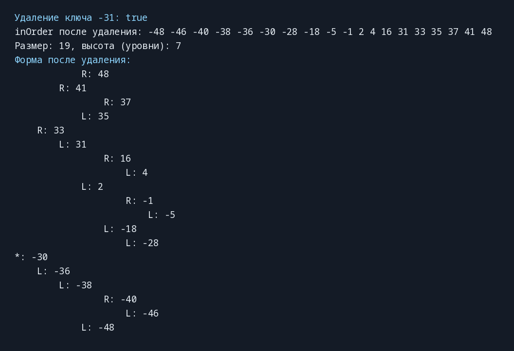

# Отчет по лабораторной работе 9

МИНИСТЕРСТВО НАУКИ И ВЫСШЕГО ОБРАЗОВАНИЯ
РОССИЙСКОЙ ФЕДЕРАЦИИ
Федеральное государственное автономное
образовательное учреждение высшего образования
«СЕВЕРО-КАВКАЗСКИЙ ФЕДЕРАЛЬНЫЙ УНИВЕРСИТЕТ»
Институт информационных технологий и кибер безопасности
Департамент цифровых, робототехнических систем и электроники
Кафедра программной инженерии

**Тема:** Бинарное дерево. Обходы. BST

**Вариант:** 3. Все три части, без уровней сложности

**Выполнил:**
Студент группы ПИЖ-б-о-25-2 (2),
направление подготовки: 09.03.04
“Программная инженерия”

Кравцун Михаил Алексеевич

**Проверил:**
Ассистент межинститутской базовой кафедры департамента цифровых,
робототехнических систем и электроники института перспективной
инженерии

Белик Ангелина Игоревна

---

## Репозиторий

[GitHub: Algorithms-Data-structures, лабораторная работа 9 второго курса](https://github.com/WhXteBeXr/Algorithms-Data-structures/tree/main/course-2/lab9)

## Цель работы

Реализовать бинарное дерево и три рекурсивных обхода, освоить операции BST и поиск k-го наибольшего ключа. Изучить удаление, управление памятью и зависимость сложности от формы дерева.

## Постановка задачи

Выполняются вариант 3 обеих индивидуальных частей и общая третья часть. Уровни сложности в этой работе не выделены.

| Часть | Требования |
| --- | --- |
| 1. Бинарное дерево | preOrder, inOrder, postOrder и вычисление высоты |
| 2. BST | insert, search, inOrder и k-й наибольший элемент |
| 3. Общее применение | 20 случайных чисел, отсортированный обход, минимум, максимум, высота, удаление введённого пользователем ключа и вывод дерева |

Удаление поддерживает все три случая. Дополнительно демонстрируются пустое дерево, дубликаты, ошибочные номера k и вырожденная форма BST.

## Теоретическая часть

Узел бинарного дерева содержит значение и не более двух детей. Корень не имеет родителя, лист не имеет детей. В обычном бинарном дереве порядок значений произвольный. В строгом BST для каждого узла все ключи слева меньше его ключа, а все ключи справа больше. Повторяющиеся ключи в этой реализации игнорируются.

Прямой обход preOrder посещает корень, левое и правое поддеревья. Симметричный inOrder посещает левое поддерево, корень и правое поддерево. Обратный postOrder посещает оба поддерева перед корнем. Каждый обход проходит все узлы, но только inOrder корректного BST гарантирует возрастающую последовательность. Для k-го наибольшего нужен обратный симметричный порядок: справа, корень, слева.

Высота в программе измеряется числом уровней: пустое дерево имеет высоту 0, лист 1. Это соответствует рекурсивной формуле и числовым примерам методички. Если считать расстояние в рёбрах, для непустого дерева получится на единицу меньше. Уровень отдельного узла при отсчёте от корня по-прежнему начинается с 0.

При поиске и вставке сравнение выбирает только одно поддерево. При удалении листа связь становится пустой. Узел с одним ребёнком заменяется этим ребёнком вместе с его поддеревом. Для узла с двумя детьми ключ заменяется минимумом правого поддерева, затем физический узел этого преемника удаляется. У преемника нет левого ребёнка, поэтому остаётся более простой случай.

## Исходные файлы

[BinaryTree.h](BinaryTree.h) и [BinaryTree.cpp](BinaryTree.cpp) содержат узел, построение обычного дерева из массива по уровням, три обхода, высоту и боковую визуализацию. [BST.h](BST.h) и [BST.cpp](BST.cpp) используют это дерево как внутренний компонент и добавляют вставку, поиск, удаление, экстремумы и выбор по номеру. Готовые контейнеры поиска не применяются, vector хранит входные данные и результаты обходов.

[main.cpp](main.cpp) демонстрирует все три части и граничные случаи. [CMakeLists.txt](CMakeLists.txt) задаёт цель c2-lab9 и C++20. Владение узлами обеспечивается unique_ptr, отдельный ручной деструктор не требуется.

## Особенности реализации

- Массив обычного дерева задаёт детей позиции i индексами 2i+1 и 2i+2. Это построение формы, а не вставка в BST. Наличие детей проверяется до вычисления индексов.
- Рекурсивные обходы используют общую функцию с выбором момента добавления корня в результат. BST переиспользует inOrder, высоту и печать.
- BST не балансируется автоматически. Размер хранится отдельно и меняется только при успешной вставке нового узла или удалении существующего.
- Вставка и удаление работают с адресом владеющей связи. Это позволяет одинаково заменять корень и дочерние узлы.
- При удалении unique_ptr сначала перемещается во временного владельца. Поддерево передаётся в освобождённую связь до уничтожения старого узла.
- k нумеруется с 1 среди различных ключей. Значения k вне диапазона вызывают out_of_range. Минимум и максимум пустого BST вызывают underflow_error.
- Отсутствующий ключ даёт false при поиске и удалении. Дубликат при вставке также даёт false.
- Для общей части перемешивается диапазон [-50, 50], берутся первые 20 значений. Повторов нет, число узлов гарантированно равно 20. Seed генератора mt19937 равен 2026 для повторяемости в данной среде. Результат shuffle может отличаться между реализациями стандартной библиотеки.
- В третьей части пользователь вводит ключ. Некорректный ввод, выход за диапазон int или конец ввода до числа завершают программу с сообщением об ошибке и кодом 1.

## Анализ сложности

Пусть n - число узлов, h - высота в уровнях. Таблица учитывает дополнительную память, общая память узлов O(n).

| Операция | Время | Дополнительная память |
| --- | --- | --- |
| Построение обычного дерева из массива | O(n) | O(log n) стек для формы, заполненной по уровням |
| Каждый обход | O(n) | O(h) стек и O(n) результат |
| Высота | O(n) | O(h) стек |
| Поиск, вставка, удаление BST | O(h) | O(1), плюс новый узел при вставке |
| Минимум и максимум | O(h) | O(1) |
| k-й наибольший | O(h+k), в худшем O(n) | O(h) стек |
| Получение размера | O(1) | O(1) |
| Боковая печать | O(nh) верхняя оценка с отступами | O(h) стек и временная строка |
| Освобождение всего дерева | O(n) | O(h) глубина рекурсивного разрушения |

В сбалансированном дереве h = O(log n), поэтому операции по одному пути логарифмические. В цепочке h = n и те же операции могут стать линейными. Случайная вставка обычно даёт более удобную форму, но не гарантирует баланс. Построение BST последовательными вставками требует O(n log n) в среднем для случайного порядка различных ключей и O(n²) в худшем случае.

В выводе равномерно расположенное дерево из семи ключей имеет высоту 3, а дерево после вставки 1..7 имеет высоту 7. Автоматического восстановления баланса после вставок и удалений нет. Рекурсивные обходы и уничтожение очень длинной цепочки ограничены доступным стеком.

## Сборка и запуск

Из корня репозитория:

```bash
cmake -S course-2/lab9 -B /tmp/algorithms-c2-lab9-release -DCMAKE_BUILD_TYPE=Release
cmake --build /tmp/algorithms-c2-lab9-release
/tmp/algorithms-c2-lab9-release/c2-lab9
```

После демонстраций программа ожидает целый ключ для удаления. В сохранённом запуске введено -31. В общем проекте используется цель c2-lab9. Сборка и запуск выполнены в Debug и Release, GCC 16.2.1, с предупреждениями -Wall, -Wextra, -Wpedantic. Предупреждений нет. Все демонстрации находятся в main.cpp, отдельных тестовых целей нет.

## Результаты

### Часть 1. Бинарное дерево

Для массива по уровням [10, 5, 15, 3, 7, 20, 6]:

| Операция | Результат |
| --- | --- |
| preOrder | 10 5 3 7 15 20 6 |
| inOrder | 3 5 7 10 20 15 6 |
| postOrder | 3 7 5 20 6 15 10 |
| Высота | 3 уровня |
| Пустое дерево | Пустой обход, высота 0 |
| Один узел | Высота 1 |

Это дерево намеренно не является BST. Его inOrder не отсортирован, что показывает различие между двумя структурами.

### Часть 2. BST

| Пример | Результат |
| --- | --- |
| Вставки 50, 30, 70, 20, 40, 60, 80 | inOrder: 20 30 40 50 60 70 80, высота 3 |
| Поиск 40 и 100 | true и false |
| Повторная вставка 50 | false, размер остаётся 7 |
| k = 1, 3, 7 | 80, 60, 20 |
| k = -1, 0, 8 | Сообщения о недопустимом номере |
| Добавление 65, затем удаление 20 | Удалён лист |
| Удаление 60 | Сохранён единственный ребёнок 65 |
| Удаление 70 | Обработаны два ребёнка 65 и 80 |
| Удаление корня 50 | Новый ключ корня 65 |
| Удаление 999 | false, дерево прежнее |
| Итоговый inOrder | 30 40 65 80, размер 4 |
| Удаление единственного узла | Пустое дерево, повторное удаление false |
| Минимум, максимум и k = 1 пустого BST | Перехвачены исключения |
| Вставка -5 после опустошения | Минимум и максимум равны -5 |
| Последовательная вставка 1..7 | Цепочка высотой 7 |

### Часть 3. Общая задача

Фактическая последовательность: -31, 33, 31, -36, 2, 16, 41, -38, -30, -18, 35, 37, 48, -48, -1, 4, -28, -40, -5, -46.

| Характеристика | До удаления | После удаления введённого -31 |
| --- | --- | --- |
| Число узлов | 20 | 19 |
| Минимум | -48 | -48 |
| Максимум | 48 | 48 |
| Высота в уровнях | 8 | 7 |
| Ключ корня | -31 | -30 |

inOrder до удаления: -48 -46 -40 -38 -36 -31 -30 -28 -18 -5 -1 2 4 16 31 33 35 37 41 48.

inOrder после удаления: -48 -46 -40 -38 -36 -30 -28 -18 -5 -1 2 4 16 31 33 35 37 41 48.

Удаляется корень с двумя детьми. Преемником становится -30, его правое поддерево с корнем -18 сохраняется. Свойство BST и порядок остальных ключей сохранены.

Полный [фактический вывод](media/program-output.txt) сохранён в media. На боковых схемах * обозначает корень, R - правого ребёнка, L - левого. Правое поддерево печатается выше родителя, глубина задаётся отступом.









## Контрольные вопросы

### 1. Что такое бинарное дерево и из чего оно состоит?

Это дерево, каждый узел которого имеет не более двух детей. Состоит из корня, узлов со значениями и связей с левыми и правыми детьми. Пустое дерево не содержит корня, листья не имеют детей.

### 2. Чем бинарное дерево отличается от BST?

Бинарность ограничивает только число детей. BST дополнительно упорядочивает все ключи поддеревьев относительно каждого корня. В этой работе слева строго меньшие ключи, справа строго большие.

### 3. Какие существуют обходы и в чём их особенности?

preOrder обрабатывает корень перед детьми, inOrder между левым и правым поддеревьями, postOrder после обоих детей. Уровневый обход посещает узлы по глубине слева направо с помощью очереди. По варианту 3 реализованы три рекурсивных обхода.

### 4. Какой обход даёт отсортированную последовательность BST?

inOrder. Левое поддерево содержит меньшие ключи, затем идёт корень, затем большие ключи справа. Обратный симметричный обход даёт убывающий порядок.

### 5. Какова сложность поиска, вставки и удаления?

O(h), где h зависит от формы дерева и порядка вставки. При логарифмической высоте это O(log n), в вырожденной цепочке O(n). Сбалансированность этой реализацией не поддерживается автоматически.

### 6. Что происходит при вставке отсортированных ключей?

Каждый новый ключ идёт по одной стороне до конца. Возникает цепочка, высота становится n. Вставка всей последовательности занимает O(n²).

### 7. Какие случаи рассматриваются при удалении?

Лист удаляется без замены, узел с одним ребёнком заменяется ребёнком. У узла с двумя детьми ключ заменяется преемником из правого поддерева, после чего узел преемника удаляется с сохранением его правого ребёнка, если он есть.

### 8. Как найти минимум и максимум?

Для минимума нужно идти из корня по левым связям до последнего узла, для максимума по правым. В пустом дереве этих значений нет. Время O(h).

### 9. Как рекурсивно вычислить высоту?

Пустое поддерево даёт 0, непустое - 1 плюс максимум высот его детей. Так получается число уровней. Каждый узел посещается один раз, время O(n), стек O(h).

### 10. Что такое LCA двух узлов?

Это их общий предок на наибольшей глубине. Узел может считаться предком самого себя. В BST при наличии обоих ключей можно спускаться, пока они лежат по одну сторону, первый разделяющий их узел или совпавший ключ и есть LCA.

### 11. Как проверить, является ли дерево BST?

Рекурсивно передавать допустимые нижнюю и верхнюю границы. Для левого поддерева верхняя граница становится ключом корня, для правого меняется нижняя. Проверять только непосредственных детей недостаточно. Альтернатива - убедиться, что inOrder строго возрастает. Оба способа требуют O(n).

### 12. Что такое сбалансированное дерево и зачем оно нужно?

Баланс ограничивает высоту логарифмически, чтобы путь поиска не превращался в линейную цепочку. Например, AVL-дерево ограничивает разность высот детей каждого узла единицей, красно-чёрное использует другие условия. Простое BST само этого не гарантирует.

### 13. Как преобразовать несбалансированное BST в сбалансированное?

Собрать ключи inOrder в отсортированный массив. Середину выбрать корнем, рекурсивно повторить для левой и правой половин. Перестроение занимает O(n) времени с дополнительным массивом O(n). Для поддержания баланса после каждого изменения применяют специальные деревья и вращения.

### 14. Как восстановить дерево по inOrder и preOrder?

Первый ключ preOrder задаёт корень. Его позиция в inOrder делит элементы на левое и правое поддеревья, размеры частей задают соответствующие фрагменты preOrder. Далее процесс повторяется. Для различных ключей и согласованных входных данных дерево определяется однозначно. С таблицей позиций возможна O(n), с линейным поиском корней худшее время O(n²).

### 15. Как выполнить итеративный обход?

Использовать явный стек вместо стека вызовов. Для inOrder нужно класть левых предков, извлекать очередной узел, обрабатывать его и переходить вправо. Для preOrder можно извлекать корень и помещать в стек сначала правого, затем левого ребёнка. PostOrder требует запомнить этап обработки или последний посещённый узел. Уровневый обход использует очередь.

## Вывод

Выполнены все три части. Реализованы три обхода обычного бинарного дерева, высота, основные операции BST и k-й наибольший ключ. Общая задача демонстрирует 20 случайных чисел и удаление введённого ключа с визуализацией. Передача владения сохраняет дочерние поддеревья при удалении, автоматическое освобождение узлов обеспечивает unique_ptr. Примеры показывают, что скорость BST определяется высотой, а упорядоченный результат inOrder сам по себе не означает сбалансированность.
